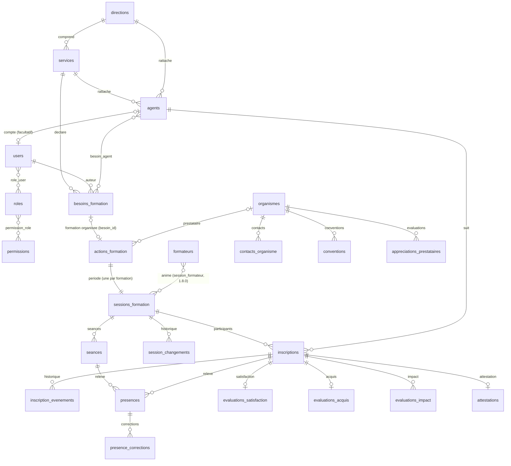

# Base de données

MySQL 8.0, moteur InnoDB, jeu de caractères `utf8mb4_unicode_ci`. Schéma créé exclusivement par les migrations versionnées
(`database/migrations`). 53 tables dont 6 techniques Laravel (`migrations`, `cache`, `cache_locks`, `jobs`, `job_batches`, `failed_jobs`).

## Diagramme des principales relations

Les tables polymorphes `decisions` (besoins), `documents` (besoin, action, session, organisme),
`notifications` (utilisateurs) et `audit_logs` (tout objet) utilisent des **alias stables** (`besoin`, `action`, `session`…)
définis dans `AppServiceProvider` (`Relation::enforceMorphMap`), indépendants des noms de classes PHP.

## Tables par domaine

### Organisation et paramétrage
| Table | Rôle | Contraintes notables |
|---|---|---|
| `directions` | Directions / structures | `code` unique |
| `services` | Services, rattachés à une direction | `code` unique ; FK `direction_id` (RESTRICT) |
| `domaines` | Domaines de compétence | `code` unique |
| `nomenclatures` | Listes paramétrables : statuts professionnels, catégories de documents (les listes priorités, types, axes et catégories de dépenses sont conservées sans usage depuis 1.4.0) | unique (`type`, `code`) |
| `annees_reference` | Années ouvertes/clôturées au recensement, dates limites | `annee` unique |
| `parametres` | Paramètres institutionnels clé/valeur typés ; indicateur « à valider par l'INPS » | `cle` unique |

### Personnel, comptes et droits
| Table | Rôle |
|---|---|
| `agents` | Référentiel : matricule **unique**, nom, prénom, direction, service, fonction, statut, coordonnées pro facultatives, `actif`, motif/date de désactivation, `source` et `reference_externe` (futur SIRH). Jamais supprimés. |
| `users` | Comptes : e-mail unique, mot de passe haché (bcrypt), `actif`, `doit_changer_mot_de_passe`, service/direction de rattachement (cloisonnement), lien facultatif et unique vers un agent |
| `roles`, `permissions`, `permission_role`, `role_user` | Contrôle d'accès ; `role_user` conserve date et auteur de l'attribution |
| `sessions`, `password_reset_tokens` | Sessions chiffrées en base ; jetons de réinitialisation (hachés, durée limitée) |

### Besoins
| Table | Rôle |
|---|---|
| `besoins_formation` | Demandes : référence `BES-AAAA-NNNN` unique, année (automatique), service, intitulé, raison (`contexte`), nombre de participants, période souhaitée, statut, auteur, date d'envoi ; colonnes priorité, type, domaine, objectifs, durée, coût conservées pour les demandes antérieures à 1.4.0 ; suppression logique **uniquement des brouillons** |
| `besoin_agent` | Agents nommément concernés |
| `decisions` | Historique **non modifiable** des décisions (auteur, date, statut avant/après, étape, commentaire) |

Statuts d'une demande (1.5.0) : envoyée (`soumise`), à compléter, refusée (`rejetee`), **formation programmée** (`organisee`, atteint par « Accepter et programmer » : décisions `acceptation` puis `organisation` dans la même transaction) ; `acceptee` et `brouillon` ne concernent que des demandes antérieures. `nb_participants` = nombre d'agents de `besoin_agent`.

### Formations (actions + session unique), participation
| Table | Rôle |
|---|---|
| `organismes`, `contacts_organisme`, `conventions`, `formateurs`, `appreciations_prestataires` | Prestataires, contacts, contrats (accès restreint), formateurs internes/externes, évaluations des prestataires |
| `actions_formation` | Contenu d'une formation : référence `ACT-AAAA-NNNN` (ou `HIS-` pour l'historique importé), année (date de début), type, modalité, statut (aligné sur la session), motif, demande d'origine `besoin_id` (unique, facultative) |
| `sessions_formation` | Période d'une formation (**une par action** depuis 1.3.0) : dates, horaires, durée, lieu, places (= nombre de participants depuis 1.5.0), formateur, statut (`planifiee` « Programmée », `terminee`, `annulee`), date et auteur de « Formation terminée » (`presences_validees_le/_par`) ; liste d'attente et bilan sans usage depuis 1.5.0 |
| `session_changements` | Historique des reports, changements de dates, annulations, changements de statut (rien n'est effacé) |
| `seances` | Journées de la formation (présences jour par jour sans usage depuis 1.5.0) |
| `inscriptions` | Participants : unique (`session_id`, `agent_id`) ; statut (inscrit, retiré = `desiste`, annulé), date et motif du retrait, **résultat** (`achevee` = a suivi la formation, `non_achevee` = ne l'a pas suivie) ; colonnes d'attente, de convocation et de remplacement conservées pour l'historique |
| `inscription_evenements` | Historique des inscriptions |
| `presences`, `presence_corrections` | **Sans usage depuis 1.5.0** ; données antérieures conservées |
| `evaluations_satisfaction`, `evaluations_acquis`, `evaluations_impact` | **Sans usage depuis 1.5.0** ; données antérieures conservées |
| `attestations` | Référence `ATT-AAAA-NNNN` unique, code de vérification aléatoire unique, émission, annulation motivée |

### Documents, traçabilité (et données financières conservées)
| Table | Rôle |
|---|---|
| `depenses` | **Sans usage depuis 1.4.0** (budget et finances retirés) ; données antérieures conservées |
| `documents` | Pièces jointes polymorphes : chemin aléatoire unique, type MIME réel, taille, SHA-256, confidentialité ; retrait logique |
| `notifications` | Notifications internes (Laravel) |
| `rappels_envoyes` | Clés des rappels automatiques déjà émis (anti-doublon) |
| `envois_email` | Résultat réel de chaque tentative d'envoi (envoyé / échec / non remis faute de SMTP) |
| `audit_logs` | Journal d'audit en ajout seul : acteur, action, type et identifiant d'objet, description, contexte JSON nettoyé, IP, date. **Déclencheurs MySQL** interdisant UPDATE/DELETE |
| `imports`, `import_lignes` | Analyses et rapports d'import (données de travail ligne à ligne) |

## Règles d'intégrité

- Suppressions en cascade limitées aux données strictement dépendantes (séances d'une session, lignes d'une version…).
  Les référentiels et les données historisées sont protégés par `RESTRICT` (impossible de supprimer un service utilisé, un agent inscrit…).
- Statuts : codes stables (`app/Enums`), transitions contrôlées par les services métier (pas de mise à jour libre du statut).
- Montants : `DECIMAL(15,2)` ; dates : `DATE` ; horodatages dans le fuseau `Africa/Bamako`.
- Références lisibles générées sous verrou (`SELECT … FOR UPDATE`) et garanties par des index uniques.
- Index sur les recherches fréquentes : nom/prénom, service/actif, année/statut, objet audité, date d'audit.
- JSON uniquement pour des contextes non structurés (journal d'audit, lignes brutes d'import).

## Données de démonstration

`DemoSeeder` crée des données **fictives** (codes préfixés `DEMO`, e-mails `@exemple.invalid`). Interdit en production.

## Tables conservées sans usage (version 1.3.0)

Le plan annuel a été retiré de l'application le 21/10/2026. Pour ne perdre aucune donnée, la migration
`2026_10_21_000900_formations_sans_plan_annuel` **ne supprime pas** les tables `plans_formation`, `plan_versions`, `plan_actions`,
`circuits_validation`, `etapes_validation` ni les colonnes `actions_formation.plan_id` et `plan_action_code` : elles restent en base,
lisibles par requête SQL, mais l'application ne les lit ni ne les écrit plus. Cette migration :

1. rattache chaque formation issue d'une ligne de plan à la demande d'origine de cette ligne (`besoin_id`) ;
2. passe les demandes « intégrées au plan » à « formation organisée » si une formation y répond, sinon à « acceptée » (à organiser) ;
3. sépare en plusieurs formations une action qui avait plusieurs sessions (`ACT-…-G2`, `-G3`…) ; dépenses et documents restent sur la première ;
4. aligne le statut de chaque action sur celui de sa session ;
5. retire les permissions `plans.*` et le paramètre `plans.interdire_auto_validation` ; désactive les circuits ;
6. inscrit un résumé chiffré dans le journal d'audit (`migration.formations_sans_plan`).

## Version 1.4.0 : demandes simplifiées, sans finances

La migration `2026_10_22_001000_demandes_simplifiees_sans_finances` ne supprime aucune donnée : elle remet les demandes
« en examen » au statut « envoyée », retire les paramètres d'activation des étapes, les permissions `finances.*` et le rôle
« Gestionnaire financier » (s'il n'est attribué à personne), et inscrit un résumé dans le journal d'audit (`migration.demandes_simplifiees`).
Les tables et colonnes financières (`depenses`, `cout_previsionnel`, `conventions.montant`) restent en base, sans usage.

## Version 1.5.0 : formation en trois étapes

La migration `2026_10_22_001100_formation_en_trois_etapes` ne supprime aucune donnée : les formations « confirmées », « en cours »
ou « reportées » (sessions et actions) reviennent au statut technique `planifiee` (« Programmée ») ; les formations terminées
ou annulées ne changent pas ; les permissions `presences.*` et `evaluations.*`, les paramètres `regles.*` et les délais de convocation
et d'évaluation d'impact sont retirés ; un résumé est inscrit dans le journal d'audit (`migration.formation_trois_etapes`).
Les tables `presences`, `presence_corrections`, `evaluations_*` et les colonnes de convocation, d'attente et de remplacement
restent en base, sans usage.

## Version 1.6.0 : profils fixes et corbeille

- `2026_10_22_001200_profils_fixes_et_libelles` : réécrit le module et le libellé des permissions existantes à partir du catalogue
  (codes, rôles et attributions inchangés).
- `2026_10_22_001300_corbeille_des_formations` : `actions_formation.deleted_at` (suppression logique) et `besoin_id_origine`
  (demande d'origine mémorisée quand une formation est mise à la corbeille, `besoin_id` étant unique). `besoins_formation.deleted_at`
  existait déjà. Agents et comptes : suppression définitive autorisée seulement s'ils ne sont référencés nulle part (les contraintes
  `RESTRICT` de la base protègent en dernier recours).

## Version 1.7.0 : plan annuel simple

| Table | Rôle |
|---|---|
| `plans_annuels` | Un plan par année (`annee` unique) ; validation : `valide_le`, `valide_par`, `commentaire_validation` |
| `plan_annuel_lignes` | Formations prévues : intitulé, période (`annee`, `T1`–`T4`, `M01`–`M12`), service, nombre d'agents, type, organisme, observations, demande d'origine (`besoin_id` unique), auteur ; retrait logique (`deleted_at`) |
| `actions_formation.ligne_plan_id` | Ligne du plan que la formation réalise ; l'état de la ligne (prévue, programmée, terminée, annulée) se déduit de cette formation |

Nouveau statut de demande `au_plan` (« Inscrite au plan ») ; décisions `inscription_plan` et `retrait_plan`.
Ces tables sont distinctes de celles du plan retiré en 1.3.0 (`plans_formation`, `plan_versions`, `plan_actions`), conservées sans usage.

## Version 1.8.0 : analyse du besoin et formateurs multiples

- `besoins_formation` : trois colonnes facultatives — `causes` (JSON : codes de `BesoinFormation::CAUSES`),
  `justification_formation` et `resultat_attendu` (textes). `contexte` contient désormais le problème constaté.
  Obligatoires dans le formulaire, vides pour les demandes antérieures.
- `session_formateur` (nouvelle) : `session_id` → `sessions_formation` (suppression en cascade), `formateur_id` → `formateurs`
  (suppression refusée), unique sur le couple. Le `formateur_id` de chaque session y a été recopié ; la colonne
  `sessions_formation.formateur_id` est conservée en lecture seule.
- `actions_formation.type` accepte aussi `mixte` (formateurs internes et externes).

## Version 1.9.0 : après la formation

- `sessions_formation` : `evaluation_froid_mois` (3 à 6 ; vide = 6), `rapport_deroulement`, `rapport_difficultes`,
  `rapport_recommandations`, `rapport_redige_le`, `rapport_redige_par` → `users`.
- `evaluations_satisfaction` (existante, de nouveau utilisée) : une fiche à chaud par inscription, notes 1 à 5.
- `evaluations_impact` (existante, de nouveau utilisée) : + `resultat_atteint` (`oui` | `partiel` | `non`) ; une seule
  évaluation par inscription (mise à jour en cas de correction).
- `attestations_intervenants` (nouvelle) : `reference` unique (ATI-AAAA-NNNN), `session_id`, `formateur_id`
  (unique sur le couple ; suppression refusée), `emise_le`, `emise_par`.
- Permissions `evaluations.gerer` (rôle responsable_drh) et `evaluations.froid` (rôle chef_service).

## Version 2.0.0 : droits personnalisés

- `permission_user` (nouvelle) : `user_id`, `permission_id` (clé primaire sur le couple, suppression en cascade),
  `accorde` (vrai : droit ajouté au profil ; faux : droit du profil retiré), `attribue_par` → `users`.
  Droits effectifs d'un compte = droits des rôles de son profil + droits ajoutés − droits retirés.

## Version 2.1.0 : diagnostic du besoin

- `besoins_formation` : `diag_savoir` (`non` | `partiel` | `oui`), `diag_moyens` et `diag_temps` (`oui` | `non`),
  `gravite` (`legere` | `reguliere` | `risque`), `situation_actuelle`, `objectif_vise` (500 caractères), `solutions_essayees`
  (JSON). Facultatives en base, obligatoires dans le formulaire. `causes` (1.8.0) est conservée pour les demandes existantes.

## Version 2.2.0 : évaluations simplifiées

- `evaluations_acquis` (de nouveau utilisée, à chaud) : + `resultat` (`oui` | `partiel` | `non`) ; `score` / `score_max`
  (sur 20) facultatifs ; `reussi` = résultat « oui ». Une par inscription.
- `evaluations_impact` (à froid) : la réponse est `resultat_atteint` (`oui` | `partiel` | `non`) ;
  `niveau_mise_en_pratique` devient facultatif (réponses 1.9.0 conservées et converties).
- `evaluations_satisfaction` n'est plus alimentée (fiches existantes conservées).

## Version 2.3.0 : accès des agents et convocations

- `users.email` devient facultatif (compte d'agent sans e-mail ; identifiant = matricule via `users.agent_id`).
- `sessions_formation` : `convoquee_le` (dernière convocation), `convocation_details` (JSON : dates, horaires, lieu au
  moment de la convocation — une différence signale une convocation rectificative à envoyer).
- `inscriptions.convoque_le` et le statut `convoque` sont de nouveau utilisés ; événements `convocation` et
  `convocation_rectificative` dans `inscription_evenements`.

## Version 2.4.0 : codes d'activation des agents

- `users` : `code_activation` (chiffré avec APP_KEY), `code_activation_expire_le`, `code_activation_essais` (5 au plus),
  `active_le` (date d'activation par l'agent).

## Version 2.5.0 : formations diplômantes

- Table `formations_diplomantes` : `reference` (DIP-AAAA-NNNN, unique), `agent_id` (suppression de l'agent interdite),
  `niveau`, `intitule`, `etablissement`, `ville`, `pays`, `annee_debut` (année académique), `duree_annees`, `mode`,
  `prise_en_charge`, `situation`, `date_obtention`, `observations`, `cree_par`, `modifie_par`, horodatage.
  **Aucune colonne de montant.** Pièces jointes dans `documents` (type `diplomante`).
- Permission `diplomantes.gerer` (rôle `responsable_drh`). `roles.nom` du rôle `chef_service` : « Responsable de structure ».
