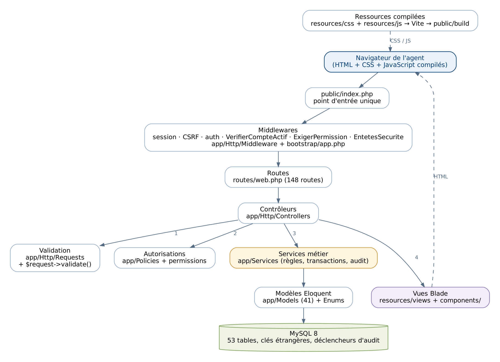
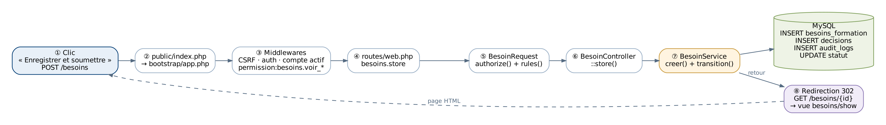
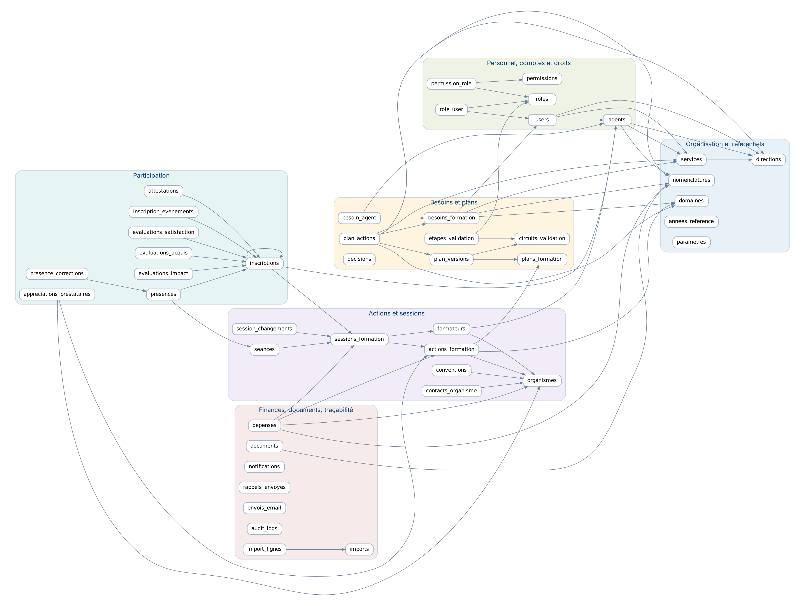
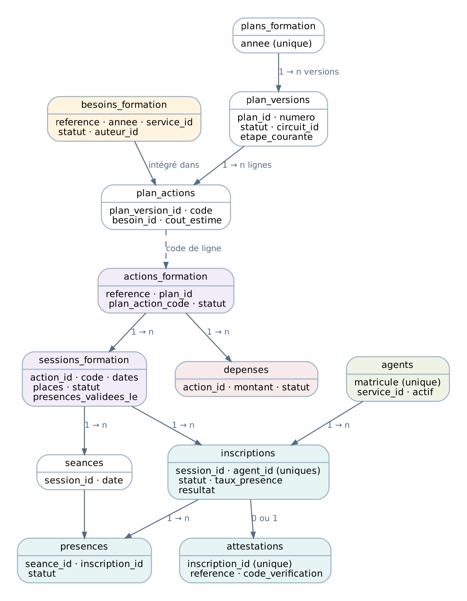
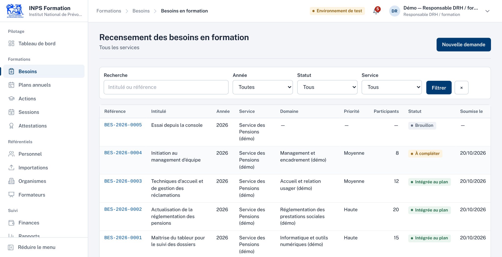
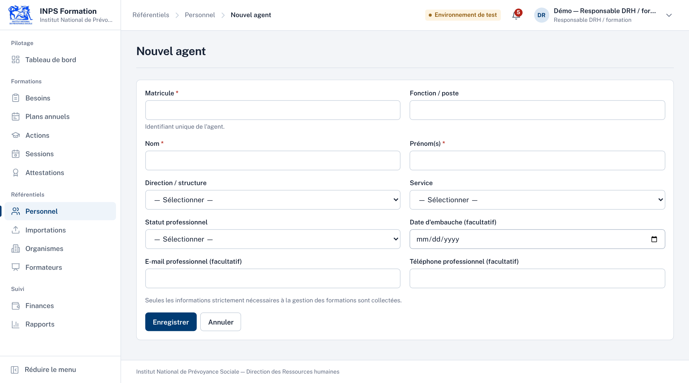
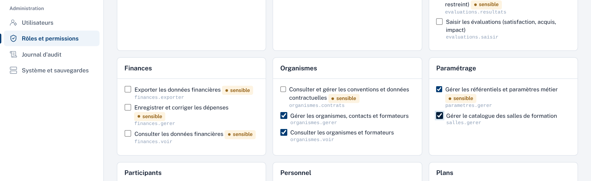
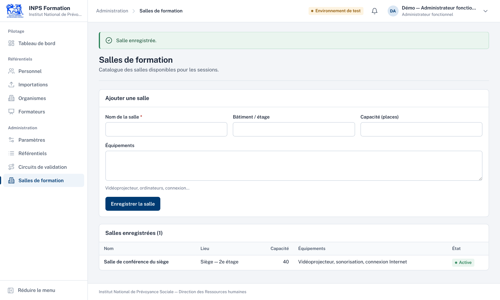

# Introduction : comment utiliser cette formation

> **Version décrite et écarts (à lire d'abord).** Ce support a été écrit pour la version 1.1.0, puis **mis à jour pour la
> version 2.6.0** le 28/10/2026 et **complété le 29/10/2026** avec les modifications faites sur la 2.6.0 (sans changement de
> numéro de version, à la demande de l'utilisateur). **Toutes les parties 1 à 6 décrivent maintenant le code actuel** ; chaque
> extrait de code est lu dans les fichiers du projet et vérifié automatiquement. Seules la partie 7 et l'annexe D (vidéos)
> décrivent encore la 1.1.0. En cas de doute, le code et `CHANGELOG.md` font foi. Évolutions depuis la 1.1.0 :
> - **1.2.0** : deux profils seulement (la RH gère tout, le responsable de structure fait les demandes).
> - **1.3.0** : l'ancien **plan annuel est retiré** (versions, circuits de validation) ; une **formation** = une action + **une**
>   session, créées ensemble (`ActionService::creerFormation`, `FormationController`, routes `formations.*`).
> - **1.4.0** : demande envoyée directement (plus de brouillon) ; **budget et finances retirés**.
> - **1.5.0** : agents cochés obligatoires dans la demande ; « Accepter et programmer » ; formation en trois étapes
>   (participants, « Formation terminée », attestations). Retirés : présences jour par jour, liste d'attente, report.
> - **1.5.1 / 1.6.0 / 1.6.1** : cloisonnement des formations par service ; deux profils fixes (`App\Support\Profils`) ; journal
>   lisible ; écran Sauvegardes ; suppression et corbeille ; import de la structure.
> - **1.7.0 à 1.7.4** : **plan annuel simple** (`PlanController`, `PlanService`) ; statut affiché d'une demande selon sa
>   formation ; choix direction puis service.
> - **1.8.0** : analyse du besoin ; **plusieurs formateurs** par formation et type « Mixte ».
> - **1.9.0 / 2.2.0** : **après la formation** : évaluation à chaud, évaluation à 3–6 mois, rapport de réalisation,
>   attestation d'intervention des formateurs externes.
> - **2.0.0** : **droits personnalisables par compte** (table `permission_user`).
> - **2.1.0** : diagnostic du besoin en trois questions et **aide à la décision** (`AideDecisionService`).
> - **2.3.0 / 2.4.0** : **accès des agents** (profil « Agent », « Mon espace ») avec **codes d'activation** ; **convocations**.
> - **2.5.0 à 2.5.2** : **formations diplômantes** ; « Chef de service » renommé **« Responsable de structure »** (code
>   `chef_service` inchangé) ; années simplifiées ; **nouvelle page de connexion**.
> - **2.6.0** : **nouveau design**, **tableau de bord** refait, **recherche générale** (touche « / »).
> - **Modifications du 28/10/2026 sur la 2.6.0** : « exercice » remplacé par « année » sur le tableau de bord ; correctif de
>   la sauvegarde sous Windows (`SYSTEMROOT`) ; **convocation envoyée dès l'acceptation** d'une demande, par e-mail et dans
>   « Mon espace » ; suggestions de la recherche générale pendant la frappe ; attestations : nombre d'impressions pour la RH,
>   plus de téléchargement par l'agent.
> - **Modifications du 29/10/2026 sur la 2.6.0** : **passage aux vraies données** (35 directions, 48 services, 3 671 agents) ;
>   import adapté aux fichiers du système du personnel (alias de colonnes, directions seules, colonnes sensibles jamais
>   enregistrées) ; colonne `directions.sigle` (seule migration de la journée) ; commandes `inps:importer`, `inps:vider-personnel`,
>   `inps:comptes-test` ; **liste complète des agents rangée par direction** dans les demandes et les participants (avant :
>   1 000 agents seulement) ; `mysqldump` de Laragon trouvé automatiquement. **169 tests (2088 assertions).**
>
> Les tables et colonnes des fonctions retirées (`plans_formation`, `plan_versions`, `circuits_validation`, `depenses`,
> `presences`, `evaluations_satisfaction`, colonnes de coût…) **restent en base, sans usage** : aucune migration n'a supprimé de
> données.

Cette formation explique l'application **INPS Formation** telle qu'elle existe réellement : chaque nom de fichier, de classe, de méthode, de route et de table cité ici provient du code source (version 2.6.0, avec les modifications des 28 et 29/10/2026). Les extraits de code ne sont pas recopiés à la main : ils sont **insérés automatiquement depuis les fichiers du projet** au moment où ce document est produit. Chaque extrait indique le fichier et les numéros de lignes, pour que tu puisses l'ouvrir dans ton éditeur et suivre.

L'objectif est que tu deviennes capable de **lire, maintenir, corriger et faire évoluer** l'application seul. On part de l'architecture générale, on descend jusqu'au code ligne par ligne, puis on remonte vers les modules métier, l'exploitation sous Windows et la maintenance.

## Organisation

| Partie | Contenu | Niveau |
|---|---|---|
| 1. Architecture générale | Les technologies, leur rôle, comment elles communiquent, l'arborescence | Débutant |
| 2. Le code de A à Z | Point d'entrée, routes, middlewares, contrôleurs, validation, policies, services, modèles, vues, CSS, JavaScript, sécurité ; un parcours complet « du clic à la base » | Débutant → intermédiaire |
| 3. Base de données | Migrations, tables, clés, relations, seeders, modèles Eloquent, manipulation sûre des données | Intermédiaire |
| 4. Fonctionnalités | Chaque module : fichiers, fonctionnement, données, règles, erreurs et corrections | Intermédiaire |
| 5. Installation et exécution | Laragon, Composer, npm, Vite, Artisan, `.env` ; diagnostic des erreurs déjà rencontrées | Débutant |
| 6. Maintenance et évolution | Modifier une page, ajouter un champ, créer une fonctionnalité, droits, bugs, tests, sauvegardes, mise en production | Intermédiaire → avancé |
| 7. Vidéos | Les épisodes vidéo et le kit pour les réenregistrer | — |
| Annexes | Toutes les routes, la matrice des permissions, le catalogue des tables | Référence |

## Ce dont tu as besoin

- L'application installée sur ton poste : `C:\laragon\www\inps-formation-2.6.0\inps-formation` (Laragon, partie 5).
- Un éditeur de code. **Visual Studio Code** (gratuit) convient très bien : *Fichier › Ouvrir le dossier* puis choisir le dossier `inps-formation`. Installe l'extension « PHP Intelephense » pour la navigation dans le code (Ctrl + clic sur un nom de classe ouvre son fichier).
- MySQL démarré (bouton « Démarrer tout » de Laragon) et l'application lancée (`php artisan serve`). Après chaque mise à jour du code : `php artisan migrate` s'il y a une migration, puis `php artisan optimize` ; après une modification du CSS ou du JavaScript, `npm run build`.
- Les comptes de démonstration, si tu as chargé les données fictives (`php artisan db:seed --class=DemoSeeder`) : `demo.responsable_drh@exemple.invalid` (profil RH) et `demo.chef_service@exemple.invalid` (profil Responsable de structure), avec le mot de passe de la variable `DEMO_PASSWORD`. Les agents fictifs n'ont pas de compte : pour essayer « Mon espace », donne un code d'activation à l'un d'eux (*Personnel › Accès des agents*). Ces comptes n'existent que dans une base de démonstration et ne doivent jamais être créés en production.

## Conventions de lecture

- `Classe::methode` désigne une méthode d'une classe PHP. Exemple : `BesoinService::transition` est la méthode `transition` de `app/Services/BesoinService.php`.
- Un chemin comme `app/Http/Controllers/BesoinController.php` part toujours du dossier racine du projet.
- Les commandes à taper dans l'invite de commandes Windows (cmd) sont présentées ainsi :

```bat
cd C:\laragon\www\inps-formation-2.6.0\inps-formation
php artisan route:list
```

- Les encadrés « À retenir » résument l'essentiel ; les encadrés « Attention » signalent ce qu'il ne faut pas faire.

!!! note "À retenir"
    Le code est rédigé en français (noms de classes, méthodes, variables, messages) pour être lisible par l'équipe de l'INPS. Seuls les mots imposés par PHP et Laravel restent en anglais (`function`, `return`, `belongsTo`, `validate`…).

## Méthode de travail conseillée

1. Lis une section, puis **ouvre le fichier cité** dans VS Code et retrouve l'extrait.
2. Rejoue les exemples dans l'application (connecte-toi avec le bon rôle de démonstration).
3. Fais les exercices de la partie 6 dans une **copie** du projet, jamais directement sur la version utilisée.
4. Après toute modification, lance les tests (`php artisan test`) : ils te disent si tu as cassé quelque chose.


## Parcours conseillé pour devenir autonome

L'objectif est que tu puisses, seul, **comprendre une demande de modification, la faire, la vérifier et l'installer sur le serveur**. Avance dans cet ordre ; chaque étape s'appuie sur la précédente. Pour chacune : lis les sections indiquées avec le code ouvert à côté, puis fais le petit exercice.

| Étape | À lire | Exercice pour vérifier que tu as compris |
|---|---|---|
| 1. Où est quoi | 1.1 à 1.4 (architecture, arborescence) | Retrouver dans VS Code le fichier qui affiche la liste des demandes (`resources/views/besoins/index.blade.php`) et le contrôleur qui la prépare. |
| 2. Le trajet d'une page | 2.1 à 2.5, puis 2.17 | Pour l'adresse `/formations`, trouver avec `php artisan route:list --path=formations` la méthode appelée et les droits exigés. |
| 3. Contrôleur, validation, service | 2.7, 2.8, 2.11 | Expliquer à voix haute ce qui se passe quand la RH clique « Refuser » sur une demande (de la route au journal d'audit). |
| 4. La base de données | 2.10, partie 3, annexe C | Dans HeidiSQL (fourni avec Laragon), lire en lecture seule les colonnes de la table `besoins_formation` et retrouver la demande créée la veille. |
| 5. Les droits | 2.9, 2.16, annexe B | Dire pourquoi un responsable de structure ne voit pas les agents d'un autre service (indice : `Agent::visiblesPar`). |
| 6. L'affichage | 2.12 à 2.15 | Changer un texte d'aide dans un formulaire, puis voir le résultat (`php artisan view:clear` si besoin). |
| 7. Les modules | partie 4, dans l'ordre du parcours métier : 4.4, 4.5, 4.6, 4.8, 4.10 | Suivre une demande jusqu'à l'attestation dans l'application, en notant à chaque écran le service métier appelé. |
| 8. Modifier sans casser | 6.1 à 6.7 | Faire l'exercice 6.2 (ajouter un champ) dans une **copie**, puis lancer `php artisan test`. |
| 9. Exploiter | 4.17, 4.21, 5.5, 6.8, 6.9 | Faire une sauvegarde, la restaurer dans une base de vérification, lancer `php artisan inps:sante`. |

!!! note "À retenir"
    On ne devient pas autonome en lisant tout d'un coup. Une bonne habitude : pour **chaque** demande de l'INPS, refais le parcours de la section 2.17 (adresse → route → contrôleur → service → modèle → vue). Au bout de quelques demandes, tu sauras où chercher sans le document.


# Partie 1 — Architecture générale

## 1.1 Vue d'ensemble

INPS Formation est une **application web monolithique** construite avec le framework **Laravel**. « Monolithique » signifie que tout est dans un seul projet : les pages (le *front*), la logique métier (le *back*), l'accès à la base de données, les exports PDF/Excel et les commandes d'exploitation. Il n'y a ni API séparée, ni application JavaScript séparée (pas de React, pas de Vue) : le serveur fabrique directement les pages HTML.

Le projet suit le modèle **MVC** (Modèle – Vue – Contrôleur), complété par une couche de **services métier** :

- le **contrôleur** reçoit la requête du navigateur, vérifie les droits, valide les données et appelle un service ;
- le **service** applique les règles métier (statuts autorisés, calculs, contrôles) dans une transaction ;
- le **modèle** représente une table MySQL et ses relations ;
- la **vue** (Blade) fabrique la page HTML renvoyée au navigateur.

<div class="figure" markdown="1">

<p class="legende">Figure 1 — Les couches de l'application et leurs dossiers.</p>
</div>

!!! note "À retenir"
    Règle d'or du projet : **les contrôleurs restent courts et les règles métier vivent dans `app/Services`**. Quand tu cherches « pourquoi l'application refuse telle action », ouvre d'abord le service du module (par exemple `app/Services/BesoinService.php`).

## 1.2 Les technologies et leur rôle

| Technologie | Version dans le projet | Rôle dans INPS Formation |
|---|---|---|
| **PHP** | 8.3 minimum (testé 8.3.6 ; tu utilises 8.4.6) | Le langage dans lequel tout le côté serveur est écrit. |
| **Laravel** | 13.37.0 (verrouillée dans `composer.lock`) | Le framework : routage, sécurité (sessions, CSRF, mots de passe), ORM Eloquent, validation, migrations, notifications, planificateur, commandes Artisan. |
| **MySQL** | 8.0 (MariaDB ou MySQL de Laragon en local) | La base de données : 59 tables (dont 8 techniques propres à Laravel : `migrations`, `sessions`, `cache`, `cache_locks`, `jobs`, `job_batches`, `failed_jobs`, `password_reset_tokens`, et plusieurs tables conservées sans usage depuis les simplifications), clés étrangères, contraintes d'unicité, 2 déclencheurs qui protègent le journal d'audit. |
| **Blade** | (inclus dans Laravel) | Le moteur de gabarits : fichiers `*.blade.php` dans `resources/views`, mélange de HTML et de directives (`@if`, `@foreach`, `{{ }}`), composants réutilisables `<x-...>`. |
| **Tailwind CSS** | 4.x | Le système de styles. Les classes utilitaires (`flex`, `gap-3`…) et les composants maison (`.btn`, `.carte`, `.indicateur`, `.graphe-barres`…) sont définis dans `resources/css/app.css` (charte graphique 2.6.0). |
| **JavaScript** | sans bibliothèque | Un seul fichier, `resources/js/app.js` (181 lignes) : confirmations, boîtes de dialogue, filtre de listes, menu mobile, afficher/masquer le mot de passe, touche « / » de la recherche, conclusion du diagnostic d'une demande, droits personnalisés, choix direction → service. Aucun script dans les pages. |
| **Vite** | 8.x | L'outil de compilation : transforme `app.css` et `app.js` en fichiers optimisés dans `public/build/`. |
| **Composer** | 2.x | Le gestionnaire de dépendances PHP : installe Laravel et les bibliothèques dans `vendor/` d'après `composer.json` / `composer.lock`. |
| **npm** (Node.js) | — | Le gestionnaire de dépendances JavaScript : installe Vite, Tailwind et la police dans `node_modules/` d'après `package.json`. Nécessaire uniquement pour **recompiler** les styles. |
| **Dompdf** | 3.1 | Génère les PDF (plan annuel, attestations, attestations d'intervention, convocations, émargement, rapport de réalisation, liste des codes d'activation, rapports) à partir de vues Blade (`resources/views/pdf`). |
| **PhpSpreadsheet** | 5.10 | Génère les exports Excel et lit les fichiers d'import (CSV, XLSX). |
| **PHPUnit** | 12.5 | Exécute les 157 tests automatisés (1963 assertions, `tests/`). |
| **Laravel Pint** | 1.x | Met en forme le code PHP selon un style uniforme (`vendor/bin/pint`). |
| **Inter** | 5.3 (paquet `@fontsource-variable/inter`, licence OFL) | La police de l'interface depuis la 2.6.0 (auparavant Public Sans), embarquée localement : aucune ressource n'est chargée depuis Internet. |

Les versions exactes figurent dans `composer.json` (PHP) et `package.json` (JavaScript).

## 1.3 Comment les parties communiquent

Toute interaction suit le même circuit. Prenons l'exemple d'un responsable de structure qui clique sur « Envoyer la demande » dans le formulaire de demande de formation.

<div class="figure" markdown="1">

<p class="legende">Figure 2 — Trajet d'une requête, du navigateur à MySQL et retour.</p>
</div>

1. **Navigateur → serveur web.** Le formulaire envoie une requête HTTP `POST /besoins` contenant les champs saisis et un jeton anti-falsification (`_token`, protection CSRF).
2. **`public/index.php`** est le seul fichier PHP exposé au web. Il charge les classes (`vendor/autoload.php`) puis démarre Laravel (`bootstrap/app.php`).
3. **Middlewares.** Avant d'atteindre le code métier, la requête traverse une chaîne de filtres : session, vérification du jeton CSRF, authentification (`auth`), compte actif (`VerifierCompteActif`), permission (`ExigerPermission`), puis, au retour, ajout des en-têtes de sécurité (`EntetesSecurite`).
4. **Route.** `routes/web.php` associe `POST /besoins` à la méthode `BesoinController::store`.
5. **Validation.** La classe `BesoinRequest` vérifie les champs (service actif, problème constaté, diagnostic, au moins un agent…). En cas d'erreur, Laravel renvoie automatiquement au formulaire avec les messages.
6. **Contrôleur → service.** `BesoinController::store` appelle `BesoinService::creer`, qui enregistre la demande directement au statut « Envoyée ».
7. **Service → modèle → MySQL.** Le service ouvre une transaction, crée l'objet `BesoinFormation`, l'enregistre (requête `INSERT`), journalise la décision et l'audit, notifie la RH.
8. **Réponse.** Le contrôleur renvoie une **redirection** vers la fiche ; le navigateur demande alors `GET /besoins/{id}` ; le contrôleur charge les données et la vue `resources/views/besoins/show.blade.php` produit le HTML, qui référence les fichiers CSS/JS compilés de `public/build/`.

Ce circuit est détaillé ligne par ligne dans la partie 2, avec les vraies requêtes SQL exécutées.

## 1.4 L'arborescence du projet

```text
inps-formation/
├── app/                      ← le code de l'application (PHP)
│   ├── Console/Commands/     ← commandes « php artisan inps:… » (7 fichiers, dont inps:code-agent)
│   ├── Enums/                ← listes de statuts (besoin, action, session, inscription, présence)
│   ├── Exceptions/           ← RegleMetierException : violation d'une règle métier
│   ├── Http/
│   │   ├── Controllers/      ← contrôleurs (un par écran/module) ; Admin/ pour l'administration ; Auth/ pour la connexion
│   │   ├── Middleware/       ← ExigerPermission, VerifierCompteActif, EntetesSecurite
│   │   └── Requests/         ← règles de validation des formulaires (FormRequest)
│   ├── Models/               ← 39 modèles Eloquent (une classe par table métier utilisée)
│   ├── Notifications/        ← NotificationMetier (notification interne stockée en base)
│   ├── Policies/             ← règles d'accès objet par objet (besoins, agents, documents)
│   ├── Providers/            ← AppServiceProvider : configuration globale (mots de passe, limitations, autorisations)
│   ├── Services/             ← la logique métier (19 services)
│   ├── Support/              ← CataloguePermissions, Profils, Identite, JournalLisible, ProtectionAudit, Similarite, Utilisations
│   └── helpers.php           ← fonctions d'affichage : fcfa(), date_fr(), pourcent()
├── bootstrap/app.php         ← assemblage de l'application : routes, middlewares, gestion des erreurs
├── config/                   ← configuration (lit le fichier .env) ; config/inps.php = réglages propres au projet
├── database/
│   ├── migrations/           ← création et évolutions de la structure de la base (26 fichiers)
│   ├── seeders/              ← données initiales (référentiel) et de démonstration
│   └── sql/protection_audit.sql ← déclencheurs à installer manuellement si besoin
├── docs/                     ← documentation (installation, sécurité, guides, recette…)
├── exemples/                 ← modèles de fichiers d'import (CSV)
├── public/                   ← racine web : index.php, build/ (CSS/JS compilés), images/institution/
├── resources/
│   ├── css/app.css           ← styles (Tailwind 4 + composants maison)
│   ├── js/app.js             ← comportements JavaScript
│   └── views/                ← vues Blade (par module), components/ (composants), pdf/ (gabarits PDF)
├── routes/
│   ├── web.php               ← toutes les URL de l'application (140 routes)
│   └── console.php           ← tâches planifiées (rappels quotidiens, sauvegarde)
├── storage/                  ← fichiers générés : logs/, app/private/ (documents déposés), cache des vues
├── tests/                    ← tests automatisés (Feature/ et Unit/)
├── vendor/                   ← dépendances PHP installées par Composer (ne jamais modifier)
├── node_modules/             ← dépendances JavaScript installées par npm (ne jamais modifier)
├── .env                      ← configuration locale (mots de passe, base…) — jamais partagé
├── composer.json / composer.lock ← dépendances PHP
├── package.json / package-lock.json ← dépendances JavaScript
├── phpunit.xml               ← configuration des tests (base inps_formation_test)
└── vite.config.js            ← configuration de la compilation des styles et scripts
```

### Les fichiers les plus importants

| Fichier | Pourquoi il compte |
|---|---|
| `routes/web.php` | La carte de l'application : chaque URL, son contrôleur et ses droits. C'est le premier fichier à ouvrir pour comprendre un écran. |
| `bootstrap/app.php` | Déclare les middlewares maison et la gestion centralisée des erreurs métier. |
| `app/Providers/AppServiceProvider.php` | Politique de mot de passe, limitation des tentatives de connexion, branchement des permissions sur le système d'autorisation de Laravel. |
| `app/Support/CataloguePermissions.php` et `app/Support/Profils.php` | La liste des 30 permissions, les 7 rôles techniques et les deux profils attribuables (RH, Responsable de structure), plus le profil Agent. |
| `app/Services/*.php` | Les règles métier de chaque module. |
| `app/Models/*.php` | La correspondance avec les tables et leurs relations. |
| `resources/views/components/layout.blade.php` | La coquille de toutes les pages : menu latéral à rubriques (filtré selon les droits), barre du haut avec la recherche générale, fil d'Ariane, messages. |
| `database/migrations/*.php` | La structure exacte de la base. |
| `.env` | Les réglages de ton installation (base, environnement, messagerie, sauvegardes). |

!!! warning "Attention"
    Ne modifie jamais les dossiers `vendor/` et `node_modules/` : ils sont recréés par `composer install` et `npm ci`, toute modification serait perdue. De même, `public/build/` est régénéré par `npm run build`.


# Partie 2 — Le code de A à Z

Cette partie suit l'ordre dans lequel le code est exécuté : le point d'entrée, la configuration, les routes, les middlewares, les contrôleurs, la validation, les autorisations, les services, les modèles, puis les vues, le CSS et le JavaScript. Elle se termine par un parcours complet, du clic de l'utilisateur jusqu'aux requêtes SQL réellement exécutées.

## 2.1 Le point d'entrée : `public/index.php`

Le serveur web (en développement : `php artisan serve` ; en production : Apache ou Nginx) envoie **toutes** les requêtes à ce fichier. C'est le fichier standard de Laravel ; il n'a pas été modifié.


<p class="source"><strong><code>public/index.php</code></strong> — lignes 1 à 20</p>

```php
<?php

use Illuminate\Foundation\Application;
use Illuminate\Http\Request;

define('LARAVEL_START', microtime(true));

// Application en maintenance (php artisan down) : page d'attente
if (file_exists($maintenance = __DIR__.'/../storage/framework/maintenance.php')) {
    require $maintenance;
}

// Chargement automatique des classes (Composer)
require __DIR__.'/../vendor/autoload.php';

// Démarrage de Laravel et traitement de la requête
/** @var Application $app */
$app = require_once __DIR__.'/../bootstrap/app.php';

$app->handleRequest(Request::capture());
```


Bloc par bloc :

- **Mode maintenance** : si `storage/framework/maintenance.php` existe (créé par `php artisan down`), Laravel affiche la page de maintenance et s'arrête là.
- **Chargement automatique des classes** : `vendor/autoload.php` est généré par Composer. Grâce à lui, écrire `use App\Services\BesoinService;` suffit pour que PHP trouve `app/Services/BesoinService.php` (règle « PSR-4 » déclarée dans `composer.json` : l'espace de noms `App\` correspond au dossier `app/`). C'est aussi Composer qui charge `app/helpers.php` (section `autoload.files`).
- **Démarrage** : `bootstrap/app.php` construit l'application, puis `handleRequest()` fait traverser la requête jusqu'à la réponse.

!!! note "À retenir"
    Seul le dossier `public/` doit être accessible depuis le web. Le code (`app/`), la configuration (`.env`) et les documents déposés (`storage/app/private`) restent hors de portée des navigateurs.

## 2.2 L'assemblage : `bootstrap/app.php`

Ce fichier configure trois choses : les fichiers de routes, les middlewares et la gestion des erreurs.


<p class="source"><strong><code>bootstrap/app.php</code></strong> — lignes 1 à 37</p>

```php
<?php

use App\Exceptions\RegleMetierException;
use App\Http\Middleware\EntetesSecurite;
use App\Http\Middleware\ExigerPermission;
use App\Http\Middleware\VerifierCompteActif;
use Illuminate\Foundation\Application;
use Illuminate\Foundation\Configuration\Exceptions;
use Illuminate\Foundation\Configuration\Middleware;
use Illuminate\Http\Request;

return Application::configure(basePath: dirname(__DIR__))
    ->withRouting(
        web: __DIR__.'/../routes/web.php',
        commands: __DIR__.'/../routes/console.php',
        health: '/up',
    )
    ->withMiddleware(function (Middleware $middleware): void {
        $middleware->web(append: [EntetesSecurite::class, VerifierCompteActif::class]);
        $middleware->alias(['permission' => ExigerPermission::class]);
        $middleware->redirectGuestsTo(fn () => route('login'));
        $middleware->redirectUsersTo(fn () => route('accueil'));
        // Derrière un proxy inverse (HTTPS terminé en amont) : renseigner TRUSTED_PROXIES.
        $middleware->trustProxies(at: env('TRUSTED_PROXIES') ? explode(',', env('TRUSTED_PROXIES')) : []);
    })
    ->withExceptions(function (Exceptions $exceptions): void {
        // Règles métier : retour au formulaire avec un message compréhensible (gestion centralisée).
        $exceptions->render(function (RegleMetierException $e, Request $request) {
            if ($request->expectsJson()) {
                return response()->json(['message' => $e->getMessage()], 422);
            }

            return back()->withInput()->with('erreur', $e->getMessage());
        });
        $exceptions->dontReport([RegleMetierException::class]);
        $exceptions->shouldRenderJsonWhen(fn (Request $request) => $request->is('api/*') || $request->expectsJson());
    })->create();
```


- **`withRouting`** : les pages sont déclarées dans `routes/web.php`, les tâches planifiées dans `routes/console.php`. La route `/up` est un contrôle de santé fourni par Laravel (réponse 200 si l'application démarre).
- **`withMiddleware`** :
  - `$middleware->web(append: [...])` ajoute **à toutes les pages** `EntetesSecurite` (en-têtes HTTP de sécurité) et `VerifierCompteActif` (déconnexion d'un compte désactivé, changement de mot de passe obligatoire) ;
  - `alias(['permission' => ExigerPermission::class])` crée le raccourci `permission:` utilisé dans les routes ;
  - `redirectGuestsTo` : un visiteur non connecté qui demande une page protégée est envoyé vers la route `login` ;
  - `redirectUsersTo` : un utilisateur déjà connecté qui ouvre la page de connexion est envoyé vers `accueil` ;
  - `trustProxies` : utile en production si un proxy inverse termine le HTTPS (variable `TRUSTED_PROXIES`).
- **`withExceptions`** : c'est ici qu'est gérée **de façon centralisée** l'exception `RegleMetierException`. Quand un service refuse une action (« Cette demande ne peut plus être modifiée… »), il lance cette exception ; Laravel renvoie alors l'utilisateur sur la page précédente (`back()`), conserve sa saisie (`withInput()`) et affiche le message (`with('erreur', …)`). C'est pourquoi les contrôleurs n'ont presque jamais de `try/catch`. `dontReport` évite d'écrire ces refus normaux dans les journaux d'erreurs.

## 2.3 La configuration : `.env` et `config/`

Laravel lit les réglages dans le fichier **`.env`** (un par installation, jamais partagé ni versionné), via les fichiers PHP du dossier `config/`. Exemple : `config/database.php` lit `DB_DATABASE`, `DB_USERNAME`, `DB_PASSWORD`.

Les réglages propres à INPS Formation sont dans `config/inps.php` :


<p class="source"><strong><code>config/inps.php</code></strong> — lignes 1 à 30</p>

```php
<?php

/*
| Configuration technique propre à l'application (les règles métier sont dans la table
| « parametres », modifiables depuis l'écran Paramétrage).
*/
return [
    // Force HTTPS (redirections, URL générées, cookies sécurisés) — obligatoire en production.
    'forcer_https' => env('FORCE_HTTPS', env('APP_ENV') === 'production'),

    // Mot de passe des comptes de démonstration (php artisan db:seed --class=DemoSeeder ; jamais en production)
    'demo_mot_de_passe' => env('DEMO_PASSWORD'),

    'sauvegarde' => [
        // « ?: » et non une valeur par défaut d'env() : une ligne « BACKUP_PATH= » laissée vide dans .env
        // renvoie une chaîne vide, et le dossier vide provoquait « mkdir(): Invalid path » (constaté le 28/10/2026)
        'repertoire' => env('BACKUP_PATH') ?: storage_path('app/sauvegardes'),
        'mot_de_passe' => env('BACKUP_PASSWORD'), // chiffrement AES-256 de l'archive si défini
        'retention' => (int) (env('BACKUP_RETENTION') ?: 14),
        'mysqldump' => env('MYSQLDUMP_PATH') ?: 'mysqldump',
        'mysql' => env('MYSQL_CLIENT_PATH') ?: 'mysql',
    ],

    'securite' => [
        'tentatives_connexion' => (int) (env('LOGIN_MAX_ATTEMPTS') ?: 5), // par minute et par couple e-mail/IP
        'mot_de_passe_longueur' => max(8, (int) (env('PASSWORD_MIN_LENGTH') ?: 12)),
        'mot_de_passe_compromis' => (bool) env('PASSWORD_CHECK_PWNED', false), // nécessite un accès Internet
        'inactivite_minutes' => (int) (env('SESSION_LIFETIME') ?: 30),
    ],
];
```


Dans le code, on lit ces valeurs avec `config('inps.securite.tentatives_connexion')`, jamais directement avec `env()` (sauf dans les fichiers de `config/`). Raison : en production, `php artisan config:cache` regroupe toute la configuration dans un fichier en cache et `env()` n'est plus relu.

Il existe un **second niveau** de réglages, modifiable sans toucher au serveur : la table `parametres` (écran *Administration › Paramètres*). Elle contient les règles métier (seuil d'achèvement, poids des retards, activation des étapes…). On la lit avec `Parametre::valeur('cle', valeurParDefaut)` :


<p class="source"><strong><code>app/Models/Parametre.php</code></strong> — lignes 29 à 45</p>

```php
public static function valeur(string $cle, mixed $defaut = null): mixed
{
    $tous = Cache::remember('parametres.tous', 300, fn () => static::query()->get(['cle', 'valeur', 'type'])
        ->mapWithKeys(fn ($p) => [$p->cle => [$p->valeur, $p->type]])->all());

    if (! array_key_exists($cle, $tous) || $tous[$cle][0] === null || $tous[$cle][0] === '') {
        return $defaut;
    }
    [$v, $type] = $tous[$cle];

    return match ($type) {
        'int' => (int) $v,
        'decimal' => (float) $v,
        'bool' => in_array($v, ['1', 'true', 'oui'], true),
        default => $v,
    };
}
```


Le résultat est gardé 5 minutes en cache (`Cache::remember('parametres.tous', 300, …)`) pour éviter une requête SQL à chaque lecture ; `Parametre::viderCache()` est appelé après chaque modification dans l'écran de paramétrage. La conversion de type (`int`, `decimal`, `bool`) se fait selon la colonne `type`.

!!! tip "Astuce"
    Règle simple pour savoir où placer un réglage : s'il dépend du **serveur** (mot de passe MySQL, HTTPS, chemin des sauvegardes), il va dans `.env` ; s'il s'agit d'une **règle de gestion** que la DRH peut vouloir changer (seuil de 80 %, délais de rappel), il va dans la table `parametres`.

## 2.4 Les routes : `routes/web.php`

Une **route** associe une méthode HTTP et une URL à une méthode de contrôleur. Le fichier `routes/web.php` contient les 140 routes de l'application (liste complète en annexe A). Voici sa structure, en commençant par les pages publiques :


<p class="source"><strong><code>routes/web.php</code></strong> — lignes 42 à 74</p>

```php
// Logo et photographie institutionnels (publics : affichés sur la page de connexion)
Route::get('/identite/{type}', [IdentiteController::class, 'fichier'])->whereIn('type', ['logo', 'photo'])->name('identite.fichier');

Route::middleware('guest')->group(function () {
    Route::get('/connexion', [ConnexionController::class, 'create'])->name('login');
    Route::post('/connexion', [ConnexionController::class, 'store'])->middleware('throttle:connexion')->name('login.store');
    // Activation d'un compte d'agent avec son code (2.4.0)
    Route::get('/activation', [ActivationController::class, 'create'])->name('activation');
    Route::post('/activation', [ActivationController::class, 'store'])->middleware('throttle:activation')->name('activation.store');
    Route::get('/mot-de-passe-oublie', [MotDePasseController::class, 'demande'])->name('password.request');
    Route::post('/mot-de-passe-oublie', [MotDePasseController::class, 'envoyerLien'])->middleware('throttle:reinitialisation')->name('password.email');
    Route::get('/reinitialisation/{token}', [MotDePasseController::class, 'formulaireReinitialisation'])->name('password.reset');
    Route::post('/reinitialisation', [MotDePasseController::class, 'reinitialiser'])->middleware('throttle:reinitialisation')->name('password.update');
});

Route::middleware('auth')->group(function () {
    Route::post('/deconnexion', [ConnexionController::class, 'destroy'])->name('logout');
    Route::get('/mon-mot-de-passe', [MotDePasseController::class, 'edit'])->name('mot-de-passe.edit');
    Route::put('/mon-mot-de-passe', [MotDePasseController::class, 'update'])->name('mot-de-passe.update');

    Route::get('/', [TableauBordController::class, 'accueil'])->name('accueil');
    Route::get('/tableau-de-bord', [TableauBordController::class, 'index'])->middleware('permission:tableau_bord.voir')->name('tableau-bord');

    Route::get('/notifications', [NotificationController::class, 'index'])->name('notifications.index');

    Route::get('/recherche', [RechercheController::class, 'index'])->middleware('throttle:60,1')->name('recherche');
    Route::post('/notifications/{id}/lue', [NotificationController::class, 'lue'])->name('notifications.lue');
    Route::post('/notifications/tout-lire', [NotificationController::class, 'toutLire'])->name('notifications.tout-lire');

    Route::middleware('permission:espace.personnel')->group(function () {
        Route::get('/mon-espace', [EspaceAgentController::class, 'index'])->name('espace.index');
        // 28/10/2026 : l'agent ne télécharge plus son attestation (remise par la RH) ; il voit seulement qu'elle est délivrée
        Route::get('/mon-espace/convocations/{inscription}', [ConvocationController::class, 'agent'])->name('espace.convocation');
```

    });


Lecture :

- `Route::get('/connexion', [ConnexionController::class, 'create'])->name('login')` : une requête `GET /connexion` appelle `ConnexionController::create`. Le **nom** `login` permet de générer l'URL partout avec `route('login')` : si l'URL change un jour, aucun lien n'est à corriger.
- `Route::middleware('guest')->group(...)` : ces pages ne sont accessibles qu'aux visiteurs **non connectés**. On y trouve depuis la 2.4.0 la page d'**activation** d'un compte d'agent (`/activation`, limitée par `throttle:activation`).
- `->middleware('throttle:connexion')` : limitation du nombre de tentatives (règle définie dans `AppServiceProvider`, voir 2.6).
- `Route::middleware('auth')->group(...)` : tout ce qui suit exige d'être **connecté**.
- `Route::middleware('permission:espace.personnel')->group(...)` : en plus, ces routes exigent la permission `espace.personnel` (« Mon espace » de l'agent et ses convocations).
- `/recherche` (2.6.0) n'exige aucune permission particulière : c'est le contrôleur qui n'interroge que les rubriques que le compte a le droit de voir ; `throttle:60,1` limite à 60 recherches par minute.

Le module des besoins illustre le cumul des contrôles :


<p class="source"><strong><code>routes/web.php</code></strong> — lignes 107 à 117</p>

```php
// Module C — Besoins (cloisonnement par policy)
Route::middleware('permission:besoins.voir_tous|besoins.voir_service')->group(function () {
    Route::get('/besoins', [BesoinController::class, 'index'])->name('besoins.index');
    Route::get('/besoins/creer', [BesoinController::class, 'create'])->name('besoins.create');
    Route::post('/besoins', [BesoinController::class, 'store'])->name('besoins.store');
    Route::get('/besoins/{besoin}', [BesoinController::class, 'show'])->name('besoins.show');
    Route::get('/besoins/{besoin}/modifier', [BesoinController::class, 'edit'])->name('besoins.edit');
    Route::put('/besoins/{besoin}', [BesoinController::class, 'update'])->name('besoins.update');
    Route::delete('/besoins/{besoin}', [BesoinController::class, 'destroy'])->name('besoins.destroy');
    Route::post('/besoins/{besoin}/transition', [BesoinController::class, 'transition'])->name('besoins.transition');
    Route::post('/besoins/{besoin}/accepter', [BesoinController::class, 'accepter'])->middleware('permission:actions.gerer')->name('besoins.accepter');
```

    });


- Le groupe exige `besoins.voir_tous` **ou** `besoins.voir_service` (le `|` signifie « au moins une des deux »). La route `besoins.accepter` (« Accepter et programmer ») exige **en plus** `actions.gerer` : les conditions des groupes et des routes se cumulent.
- `{besoin}` est un **paramètre de route**. Dans le contrôleur, la signature `show(Request $r, BesoinFormation $besoin)` déclenche la *liaison implicite de modèle* (*route model binding*) : Laravel exécute `SELECT * FROM besoins_formation WHERE id = …` et injecte l'objet, ou renvoie **404** s'il n'existe pas (ou s'il est supprimé logiquement, grâce à `SoftDeletes`).
- Le contrôle fin (« ce besoin appartient-il à mon service ? ») n'est **pas** fait par la route mais par la *policy*, dans le contrôleur (section 2.8).
- Les formulaires HTML ne savent envoyer que `GET` et `POST`. Pour `PUT` et `DELETE`, la vue ajoute un champ caché avec `@method('PUT')` ; Laravel le lit et choisit la bonne route.

Pour l'administration, les routes sont préfixées et nommées en groupe :


<p class="source"><strong><code>routes/web.php</code></strong> — lignes 233 à 244</p>

```php
// Administration et paramétrage (Module N, section 5)
Route::prefix('administration')->name('admin.')->group(function () {
    Route::middleware('permission:utilisateurs.gerer')->group(function () {
        Route::get('/utilisateurs', [UtilisateurController::class, 'index'])->name('utilisateurs.index');
        Route::get('/utilisateurs/creer', [UtilisateurController::class, 'create'])->name('utilisateurs.create');
        Route::post('/utilisateurs', [UtilisateurController::class, 'store'])->name('utilisateurs.store');
        Route::get('/utilisateurs/{utilisateur}/modifier', [UtilisateurController::class, 'edit'])->name('utilisateurs.edit');
        Route::put('/utilisateurs/{utilisateur}', [UtilisateurController::class, 'update'])->name('utilisateurs.update');
        Route::post('/utilisateurs/{utilisateur}/activation', [UtilisateurController::class, 'activation'])->name('utilisateurs.activation');
        Route::post('/utilisateurs/{utilisateur}/reinitialiser', [UtilisateurController::class, 'reinitialiserMotDePasse'])->name('utilisateurs.reinitialiser');
    });
    Route::middleware('permission:roles.gerer')->group(function () {
```


`prefix('administration')` ajoute `/administration` devant chaque URL, et `name('admin.')` ajoute `admin.` devant chaque nom : la route déclarée `utilisateurs.index` s'appelle donc `admin.utilisateurs.index` et répond à `/administration/utilisateurs`.

!!! tip "Astuce"
    Pour retrouver le contrôleur d'une page, lis l'URL dans le navigateur puis tape `php artisan route:list --path=besoins` : la commande affiche les routes correspondantes, leur nom et leur contrôleur.

### Les tâches planifiées : `routes/console.php`


<p class="source"><strong><code>routes/console.php</code></strong> — lignes 1 à 12</p>

```php
<?php

use Illuminate\Support\Facades\Schedule;

/*
| Tâches planifiées. Sur le serveur, une seule entrée cron est nécessaire :
|   * * * * * cd /var/www/inps-formation && php artisan schedule:run >> /dev/null 2>&1
| (voir docs/INSTALLATION_PRODUCTION.md ; sous Windows : Planificateur de tâches).
*/
Schedule::command('inps:echeances')->dailyAt('06:30')->withoutOverlapping();
Schedule::command('inps:sauvegarde')->dailyAt('01:30')->withoutOverlapping()->environments(['production', 'staging']);
Schedule::command('auth:clear-resets')->daily();
```


Le **planificateur** de Laravel lance chaque jour la commande `inps:echeances` (rappels) à 6 h 30 et `inps:sauvegarde` à 1 h 30 (uniquement en production ou pré-production), et purge les jetons de réinitialisation expirés. Il ne fonctionne que si `php artisan schedule:run` est exécuté **chaque minute** par le système (tâche cron sous Linux, Planificateur de tâches sous Windows).

## 2.5 Les middlewares

Un **middleware** est un filtre placé avant (et/ou après) le contrôleur. Il reçoit la requête, peut la refuser ou la rediriger, sinon la passe au suivant avec `$next($request)`.

### `ExigerPermission` : le contrôle d'accès des routes


<p class="source"><strong><code>app/Http/Middleware/ExigerPermission.php</code></strong> — lignes 1 à 25</p>

```php
<?php

namespace App\Http\Middleware;

use Closure;
use Illuminate\Http\Request;
use Symfony\Component\HttpFoundation\Response;

/**
 * Contrôle d'accès côté serveur : route accessible si l'utilisateur détient AU MOINS UNE
 * des permissions listées (séparées par « | »). Refus par défaut.
 * Exemple : ->middleware('permission:besoins.voir_tous|besoins.voir_service')
 */
class ExigerPermission
{
    public function handle(Request $request, Closure $next, string $permissions): Response
    {
        $user = $request->user();
        if (! $user || ! $user->aUneDesPermissions(...explode('|', $permissions))) {
            abort(403, 'Vous ne disposez pas des droits nécessaires pour accéder à cette page.');
        }

        return $next($request);
    }
}
```


- Le texte après `permission:` arrive dans `$permissions` (par exemple `"besoins.voir_tous|besoins.voir_service"`).
- `explode('|', …)` le découpe en tableau ; l'opérateur `...` passe chaque élément comme argument à `aUneDesPermissions`.
- Si l'utilisateur n'a **aucune** des permissions, `abort(403, …)` arrête tout avec le code HTTP 403. C'est le principe du **refus par défaut** : sans permission explicite, pas d'accès.

!!! note "Les pages d'erreur"
    Le projet ne contient pas de pages d'erreur personnalisées (il n'existe pas de dossier `resources/views/errors`). Laravel affiche donc ses pages standard, minimalistes : pour une erreur 403, le code et le message passé à `abort()` (« 403 | Vous ne disposez pas des droits nécessaires… ») ; pour les autres, un libellé en anglais (« 404 | Not Found », « 419 | Page Expired », « 500 | Server Error »). Pour des pages en français aux couleurs de l'INPS, il suffirait de créer les vues `403.blade.php`, `404.blade.php`, `419.blade.php` et `500.blade.php` dans un dossier `resources/views/errors` : c'est une amélioration possible, non réalisée.

### `VerifierCompteActif` : comptes désactivés et mots de passe à changer


<p class="source"><strong><code>app/Http/Middleware/VerifierCompteActif.php</code></strong> — lignes 1 à 31</p>

```php
<?php

namespace App\Http\Middleware;

use App\Services\Audit;
use Closure;
use Illuminate\Http\Request;
use Illuminate\Support\Facades\Auth;
use Symfony\Component\HttpFoundation\Response;

/** Déconnecte immédiatement un compte désactivé et impose le changement de mot de passe si requis. */
class VerifierCompteActif
{
    public function handle(Request $request, Closure $next): Response
    {
        $user = $request->user();
        if ($user && ! $user->actif) {
            Audit::enregistrer('securite.session_compte_inactif', $user, 'Session interrompue : compte désactivé');
            Auth::logout();
            $request->session()->invalidate();
            $request->session()->regenerateToken();

            return redirect()->route('login')->withErrors(['email' => 'Votre compte est désactivé. Contactez l\'administrateur.']);
        }
        if ($user && $user->doit_changer_mot_de_passe && ! $request->routeIs('mot-de-passe.*', 'logout')) {
            return redirect()->route('mot-de-passe.edit')->with('avertissement', 'Vous devez définir un nouveau mot de passe avant de continuer.');
        }

        return $next($request);
    }
}
```


Ce middleware s'exécute sur toutes les pages. Si un administrateur désactive un compte pendant que la personne est connectée, sa **prochaine** requête la déconnecte (avec trace dans le journal d'audit). Si `doit_changer_mot_de_passe` vaut vrai (mot de passe temporaire donné par l'administrateur), toutes les pages renvoient vers « Changer mon mot de passe », sauf cette page elle-même et la déconnexion.

### `EntetesSecurite` : les en-têtes HTTP de sécurité


<p class="source"><strong><code>app/Http/Middleware/EntetesSecurite.php</code></strong> — lignes 1 à 31</p>

```php
<?php

namespace App\Http\Middleware;

use Closure;
use Illuminate\Http\Request;
use Symfony\Component\HttpFoundation\Response;

/** En-têtes HTTP de sécurité (CSP stricte : aucun script ni style externe). */
class EntetesSecurite
{
    public function handle(Request $request, Closure $next): Response
    {
        $response = $next($request);
        $h = $response->headers;
        $vite = app()->environment('local') && is_file(public_path('hot')) ? ' '.trim((string) file_get_contents(public_path('hot'))).' ws:' : '';
        $h->set('Content-Security-Policy', "default-src 'self'; script-src 'self'$vite; style-src 'self' 'unsafe-inline'$vite; img-src 'self' data:; font-src 'self'; connect-src 'self'$vite; frame-ancestors 'none'; form-action 'self'; base-uri 'self'; object-src 'none'");
        $h->set('X-Frame-Options', 'DENY');
        $h->set('X-Content-Type-Options', 'nosniff');
        $h->set('Referrer-Policy', 'same-origin');
        $h->set('Permissions-Policy', 'camera=(), microphone=(), geolocation=()');
        if (config('inps.forcer_https')) {
            $h->set('Strict-Transport-Security', 'max-age=31536000; includeSubDomains');
        }
        if ($request->user() && ! $h->has('Content-Disposition')) {
            $h->set('Cache-Control', 'no-store, private');
        }

        return $response;
    }
}
```


Ce middleware agit **après** le contrôleur (il appelle d'abord `$next($request)` puis modifie la réponse) :

- **Content-Security-Policy (CSP)** : le navigateur n'exécute que les scripts servis par l'application elle-même (`'self'`). Un script injecté dans une page (attaque XSS) serait bloqué. C'est pour cette raison que le projet ne contient **aucun script écrit dans les vues** : tout le JavaScript est dans `resources/js/app.js`. En développement avec `npm run dev`, l'adresse du serveur Vite (fichier `public/hot`) est autorisée en plus.
- **X-Frame-Options: DENY** : interdit d'afficher l'application dans un cadre d'un autre site (anti-clickjacking).
- **Strict-Transport-Security** : impose HTTPS au navigateur, seulement si `FORCE_HTTPS` est actif.
- **Cache-Control: no-store** pour les pages d'un utilisateur connecté : le navigateur ne garde pas de copie des pages contenant des données personnelles.

### Les middlewares fournis par Laravel

Le groupe `web` de Laravel 13 (appliqué à toutes les routes de `routes/web.php`) contient, dans cet ordre : `EncryptCookies`, `AddQueuedCookiesToResponse`, `StartSession`, `ShareErrorsFromSession`, `PreventRequestForgery`, `SubstituteBindings` ; le projet y ajoute `EntetesSecurite` et `VerifierCompteActif`.

| Middleware | Rôle |
|---|---|
| `EncryptCookies` | Chiffre les cookies : l'utilisateur ne peut ni les lire ni les falsifier. |
| `StartSession` | Retrouve la session de l'utilisateur (table `sessions`, contenu chiffré si `SESSION_ENCRYPT=true`). |
| `ShareErrorsFromSession` | Rend la variable `$errors` (erreurs de validation) disponible dans toutes les vues. |
| `PreventRequestForgery` | Protection CSRF : refuse tout `POST`/`PUT`/`DELETE` sans le jeton `_token` correct → page **419 « Page Expired »**. Les vues l'insèrent avec `@csrf`. |
| `SubstituteBindings` | Transforme `{besoin}` dans l'URL en objet `BesoinFormation` (liaison de modèle). |
| `auth` | Exige un utilisateur connecté, sinon redirection vers la connexion. |
| `guest` | Réservé aux visiteurs non connectés. |
| `throttle:…` | Limitation du nombre de requêtes (tentatives de connexion, réinitialisation). |

## 2.6 La configuration globale : `AppServiceProvider`

`app/Providers/AppServiceProvider.php` est exécuté au démarrage de chaque requête. Sa méthode `boot()` règle des comportements globaux :


<p class="source"><strong><code>app/Providers/AppServiceProvider.php</code></strong> — lignes 62 à 133</p>

```php
public function boot(): void
{
    // Protection contre l'affectation massive : seuls les champs $fillable sont acceptés ;
    // en développement, toute tentative sur un champ non autorisé lève une exception.
    Model::preventSilentlyDiscardingAttributes(! app()->isProduction());
    Model::preventLazyLoading(false);

    // Types polymorphes stables en base (indépendants des noms de classes).
    // Les anciens types « plan », « plan_version » (plan annuel retiré en 1.3.0) et « depense » (finances retirées en 1.4.0) ne sont plus chargés.
    Relation::enforceMorphMap([
        'user' => User::class, 'role' => Role::class, 'agent' => Agent::class, 'besoin' => BesoinFormation::class,
        'action' => ActionFormation::class,
        'session' => SessionFormation::class, 'inscription' => Inscription::class, 'organisme' => Organisme::class,
        'document' => Document::class, 'attestation' => Attestation::class, 'import' => Import::class,
        // 1.7.1 : tous les modèles susceptibles d'être cités dans le journal d'audit (référentiels, formateurs, plan…)
        'direction' => Direction::class, 'service' => Service::class, 'domaine' => Domaine::class,
        'annee' => AnneeReference::class, 'nomenclature' => Nomenclature::class, 'parametre' => Parametre::class,
        'formateur' => Formateur::class, 'contact_organisme' => ContactOrganisme::class, 'convention' => Convention::class,
        'appreciation' => AppreciationPrestataire::class, 'permission' => Permission::class, 'decision' => Decision::class,
        'plan_annuel' => PlanAnnuel::class, 'plan_ligne' => PlanLigne::class, 'seance' => Seance::class,
        'session_changement' => SessionChangement::class, 'inscription_evenement' => InscriptionEvenement::class,
        'presence' => Presence::class, 'presence_correction' => PresenceCorrection::class,
        'attestation_intervenant' => AttestationIntervenant::class, 'diplomante' => FormationDiplomante::class,
        'evaluation_satisfaction' => EvaluationSatisfaction::class, 'evaluation_acquis' => EvaluationAcquis::class,
        'evaluation_impact' => EvaluationImpact::class, 'import_ligne' => ImportLigne::class,
        'envoi_email' => EnvoiEmail::class, 'rappel' => RappelEnvoye::class, 'audit_log' => AuditLog::class,
    ]);

    if (config('inps.forcer_https')) {
        URL::forceScheme('https');
    }

    // Politique de mot de passe (longueur paramétrable, complexité, contrôle des fuites optionnel).
    Password::defaults(function () {
        $r = Password::min(config('inps.securite.mot_de_passe_longueur', 12))->letters()->mixedCase()->numbers()->symbols();

        return config('inps.securite.mot_de_passe_compromis') ? $r->uncompromised() : $r;
    });

    // Limitation des tentatives de connexion et de réinitialisation.
    RateLimiter::for('connexion', fn (Request $r) => [
        Limit::perMinute(config('inps.securite.tentatives_connexion', 5))->by(mb_strtolower((string) $r->input('email')).'|'.$r->ip()),
        Limit::perMinute(30)->by($r->ip()),
    ]);
    RateLimiter::for('reinitialisation', fn (Request $r) => Limit::perMinute(3)->by($r->ip()));
    // Activation par code (2.4.0) : en plus des 5 essais par code, 10 essais par minute et par poste
    RateLimiter::for('activation', fn (Request $r) => Limit::perMinute(10)->by($r->ip()));

    // Chaque permission est exposée comme « ability » : @can('rapports.voir'), $user->can(...).
    // Refus par défaut : aucune règle ne donne tous les droits à un profil.
    Gate::after(function (User $user, string $ability, ?bool $resultat) {
        if ($resultat !== null) {
            return $resultat;
        }

        return str_contains($ability, '.') ? $user->aPermission($ability) : null;
    });

    Blade::if('permission', fn (string ...$codes) => auth()->check() && auth()->user()->aUneDesPermissions(...$codes));

    Paginator::defaultView('components.pagination');

    // Courriel de réinitialisation en français (lien à usage unique et durée limitée)
    ResetPassword::toMailUsing(fn ($user, string $token) => (new MailMessage)
        ->subject('Réinitialisation de votre mot de passe — gestion des formations')
        ->greeting('Bonjour,')
        ->line('Une demande de réinitialisation du mot de passe de votre compte a été reçue.')
        ->action('Définir un nouveau mot de passe', url(route('password.reset', ['token' => $token, 'email' => $user->getEmailForPasswordReset()], false)))
        ->line('Ce lien expire dans '.config('auth.passwords.users.expire').' minutes.')
        ->line('Si vous n\'êtes pas à l\'origine de cette demande, ignorez ce message et prévenez l\'administrateur.')
        ->salutation('Direction des Ressources humaines'));
}
```


Les points clés :

- **`Model::preventSilentlyDiscardingAttributes`** : en développement, si du code tente de remplir un champ non autorisé (absent de `$fillable`), Laravel lève une erreur au lieu de l'ignorer silencieusement. Cela aide à détecter les erreurs pendant le développement.
- **`Relation::enforceMorphMap`** : pour les tables « polymorphes » (`documents`, `decisions`, `notifications`, `audit_logs`), la colonne de type stocke un alias court et stable (`besoin`, `session`, `diplomante`…) plutôt que le nom complet de la classe PHP. Renommer une classe ne casse donc pas les données. Depuis la 1.7.1, **tous** les modèles y figurent : un modèle absent de la liste faisait échouer l'écriture dans le journal (« Aucune morph map définie… »). Tout nouveau modèle doit y être ajouté.
- **`Password::defaults`** : la politique de mot de passe (12 caractères minimum par défaut, lettres majuscules et minuscules, chiffres, symboles). Elle est réutilisée partout avec `RegleMotDePasse::defaults()`.
- **`RateLimiter::for('connexion', …)`** : 5 tentatives par minute par couple identifiant (e-mail ou matricule) + adresse IP, et 30 par minute par adresse IP. C'est cette règle qui produit le message « Trop de tentatives ». `activation` (2.4.0) limite l'activation des comptes d'agents à 10 essais par minute et par poste, en plus des 5 essais par code.
- **`Gate::after`** : branche le système de permissions maison sur le système d'autorisation de Laravel. Grâce à lui, `$user->can('rapports.voir')` et la directive Blade `@can('rapports.voir')` fonctionnent avec les droits effectifs du compte (profil et droits personnalisés).
- **`Blade::if('permission', …)`** : crée la directive `@permission('code') … @endpermission` utilisée dans les vues pour afficher un bouton seulement si l'utilisateur a le droit.
- **`Paginator::defaultView`** : la pagination utilise le composant maison `resources/views/components/pagination.blade.php`.
- **`ResetPassword::toMailUsing`** : le texte en français du courriel de réinitialisation du mot de passe.


## 2.7 Les contrôleurs

Un **contrôleur** regroupe les actions d'un écran. Ils sont tous dans `app/Http/Controllers` et héritent de la classe de base :


<p class="source"><strong><code>app/Http/Controllers/Controller.php</code></strong> — lignes 1 à 25</p>

```php
<?php

namespace App\Http\Controllers;

use Illuminate\Foundation\Auth\Access\AuthorizesRequests;
use Illuminate\Http\Request;

abstract class Controller
{
    use AuthorizesRequests;

    /** Filtres communs (année, direction, service, domaine, type) validés. */
    protected function filtres(Request $r): array
    {
        return array_filter($r->validate([
            'annee' => ['nullable', 'integer', 'between:2000,2100'],
            'direction_id' => ['nullable', 'integer', 'exists:directions,id'],
            'service_id' => ['nullable', 'integer', 'exists:services,id'],
            'domaine_id' => ['nullable', 'integer', 'exists:domaines,id'],
            'type' => ['nullable', 'in:interne,externe,mixte'],
            'du' => ['nullable', 'date'],
            'au' => ['nullable', 'date'],
        ]), fn ($v) => $v !== null && $v !== '');
    }
}
```


- `use AuthorizesRequests;` donne aux contrôleurs la méthode `$this->authorize('action', $objet)`, qui interroge la *policy* et renvoie **403** si la réponse est non.
- `filtres()` valide les filtres communs aux écrans de pilotage (année, direction, service, domaine, type, période). `array_filter` retire les filtres vides. Le tableau de bord et les rapports l'utilisent.

### Lecture complète d'un contrôleur : `BesoinController`

C'est le contrôleur des **demandes de formation**. Il est représentatif de tous les autres : chaque méthode fait trois choses, toujours dans le même ordre — **vérifier les droits**, **valider la saisie**, **appeler le service métier** — puis elle affiche une vue ou redirige.

**Le service métier est fourni par Laravel.** Le constructeur demande un `BesoinService` ; Laravel le crée tout seul (c'est l'*injection de dépendances*) :


<p class="source"><strong><code>app/Http/Controllers/BesoinController.php</code></strong> — lignes 25 à 33</p>

```php
class BesoinController extends Controller
{
    /**
     * Nombre d'agents au-delà duquel le formulaire propose une recherche plutôt que la liste complète.
     * 29/10/2026 : la RH veut voir la liste de tout le personnel (3 671 agents) : la liste complète est gardée jusqu'à 6 000.
     */
    public const LISTE_MAX = 6000;

    public function __construct(private BesoinService $service) {}
```


- `LISTE_MAX` : nombre d'agents au-delà duquel le formulaire remplace la liste complète par une recherche (section 4.4). Une constante `public const` se lit partout avec `BesoinController::LISTE_MAX`.
- `private BesoinService $service` dans les parenthèses du constructeur crée la propriété `$this->service` en une ligne (syntaxe PHP 8).

**La liste des demandes (`index`).**


<p class="source"><strong><code>app/Http/Controllers/BesoinController.php</code></strong> — lignes 35 à 57</p>

```php
public function index(Request $r): View
{
    $this->authorize('viewAny', BesoinFormation::class);
    $f = $r->validate(['annee' => ['nullable', 'integer'], 'statut' => ['nullable', Rule::in(array_keys(BesoinFormation::optionsFiltre()))], 'service_id' => ['nullable', 'integer'],
        'q' => ['nullable', 'string', 'max:100']]);
    $etatFormation = fn ($q, string $statut) => $q->where('statut', StatutBesoin::Organisee->value)
        ->whereHas('formation.session', fn ($s) => $s->where('statut', $statut));
    $besoins = BesoinFormation::visiblesPar($r->user())->with(['service.direction', 'auteur', 'formation.session'])->withCount('agents')
        ->when($f['annee'] ?? null, fn ($q, $v) => $q->where('annee', $v))
        ->when($f['statut'] ?? null, fn ($q, $v) => match ($v) {
            'formation_terminee' => $etatFormation($q, 'terminee'),
            'formation_annulee' => $etatFormation($q, 'annulee'),
            // « Formation programmée » : formation ni terminée ni annulée
            StatutBesoin::Organisee->value => $q->where('statut', $v)->whereDoesntHave('formation.session', fn ($s) => $s->whereIn('statut', ['terminee', 'annulee'])),
            default => $q->where('statut', $v),
        })
        ->when($f['service_id'] ?? null, fn ($q, $v) => $q->where('service_id', $v))
        ->when($f['q'] ?? null, fn ($q, $v) => $q->where(fn ($w) => $w->where('intitule', 'like', '%'.addcslashes($v, '%_').'%')->orWhere('reference', 'like', '%'.addcslashes($v, '%_').'%')))
        ->latest('id')->paginate(25)->withQueryString();

    return view('besoins.index', ['besoins' => $besoins, 'f' => $f, 'annees' => AnneeReference::orderByDesc('annee')->pluck('annee'),
        'services' => $r->user()->aPermission('besoins.voir_tous') ? Service::actifs()->get() : collect()]);
}
```


Ligne par ligne :

- `$this->authorize('viewAny', BesoinFormation::class)` interroge la *policy* (`BesoinFormationPolicy::viewAny`) ; si la réponse est non, Laravel renvoie une page **403** et le reste n'est pas exécuté.
- `$r->validate([...])` vérifie les filtres de l'adresse (`?annee=2026&statut=soumise`). Une valeur inattendue (un statut inventé, un texte de plus de 100 caractères) est refusée : on ne fait jamais confiance à ce qui vient du navigateur.
- `BesoinFormation::visiblesPar($r->user())` applique le **cloisonnement** : la RH voit tout, un responsable de structure seulement les demandes de son service (section 2.10).
- `->with([...])` charge à l'avance le service, l'auteur et la formation de chaque demande (une requête par relation au lieu d'une par ligne : c'est le « chargement anticipé ») ; `->withCount('agents')` ajoute le nombre d'agents sans les charger.
- Chaque `->when($f['…'] ?? null, fn …)` n'ajoute la condition **que si le filtre est rempli**. Le `match` sur le statut traduit les deux statuts « calculés » (« Formation terminée », « Formation annulée ») qui dépendent de la formation et non de la demande.
- `addcslashes($v, '%_')` neutralise les caractères spéciaux de `LIKE` : taper `%` ne liste pas toutes les demandes.
- `->paginate(25)->withQueryString()` découpe en pages de 25 et garde les filtres dans les liens « page suivante ».

**Le formulaire et l'enregistrement (`create`, `store`).**


<p class="source"><strong><code>app/Http/Controllers/BesoinController.php</code></strong> — lignes 59 à 70</p>

```php
public function create(Request $r): View
{
    $this->authorize('create', BesoinFormation::class);

    return view('besoins.form', ['besoin' => new BesoinFormation(['service_id' => $r->user()->service_id])] + $this->listes($r));
}

public function store(BesoinRequest $r): RedirectResponse
{
    $b = $this->service->creer($r->donnees(), $r->user(), $this->agentsAutorises($r));

    return redirect()->route('besoins.show', $b)->with('succes', 'Demande envoyée à la RH.');
```


- `create` prépare une demande vide au service de l'utilisateur, plus les listes du formulaire (`listes()`, plus bas).
- `store` reçoit un **`BesoinRequest`** au lieu d'un `Request` : Laravel a déjà vérifié les droits et la saisie avant d'entrer dans la méthode (section 2.8). S'il manque un champ, l'utilisateur revient au formulaire avec les messages d'erreur, et `store` n'est jamais appelée.
- `$r->donnees()` donne les champs validés sans la liste des agents ; `agentsAutorises($r)` donne la liste des agents, filtrée par les droits. Le service crée la demande **et l'envoie aussitôt** à la RH (il n'y a plus de brouillon depuis la 1.4.0).
- `->with('succes', '…')` dépose un message « flash » : il s'affiche une seule fois, sur la page suivante (composant `x-messages`).

**La fiche (`show`).**


<p class="source"><strong><code>app/Http/Controllers/BesoinController.php</code></strong> — lignes 73 à 83</p>

```php
public function show(Request $r, BesoinFormation $besoin): View
{
    $this->authorize('view', $besoin);
    $besoin->load(['service.direction', 'priorite', 'typeFormation', 'domaine', 'auteur', 'agents', 'decisions.user', 'documents.categorie', 'formation.session']);

    // Aide à la décision (2.1.0) : seulement pour qui décide des demandes
    $aide = $r->user()->aPermission('besoins.instruire') ? app(AideDecisionService::class)->signaux($besoin) : [];

    return view('besoins.show', ['b' => $besoin, 'aide' => $aide, 'categoriesDoc' => Nomenclature::deType('categorie_document')->get(),
        'organismes' => $r->user()->aPermission('actions.gerer') ? Organisme::where('actif', true)->orderBy('raison_sociale')->get() : collect()]);
}
```


- `BesoinFormation $besoin` dans les paramètres : Laravel lit l'identifiant dans l'adresse (`/besoins/12`), charge la demande et renvoie **404** si elle n'existe pas (liaison de modèle).
- L'**aide à la décision** (`AideDecisionService::signaux`) n'est calculée que pour qui décide (`besoins.instruire`) : inutile de faire travailler la base pour un responsable de structure qui ne la verra pas.
- La liste des organismes n'est chargée que pour qui peut programmer une formation (`actions.gerer`).

**Compléter et renvoyer (`update`).** Quand la RH demande des précisions, le responsable de structure corrige puis renvoie :


<p class="source"><strong><code>app/Http/Controllers/BesoinController.php</code></strong> — lignes 92 à 99</p>

```php
public function update(BesoinRequest $r, BesoinFormation $besoin): RedirectResponse
{
    $this->authorize('update', $besoin);
    $this->service->modifier($besoin, $r->donnees(), $r->user(), $this->agentsAutorises($r));
    $this->service->transition($besoin, 'soumission', $r->user());

    return redirect()->route('besoins.show', $besoin)->with('succes', 'Demande complétée et renvoyée à la RH.');
}
```


Deux appels au service : `modifier` (les champs et les agents), puis `transition(…, 'soumission', …)` qui repasse la demande au statut « Envoyée » et prévient la RH.

**Les décisions (`transition`, `accepter`).**


<p class="source"><strong><code>app/Http/Controllers/BesoinController.php</code></strong> — lignes 109 à 116</p>

```php
public function transition(Request $r, BesoinFormation $besoin): RedirectResponse
{
    $d = $r->validate(['action' => ['required', 'in:soumission,demande_complement,rejet'], 'commentaire' => ['nullable', 'string', 'max:2000']]);
    $this->authorize($d['action'] === 'soumission' ? 'update' : 'instruire', $besoin);
    $this->service->transition($besoin, $d['action'], $r->user(), $d['commentaire'] ?? null);

    return back()->with('succes', 'Décision enregistrée.');
}
```


- `'in:soumission,demande_complement,rejet'` : seules ces trois actions passent par ce bouton générique.
- Le droit vérifié dépend de l'action : renvoyer sa demande demande le droit de la **modifier** (`update`) ; demander des précisions ou refuser demande le droit d'**instruire**.


<p class="source"><strong><code>app/Http/Controllers/BesoinController.php</code></strong> — lignes 118 à 140</p>

```php
/**
 * Accepter = programmer (version 1.5.0) : la RH fixe les dates, le lieu et l'organisme ;
 * la formation est créée et les agents de la demande y sont inscrits.
 */
public function accepter(Request $r, BesoinFormation $besoin, ActionService $actions): RedirectResponse
{
    $this->authorize('instruire', $besoin);
    $d = $r->validate(['date_debut' => ['required', 'date'], 'date_fin' => ['required', 'date', 'after_or_equal:date_debut'],
        'lieu' => ['nullable', 'string', 'max:255'], 'organisme_id' => ['nullable', 'integer', 'exists:organismes,id'],
        'commentaire' => ['nullable', 'string', 'max:2000'], 'convoquer' => ['nullable', 'boolean']], [], ['date_debut' => 'date de début', 'date_fin' => 'date de fin']);
    if (! in_array($besoin->statut, [StatutBesoin::Soumise, StatutBesoin::Acceptee], true)) {
        return back()->with('erreur', "Action impossible : la demande est « {$besoin->statut->libelle()} ».");
    }
    $a = $actions->accepterEtProgrammer($besoin, $d, $r->user(), $d['commentaire'] ?? null);
    $refus = $a->getAttribute('refus_inscription') ?? [];
    $a->offsetUnset('refus_inscription');
    // Convocation des agents dès l'acceptation (28/10/2026) : case « Convoquer aussitôt les agents », cochée par défaut
    $convocation = $r->boolean('convoquer', true) ? app(ConvocationService::class)->convoquerAussitot($a->session()->firstOrFail(), $r->user(), false, $besoin->auteur_id) : null;

    return redirect()->route('formations.show', $a)->with('succes', ($refus
        ? 'Demande acceptée : la formation est programmée. Attention, '.count($refus).' agent(s) de la demande n\'ont pas pu être inscrits (voir ci-dessous).'
        : 'Demande acceptée : la formation est programmée et les agents de la demande sont inscrits.').($convocation ? ' '.$convocation : ''))->with('avertissements', $refus);
}
```


« Accepter et programmer » fait tout en une fois : la demande est acceptée, la formation est créée aux dates choisies, les agents de la demande y sont inscrits (`ActionService::accepterEtProgrammer`, section 4.6) et, si la case « Convoquer aussitôt les agents » est cochée (elle l'est par défaut), chacun reçoit sa convocation (`ConvocationService::convoquerAussitot`, section 4.8). Les agents qui n'ont pas pu être inscrits (inactifs, déjà en formation aux mêmes dates) ne sont **jamais ignorés en silence** : ils sont listés sous le message (`->with('avertissements', $refus)`).

**Les méthodes privées.**


<p class="source"><strong><code>app/Http/Controllers/BesoinController.php</code></strong> — lignes 142 à 152</p>

```php
/** Agents à former : limités au périmètre visible par l'utilisateur ; au moins un. */
private function agentsAutorises(BesoinRequest $r): array
{
    $ids = $r->validated()['agents'] ?? [];
    $autorises = $ids ? Agent::visiblesPar($r->user())->where('actif', true)->whereIn('id', $ids)->pluck('id')->all() : [];
    if ($autorises === []) {
        throw ValidationException::withMessages(['agents' => 'Cochez au moins un agent à former.']);
    }

    return $autorises;
}
```


Les agents cochés sont relus **dans la base**, limités à ceux que l'utilisateur a le droit de voir (`Agent::visiblesPar`) et actifs. Un responsable de structure qui modifierait la page dans son navigateur pour ajouter l'identifiant d'un agent d'un autre service verrait cet agent simplement écarté.


<p class="source"><strong><code>app/Http/Controllers/BesoinController.php</code></strong> — lignes 154 à 170</p>

```php
private function listes(Request $r): array
{
    $u = $r->user();
    $visibles = fn () => Agent::visiblesPar($u)->where('actif', true);
    $nb = $visibles()->count();
    // 29/10/2026 : liste complète de tous les agents visibles (l'ancienne limite à 1 000 cachait la plupart d'entre eux) ;
    // au-delà de LISTE_MAX seulement, recherche dans tout le personnel côté serveur.
    $besoin = $r->route('besoin');
    $ids = collect(old('agents', $besoin instanceof BesoinFormation ? $besoin->agents()->pluck('agents.id')->all() : []))->map(fn ($v) => (int) $v)->all();

    return [
        'services' => $u->aPermission('besoins.creer_tous_services') ? Service::actifs()->with('direction')->get() : collect(),
        'nbAgents' => $nb,
        'agents' => $nb <= self::LISTE_MAX ? $visibles()->with(['service', 'direction'])->orderBy('nom')->orderBy('prenom')->get(['id', 'matricule', 'nom', 'prenom', 'service_id', 'direction_id']) : null,
        'agentsChoisis' => $ids ? $visibles()->whereIn('id', $ids)->orderBy('nom')->orderBy('prenom')->get(['id', 'matricule', 'nom', 'prenom']) : collect(),
    ];
}
```


`listes()` prépare les données du formulaire : les services (seulement pour la RH, qui peut faire une demande pour n'importe quel service), la **liste complète des agents visibles** (avec leur service et leur direction, pour les regrouper à l'écran) et les agents déjà choisis. `old('agents', …)` reprend la saisie après une erreur de validation : l'utilisateur ne perd pas ses cases cochées.

!!! note "À retenir"
    Un contrôleur doit rester **court** : il vérifie, il valide, il délègue. Les règles de gestion (qui peut passer d'un statut à l'autre, quelle année attribuer, qui prévenir) sont dans le **service** (`BesoinService`, section 2.11), pour s'appliquer de la même façon quel que soit l'écran, la commande ou le test qui l'appelle.

## 2.8 La validation des données

Toute donnée saisie est contrôlée **côté serveur** avant d'être utilisée : un contrôle dans le navigateur se contourne facilement. Pour les formulaires importants, les règles sont regroupées dans une classe *Form Request* (`app/Http/Requests`) : `BesoinRequest` (demande), `FormationRequest` (formation), `AgentRequest` (fiche agent). Pour les petits formulaires, le contrôleur appelle directement `$r->validate([...])`, comme dans `index` ou `accepter` ci-dessus.

Voici `BesoinRequest` en entier :


<p class="source"><strong><code>app/Http/Requests/BesoinRequest.php</code></strong> — lignes 1 à 80</p>

```php
<?php

namespace App\Http\Requests;

use App\Models\BesoinFormation;
use Illuminate\Foundation\Http\FormRequest;
use Illuminate\Validation\Rule;

/**
 * Demande de formation : intitulé, analyse du besoin (problème constaté ; diagnostic savoir-faire / moyens / temps ;
 * gravité ; situation actuelle et objectif ; solutions essayées ; pourquoi une formation ; résultat attendu — 2.1.0),
 * agents à former (au moins un), période souhaitée.
 * Le nombre de participants est celui des agents cochés (version 1.5.0).
 * Le service est celui du responsable de structure (un autre service est refusé par BesoinService) ; seule la RH (droit « tous services ») le choisit. L'année est déterminée automatiquement.
 */
class BesoinRequest extends FormRequest
{
    public function authorize(): bool
    {
        return $this->user()->aPermission('besoins.creer');
    }

    public function rules(): array
    {
        $tousServices = $this->user()->aPermission('besoins.creer_tous_services');

        return [
            'service_id' => [$tousServices ? 'required' : 'nullable', 'integer', Rule::exists('services', 'id')->where('actif', true)],
            'intitule' => ['required', 'string', 'max:255'],
            'contexte' => ['required', 'string', 'max:5000'],
            'diag_savoir' => ['required', Rule::in(array_keys(BesoinFormation::DIAG_SAVOIR))],
            'diag_moyens' => ['required', Rule::in(array_keys(BesoinFormation::DIAG_OUI_NON))],
            'diag_temps' => ['required', Rule::in(array_keys(BesoinFormation::DIAG_OUI_NON))],
            'gravite' => ['required', Rule::in(array_keys(BesoinFormation::GRAVITES))],
            'situation_actuelle' => ['required', 'string', 'max:500'],
            'objectif_vise' => ['required', 'string', 'max:500'],
            'solutions_essayees' => ['required', 'array', 'min:1'],
            'solutions_essayees.*' => ['string', Rule::in(array_keys(BesoinFormation::SOLUTIONS))],
            'justification_formation' => ['required', 'string', 'max:3000'],
            'resultat_attendu' => ['required', 'string', 'max:3000'],
            'periode_souhaitee' => ['nullable', 'string', 'max:100'],
            'agents' => ['required', 'array', 'min:1', 'max:500'],
            'agents.*' => ['integer', 'exists:agents,id'],
        ];
    }

    public function attributes(): array
    {
        return ['service_id' => 'service demandeur', 'intitule' => 'formation souhaitée', 'contexte' => 'problème constaté', 'diag_savoir' => 'les agents savent-ils faire', 'diag_moyens' => 'les moyens',
            'diag_temps' => 'le temps', 'gravite' => 'gravité', 'situation_actuelle' => 'situation actuelle', 'objectif_vise' => 'objectif visé',
            'solutions_essayees' => 'solutions déjà essayées',
            'justification_formation' => 'raison pour laquelle une formation réglerait le problème', 'resultat_attendu' => 'ce que les agents devront savoir faire',
            'agents' => 'agents à former', 'periode_souhaitee' => 'période souhaitée'];
    }

    public function messages(): array
    {
        return ['agents.required' => 'Cochez au moins un agent à former.', 'agents.min' => 'Cochez au moins un agent à former.',
            'diag_savoir.required' => 'Répondez à la question.', 'diag_moyens.required' => 'Répondez à la question.', 'diag_temps.required' => 'Répondez à la question.',
            'gravite.required' => 'Indiquez la gravité du problème.',
            'solutions_essayees.required' => 'Cochez au moins une réponse (« Rien pour l\'instant » si rien n\'a été essayé).',
            'solutions_essayees.min' => 'Cochez au moins une réponse (« Rien pour l\'instant » si rien n\'a été essayé).'];
    }

    /** « Rien pour l'instant » ne se coche pas avec une autre solution. */
    public function withValidator($v): void
    {
        $v->after(function ($v) {
            $s = (array) $this->input('solutions_essayees', []);
            if (in_array('aucune', $s, true) && count($s) > 1) {
                $v->errors()->add('solutions_essayees', '« Rien pour l\'instant » ne peut pas être coché avec une autre réponse.');
            }
        });
    }

    public function donnees(): array
    {
        return collect($this->validated())->except('agents')->all();
    }
}
```


| Méthode | Rôle |
|---|---|
| `authorize()` | Premier contrôle des droits : sans `besoins.creer`, réponse **403** avant même de regarder la saisie. |
| `rules()` | Une ligne par champ. `required` (obligatoire), `string`, `max:255` (longueur), `integer`, `array` et `min:1` (au moins une case cochée), `exists:agents,id` (l'identifiant existe dans la table). |
| `attributes()` | Le nom lisible de chaque champ, utilisé dans les messages : « Le champ *problème constaté* est obligatoire » plutôt que « Le champ *contexte*… ». |
| `messages()` | Les messages remplacés par une phrase plus claire pour l'utilisateur. |
| `withValidator()` | Une règle qui porte sur **plusieurs** réponses à la fois : « Rien pour l'instant » ne peut pas être coché avec une autre solution. |
| `donnees()` | Les champs validés, sans la liste des agents, traitée à part. |

Points à remarquer :

- **`Rule::in(array_keys(BesoinFormation::GRAVITES))`** : les valeurs permises sont lues dans les constantes du modèle (section 2.10). Pour ajouter une gravité, on ajoute une ligne dans `BesoinFormation::GRAVITES` : le formulaire, la validation et l'affichage suivent.
- **`Rule::exists('services', 'id')->where('actif', true)`** : le service doit exister **et** être actif.
- La règle du service dépend des droits : `required` pour la RH (`besoins.creer_tous_services`), `nullable` pour un responsable de structure, dont le service est pris d'office par `BesoinService`.
- `$this->validated()` ne renvoie **que** les champs déclarés dans `rules()` : un champ ajouté par un petit malin dans la page (`statut=acceptee`) est ignoré.

**Deux autres techniques**, dans `FormationRequest` :


<p class="source"><strong><code>app/Http/Requests/FormationRequest.php</code></strong> — lignes 56 à 79</p>

```php
/** La liste des formateurs fait partie du formulaire : tout décocher la vide (1.8.0). */
protected function prepareForValidation(): void
{
    if ($this->boolean('formateurs_envoyes') && ! $this->has('formateurs')) {
        $this->merge(['formateurs' => []]);
    }
}

/** Le type de formation doit correspondre aux formateurs choisis (un interne et un externe : « Mixte »). */
public function withValidator($v): void
{
    $v->after(function ($v) {
        $ids = (array) $this->input('formateurs', []);
        if ($ids === [] || $v->errors()->hasAny(['type', 'formateurs', 'formateurs.*'])) {
            return;
        }
        $types = Formateur::whereIn('id', $ids)->pluck('type')->unique();
        $type = $this->input('type');
        if ($type === 'interne' && $types->contains('externe')) {
            $v->errors()->add('formateurs', 'Un formateur externe est choisi : choisissez le type « Externe » ou « Mixte ».');
        } elseif ($type === 'externe' && $types->contains('interne')) {
            $v->errors()->add('formateurs', 'Un formateur interne est choisi : choisissez le type « Interne » ou « Mixte ».');
        }
    });
```


- `prepareForValidation()` corrige la saisie **avant** les règles : quand on décoche tous les formateurs, le navigateur n'envoie rien du tout ; le champ caché `formateurs_envoyes` permet de comprendre qu'il faut vider la liste.
- `withValidator()` vérifie la cohérence entre le type de formation et les formateurs choisis (un formateur externe dans une formation « Interne » est refusé).

**Ce que voit l'utilisateur.** En cas d'erreur, Laravel revient au formulaire avec la saisie conservée (`old()`) et les erreurs dans `$errors`. Le composant `<x-champ>` (section 2.12) affiche le message sous le champ concerné, avec `@error('intitule') … @enderror`. Les règles métier plus profondes (année clôturée, demande déjà décidée) sont vérifiées par le service, qui lance une `RegleMetierException` : son message s'affiche en rouge en haut de la page (`bootstrap/app.php`, section 2.2).

## 2.9 Les autorisations : permissions et policies

L'application contrôle l'accès à **deux niveaux** :

| Niveau | Question posée | Où |
|---|---|---|
| **Permission** (fonctionnalité) | « Cet utilisateur peut-il utiliser ce module ? » | Middleware `permission:` dans `routes/web.php` ; directive `@permission` dans les vues ; `$user->aPermission('code')` dans le code |
| **Policy** (objet) | « Peut-il voir / modifier **cet** enregistrement précis ? » | Classes de `app/Policies`, appelées par `$this->authorize()` |

### D'où viennent les permissions d'un utilisateur ?

Depuis la 1.6.0, on n'attribue plus des rôles à la carte : on choisit un **profil**. Un profil est un ensemble fixe de **rôles techniques** (table `role_user`), et chaque rôle a ses **permissions** (table `permission_role`). Les profils sont déclarés dans `App\Support\Profils` :


<p class="source"><strong><code>app/Support/Profils.php</code></strong> — lignes 15 à 27</p>

```php
/** code => [libellé, rôles techniques, description, service obligatoire] */
public const PROFILS = [
    'rh' => ['RH', ['responsable_drh', 'admin_technique'],
        'Gère tout : demandes, formations, participants, attestations, personnel, rapports, paramètres, comptes et sauvegardes.', false],
    'chef_service' => ['Responsable de structure', ['chef_service'],
        'Fait les demandes de formation de son service et suit les formations de ses agents.', true],
];

/**
 * Profil « Agent » (2.3.0) : consultation de ses propres formations, convocations et attestations.
 * Les comptes d'agents se créent depuis Personnel › Accès des agents (identifiant : le matricule), pas depuis Utilisateurs.
 */
public const AGENT = ['Agent', ['agent'], 'Consulte ses formations et ses convocations, et voit si son attestation est délivrée (remise par la RH).'];
```


- **RH** : cumule les rôles `responsable_drh` et `admin_technique` ; il gère tout.
- **Responsable de structure** (anciennement « Chef de service », renommé en 2.5.0) : le rôle technique garde son code `chef_service` ; le service du compte est obligatoire (cloisonnement).
- **Agent** (2.3.0) : uniquement le rôle `agent` (permission `espace.personnel`). Ces comptes ne se créent pas dans *Administration › Utilisateurs* mais dans *Personnel › Accès des agents* (section 4.15).

Les autres rôles du catalogue (`admin_fonctionnel`, `autorite_validation`, `auditeur`) restent en base pour une organisation future, sans être proposés. Il n'existe aucun rôle « super-administrateur » qui aurait tout.

Depuis la 2.0.0, un compte peut en plus avoir des **droits personnalisés** : des droits **ajoutés** ou **retirés** par rapport à son profil, enregistrés dans la table `permission_user` (colonne `accorde` : vrai = ajouté, faux = retiré). Les droits effectifs se calculent ainsi :


<p class="source"><strong><code>app/Models/User.php</code></strong> — lignes 106 à 122</p>

```php
/** Droits effectifs : ceux du profil, plus les droits ajoutés, moins les droits retirés. @return array<string,bool> */
public function permissionCodes(): array
{
    if ($this->permissionsCache === null) {
        $codes = $this->permissionsDuProfil();
        foreach ($this->droitsPersonnalises() as $code => $accorde) {
            if ($accorde) {
                $codes[$code] = true;
            } else {
                unset($codes[$code]);
            }
        }
        $this->permissionsCache = $codes;
    }

    return $this->permissionsCache;
}
```


`permissionsDuProfil()` exécute **une seule requête** (jointure `permissions` → `permission_role` → `role_user`), `droitsPersonnalises()` lit les écarts de `permission_user`, et le résultat est gardé en mémoire pour la durée de la requête HTTP (`$permissionsCache`). Après une modification des rôles ou des droits, `viderCachePermissions()` force le recalcul.


<p class="source"><strong><code>app/Models/User.php</code></strong> — lignes 130 à 137</p>

```php
public function aPermission(string $code): bool
{
    if (! $this->actif) {
        return false;
    }

    return isset($this->permissionCodes()[$code]);
}
```


Un compte désactivé (`actif = false`) n'a **aucune** permission, même si ses rôles sont toujours en base. Comme toutes les vérifications passent par `aPermission`, les droits personnalisés s'appliquent partout : routes, menus, boutons, policies et destinataires des notifications.

### Une policy : `BesoinFormationPolicy`

Laravel associe automatiquement `app/Policies/BesoinFormationPolicy.php` au modèle `App\Models\BesoinFormation` grâce à la convention de nommage (nom du modèle + `Policy`). Aucune déclaration n'est nécessaire.


<p class="source"><strong><code>app/Policies/BesoinFormationPolicy.php</code></strong> — lignes 1 à 55</p>

```php
<?php

namespace App\Policies;

use App\Enums\StatutBesoin;
use App\Models\BesoinFormation;
use App\Models\User;
use App\Services\SuppressionService;

/** Cloisonnement des besoins par service ; refus par défaut. */
class BesoinFormationPolicy
{
    public function viewAny(User $u): bool
    {
        return $u->aUneDesPermissions('besoins.voir_tous', 'besoins.voir_service');
    }

    public function view(User $u, BesoinFormation $b): bool
    {
        return $u->aPermission('besoins.voir_tous')
            || ($u->aPermission('besoins.voir_service') && $u->service_id && $u->service_id === $b->service_id);
    }

    public function create(User $u): bool
    {
        return $u->aPermission('besoins.creer');
    }

    /** Modification / soumission : demande modifiable, et périmètre du service (ou tous services). */
    public function update(User $u, BesoinFormation $b): bool
    {
        return $b->estModifiable() && $u->aPermission('besoins.creer')
            && ($u->aPermission('besoins.creer_tous_services') || ($u->service_id && $u->service_id === $b->service_id));
    }

    public function delete(User $u, BesoinFormation $b): bool
    {
        // Version 1.6.0 : l'auteur tant que la RH n'a pas décidé ; la RH pour toute demande sans formation (voir SuppressionService)
        return $this->view($u, $b) && ($u->aPermission('besoins.creer') || $u->aPermission('besoins.instruire'))
            && app(SuppressionService::class)->obstacleBesoin($b, $u) === null;
    }

    /** Joindre un justificatif : le service demandeur, tant que la RH n'a pas décidé (ou a demandé des précisions). */
    public function joindre(User $u, BesoinFormation $b): bool
    {
        return in_array($b->statut, [StatutBesoin::Brouillon, StatutBesoin::Soumise, StatutBesoin::ACompleter], true)
            && $u->aPermission('besoins.creer') && $this->view($u, $b)
            && ($u->aPermission('besoins.creer_tous_services') || ($u->service_id && $u->service_id === $b->service_id));
    }

    public function instruire(User $u, BesoinFormation $b): bool
    {
        return $u->aPermission('besoins.instruire') && $this->view($u, $b);
    }
}
```


Chaque méthode répond par vrai ou faux :

- **`view`** : la DRH (`besoins.voir_tous`) voit tout ; un responsable de structure (`besoins.voir_service`) ne voit que les besoins **de son propre service** (`$u->service_id === $b->service_id`).
- **`update`** : il faut que la demande soit encore modifiable (« à compléter », ou brouillon antérieur à la 1.4.0), avoir le droit de faire des demandes, et être du même service (sauf permission `besoins.creer_tous_services`).
- **`delete`** (1.6.0) : la règle détaillée est dans `SuppressionService::obstacleBesoin` — l'auteur tant que la RH n'a pas décidé, la RH pour une demande sans formation.
- **`joindre`** : joindre un justificatif, réservé au service demandeur tant que la RH n'a pas décidé.
- **`instruire`** : avoir `besoins.instruire` **et** pouvoir voir la demande.

La liste et la fiche utilisent la même logique : la policy pour un objet, le *scope* `visiblesPar` pour une liste (voir 2.10). Les deux doivent rester cohérents.

## 2.10 Les modèles Eloquent

Un **modèle** est une classe PHP qui représente une table. Eloquent (l'outil d'accès aux données de Laravel) traduit les appels PHP en requêtes SQL. Il y a 39 modèles dans `app/Models`. Le plus complet est `BesoinFormation` (table `besoins_formation`).

**L'en-tête : table, champs remplissables, listes de valeurs.**


<p class="source"><strong><code>app/Models/BesoinFormation.php</code></strong> — lignes 15 à 41</p>

```php
class BesoinFormation extends Model
{
    use SoftDeletes;

    protected $table = 'besoins_formation';

    /**
     * Champs saisis (formulaire minimal, version 1.4.0). Le statut, l'auteur, la référence, l'année et la date d'envoi
     * sont gérés par le service métier. Les autres colonnes (priorité, domaine, objectifs, coût…) ne sont plus saisies
     * et restent affichées pour les demandes antérieures.
     */
    protected $fillable = [
        'annee', 'service_id', 'intitule', 'contexte',
        'nb_participants', 'periode_souhaitee', // nb_participants : calculé à partir des agents cochés (1.5.0)
        'causes', 'justification_formation', 'resultat_attendu', // analyse du besoin (1.8.0)
        'diag_savoir', 'diag_moyens', 'diag_temps', 'gravite', 'situation_actuelle', 'objectif_vise', 'solutions_essayees', // 2.1.0
    ];

    /** Diagnostic du besoin (2.1.0) : trois questions simples dont l'application tire une conclusion. */
    public const DIAG_SAVOIR = ['non' => 'Non, ils n\'ont pas appris', 'partiel' => 'En partie (certains agents, ou pas tout)', 'oui' => 'Oui, ils savent faire'];

    public const DIAG_OUI_NON = ['oui' => 'Oui', 'non' => 'Non'];

    public const GRAVITES = ['legere' => 'Gêne légère', 'reguliere' => 'Retards ou erreurs réguliers', 'risque' => 'Risque pour les assurés ou pour l\'Institut'];

    public const SOLUTIONS = ['aucune' => 'Rien pour l\'instant', 'collegue' => 'Accompagnement par un collègue', 'procedure' => 'Note ou procédure écrite',
        'organisation' => 'Changement d\'organisation ou d\'outil', 'autre' => 'Autre (à préciser dans le problème constaté)'];
```


- `protected $table = 'besoins_formation';` : nom de la table (sinon Laravel le déduirait de l'anglais).
- `use SoftDeletes;` : `delete()` ne supprime pas la ligne, il remplit `deleted_at` ; les requêtes ignorent ensuite automatiquement les lignes « supprimées ». C'est ce qui permet la **corbeille** (section 4.16).
- **`$fillable`** : la liste blanche des champs remplissables en masse (`new BesoinFormation($donnees)`, `->fill($donnees)`). Le statut, l'auteur, la référence et la date d'envoi n'y sont **pas** : seul le service les fixe, champ par champ (`$b->statut = …`). Une saisie piégée ne peut donc pas changer le statut.
- Les constantes (`DIAG_SAVOIR`, `GRAVITES`, `SOLUTIONS`…) sont la **source unique** des choix possibles : le formulaire les affiche, `BesoinRequest` les valide, la fiche affiche leurs libellés.

**Une règle métier attachée au modèle : la conclusion du diagnostic.**


<p class="source"><strong><code>app/Models/BesoinFormation.php</code></strong> — lignes 48 à 67</p>

```php
/**
 * Conclusion du diagnostic : [couleur, texte]. Une formation règle un manque de savoir-faire ;
 * elle ne règle ni un manque de moyens ni un manque de temps.
 *
 * @return array{0:string,1:string}|null
 */
public function conclusionDiagnostic(): ?array
{
    if (! $this->aDiagnostic()) {
        return null;
    }
    if ($this->diag_savoir === 'oui') {
        return ['rouge', 'Les agents savent déjà faire : une formation ne réglera probablement pas ce problème. Cherchez plutôt du côté des moyens, du temps ou de l\'organisation.'];
    }
    if ($this->diag_moyens === 'non' || $this->diag_temps === 'non') {
        return ['orange', 'Il manque du savoir-faire, mais aussi '.($this->diag_moyens === 'non' && $this->diag_temps === 'non' ? 'des moyens et du temps' : ($this->diag_moyens === 'non' ? 'des moyens' : 'du temps')).' : la formation seule ne suffira pas.'];
    }

    return ['vert', 'Il manque du savoir-faire, et les agents ont les moyens et le temps : une formation est la bonne réponse.'];
}
```


La règle se lit comme une phrase : si les agents savent déjà faire, une formation ne réglera pas le problème (rouge) ; s'il manque aussi des moyens ou du temps, elle ne suffira pas (orange) ; sinon, c'est la bonne réponse (vert). Le JavaScript du formulaire applique la même règle pendant la saisie (`data-diagnostic`, section 2.14) ; si tu changes l'une, change l'autre.

**Les conversions automatiques (`casts`).**


<p class="source"><strong><code>app/Models/BesoinFormation.php</code></strong> — lignes 106 à 116</p>

```php
protected function casts(): array
{
    return [
        'statut' => StatutBesoin::class,
        'causes' => 'array',
        'solutions_essayees' => 'array',
        'soumis_le' => 'datetime',
        'duree_estimee_jours' => 'decimal:1',
        'annee' => 'integer',
    ];
}
```


`'statut' => StatutBesoin::class` transforme la chaîne `'soumise'` lue en base en objet `StatutBesoin::Soumise` (et l'inverse à l'enregistrement) ; `'solutions_essayees' => 'array'` stocke une liste en JSON (`["aucune"]`) et la rend comme un tableau PHP ; `'soumis_le' => 'datetime'` donne une date manipulable (`$b->soumis_le->format('d/m/Y')`).

**Les relations.**


<p class="source"><strong><code>app/Models/BesoinFormation.php</code></strong> — lignes 118 à 151</p>

```php
public function service(): BelongsTo
{
    return $this->belongsTo(Service::class);
}

public function auteur(): BelongsTo
{
    return $this->belongsTo(User::class, 'auteur_id');
}

public function priorite(): BelongsTo
{
    return $this->belongsTo(Nomenclature::class, 'priorite_id');
}

public function typeFormation(): BelongsTo
{
    return $this->belongsTo(Nomenclature::class, 'type_formation_id');
}

public function domaine(): BelongsTo
{
    return $this->belongsTo(Domaine::class);
}

public function agents(): BelongsToMany
{
    return $this->belongsToMany(Agent::class, 'besoin_agent', 'besoin_id', 'agent_id');
}

/** Formation organisée en réponse à cette demande (au plus une). */
public function formation(): HasOne
{
    return $this->hasOne(ActionFormation::class, 'besoin_id');
```


| Méthode | Type | Signification |
|---|---|---|
| `service()` | `belongsTo` | la demande appartient à un service (colonne `service_id`) |
| `auteur()` | `belongsTo(User::class, 'auteur_id')` | clé étrangère au nom non standard, d'où le 2e argument |
| `priorite()`, `typeFormation()`, `domaine()` | `belongsTo` | anciens champs, plus saisis depuis la 1.4.0 mais encore affichés pour les demandes anciennes |
| `agents()` | `belongsToMany(Agent::class, 'besoin_agent', 'besoin_id', 'agent_id')` | plusieurs agents, via la table de liaison `besoin_agent` |
| `formation()` | `hasOne(ActionFormation::class, 'besoin_id')` | la formation programmée en réponse (au plus une) |
| `lignePlan()` | `hasOne(PlanLigne::class, 'besoin_id')` | la ligne du plan annuel où la demande est inscrite |
| `decisions()` | `morphMany(Decision::class, 'decidable')` | relation **polymorphe** : la table `decisions` peut servir à plusieurs types d'objets, distingués par `decidable_type` (`'besoin'`) |
| `documents()` | `morphMany(Document::class, 'documentable')` | les pièces jointes, sur le même principe |

`$besoin->service` (sans parenthèses) renvoie l'objet lié ; `$besoin->service()` (avec parenthèses) renvoie la relation, sur laquelle on peut continuer une requête (`$besoin->agents()->sync([...])`).

**Un statut affiché différent du statut enregistré.**


<p class="source"><strong><code>app/Models/BesoinFormation.php</code></strong> — lignes 164 à 183</p>

```php
/**
 * Statut affiché (1.7.2) : une demande « Formation programmée » suit l'avancement de sa formation
 * (« Formation terminée » ou « Formation annulée »). Le statut enregistré de la demande ne change pas.
 *
 * @return array{0: string, 1: string} libellé, couleur
 */
public function statutAffiche(): array
{
    if ($this->statut === StatutBesoin::Organisee) {
        $s = $this->formation?->session?->statut;
        if ($s === StatutSession::Terminee) {
            return ['Formation terminée', 'vert'];
        }
        if ($s === StatutSession::Annulee) {
            return ['Formation annulée', 'rouge'];
        }
    }

    return [$this->statut->libelle(), $this->statut->couleur()];
}
```


Une demande « Formation programmée » affiche l'avancement de sa formation (« Formation terminée », « Formation annulée ») ; le statut enregistré, lui, ne change pas. C'est pourquoi le filtre de la liste traite ces deux cas à part (`BesoinController::index`).

**Le cloisonnement : un *scope* local.**


<p class="source"><strong><code>app/Models/BesoinFormation.php</code></strong> — lignes 206 à 217</p>

```php
/** Cloisonnement par service selon les permissions. */
public function scopeVisiblesPar(Builder $q, User $user): Builder
{
    if ($user->aPermission('besoins.voir_tous')) {
        return $q;
    }
    if ($user->aPermission('besoins.voir_service') && $user->service_id) {
        return $q->where('service_id', $user->service_id);
    }

    return $q->whereRaw('1 = 0');
}
```


On l'appelle `BesoinFormation::visiblesPar($user)` (Laravel retire le préfixe `scope`). Il ajoute `WHERE service_id = ?` pour un responsable de structure, rien pour la RH, et `WHERE 1 = 0` (aucun résultat) pour un compte sans droit. Les autres modèles cloisonnés suivent le même modèle : `Agent::visiblesPar` (section 4.3), `ActionFormation::visiblesPar` (section 4.6).

### Les principaux modèles

| Modèle | Table | Ce qu'il représente |
|---|---|---|
| `Direction`, `Service` | `directions`, `services` | la structure de l'INPS (une direction a des services ; une direction a un **sigle** depuis le 29/10/2026) |
| `Agent` | `agents` | une fiche du personnel (matricule unique, direction, service, fonction) ; jamais supprimée, seulement désactivée |
| `User` | `users` | un compte de connexion (RH, responsable de structure, agent) ; lié au plus à un agent (`agent_id`) |
| `Role`, `Permission` | `roles`, `permissions`, `role_user`, `permission_role`, `permission_user` | les droits (section 2.9) |
| `BesoinFormation`, `Decision` | `besoins_formation`, `besoin_agent`, `decisions` | les demandes et l'historique de leurs décisions |
| `PlanAnnuel`, `PlanLigne` | `plans_annuels`, `plan_annuel_lignes` | le plan annuel (section 4.5) |
| `ActionFormation`, `SessionFormation`, `Seance` | `actions_formation`, `sessions_formation`, `seances` | une formation = une action (quoi, par qui) + une session (quand, où) + ses jours |
| `Inscription`, `InscriptionEvenement` | `inscriptions`, `inscription_evenements` | un participant à une formation et l'historique de sa participation |
| `Attestation`, `AttestationIntervenant` | `attestations`, `attestations_intervenants` | les attestations des participants et des formateurs externes |
| `EvaluationAcquis`, `EvaluationImpact` | `evaluations_acquis`, `evaluations_impact` | l'évaluation à chaud (« ont-ils compris ? ») et à 3–6 mois (« appliquent-ils ? ») |
| `Organisme`, `ContactOrganisme`, `Convention`, `AppreciationPrestataire`, `Formateur` | tables du même nom | les prestataires et les formateurs (section 4.7) |
| `FormationDiplomante` | `formations_diplomantes` | les formations diplômantes suivies par les agents (section 4.19) |
| `Document` | `documents` | une pièce jointe (fichier dans `storage/app/private`) |
| `Import`, `ImportLigne` | `imports`, `import_lignes` | un import et ses lignes analysées (section 4.3) |
| `AuditLog` | `audit_logs` | le journal d'audit, impossible à modifier (section 2.16) |
| `Parametre`, `Nomenclature`, `Domaine`, `AnneeReference` | tables du même nom | les paramètres et les listes de choix (section 4.16) |
| `EnvoiEmail`, `RappelEnvoye` | `envois_emails`, `rappels_envoyes` | le suivi des e-mails et des rappels déjà envoyés |

Certains modèles des fonctions retirées (`Presence`, `PresenceCorrection`, `EvaluationSatisfaction`) existent encore pour lire les données anciennes.

### Les énumérations (`app/Enums`)


<p class="source"><strong><code>app/Enums/StatutBesoin.php</code></strong> — lignes 1 à 57</p>

```php
<?php

namespace App\Enums;

/**
 * Statuts d'une demande de formation (parcours simplifié, version 1.4.0) :
 * envoyée → acceptée (formation programmée en même temps) / refusée / à compléter.
 * Les codes sont stables (utilisés par la logique métier) ; les libellés sont affichés à l'écran.
 * « Brouillon » ne concerne que des demandes enregistrées avant la version 1.4.0 (une demande est désormais envoyée directement).
 */
enum StatutBesoin: string
{
    case Brouillon = 'brouillon';
    case Soumise = 'soumise';
    case ACompleter = 'a_completer';
    case Acceptee = 'acceptee';
    case Rejetee = 'rejetee';
    case AuPlan = 'au_plan'; // 1.7.0 : acceptée et inscrite au plan annuel, à programmer
    case Organisee = 'organisee';

    public function libelle(): string
    {
        return match ($this) {
            self::Brouillon => 'Non envoyée',
            self::Soumise => 'Envoyée',
            self::ACompleter => 'À compléter',
            self::Acceptee => 'Acceptée',
            self::Rejetee => 'Refusée',
            self::AuPlan => 'Inscrite au plan',
            self::Organisee => 'Formation programmée',
        };
    }

    public function couleur(): string
    {
        return match ($this) {
            self::Brouillon => 'gris',
            self::Soumise => 'bleu',
            self::ACompleter => 'orange',
            self::Acceptee => 'vert',
            self::Rejetee => 'rouge',
            self::AuPlan => 'gris',
            self::Organisee => 'indigo',
        };
    }

    /** @return array<string,string> */
    public static function options(): array
    {
        $o = [];
        foreach (self::cases() as $c) {
            $o[$c->value] = $c->libelle();
        }

        return $o;
    }
}
```


Une **énumération** PHP liste les valeurs possibles d'un statut. La base stocke le code (`'a_completer'`), l'écran affiche le libellé (`->libelle()` → « À compléter ») et la couleur du badge (`->couleur()`). `options()` sert aux listes déroulantes. Il y a cinq énumérations :

| Énumération | Valeurs |
|---|---|
| `StatutBesoin` | `brouillon` (demandes d'avant la 1.4.0), `soumise` (« Envoyée »), `a_completer`, `acceptee`, `rejetee` (« Refusée »), `au_plan` (« Inscrite au plan »), `organisee` (« Formation programmée ») |
| `StatutSession` | `planifiee`, `confirmee`, `en_cours`, `terminee`, `reportee`, `annulee` |
| `StatutAction` | `planifiee`, `en_cours`, `realisee`, `reportee`, `annulee` (suit automatiquement le statut de la session) |
| `StatutInscription` | `inscrit`, `liste_attente`, `convoque`, `confirme`, `desiste`, `remplace`, `annule` |
| `StatutPresence` | statuts de l'ancienne saisie des présences (retirée en 1.5.0), gardés pour les données anciennes |

!!! warning "Attention"
    Ne renomme jamais la **valeur** d'un cas d'énumération (`'a_completer'`) : elle est enregistrée dans les lignes de la base. Tu peux en revanche changer librement son **libellé**.

## 2.11 Les services métier

Les services (`app/Services`) contiennent les **règles de gestion**. Les contrôleurs, les commandes `inps:…` et les tests les appellent tous de la même façon, ce qui garantit que les règles s'appliquent partout. Le plus pédagogique est `BesoinService`, qui gère le cycle de vie d'une demande.


<p class="source"><strong><code>app/Services/BesoinService.php</code></strong> — lignes 12 à 33</p>

```php
/**
 * Cycle de vie des demandes de formation (parcours simplifié, version 1.4.0).
 *
 *   envoyée ─accepter et programmer (dates, lieu)→ formation programmée (acceptée puis organisée dans la même opération)
 *      │  └─refuser (motif)→ refusée
 *      └─demander des précisions (motif)→ à compléter ─renvoyer→ envoyée
 *
 * Une demande est envoyée à la RH dès sa création (pas de brouillon). L'année de la demande est déterminée
 * automatiquement (année en cours, ou prochaine année ouverte si l'année en cours est clôturée).
 */
class BesoinService
{
    /** action => [statuts de départ autorisés, statut d'arrivée, commentaire obligatoire] */
    private const TRANSITIONS = [
        'soumission' => [[S::Brouillon, S::ACompleter], S::Soumise, false],
        'demande_complement' => [[S::Soumise], S::ACompleter, true],
        'acceptation' => [[S::Soumise], S::Acceptee, false],
        'rejet' => [[S::Soumise], S::Rejetee, true],
        'inscription_plan' => [[S::Soumise], S::AuPlan, false],
        'retrait_plan' => [[S::AuPlan], S::Soumise, true],
        'organisation' => [[S::Acceptee, S::AuPlan], S::Organisee, false],
    ];
```


Le commentaire en tête dessine le parcours. La constante **`TRANSITIONS`** en est la traduction exacte : une **machine à états**. Pour chaque action, elle indique depuis quels statuts elle est permise, vers quel statut elle mène, et si un commentaire (un motif) est obligatoire. Par exemple, `'rejet' => [[S::Soumise], S::Rejetee, true]` : on ne peut refuser qu'une demande envoyée, elle devient « Refusée », et le motif est obligatoire. Pour ajouter une étape, on ajoute une ligne ici (et son libellé dans `StatutBesoin`).

**Créer une demande.**


<p class="source"><strong><code>app/Services/BesoinService.php</code></strong> — lignes 37 à 61</p>

```php
/** Crée la demande et l'envoie aussitôt à la RH. */
public function creer(array $donnees, User $auteur, array $agentIds = []): BesoinFormation
{
    $donnees['service_id'] ??= $auteur->service_id;
    $this->verifierService($donnees['service_id'] ?? null, $auteur);
    $donnees['annee'] ??= self::anneeDeLaDemande();
    $donnees['nb_participants'] = count(array_unique($agentIds)) ?: null; // le nombre est celui des agents cochés

    $b = DB::transaction(function () use ($donnees, $auteur, $agentIds) {
        $b = new BesoinFormation($donnees);
        $b->reference = GenerateurReference::suivante('besoins_formation', 'reference', 'BES', (int) $donnees['annee']);
        $b->statut = S::Soumise;
        $b->soumis_le = now();
        $b->auteur_id = $auteur->id;
        $b->save();
        $b->agents()->sync($agentIds);
        $b->decisions()->create(['action' => 'soumission', 'statut_apres' => S::Soumise->value, 'user_id' => $auteur->id]);
        Audit::enregistrer('besoin.creation', $b, "Demande {$b->reference} envoyée");

        return $b;
    });
    $this->notifierTransition($b, 'soumission');

    return $b;
}
```


- `$donnees['service_id'] ??= $auteur->service_id;` : si aucun service n'est donné, c'est celui de l'auteur. `verifierService` refuse ensuite un autre service que le sien, sauf pour la RH (`besoins.creer_tous_services`). La règle est vérifiée **dans le service**, pas seulement à l'écran, pour s'appliquer quelle que soit l'origine de l'appel.
- `self::anneeDeLaDemande()` choisit l'année (ci-dessous) ; `nb_participants` est le nombre d'agents cochés.
- **`DB::transaction(function () {...})`** : toutes les écritures réussissent ensemble ou aucune n'est faite. Si l'écriture de la décision échouait, la demande ne serait pas créée à moitié.
- `GenerateurReference::suivante('besoins_formation', 'reference', 'BES', 2026)` fabrique `BES-2026-0001`, `BES-2026-0002`…
- `$b->agents()->sync($agentIds)` met la table `besoin_agent` en conformité avec la liste.
- `$b->decisions()->create([...])` écrit l'historique visible sur la fiche ; `Audit::enregistrer(...)` écrit le journal d'audit.
- `notifierTransition($b, 'soumission')` prévient la RH, **après** la transaction : on ne notifie que ce qui est vraiment enregistré.

**Choisir l'année.**


<p class="source"><strong><code>app/Services/BesoinService.php</code></strong> — lignes 63 à 80</p>

```php
/**
 * Année d'une nouvelle demande : l'année en cours si elle est ouverte (créée ouverte si elle n'existe pas encore),
 * sinon la prochaine année ouverte.
 */
public static function anneeDeLaDemande(): int
{
    $courante = (int) now()->year;
    $ref = AnneeReference::firstOrCreate(['annee' => $courante], ['statut' => 'ouverte']);
    if ($ref->estOuverte()) {
        return $courante;
    }
    $suivante = AnneeReference::where('statut', 'ouverte')->where('annee', '>', $courante)->orderBy('annee')->value('annee');
    if (! $suivante) {
        throw new RegleMetierException("L'année $courante est clôturée et aucune année suivante n'est ouverte : la RH doit en ouvrir une (Administration › Référentiels › Années).");
    }

    return (int) $suivante;
}
```


L'année en cours si elle est ouverte (elle est créée ouverte la première fois), sinon la prochaine année ouverte ; s'il n'y en a aucune, un message clair dit à la RH quoi faire.

**Changer de statut.**


<p class="source"><strong><code>app/Services/BesoinService.php</code></strong> — lignes 105 à 142</p>

```php
public function transition(BesoinFormation $b, string $action, User $user, ?string $commentaire = null): BesoinFormation
{
    if (! isset(self::TRANSITIONS[$action])) {
        throw new RegleMetierException('Action inconnue.');
    }
    [$depart, $arrivee, $motifObligatoire] = self::TRANSITIONS[$action];

    if ($action === 'soumission' && $b->annee) {
        $annee = AnneeReference::where('annee', $b->annee)->first();
        if ($annee && ! $annee->estOuverte()) {
            throw new RegleMetierException("L'année {$b->annee} est clôturée : aucune nouvelle soumission n'est possible.");
        }
    }
    if ($motifObligatoire && trim((string) $commentaire) === '') {
        throw new RegleMetierException('Un commentaire motivé est obligatoire pour cette décision.');
    }

    return DB::transaction(function () use ($b, $action, $depart, $arrivee, $user, $commentaire) {
        $b = BesoinFormation::whereKey($b->id)->lockForUpdate()->firstOrFail();
        if (! in_array($b->statut, $depart, true)) {
            throw new RegleMetierException("Action impossible : la demande est « {$b->statut->libelle()} ».");
        }
        $avant = $b->statut;
        $b->statut = $arrivee;
        if ($action === 'soumission') {
            $b->soumis_le = now();
        }
        $b->save();
        $b->decisions()->create([
            'action' => $action, 'statut_avant' => $avant->value, 'statut_apres' => $arrivee->value,
            'commentaire' => $commentaire, 'user_id' => $user->id,
        ]);
        Audit::enregistrer('besoin.'.$action, $b, "{$b->reference} : {$avant->libelle()} → {$arrivee->libelle()}");
        $this->notifierTransition($b, $action, $commentaire);

        return $b;
    });
}
```


Points remarquables :

1. Les contrôles « de forme » (action connue, année ouverte, motif obligatoire) sont faits **avant** la transaction.
2. **`lockForUpdate()`** relit la demande en la verrouillant (`SELECT … FOR UPDATE`). Si deux personnes cliquent « Accepter » et « Refuser » au même instant, la seconde attend la fin de la première, puis voit le nouveau statut et reçoit « Action impossible ». Sans ce verrou, les deux décisions pourraient s'enregistrer.
3. `in_array($b->statut, $depart, true)` applique la machine à états.
4. Chaque refus lance une **`RegleMetierException`** avec un message clair, transformé en message à l'écran par `bootstrap/app.php`.
5. `notifierTransition` prévient les bonnes personnes : la RH à l'envoi, l'auteur lors d'une décision.


### Les utilitaires transverses

**Le journal d'audit** — toute opération sensible appelle `Audit::enregistrer` :


<p class="source"><strong><code>app/Services/Audit.php</code></strong> — lignes 11 à 58</p>

```php
/**
 * Point d'entrée unique du journal d'audit.
 * Ne jamais transmettre de secret ni de donnée personnelle superflue dans $contexte :
 * les clés sensibles connues sont retirées automatiquement par sécurité.
 */
class Audit
{
    private const CLES_INTERDITES = ['password', 'mot_de_passe', 'password_confirmation', 'token', 'remember_token', '_token', 'motif_absence', 'secret'];

    public static function enregistrer(string $action, Model|string|null $objet = null, ?string $description = null, array $contexte = [], ?int $userId = null): AuditLog
    {
        $request = app()->runningInConsole() && ! app()->runningUnitTests() ? null : request();
        $type = $objet instanceof Model ? self::type($objet) : $objet;
        $id = $objet instanceof Model ? $objet->getKey() : null;

        return AuditLog::create([
            'user_id' => $userId ?? auth()->id(),
            'action' => $action,
            'objet_type' => $type,
            'objet_id' => $id,
            'description' => $description ? mb_substr($description, 0, 500) : null,
            'contexte' => $contexte ? self::nettoyer($contexte) : null,
            'ip' => $request?->ip(),
            'user_agent' => $request ? mb_substr((string) $request->userAgent(), 0, 255) : 'console',
        ]);
    }

    /** Type stable de l'objet ; un modèle absent de la table des types ne doit jamais faire échouer l'action journalisée. */
    private static function type(Model $m): string
    {
        try {
            return $m->getMorphClass();
        } catch (ClassMorphViolationException) {
            return Str::snake(class_basename($m));
        }
    }

    private static function nettoyer(array $c): array
    {
        $c = Arr::except($c, self::CLES_INTERDITES);
        foreach ($c as $k => $v) {
            if (is_array($v)) {
                $c[$k] = self::nettoyer($v);
            }
        }

        return $c;
    }
```


Il enregistre qui (`user_id`), quoi (`action`, ex. `besoin.soumission`), sur quel objet (`objet_type`, `objet_id`), quand, depuis quelle adresse IP, avec un contexte JSON. Les clés sensibles (mots de passe, jetons, motifs d'absence) sont **retirées automatiquement** du contexte. La table `audit_logs` est en **ajout seul** : le modèle `AuditLog` refuse toute modification ou suppression, et deux déclencheurs MySQL font de même au niveau de la base.

**Les références lisibles** :


<p class="source"><strong><code>app/Services/GenerateurReference.php</code></strong> — lignes 1 à 22</p>

```php
<?php

namespace App\Services;

use Illuminate\Support\Facades\DB;

/**
 * Génère des références lisibles et uniques : PREFIXE-ANNEE-NNNN.
 * Le calcul s'appuie sur la plus grande référence existante, sous verrou (FOR UPDATE)
 * dans la transaction appelante ; la contrainte d'unicité en base garantit l'absence de doublon.
 */
class GenerateurReference
{
    public static function suivante(string $table, string $colonne, string $prefixe, int $annee): string
    {
        $base = $prefixe.'-'.$annee.'-';
        $derniere = DB::table($table)->where($colonne, 'like', $base.'%')->lockForUpdate()->orderByDesc($colonne)->value($colonne);
        $n = $derniere ? ((int) substr($derniere, strlen($base))) + 1 : 1;

        return $base.str_pad((string) $n, 4, '0', STR_PAD_LEFT);
    }
}
```


La plus grande référence existante de l'année est lue **sous verrou** ; la contrainte d'unicité de la colonne `reference` garantit en dernier recours qu'aucun doublon n'est enregistré.

**Les notifications** — `NotificationService::notifier` crée une notification interne (table `notifications`, icône cloche) et, si le paramètre `notifications.email_actif` est activé, tente un e-mail dont le **résultat réel** est consigné dans `envois_email` :


<p class="source"><strong><code>app/Services/NotificationService.php</code></strong> — lignes 36 à 53</p>

```php
/**
 * @param  iterable<User>|User  $destinataires
 * @param  bool  $avecEmail  faux quand l'e-mail part autrement (convocation avec la pièce jointe)
 */
public function notifier(iterable|User $destinataires, string $categorie, string $titre, string $message, ?string $url = null, bool $avecEmail = true): int
{
    $liste = $destinataires instanceof User ? collect([$destinataires]) : collect($destinataires);
    $liste = $liste->filter(fn (User $u) => $u->actif)->unique('id');
    $n = new NotificationMetier($categorie, $titre, $message, $url);
    foreach ($liste as $u) {
        $u->notify($n);
        if ($avecEmail) {
            $this->envoyerEmail($u, $titre, $message, $url);
        }
    }

    return $liste->count();
}
```


**Les fonctions d'affichage** (`app/helpers.php`) : `fcfa(2500000)` → « 2 500 000 FCFA », `date_fr($date)` → « 21/10/2026 », `pourcent(83.3)` → « 83,3 % ». Utilise-les dans les vues pour un affichage homogène.

### Les autres services

| Service | Rôle |
|---|---|
| `ActionService` | Formations : création (action + session + séances), « Accepter et programmer », modification, formateurs, annulation, « Formation terminée » (section 4.6). |
| `InscriptionService` | Participants : ajout (contrôles : agent inactif, doublon, dates qui se chevauchent avec une autre formation) et retrait (section 4.8). |
| `ConvocationService` | Convocation des participants : PDF, notification, e-mail, « Mon espace », convocation rectificative (section 4.8). |
| `PlanService` | Plan annuel : lignes, inscription d'une demande, programmation, validation (section 4.5). |
| `EvaluationService` | Après la formation : évaluation à chaud, évaluation à 3–6 mois, rapport de réalisation (section 4.10). |
| `AttestationService` | Émission et annulation des attestations (section 4.10). |
| `AideDecisionService` | Aide à la décision sur une demande : agents déjà formés, demandes semblables, résultat des formations semblables (section 4.4). |
| `AccesAgentService` | Comptes des agents et codes d'activation à 6 chiffres (section 4.15). |
| `ImportService` | Imports de la structure, du personnel et de l'historique, en deux temps : analyse puis confirmation (section 4.3). |
| `SuppressionService` | Suppression des éléments saisis par erreur et corbeille (section 4.16). |
| `IndicateurService` | Indicateurs du tableau de bord (section 4.2). |
| `RapportService` | Les 10 rapports statistiques (section 4.13). |
| `ExportService` | Fichiers Excel et PDF. |
| `DocumentService` | Dépôt sécurisé des pièces jointes (type réel vérifié, nom aléatoire, empreinte SHA-256). |
| `SauvegardeService` | Sauvegarde et restauration de la base et des documents (section 4.17). |
| `NotificationService`, `Audit`, `GenerateurReference` | Utilitaires transverses (ci-dessus). |

Ils sont détaillés module par module dans la partie 4.

## 2.12 Les vues Blade

Les pages sont produites par des **vues Blade** : des fichiers `*.blade.php` dans `resources/views`, rangés par module (`besoins/`, `formations/`, `plan/`, `evaluations/`, `diplomantes/`…). Un contrôleur appelle `view('besoins.show', [...])` : le point remplace le séparateur de dossier, donc `resources/views/besoins/show.blade.php`.

### La syntaxe essentielle

| Syntaxe | Rôle | Exemple dans le projet |
|---|---|---|
| `{{ $variable }}` | Affiche une valeur **échappée** (les caractères `<`, `>`, `"` sont neutralisés : protection contre l'injection de code, dite XSS) | `{{ $b->intitule }}` |
| `{!! $html !!}` | Affiche **sans** échappement — à n'utiliser que pour du HTML produit par l'application, jamais pour une saisie utilisateur | uniquement dans `x-icone`, pour insérer les tracés SVG définis dans le composant lui-même |
| `@if … @elseif … @else … @endif` | Condition | `@if ($annees->isEmpty())` |
| `@foreach ($liste as $x) … @endforeach` | Boucle | `@foreach ($agents as $a)` |
| `@csrf` | Champ caché contenant le jeton anti-falsification ; **obligatoire** dans tout formulaire `POST` | tous les formulaires |
| `@method('PUT')` | Simule `PUT`/`DELETE` | formulaire de modification |
| `@can('update', $b) … @endcan` | Affiche si la policy autorise | boutons « Modifier », « Soumettre » |
| `@permission('rapports.voir') … @endpermission` | Affiche si l'utilisateur a la permission (directive maison) | bouton « Rapports et exports » du tableau de bord |
| `@php … @endphp` | Petit bloc PHP (à limiter : la logique va dans le contrôleur ou le service) | préparation d'une liste |
| `<x-nom attribut="…" />` | Utilise un **composant** de `resources/views/components/nom.blade.php` | `<x-champ>`, `<x-carte>` |
| `:attribut="$expr"` | Passe une expression PHP à un composant (le `:` signifie « évaluer ») | `:valeur="$besoin->annee"` |
| `old('champ', $defaut)` | Valeur saisie avant une erreur de validation | dans `x-champ` |

### La coquille commune : `components/layout.blade.php`

Toutes les pages connectées commencent par `<x-layout :titre="...">` et finissent par `</x-layout>`. Le composant fournit le menu latéral, la barre du haut (recherche générale, notifications, menu du compte), le fil d'Ariane et la zone de messages ; le contenu de la page est inséré à la place de `{{ $slot }}`. Son apparence a été refaite en 2.6.0 (menu blanc à rubriques en petites capitales), sans changer son principe.


<p class="source"><strong><code>resources/views/components/layout.blade.php</code></strong> — lignes 1 à 58</p>

```html+php
@props(['titre' => null])
@php
    $u = auth()->user();
    $p = fn (...$c) => $u->aUneDesPermissions(...$c);
    $couleur = \App\Models\Parametre::valeur('institution.couleur_principale', '#003B73');
    $couleur = preg_match('/^#[0-9a-fA-F]{6}$/', (string) $couleur) ? $couleur : '#003B73';
    $sigle = \App\Models\Parametre::valeur('institution.sigle', 'INPS');
    $nomInstitution = \App\Models\Parametre::valeur('institution.nom', 'Institut National de Prévoyance Sociale');
    $nonLues = $u->unreadNotifications()->count();
    // Pastille du menu « Demandes » : demandes envoyées en attente de décision (RH seulement)
    $aDecider = $u->aPermission('besoins.instruire') ? \App\Models\BesoinFormation::where('statut', \App\Enums\StatutBesoin::Soumise->value)->count() : 0;
    $compteurs = ['besoins.index' => $aDecider];
    $logo = \App\Support\Identite::url('logo');
    // [libellé, route, motif de route active, autorisé, icône]
    $menu = [
        'Pilotage' => [
            ['Tableau de bord', 'tableau-bord', 'tableau-bord', $p('tableau_bord.voir'), 'tableau'],
            ['Mon espace', 'espace.index', 'espace.*', $p('espace.personnel'), 'espace'],
        ],
        'Gestion des formations' => [
            ['Demandes', 'besoins.index', 'besoins.*', $p('besoins.voir_tous', 'besoins.voir_service'), 'besoins'],
            ['Plan annuel', 'plan.index', 'plan.*', $p('actions.voir'), 'calendrier'],
            ['Formations', 'formations.index', 'formations.*|sessions.*|participants.*|evaluations.chaud*|rapport-realisation.*', $p('actions.voir'), 'actions'],
            ['Évaluations', 'evaluations.index', 'evaluations.index|evaluations.froid*', $p('evaluations.gerer', 'evaluations.froid'), 'evaluations'],
            ['Attestations', 'attestations.index', 'attestations.*', $p('attestations.emettre'), 'attestations'],
            ['Formations diplômantes', 'diplomantes.index', 'diplomantes.*', $p('diplomantes.gerer'), 'diplome'],
        ],
        'Référentiels' => [
            ['Personnel', 'agents.index', 'agents.*', $p('agents.voir_tous', 'agents.voir_service'), 'personnel'],
            ['Importations', 'imports.index', 'imports.*', $p('agents.importer'), 'importations'],
            ['Organismes', 'organismes.index', 'organismes.*', $p('organismes.voir'), 'organismes'],
            ['Formateurs', 'formateurs.index', 'formateurs.*', $p('organismes.voir'), 'formateurs'],
        ],
        'Suivi' => [
            ['Rapports', 'rapports.index', 'rapports.*', $p('rapports.voir'), 'rapports'],
        ],
        'Administration' => [
            ['Paramètres', 'admin.parametres.index', 'admin.parametres.*', $p('parametres.gerer'), 'parametres'],
            ['Référentiels', ['admin.referentiels.index', 'directions'], 'admin.referentiels.*', $p('parametres.gerer'), 'referentiels'],
            ['Utilisateurs', 'admin.utilisateurs.index', 'admin.utilisateurs.*', $p('utilisateurs.gerer'), 'utilisateurs'],
            ['Profils et droits', 'admin.roles.index', 'admin.roles.*', $p('roles.gerer'), 'roles'],
            ['Journal d\'audit', 'admin.audit.index', 'admin.audit.*', $p('audit.voir'), 'audit'],
            ['Sauvegardes', 'admin.systeme.index', 'admin.systeme.*', $p('systeme.superviser'), 'systeme'],
            ['Corbeille', 'corbeille.index', 'corbeille.*', $p('actions.gerer'), 'corbeille'],
        ],
    ];
    // Fil d'Ariane : rubrique active déduite du menu
    $rubrique = null;
    foreach ($menu as $section => $liens) {
        foreach ($liens as $l) {
            if ($l[3] && request()->routeIs(...explode('|', $l[2]))) {
                $rubrique = [$section, $l[0], is_array($l[1]) ? route($l[1][0], $l[1][1]) : route($l[1])];
            }
        }
    }
    $initiales = collect(preg_split('/\s+/', trim($u->name)))->filter(fn ($m) => preg_match('/^\p{L}/u', $m))->take(2)->map(fn ($m) => mb_strtoupper(mb_substr($m, 0, 1)))->implode('');
    $roles = $u->roles->pluck('nom')->implode(', ');
@endphp
```


- Le **menu** est un tableau PHP par rubrique (*Pilotage*, *Gestion des formations*, *Référentiels*, *Suivi*, *Administration*) : `[libellé, route, motif de route active, autorisé ?, icône]`. La 4e colonne appelle `$p('permission')` : une entrée n'apparaît **que si l'utilisateur détient la permission** ; une rubrique sans entrée visible n'est pas affichée. Pour ajouter une entrée de menu, on ajoute une ligne dans ce tableau (et l'icône dans `x-icone`).
- `$compteurs` (2.6.0) associe une route à un nombre affiché en **pastille** : pour la RH (`besoins.instruire`), le nombre de demandes envoyées en attente de décision, à côté de « Demandes ».
- `request()->routeIs('besoins.*')` détermine l'entrée active (surlignée) et le **fil d'Ariane**, affiché au-dessus du titre sur les fiches et formulaires (« Gestion des formations › Demandes › Demande BES-2026-0003 »).
- La couleur principale vient du paramètre `institution.couleur_principale` ; une valeur qui n'est pas un code couleur valide est remplacée par `#003B73` (le test `test_couleur_institutionnelle_par_defaut_et_valeur_invalide_neutralisee` le vérifie).
- `$nonLues` alimente la pastille rouge de la cloche des notifications.


<p class="source"><strong><code>resources/views/components/layout.blade.php</code></strong> — lignes 59 à 71</p>

```html+php
<!DOCTYPE html>
<html lang="fr" style="--couleur-principale: {{ $couleur }}">
<head>
    <meta charset="utf-8">
    <meta name="viewport" content="width=device-width, initial-scale=1">
    <meta name="robots" content="noindex, nofollow">
    <meta name="theme-color" content="#003B73">
    <title>{{ $titre ? $titre.' — ' : '' }}INPS Formation</title>
    @vite(['resources/css/app.css', 'resources/js/app.js'])
</head>
<body>
<a href="#contenu" class="sr-only focus:not-sr-only focus:fixed focus:top-3 focus:left-3 focus:z-[60] bg-white px-4 py-2 rounded border border-filet">Aller au contenu</a>
<div class="coquille">
```


`@vite([...])` insère les balises `<link>` et `<script>` vers les fichiers compilés de `public/build/` (en lisant `public/build/manifest.json`). C'est la ligne qui provoque l'erreur « Vite manifest not found » si `npm run build` n'a jamais été exécuté.

La barre du haut contient le formulaire de **recherche générale** (section 4.20). C'est un simple formulaire `GET` vers la route `recherche` (Entrée ou clic sur la loupe) ; `data-sans-chargement` évite que le bouton soit bloqué par le comportement « Traitement… » de `app.js`, et `data-suggestions` active les suggestions pendant la frappe :


<p class="source"><strong><code>resources/views/components/layout.blade.php</code></strong> — lignes 115 à 122</p>

```html+php
<form method="GET" action="{{ route('recherche') }}" class="recherche-globale" role="search" data-sans-chargement>
    <button type="submit" class="recherche-loupe" aria-label="Lancer la recherche" title="Rechercher"><x-icone nom="loupe" class="h-[17px] w-[17px]" /></button>
    <label for="recherche-globale" class="sr-only">Rechercher</label>
    <input id="recherche-globale" type="search" name="q" value="{{ request()->routeIs('recherche') ? request('q') : '' }}" placeholder="Rechercher un agent, une formation…" autocomplete="off" maxlength="100"
           data-suggestions="{{ route('recherche') }}" role="combobox" aria-autocomplete="list" aria-expanded="false" aria-controls="recherche-suggestions">
    <kbd aria-hidden="true">/</kbd>
    <div id="recherche-suggestions" class="recherche-suggestions" role="listbox" aria-label="Suggestions" hidden></div>
</form>
```


!!! note "À retenir"
    Masquer un bouton dans la vue **n'est pas** une sécurité : c'est du confort. La sécurité est assurée côté serveur (middleware `permission:` sur la route, `authorize()` dans le contrôleur). Les deux doivent toujours aller ensemble.

### Les composants réutilisables

Le dossier `resources/views/components` contient 20 composants :

| Composant | Rôle |
|---|---|
| `x-layout` | Coquille des pages connectées (menu, barre du haut, fil d'Ariane, messages). |
| `x-invite` | Coquille des pages publiques : connexion, activation, mot de passe oublié, réinitialisation (section 4.18). |
| `x-entete` | Titre de page, sous-titre et zone de boutons à droite. |
| `x-carte` | Panneau blanc arrondi avec titre, petit symbole facultatif (`icone`, 2.6.0) et zone d'actions (fente `actions`). |
| `x-kpi` | Carte chiffrée du tableau de bord ; `evolution` (2.6.0) affiche la variation par rapport à l'année précédente. |
| `x-champ` | Champ de formulaire complet : libellé, valeur, aide, message d'erreur, accessibilité ; `icone` (2.5.2) pour les pages de connexion. |
| `x-badge` | Étiquette arrondie de statut (couleur et libellé tirés de l'énumération). |
| `x-action-form` | Bouton qui envoie une action `POST`/`DELETE` protégée (avec confirmation facultative). |
| `x-dialogue-motif` | Boîte de dialogue demandant un motif (refus, annulation, retrait du plan…). |
| `x-dialogue-formulaire` | Boîte de dialogue contenant un petit formulaire (accepter et programmer, inscrire au plan…). |
| `x-documents` | Liste et dépôt des pièces jointes d'un objet. |
| `x-decisions` | Historique des décisions d'une demande. |
| `x-parcours` | Étapes du parcours d'une demande ou d'une formation, avec l'étape en cours. |
| `x-choix-service` | Choix de la direction puis du service (1.7.4). |
| `x-choix-agents` | Choix des agents d'une demande ou des participants d'une formation : liste complète rangée par direction, filtre, compteur ; recherche côté serveur au-delà de 6 000 agents (29/10/2026, section 4.4). |
| `x-selection-suppression` | Cases à cocher et bouton de suppression groupée (1.6.0). |
| `x-messages` | Messages de succès, d'erreur, d'avertissement, erreurs de validation. |
| `x-vide`, `x-pagination`, `x-icone` | État vide, pagination, pictogrammes SVG. |

Le composant de champ montre comment un composant reçoit des paramètres (`@props`) et produit un HTML accessible :


<p class="source"><strong><code>resources/views/components/champ.blade.php</code></strong> — lignes 1 à 52</p>

```html+php
{{-- Champ de formulaire accessible : libellé visible, valeur ancienne, aide et erreur reliées au champ.
     « icone » (2.5.2) : symbole décoratif à gauche du champ (pages de connexion). --}}
@props(['nom', 'libelle', 'type' => 'text', 'valeur' => null, 'options' => null, 'requis' => false, 'aide' => null, 'vide' => '— Sélectionner —', 'attrs' => [], 'basculer' => false, 'icone' => null])
@php
    $id = 'ch_'.str_replace(['[', ']', '.'], '_', $nom);
    $cle = str_replace(['[', ']'], ['.', ''], $nom);
    $v = old($cle, $valeur instanceof \BackedEnum ? $valeur->value : ($valeur instanceof \DateTimeInterface ? $valeur->format('Y-m-d') : $valeur));
    $enErreur = $errors->has($cle);
    $decrit = trim(($aide ? $id.'_aide ' : '').($enErreur ? $id.'_err' : ''));
@endphp
<div {{ $attributes->only('class') }}>
    @if ($type === 'checkbox')
        <input type="hidden" name="{{ $nom }}" value="0">
        <label class="inline-flex items-center gap-2.5 font-normal cursor-pointer"><input type="checkbox" id="{{ $id }}" name="{{ $nom }}" value="1" @checked($v)> {{ $libelle }}</label>
    @else
        <label for="{{ $id }}">{{ $libelle }}@if ($requis) <span class="text-erreur" aria-hidden="true">*</span>@endif</label>
        @if ($type === 'select')
            <select id="{{ $id }}" name="{{ $nom }}" @required($requis) @if ($enErreur) aria-invalid="true" @endif @if ($decrit) aria-describedby="{{ $decrit }}" @endif>
                @if ($vide !== false)<option value="">{{ $vide }}</option>@endif
                @foreach ($options as $k => $o)
                    @if (is_iterable($o)){{-- groupe d'options (ex. services regroupés par direction) --}}
                        <optgroup label="{{ $k }}">@foreach ($o as $k2 => $o2)<option value="{{ $k2 }}" @selected((string) $v === (string) $k2)>{{ $o2 }}</option>@endforeach</optgroup>
                    @else
                        <option value="{{ $k }}" @selected((string) $v === (string) $k)>{{ $o }}</option>
                    @endif
                @endforeach
            </select>
        @elseif ($type === 'textarea')
            <textarea id="{{ $id }}" name="{{ $nom }}" rows="{{ $attrs['rows'] ?? 3 }}" @required($requis) @if ($enErreur) aria-invalid="true" @endif @if ($decrit) aria-describedby="{{ $decrit }}" @endif>{{ $v }}</textarea>
        @elseif ($type === 'password' && $basculer)
            <div class="champ-mdp {{ $icone ? 'champ-icone' : '' }}">
                @if ($icone)<span class="champ-icone-symbole" aria-hidden="true"><x-icone :nom="$icone" class="h-[18px] w-[18px]" /></span>@endif
                <input type="password" id="{{ $id }}" name="{{ $nom }}" value="" @required($requis)
                       @foreach ($attrs as $a => $av) {{ $a }}="{{ $av }}" @endforeach @if ($enErreur) aria-invalid="true" @endif @if ($decrit) aria-describedby="{{ $decrit }}" @endif>
                <button type="button" data-basculer-mdp="{{ $id }}" aria-controls="{{ $id }}" aria-pressed="false" aria-label="Afficher le mot de passe">
                    <x-icone nom="oeil" class="h-[18px] w-[18px] icone-afficher" /><x-icone nom="oeil-barre" class="h-[18px] w-[18px] icone-masquer hidden" />
                </button>
            </div>
        @elseif ($icone)
            <div class="champ-icone">
                <span class="champ-icone-symbole" aria-hidden="true"><x-icone :nom="$icone" class="h-[18px] w-[18px]" /></span>
                <input type="{{ $type }}" id="{{ $id }}" name="{{ $nom }}" value="{{ $type === 'password' ? '' : $v }}" @required($requis)
                       @foreach ($attrs as $a => $av) {{ $a }}="{{ $av }}" @endforeach @if ($enErreur) aria-invalid="true" @endif @if ($decrit) aria-describedby="{{ $decrit }}" @endif>
            </div>
        @else
            <input type="{{ $type }}" id="{{ $id }}" name="{{ $nom }}" value="{{ $type === 'password' ? '' : $v }}" @required($requis)
                   @foreach ($attrs as $a => $av) {{ $a }}="{{ $av }}" @endforeach @if ($enErreur) aria-invalid="true" @endif @if ($decrit) aria-describedby="{{ $decrit }}" @endif>
        @endif
    @endif
    @if ($aide)<p class="aide" id="{{ $id }}_aide">{{ $aide }}</p>@endif
    @error($cle)<p class="erreur-champ" id="{{ $id }}_err"><x-icone nom="erreur" class="h-3.5 w-3.5 mt-0.5" />{{ $message }}</p>@enderror
</div>
```


- `@props([...])` déclare les paramètres et leurs valeurs par défaut.
- `$cle` convertit un nom de champ en notation de validation (`agents[0]` → `agents.0`) pour retrouver le bon message d'erreur.
- `old($cle, …)` réaffiche la saisie après une erreur ; un mot de passe n'est jamais réaffiché.
- `aria-invalid` et `aria-describedby` relient le champ à son message d'erreur pour les lecteurs d'écran.
- `@error($cle) … @enderror` n'affiche le message que si ce champ est en erreur.

Un formulaire complet, celui de la demande de formation, s'écrit alors en peu de lignes. Le même gabarit sert à la création et au complément d'une demande (`$besoin->exists`) :


<p class="source"><strong><code>resources/views/besoins/form.blade.php</code></strong> — lignes 1 à 17</p>

```html+php
@php
    $existe = $besoin->exists;
@endphp
<x-layout :titre="$existe ? 'Compléter la demande' : 'Nouvelle demande'">
    <x-entete :titre="$existe ? 'Compléter la demande '.$besoin->reference : 'Demander une formation'"
              :sous-titre="$existe ? 'Corrigez ou complétez la demande comme indiqué par la RH, puis renvoyez-la.' : 'La demande est envoyée directement à la RH, qui l\'accepte, la refuse ou vous demande des précisions.'" />
    <form method="POST" action="{{ $existe ? route('besoins.update', $besoin) : route('besoins.store') }}" class="space-y-5">
        @csrf @if ($existe) @method('PUT') @endif
        <x-carte>
            <div class="space-y-4 max-w-3xl">
                @if ($services->isNotEmpty())
                    <x-champ nom="service_id" libelle="Service demandeur" type="select" :valeur="$besoin->service_id" :options="\App\Models\Service::optionsParDirection()" :requis="true" />
                @endif
                <x-champ nom="intitule" libelle="Formation souhaitée" :valeur="$besoin->intitule" :requis="true" aide="Le nom de la formation, en quelques mots. Exemple : « Excel pour le suivi des cotisations »." />
                <x-champ class="max-w-sm" nom="periode_souhaitee" libelle="Période souhaitée" :valeur="$besoin->periode_souhaitee" aide="Exemple : avant juin, 2e trimestre…" />
            </div>
        </x-carte>
```


Le diagnostic (`data-diagnostic="#conclusion-diag"`) n'a pas de script dans la page : c'est `app.js` qui repère l'attribut et affiche la conclusion pendant la saisie (section 2.14). La fin du formulaire n'a plus qu'un bouton d'envoi, puisqu'une demande part directement à la RH depuis la 1.4.0 :


<p class="source"><strong><code>resources/views/besoins/form.blade.php</code></strong> — lignes 75 à 78</p>

```html+php
<div class="flex flex-wrap gap-2">
    <button class="btn btn-primaire">{{ $existe ? 'Renvoyer la demande' : 'Envoyer la demande' }}</button>
    <a class="btn btn-secondaire" href="{{ $existe ? route('besoins.show', $besoin) : route('besoins.index') }}">Annuler</a>
</div>
```


Les boutons d'action d'une fiche utilisent `x-action-form`, qui fabrique un petit formulaire protégé :


<p class="source"><strong><code>resources/views/components/action-form.blade.php</code></strong> — lignes 1 à 8</p>

```html+php
{{-- Bouton déclenchant une action POST protégée CSRF, avec confirmation éventuelle. --}}
@props(['url', 'libelle', 'methode' => 'POST', 'confirmer' => null, 'classe' => 'btn btn-secondaire btn-petit', 'champs' => []])
<form method="POST" action="{{ $url }}" class="inline" @if ($confirmer) data-confirm="{{ $confirmer }}" @endif>
    @csrf
    @if (strtoupper($methode) !== 'POST') @method($methode) @endif
    @foreach ($champs as $k => $v)<input type="hidden" name="{{ $k }}" value="{{ $v }}">@endforeach
    <button type="submit" class="{{ $classe }}">{{ $libelle }}</button>
</form>
```


### Les gabarits PDF

Les PDF sont aussi des vues Blade (`resources/views/pdf/`), transformées par Dompdf dans `ExportService::pdf` (ou `ExportService::pdfBinaire` quand le PDF est joint à un e-mail, comme une convocation). Gabarits de la 2.6.0 : `attestation`, `attestation-intervenant`, `convocation`, `codes-activation`, `emargement`, `historique-agent`, `plan`, `rapport`, `rapport-realisation`. Les fichiers commençant par `_` (`_entete`, `_pied`, `_style`) sont des morceaux inclus avec `@include('pdf._entete')`. Dompdf ne comprend qu'un CSS simple : pas de Tailwind dans ces vues, uniquement le style de `pdf/_style.blade.php`. Le nouveau design 2.6.0 ne concerne pas les PDF.

## 2.13 Le CSS : Tailwind 4 et les composants maison

Tout le style est dans `resources/css/app.css`. La version 2.6.0 l'a entièrement redessiné d'après le modèle de tableau de bord choisi par l'INPS, décliné aux couleurs de l'Institut (bleu `#003B73` et bleu du logo `#064CFA`). Le fichier commence par les **jetons** de la charte graphique :


<p class="source"><strong><code>resources/css/app.css</code></strong> — lignes 1 à 56</p>

```css
/*
 * INPS Formation — système graphique (version 2.6.0)
 * --------------------------------------------------
 * Inspiré d'un tableau de bord « SaaS » clair, décliné aux couleurs de l'INPS :
 *  - bleu institutionnel #003B73 (structure, boutons principaux) et bleu du logo #064CFA (accents, graphiques) ;
 *  - fond gris très clair, cartes blanches à bord fin et coins arrondis, menu blanc à rubriques en petites capitales ;
 *  - étiquettes arrondies, en-têtes de tableaux discrets, chiffres en grand.
 * Police : Inter (OFL), embarquée localement — aucune ressource externe (CSP).
 * Tous les jetons sont définis ici ; les vues n'emploient que ces classes et les utilitaires Tailwind.
 */
@import 'tailwindcss';
@import '@fontsource-variable/inter';

@source '../../vendor/laravel/framework/src/Illuminate/Pagination/resources/views/*.blade.php';
@source '../../storage/framework/views/*.php';
@source '../views';
@source '../../app';

@theme {
    --font-sans: 'Inter Variable', 'Inter', 'Segoe UI', system-ui, -apple-system, Arial, sans-serif;

    /* La couleur principale reste paramétrable (Administration > Paramètres) */
    --color-primaire: var(--couleur-principale, #003B73);
    --color-primaire-fonce: color-mix(in oklab, var(--couleur-principale, #003B73) 78%, black);
    --color-primaire-clair: #EEF4FA;
    --color-inps: #003B73;
    --color-inps-2: #0B57C9;
    --color-inps-vif: #064CFA;
    --color-inps-50: #EEF4FD;
    --color-inps-100: #D6E4FB;

    /* Palette des graphiques (du plus foncé au plus clair) */
    --color-graphe-1: #003B73;
    --color-graphe-2: #064CFA;
    --color-graphe-3: #5B8DEF;
    --color-graphe-4: #A9C4F7;
    --color-graphe-5: #2BA99B;

    --color-encre: #101828;
    --color-encre-2: #475467;
    --color-encre-3: #667085;
    --color-fond: #F5F6F8;
    --color-fond-2: #F9FAFB;
    --color-filet: #E4E7EC;
    --color-filet-fort: #D0D5DD;

    --color-ok: #067647;
    --color-ok-fond: #E7F6EE;
    --color-alerte: #93370D;
    --color-alerte-fond: #FEF0C7;
    --color-erreur: #B42318;
    --color-erreur-fond: #FEE4E2;

    --radius-controle: 8px;
    --radius-panneau: 12px;
}
```


- `@import 'tailwindcss';` charge Tailwind ; `@import '@fontsource-variable/inter';` charge la police Inter depuis `node_modules` (elle est copiée dans `public/build` à la compilation : aucune ressource externe).
- `@source` indique à Tailwind **où chercher les classes utilisées** (vues, code PHP). Une classe utilisée seulement ailleurs ne serait pas générée.
- `@theme { … }` définit les couleurs et rayons : chaque `--color-xxx` crée automatiquement les classes `bg-xxx`, `text-xxx`, `border-xxx`. Exemple : `--color-encre-3` permet d'écrire `text-encre-3` dans une vue. Les jetons `--color-graphe-1` à `--color-graphe-5` sont la palette des graphiques du tableau de bord.
- `--color-primaire` lit la variable `--couleur-principale` posée par `layout.blade.php` à partir du paramètre de l'INPS : changer la couleur dans l'écran *Paramètres* change l'interface sans recompiler.

Le fichier est ensuite organisé en blocs repérés par un commentaire :

| Bloc | Contenu |
|---|---|
| `@layer base` | Police, titres, liens, focus visible ; **tableaux** : en-têtes en petites capitales grises, lignes aérées, survol. |
| `@layer components` | Boutons (`.btn`, `.btn-primaire`, `.btn-secondaire`, `.btn-danger`), cartes (`.carte`, `.carte-entete`, `.carte-titre`), formulaires (`.grille-form`, `.champ-mdp`), étiquettes (`.statut`), messages (`.message-*`) ; nouveautés 2.6.0 : `.indicateur` et `.evolution-hausse/-baisse/-stable` (cartes chiffrées), `.graphe-barres`, `.graphe-colonne`, `.graphe-pile`, `.legende` (graphiques), `.titre-menu`, `.lien-menu`, `.compteur-menu` (menu), `.recherche-globale` (barre du haut), `.ariane` (fil d'Ariane). |
| Coquille de l'application | `.coquille`, `.barre-laterale`, `.barre-haute`, menu réduit en icônes sur bureau, tiroir sur mobile. |
| Pages publiques (2.5.2) | `.invite*`, `.connexion-visuel`, `.visuel-bande`, `.visuel-cercle` : page de connexion (section 4.18). |
| Accessibilité, impression | `prefers-reduced-motion` (animations coupées si l'utilisateur l'a demandé à son système) et `@media print` (menus masqués). |

Les vues combinent ces classes et les utilitaires Tailwind (`flex`, `gap-2`, `mt-4`, `xl:grid-cols-4`…).

!!! warning "Attention"
    Après **toute** modification de `resources/css/app.css`, de `resources/js/app.js` **ou de classes Tailwind dans une vue**, il faut relancer `npm run build` (ou laisser tourner `npm run dev` pendant le développement). Sinon, la nouvelle classe n'existe pas dans `public/build` et n'a aucun effet.

## 2.14 Le JavaScript : `resources/js/app.js`

Le projet n'utilise aucune bibliothèque JavaScript. Le fichier écoute les événements **au niveau du document** et réagit aux attributs `data-*` présents dans le HTML. Avantages : aucun script dans les vues (compatible avec la CSP stricte, section 2.5), et un comportement s'ajoute à n'importe quel élément en lui donnant simplement l'attribut. C'est la règle du projet : **ne jamais écrire de `<script>` ni d'attribut `onclick`/`onchange` dans une vue** — le navigateur les bloquerait (c'était la cause du bogue du choix de l'année du plan, corrigé en 1.7.3 par `data-soumission-auto`).


<p class="source"><strong><code>resources/js/app.js</code></strong> — lignes 1 à 37</p>

```javascript
/*
 * JavaScript minimal (aucune dépendance) — compatible avec la CSP stricte (aucun script en ligne).
 *  - data-confirm : demande de confirmation avant les opérations sensibles ;
 *  - data-dialog-open / data-dialog-close : ouverture des boîtes de dialogue <dialog> ;
 *  - data-filtre-liste : filtre texte d'une liste de cases à cocher (mots dans n'importe quel ordre, sans accents) ;
 *  - data-choix-agents : choix d'agents dans une longue liste, par recherche côté serveur ;
 *  - data-tout-cocher : sélection groupée ;
 *  - état de chargement des boutons à la soumission (évite les doubles envois) ;
 *  - menu latéral : tiroir sur mobile, réduction en icônes sur bureau (préférence mémorisée) ;
 *  - affichage / masquage du mot de passe.
 */
document.addEventListener('submit', (e) => {
    const form = e.target;
    const msg = form.dataset.confirm || e.submitter?.dataset.confirm;
    if (msg && !window.confirm(msg)) {
        e.preventDefault();
        return;
    }
    // Formulaire qui renvoie un fichier (feuilles d'accès…) : la page ne change pas ; on bloque le bouton un moment
    // pour éviter un second clic, qui produirait de nouveaux mots de passe et rendrait le premier PDF caduc (2.3.2)
    if (form.hasAttribute('data-telechargement')) {
        const b = e.submitter || form.querySelector('button');
        if (b) {
            setTimeout(() => {
                b.disabled = true; b.dataset.texteInitial = b.textContent; b.textContent = 'Téléchargement en cours…';
                setTimeout(() => { b.disabled = false; b.textContent = b.dataset.texteInitial; }, 20000);
            }, 0);
        }
        return;
    }
    if (form.method.toLowerCase() === 'post' && !form.hasAttribute('data-sans-chargement')) {
        const b = e.submitter || form.querySelector('[type=submit]');
        if (b) {
            setTimeout(() => { b.disabled = true; b.dataset.texte = b.textContent; b.textContent = 'Traitement…'; }, 0);
        }
    }
});
```


La touche « / » de la recherche générale (2.6.0) suit le même principe : un seul écouteur sur le document, qui ignore la touche pendant une saisie.


<p class="source"><strong><code>resources/js/app.js</code></strong> — lignes 78 à 85</p>

```javascript
// Touche « / » : place le curseur dans la recherche générale (sauf pendant une saisie)
document.addEventListener('keydown', (e) => {
    if (e.key !== '/' || e.ctrlKey || e.metaKey || e.altKey) return;
    const cible = e.target;
    if (cible.closest('input, textarea, select, [contenteditable]')) return;
    const champ = document.getElementById('recherche-globale');
    if (champ) { e.preventDefault(); champ.focus(); }
});
```


| Attribut HTML | Effet |
|---|---|
| `data-confirm="Texte ?"` | Demande une confirmation avant d'envoyer le formulaire. |
| (tout formulaire `POST`) | Désactive le bouton et affiche « Traitement… » pour éviter un double envoi ; `data-sans-chargement` désactive ce comportement. |
| `data-telechargement` | Formulaire qui renvoie un fichier (la page ne change pas) : le bouton est bloqué 20 secondes (« Téléchargement en cours… »). |
| `data-dialog-open="id"` / `data-dialog-close` | Ouvre / ferme une boîte de dialogue `<dialog>`. |
| `data-menu-ouvrir`, `data-menu-fermer` | Ouvre / ferme le menu latéral sur mobile (Échap le ferme aussi). |
| `data-menu-reduire` | Réduit le menu en icônes sur ordinateur ; le choix est mémorisé (`localStorage`). |
| `data-basculer-mdp="id"` | Affiche / masque le mot de passe. |
| `data-filtre-liste="#liste"` + `data-filtre-texte` | Filtre une liste de cases à cocher pendant la frappe : chaque mot tapé, dans n'importe quel ordre, sans tenir compte des accents ; les groupes vides sont masqués, `data-filtre-vide` affiche « Aucun agent… » ; Entrée ne soumet pas le formulaire (29/10/2026). |
| `data-compte-coches="#liste"` | Affiche le nombre de cases cochées dans la liste (29/10/2026). |
| `data-choix-agents="url"` | Choix d'agents par recherche côté serveur (requête JSON vers `url`), ajout et retrait sous forme d'étiquettes (29/10/2026, mode de réserve du composant `x-choix-agents`). |
| `data-tout-cocher=".selecteur"` | Coche / décoche toutes les cases visibles. |
| `data-soumission-auto` | Liste dont le choix recharge la page (année du plan, année du tableau de bord). |
| `data-services-de="#direction"` | Liste des services limitée à la direction choisie (1.7.4). |
| `data-diagnostic="#boite"` | Demande de formation : conclusion du diagnostic affichée pendant la saisie (même règle que `BesoinFormation::conclusionDiagnostic`). |
| `data-active-droits="#liste"` | Fiche d'un compte : active les cases des droits personnalisés (2.0.0). |
| `#recherche-globale` + touche « / » | Place le curseur dans la recherche générale (2.6.0). |
| `data-suggestions="url"` | Recherche générale : suggestions sous la barre pendant la frappe (requête JSON vers `url`, flèches, Entrée, Échap). |

## 2.15 La compilation : Vite


<p class="source"><strong><code>vite.config.js</code></strong> — lignes 1 à 19</p>

```javascript
import { defineConfig } from 'vite';
import laravel from 'laravel-vite-plugin';
import tailwindcss from '@tailwindcss/vite';

// Aucune police ni ressource distante : l'application fonctionne sans accès Internet.
export default defineConfig({
    plugins: [
        laravel({
            input: ['resources/css/app.css', 'resources/js/app.js'],
            refresh: true,
        }),
        tailwindcss(),
    ],
    server: {
        watch: {
            ignored: ['**/storage/framework/views/**'],
        },
    },
});
```


- `laravel({ input: [...] })` : les deux fichiers d'entrée.
- `tailwindcss()` : le module qui génère le CSS de Tailwind.
- `npm run build` produit `public/build/manifest.json` et `public/build/assets/app-XXXX.css` / `app-XXXX.js`. Le suffixe `XXXX` change à chaque modification : le navigateur ne peut pas garder une ancienne version en cache.
- `npm run dev` lance un serveur de développement qui recompile instantanément et recharge la page à chaque enregistrement ; il crée le fichier `public/hot` (supprimé à l'arrêt). Pendant que `npm run dev` tourne, `php artisan serve` doit tourner aussi, dans une autre fenêtre.

Les dépendances JavaScript sont déclarées dans `package.json` ; elles servent **uniquement** à compiler. En production, seul le dossier `public/build` est nécessaire : Node.js n'a pas besoin d'être installé sur le serveur si l'on copie un `public/build` déjà compilé (c'est le cas de l'archive livrée).


## 2.16 Authentification, rôles, permissions et sécurité

### La connexion

Formulaire : `resources/views/auth/connexion.blade.php` (page redessinée en 2.5.2, section 4.18). Traitement : `ConnexionController::store`. Depuis la 2.3.0, l'identifiant est **l'adresse e-mail**, ou **le matricule** pour un compte d'agent.


<p class="source"><strong><code>app/Http/Controllers/Auth/ConnexionController.php</code></strong> — lignes 28 à 60</p>

```php
public function store(Request $request): RedirectResponse
{
    $cred = $request->validate([
        'email' => ['required', 'string', 'max:190'], // e-mail, ou matricule pour un agent (2.3.0)
        'password' => ['required', 'string', 'max:255'],
    ], [], ['email' => 'e-mail ou matricule']);
    $identifiant = trim($cred['email']);
    $empreinte = substr(hash('sha256', mb_strtolower($identifiant)), 0, 16); // aucun identifiant en clair dans le journal
    $existant = str_contains($identifiant, '@')
        ? User::where('email', $identifiant)->first()
        : User::whereHas('agent', fn ($q) => $q->where('matricule', mb_strtoupper($identifiant)))->first();

    // Vérification du mot de passe même si le compte n'existe pas : même durée de réponse (pas d'indice sur les identifiants)
    $motDePasseValide = Hash::check($cred['password'], $existant?->password ?? self::EMPREINTE_FACTICE);
    if (! $existant || ! $existant->actif || ! $motDePasseValide) {
        Audit::enregistrer('securite.connexion_echec', null, 'Échec de connexion', ['empreinte_identifiant' => $empreinte, 'compte_inactif' => (bool) ($existant && ! $existant->actif)], $existant?->id);

        // Agent qui n'a pas encore activé son compte (2.4.0) : on l'oriente vers l'activation par code
        if ($existant && $existant->actif && ! $motDePasseValide && $existant->aCodeValide()) {
            return redirect()->route('activation')->withInput(['matricule' => $identifiant])
                ->with('avertissement', 'Votre compte n\'est pas encore activé : saisissez le code à 6 chiffres donné par la RH et choisissez votre mot de passe.');
        }

        return back()->withInput($request->only('email'))->withErrors(['email' => 'Identifiants incorrects ou compte désactivé.']);
    }
    Auth::login($existant);
    $request->session()->regenerate(); // protection contre la fixation de session
    $u = $request->user();
    $u->forceFill(['derniere_connexion_le' => now(), 'derniere_connexion_ip' => $request->ip()])->save();
    Audit::enregistrer('securite.connexion', $u, 'Connexion réussie');

    return redirect()->intended(route('accueil'));
}
```


1. Validation simple des deux champs (l'identifiant n'est plus forcément un e-mail).
2. Recherche du compte : par e-mail si l'identifiant contient `@`, sinon par le matricule de l'agent lié (`whereHas('agent', …)`).
3. `Hash::check` compare le mot de passe saisi avec l'empreinte stockée (algorithme *bcrypt* : la base ne contient jamais le mot de passe en clair). **Même si le compte n'existe pas**, le mot de passe est comparé à une empreinte factice (`EMPREINTE_FACTICE`) : la réponse prend le même temps, ce qui ne donne aucun indice sur l'existence d'un identifiant.
4. En cas d'échec : une trace est écrite dans l'audit avec une **empreinte** de l'identifiant (pas l'identifiant lui-même) et le message reste volontairement vague (« Identifiants incorrects ou compte désactivé »). Un agent qui n'a pas encore activé son compte (il a un code d'activation valable) est orienté vers la page d'activation.
5. En cas de succès : `Auth::login`, puis `session()->regenerate()` change l'identifiant de session (protection contre la *fixation de session*), la date et l'IP de dernière connexion sont enregistrées, puis `redirect()->intended(...)` renvoie vers la page initialement demandée, ou vers `accueil`.

La route de connexion est limitée par `throttle:connexion` (5 essais par minute pour un même identifiant depuis une même adresse IP). Au-delà, Laravel répond « Trop de tentatives » ; pendant le développement, `php artisan cache:clear` remet le compteur à zéro.

La page `accueil` (`TableauBordController::accueil`) oriente chaque profil vers son écran principal : tableau de bord (RH), demandes (responsable de structure) ou « Mon espace » (agent).

### Mots de passe et codes d'activation

- **Création du premier compte** : il n'existe aucun compte par défaut. Le premier administrateur technique est créé en console avec `php artisan inps:creer-admin` (saisie masquée, politique de mot de passe appliquée).
- **Comptes RH et responsables de structure** : créés dans *Administration › Utilisateurs* avec un mot de passe temporaire de 16 caractères, affiché **une seule fois**, à changer à la première connexion (`doit_changer_mot_de_passe`). `UtilisateurController::reinitialiserMotDePasse` en génère un nouveau et ferme toutes les sessions de l'utilisateur.
- **Comptes d'agents** (2.4.0) : pas de mot de passe temporaire, mais un **code d'activation de 6 chiffres** donné par la RH ; l'agent choisit lui-même son mot de passe (section 4.15). En cas d'oubli, la RH donne un « Nouveau code » (ou `php artisan inps:code-agent MATRICULE` en dépannage).
- **Changement par l'utilisateur** (`MotDePasseController::update`) : l'ancien mot de passe est vérifié (`current_password`), le nouveau doit être différent et respecter la politique ; les autres sessions ouvertes de l'utilisateur sont supprimées.
- **« Mot de passe oublié » par e-mail** : implémenté avec le mécanisme standard de Laravel (lien à usage unique, durée limitée). Il ne fonctionne que si un serveur SMTP est configuré dans `.env` ; sans SMTP, la page invite à contacter l'administrateur. L'application n'affirme jamais avoir envoyé un e-mail qu'elle n'a pas pu remettre.

### Gestion des comptes, des profils et des droits

`app/Http/Controllers/Admin/UtilisateurController.php` attribue un **profil** (pas des rôles à la carte) et contient plusieurs protections contre l'**élévation de privilèges** :


<p class="source"><strong><code>app/Http/Controllers/Admin/UtilisateurController.php</code></strong> — lignes 237 à 246</p>

```php
private function verifierRolesAttribuables(User $acteur, array $roleIds): void
{
    if (! $roleIds || $acteur->aPermission('roles.gerer')) {
        return;
    }
    $sensibles = Role::whereIn('id', $roleIds)->whereHas('permissions', fn ($q) => $q->whereIn('code', self::PERMISSIONS_ADMIN))->pluck('nom');
    if ($sensibles->isNotEmpty()) {
        abort(403, 'Seul un détenteur de la permission « Gérer les rôles » peut attribuer ou retirer un rôle d\'administration ('.$sensibles->implode(', ').').');
    }
}
```


Un gestionnaire de comptes qui n'a pas `roles.gerer` ne peut pas attribuer ni retirer un rôle contenant des permissions d'administration (le profil RH en contient).


<p class="source"><strong><code>app/Http/Controllers/Admin/UtilisateurController.php</code></strong> — lignes 248 à 258</p>

```php
private function protegerDernierAdmin(User $u, array $nouveauxRoles): void
{
    $admin = Role::where('code', 'admin_technique')->first();
    if (! $admin || ! $u->roles()->whereKey($admin->id)->exists() || in_array($admin->id, $nouveauxRoles, true)) {
        return;
    }
    $autres = $admin->users()->where('users.actif', true)->where('users.id', '!=', $u->id)->count();
    if ($autres === 0) {
        abort(422, 'Impossible : ce compte est le dernier administrateur technique actif.');
    }
}
```


On ne peut pas retirer son rôle au **dernier** administrateur technique actif : l'application ne peut pas se retrouver sans administrateur. Par ailleurs, `update` refuse qu'un utilisateur modifie **son propre** profil ou ses propres droits, et `activation` qu'il désactive son propre compte.

La personnalisation des droits (2.0.0) ajoute trois garde-fous dans `appliquerDroits` :


<p class="source"><strong><code>app/Http/Controllers/Admin/UtilisateurController.php</code></strong> — lignes 201 à 222</p>

```php
$libelle = fn (array $codes) => collect($codes)->map(fn ($c) => '« '.(CataloguePermissions::PERMISSIONS[$c][1] ?? $c).' »')->implode(', ');
$ajoutes = array_keys(array_filter($nouveaux));
$nonDetenus = array_values(array_filter($ajoutes, fn ($c) => ! $acteur->aPermission($c)));
if ($nonDetenus) {
    throw new RegleMetierException('Vous ne pouvez pas donner un droit que vous n\'avez pas vous-même : '.$libelle($nonDetenus).'.');
}
$admin = array_intersect(array_keys(array_diff_assoc($nouveaux, $avant) + array_diff_assoc($avant, $nouveaux)), self::PERMISSIONS_ADMIN);
if ($admin && ! $acteur->aPermission('roles.gerer')) {
    throw new RegleMetierException('Seul un détenteur du droit « Attribuer le profil RH et consulter les droits » peut modifier les droits d\'administration : '.$libelle($admin).'.');
}
$apres = array_fill_keys($profil, true);
foreach ($nouveaux as $c => $accorde) {
    if ($accorde) {
        $apres[$c] = true;
    } else {
        unset($apres[$c]);
    }
}
if ($u->aPermission('utilisateurs.gerer') && ! isset($apres['utilisateurs.gerer'])
    && User::where('actif', true)->whereKeyNot($u->id)->get()->filter(fn ($x) => $x->aPermission('utilisateurs.gerer'))->isEmpty()) {
    throw new RegleMetierException('Impossible : ce compte est le dernier à pouvoir gérer les comptes utilisateurs.');
}
```


- on ne donne pas un droit qu'on n'a pas soi-même ;
- les droits d'administration (`roles.gerer`, `utilisateurs.gerer`, `systeme.superviser`) ne s'ajoutent ni ne se retirent sans `roles.gerer` ;
- le dernier compte capable de gérer les comptes ne peut pas perdre ce droit.

Seuls les **écarts** avec le profil sont enregistrés dans `permission_user` ; décocher « Donner à ce compte des droits différents » rend exactement les droits du profil. Chaque changement est inscrit au journal (`utilisateur.droits_personnalises`, droits ajoutés et retirés). L'écran *Administration › Profils et droits* (`RoleController::index`, en **lecture seule** depuis la 1.6.0) montre les droits de chaque profil, lus en base, et la liste des comptes personnalisés : il n'est plus possible de modifier un rôle depuis l'application.

### Le journal d'audit infalsifiable

Le modèle `AuditLog` refuse toute modification au niveau PHP :


<p class="source"><strong><code>app/Models/AuditLog.php</code></strong> — lignes 28 à 32</p>

```php
protected static function booted(): void
{
    static::updating(fn () => throw new \LogicException('Le journal d\'audit n\'est pas modifiable.'));
    static::deleting(fn () => throw new \LogicException('Le journal d\'audit n\'est pas supprimable.'));
}
```


et la migration crée deux **déclencheurs MySQL** qui refusent tout `UPDATE` ou `DELETE` sur la table, même en SQL direct :


<p class="source"><strong><code>database/migrations/2026_01_01_000600_create_finances_documents_audit_tables.php</code></strong> — lignes 94 à 106</p>

```php

// Protection du journal contre les modifications ordinaires (MySQL)
// Si le compte MySQL de l'application n'a pas le droit de créer des déclencheurs
// (binlog actif sans SUPER), la migration continue : l'administrateur de base exécute
// alors database/sql/protection_audit.sql (voir docs/SECURITE.md). La commande
// « php artisan inps:sante » signale l'absence des déclencheurs.
if (DB::getDriverName() === 'mysql') {
    try {
        DB::unprepared("CREATE TRIGGER audit_logs_no_update BEFORE UPDATE ON audit_logs FOR EACH ROW SIGNAL SQLSTATE '45000' SET MESSAGE_TEXT = 'Journal d audit non modifiable'");
        DB::unprepared("CREATE TRIGGER audit_logs_no_delete BEFORE DELETE ON audit_logs FOR EACH ROW SIGNAL SQLSTATE '45000' SET MESSAGE_TEXT = 'Journal d audit non supprimable'");
    } catch (QueryException $e) {
        fwrite(STDERR, "AVERTISSEMENT : déclencheurs de protection du journal d'audit non créés (".$e->getCode()."). Exécuter database/sql/protection_audit.sql avec un compte administrateur MySQL.\n");
    }
```


Certains serveurs MySQL refusent la création de déclencheurs à un compte ordinaire quand la journalisation binaire est active (c'est le cas par défaut de MySQL 8). La migration continue alors avec un avertissement ; il faut ensuite exécuter `database/sql/protection_audit.sql` avec le compte `root`, ou autoriser temporairement l'opération (`SET GLOBAL log_bin_trust_function_creators = 1;`) puis lancer `php artisan inps:proteger-audit`. La commande `php artisan inps:sante` indique si la protection est active.

### Les documents déposés


<p class="source"><strong><code>app/Services/DocumentService.php</code></strong> — lignes 39 à 76</p>

```php
public function deposer(Model $objet, UploadedFile $fichier, array $meta, User $user): Document
{
    $ext = strtolower($fichier->getClientOriginalExtension());
    $mimeReel = (new \finfo(FILEINFO_MIME_TYPE))->file($fichier->getRealPath()) ?: 'application/octet-stream';
    if (! isset(self::TYPES_AUTORISES[$ext]) || ! in_array($mimeReel, self::TYPES_AUTORISES[$ext], true)) {
        throw new RegleMetierException("Type de fichier refusé (extension « {$ext} », contenu détecté « {$mimeReel} »).");
    }
    if ($fichier->getSize() > self::tailleMaxKo() * 1024) {
        throw new RegleMetierException('Fichier trop volumineux (maximum '.self::tailleMaxKo().' Ko).');
    }
    $chemin = 'documents/'.now()->format('Y/m').'/'.Str::uuid()->toString().'.'.$ext;
    Storage::disk('prive')->putFileAs(dirname($chemin), $fichier, basename($chemin));

    try {
        return DB::transaction(function () use ($objet, $fichier, $meta, $user, $chemin, $mimeReel) {
            $d = new Document([
                'titre' => $meta['titre'] ?: $fichier->getClientOriginalName(),
                'categorie_id' => $meta['categorie_id'] ?? null,
                'confidentiel' => (bool) ($meta['confidentiel'] ?? false),
            ]);
            $d->documentable()->associate($objet);
            $d->nom_original = mb_substr(basename($fichier->getClientOriginalName()), 0, 255);
            $d->chemin = $chemin;
            $d->mime = $mimeReel;
            $d->taille = $fichier->getSize();
            $d->sha256 = hash_file('sha256', Storage::disk('prive')->path($chemin));
            $d->depose_par = $user->id;
            $d->save();
            Audit::enregistrer('document.depot', $d, "Dépôt du document « {$d->titre} »", ['rattachement' => $objet->getMorphClass().'#'.$objet->getKey(), 'confidentiel' => $d->confidentiel]);

            return $d;
        });
    } catch (\Throwable $e) {
        Storage::disk('prive')->delete($chemin); // pas de fichier orphelin

        throw $e;
    }
}
```


- L'extension **et** le contenu réel du fichier (détecté par `finfo`, indépendamment du nom) doivent correspondre à un type autorisé : un exécutable renommé en `.pdf` est refusé.
- Le fichier est rangé sur le disque **privé** (`storage/app/private/documents/AAAA/MM/`) sous un nom aléatoire (UUID) ; il n'est jamais accessible par une URL directe.
- Une empreinte SHA-256 est conservée pour le contrôle d'intégrité.
- Si l'enregistrement en base échoue, le fichier copié est supprimé (pas de fichier orphelin).
- Le téléchargement passe par `DocumentController::telecharger`, qui vérifie la policy (`DocumentPolicy`) : il faut pouvoir voir l'objet auquel le document est rattaché, et détenir `documents.confidentiels` pour un document confidentiel (chaque téléchargement confidentiel est journalisé).

### Synthèse des protections

| Menace | Protection dans le projet | Où |
|---|---|---|
| Accès sans être connecté | middleware `auth` sur toutes les routes métier | `routes/web.php` |
| Accès à un module non autorisé | middleware `permission:` (refus par défaut) | `ExigerPermission` |
| Accès à l'enregistrement d'un autre service | policies + scopes `visiblesPar` (y compris dans la recherche générale) | `app/Policies`, modèles, `RechercheController` |
| Falsification de requête (CSRF) | jeton `@csrf` vérifié par `PreventRequestForgery` | toutes les vues de formulaire |
| Injection SQL | requêtes Eloquent paramétrées ; `addcslashes` pour `LIKE` | partout |
| Injection de script (XSS) | échappement `{{ }}` + CSP stricte sans script en ligne | vues, `EntetesSecurite` |
| Affectation de masse | `$fillable` ; données validées uniquement | modèles, contrôleurs |
| Force brute sur la connexion | `throttle:connexion` ; réponse de durée constante (pas d'indice sur les identifiants) | `AppServiceProvider`, `ConnexionController` |
| Devinette d'un code d'activation | code à usage unique, 15 jours, annulé après 5 essais, chiffré en base, absent du journal ; `throttle:activation` ; message neutre | `AccesAgentService`, `AppServiceProvider` |
| Mots de passe faibles | politique `Password::defaults` | `AppServiceProvider` |
| Vol de session | régénération à la connexion, cookies chiffrés, `HttpOnly`, `SameSite=Lax`, `Secure` en production, durée 30 min | `ConnexionController`, `config/session.php` |
| Fichier malveillant | type réel vérifié, disque privé, nom aléatoire ; import : seuls les vrais classeurs Excel ou OpenDocument sont lus (2.5.1) | `DocumentService`, `ImportService` |
| Formules dans les exports Excel | les cellules commençant par `=`, `+`, `-`, `@` sont neutralisées | `ExportService::excel` |
| Effacement des traces | audit en ajout seul + déclencheurs MySQL | `AuditLog`, migration |
| Élévation de privilèges | profils fixes, rôles et droits d'administration réservés à `roles.gerer`, pas de droit donné qu'on n'a pas, ses propres droits non modifiables, dernier admin protégé | `UtilisateurController`, `Profils` |
| Affichage dans un cadre (clickjacking) | `X-Frame-Options: DENY`, `frame-ancestors 'none'` | `EntetesSecurite` |
| Fuite d'informations en cas d'erreur | `APP_DEBUG=false` en production ; message générique | `.env` |

Les tests `tests/Feature/AuthentificationTest.php`, `tests/Feature/AutorisationTest.php`, `tests/Feature/AuditSecuriteTest.php`, `tests/Feature/DroitsPersonnalisesTest.php` et `tests/Feature/AccesConvocationTest.php` vérifient ces protections à chaque exécution de la suite de tests.


## 2.17 Parcours complet : du clic à la base de données

Rassemblons tout sur un cas réel : **un responsable de structure demande une formation pour deux agents de son service**.

### Étape 1 — L'utilisateur ouvre le formulaire

Il clique sur *Demandes › Nouvelle demande*. Le lien pointe vers `route('besoins.create')`, soit `GET /besoins/creer`.

- Middlewares : session, `auth` (connecté ?), `VerifierCompteActif`, puis `permission:besoins.voir_tous|besoins.voir_service` (le responsable de structure a `besoins.voir_service`).
- Contrôleur : `BesoinController::create` → `authorize('create', BesoinFormation::class)` → la policy vérifie `besoins.creer`.
- `listes()` prépare la liste des agents de son service (rangés par direction puis service, composant `x-choix-agents`, section 2.12).
- Vue : `resources/views/besoins/form.blade.php`, dans la coquille `x-layout`.

### Étape 2 — Il remplit et clique sur « Envoyer la demande »

Il décrit le problème, répond aux trois questions du diagnostic, coche les solutions déjà essayées et les deux agents. Le navigateur envoie `POST /besoins` avec les champs et le jeton `_token`. Le JavaScript (`app.js`) désactive le bouton pour éviter un double envoi.

### Étape 3 — Le serveur traite la requête

1. `PreventRequestForgery` compare `_token` au jeton de la session : sinon, erreur 419.
2. `ExigerPermission` vérifie la permission du groupe de routes.
3. `BesoinRequest::authorize()` vérifie `besoins.creer` ; `BesoinRequest::rules()` valide chaque champ. S'il manque le problème constaté, retour immédiat au formulaire avec « Le champ problème constaté est obligatoire. » et la saisie conservée.
4. `BesoinController::store` appelle `agentsAutorises` (les agents cochés, relus dans la base et limités à son service), puis `BesoinService::creer` : la demande est créée **directement au statut « Envoyée »** (`soumise`) et la RH est notifiée.
5. Redirection `302` vers `GET /besoins/{id}` avec le message flash « Demande envoyée à la RH. ».

### Étape 4 — Les requêtes SQL réellement exécutées

Les requêtes ci-dessous n'ont pas été écrites à la main : elles ont été **enregistrées** le 29/10/2026 pendant l'exécution réelle de ce scénario, dans la base de test (avec `DB::listen`, qui reçoit chaque requête exécutée). Les valeurs des paramètres ont été remises à leur place pour la lecture. Dans ce test, le compte n° 1 est un compte RH et le compte n° 2 le responsable de structure.

```sql
-- POST /besoins
/* 01 */ select count(*) as `aggregate` from `agents` where `id` = 1;
/* 02 */ select count(*) as `aggregate` from `agents` where `id` = 2;
/* 03 */ select `id` from `agents` where `service_id` = 1 and `actif` = '1' and `id` in (1, 2);
/* 04 */ select * from `annees_reference` where (`annee` = 2026) limit 1;
/* 05 */ select `reference` from `besoins_formation` where `reference` like 'BES-2026-%' order by `reference` desc limit 1 for update;
/* 06 */ insert into `besoins_formation` (`intitule`, `contexte`, `diag_savoir`, `diag_moyens`, `diag_temps`, `gravite`, `situation_actuelle`, `objectif_vise`, `justification_formation`, `resultat_attendu`, `solutions_essayees`, `service_id`, `annee`, `nb_participants`, `reference`, `statut`, `soumis_le`, `auteur_id`, `updated_at`, `created_at`) values ('Excel avancé pour le suivi des dossiers', 'Tableaux de suivi refaits à la main chaque mois', 'non', 'oui', 'oui', 'reguliere', '20 erreurs par mois', 'Moins de 3 erreurs par mois', 'Jamais formés', 'Savoir faire X', '["aucune"]', 1, 2026, 2, 'BES-2026-0001', 'soumise', '2026-10-29 15:27:05', 2, '2026-10-29 15:27:05', '2026-10-29 15:27:05');
/* 07 */ select * from `besoin_agent` where `besoin_agent`.`besoin_id` = 1;
/* 08 */ insert into `besoin_agent` (`agent_id`, `besoin_id`) values (1, 1);
/* 09 */ insert into `besoin_agent` (`agent_id`, `besoin_id`) values (2, 1);
/* 10 */ insert into `decisions` (`action`, `statut_apres`, `user_id`, `decidable_id`, `decidable_type`, `created_at`) values ('soumission', 'soumise', 2, 1, 'besoin', '2026-10-29 15:27:05');
/* 11 */ insert into `audit_logs` (`user_id`, `action`, `objet_type`, `objet_id`, `description`, `contexte`, `ip`, `user_agent`, `created_at`) values (2, 'besoin.creation', 'besoin', 1, 'Demande BES-2026-0001 envoyée', NULL, '127.0.0.1', 'Symfony', '2026-10-29 15:27:05');
/* 12 */ select * from `services` where `services`.`id` = 1 limit 1;
/* 13 */ select * from `users` where `actif` = '1';
/* 14 */ select `permissions`.`code` from `permissions` inner join `permission_role` on `permissions`.`id` = `permission_role`.`permission_id` inner join `role_user` on `role_user`.`role_id` = `permission_role`.`role_id` where `role_user`.`user_id` = 1;
/* 15 */ select `permission_user`.`accorde`, `permissions`.`code` from `permissions` inner join `permission_user` on `permissions`.`id` = `permission_user`.`permission_id` where `permission_user`.`user_id` = 1;
/* 16 */ select `permissions`.`code` from `permissions` inner join `permission_role` on `permissions`.`id` = `permission_role`.`permission_id` inner join `role_user` on `role_user`.`role_id` = `permission_role`.`role_id` where `role_user`.`user_id` = 2;
/* 17 */ select `permission_user`.`accorde`, `permissions`.`code` from `permissions` inner join `permission_user` on `permissions`.`id` = `permission_user`.`permission_id` where `permission_user`.`user_id` = 2;
/* 18 */ insert into `notifications` (`id`, `type`, `data`, `read_at`, `notifiable_id`, `notifiable_type`, `updated_at`, `created_at`) values ('1d4999cf-f27b-46b5-af33-f4a1bf0452d8', 'App\Notifications\NotificationMetier', '{"categorie":"besoin_soumis","titre":"Nouvelle demande de formation","message":"Le Service test 1 demande \u00ab Excel avanc\u00e9 pour le suivi des dossiers \u00bb (BES-2026-0001).","url":"http:\/\/localhost\/besoins\/1"}', NULL, 1, 'user', '2026-10-29 15:27:05', '2026-10-29 15:27:05');
/* 19 */ select `id` from `besoins_formation` where `besoins_formation`.`deleted_at` is null order by `id` desc limit 1;
-- GET /besoins/1
/* 20 */ select * from `besoins_formation` where `id` = 1 and `besoins_formation`.`deleted_at` is null limit 1;
/* 21 */ select * from `services` where `services`.`id` in (1);
/* 22 */ select * from `directions` where `directions`.`id` in (1);
/* 23 */ select * from `users` where `users`.`id` in (2);
/* 24 */ select `agents`.*, `besoin_agent`.`besoin_id` as `pivot_besoin_id`, `besoin_agent`.`agent_id` as `pivot_agent_id` from `agents` inner join `besoin_agent` on `agents`.`id` = `besoin_agent`.`agent_id` where `besoin_agent`.`besoin_id` in (1);
/* 25 */ select * from `decisions` where `decisions`.`decidable_id` in (1) and `decisions`.`decidable_type` = 'besoin' order by `id` desc;
/* 26 */ select * from `users` where `users`.`id` in (2);
/* 27 */ select * from `documents` where `documents`.`documentable_id` in (1) and `documents`.`documentable_type` = 'besoin' and `documents`.`deleted_at` is null;
/* 28 */ select * from `actions_formation` where `actions_formation`.`besoin_id` in (1) and `actions_formation`.`deleted_at` is null;
/* 29 */ select * from `nomenclatures` where `type` = 'categorie_document' and `actif` = '1' order by `ordre` asc, `libelle` asc;
/* 30 */ select exists(select * from `actions_formation` where `actions_formation`.`besoin_id` = 1 and `actions_formation`.`besoin_id` is not null and `actions_formation`.`deleted_at` is null) as `exists`;
/* 31 */ select count(*) as `aggregate` from `notifications` where `notifications`.`notifiable_type` = 'user' and `notifications`.`notifiable_id` = 2 and `notifications`.`notifiable_id` is not null and `read_at` is null;
```

Lecture, requête par requête :

| N° | Origine dans le code | Rôle |
|---|---|---|
| 01–02 | Règle `'agents.*' => ['integer', 'exists:agents,id']` de `BesoinRequest` | Une vérification **par agent coché** : l'identifiant existe. |
| 03 | `BesoinController::agentsAutorises` | Les agents cochés, limités au service de l'utilisateur et aux agents actifs. |
| 04 | `BesoinService::anneeDeLaDemande` | L'année 2026 existe-t-elle, est-elle ouverte ? |
| 05 | `GenerateurReference::suivante` | Plus grande référence `BES-2026-…`, lue **sous verrou** (`FOR UPDATE`) pour qu'aucune autre demande ne prenne le même numéro. |
| 06 | `$b->save()` dans `BesoinService::creer` | La demande, directement au statut `soumise`. Seuls les champs remplis figurent dans la requête ; `solutions_essayees` est enregistré en JSON (`'["aucune"]'`) grâce au *cast* `array`. |
| 07–09 | `$b->agents()->sync($agentIds)` | Lecture de la table de liaison, puis une ligne par agent coché. |
| 10 | `$b->decisions()->create(...)` | Historique : « soumission ». `decidable_type = 'besoin'` est l'alias défini dans `AppServiceProvider` (*morph map*). |
| 11 | `Audit::enregistrer('besoin.creation', ...)` | Journal d'audit. |
| 12 | `{$b->service->nom}` dans le texte de la notification | Le nom du service, chargé à la demande. |
| 13–17 | `NotificationService::notifierPermission('besoins.instruire', …)` | Recherche des comptes actifs qui ont le droit de décider : les comptes actifs, puis les droits de chacun (rôles, puis droits personnalisés). |
| 18 | `NotificationService::notifier` | La notification de la RH (cloche), en base. |
| 19 | le test lui-même | Recherche de l'identifiant de la demande créée (ne fait pas partie de l'application). |
| 20 | liaison de modèle `{besoin}` | Chargement de la demande pour la fiche (le filtre `deleted_at is null` vient de `SoftDeletes`). |
| 21–28 | `$besoin->load([...])` dans `BesoinController::show` | Une requête **par relation**, quel que soit le nombre de lignes : c'est l'intérêt du chargement anticipé. |
| 29 | `Nomenclature::deType('categorie_document')` | Liste des catégories pour le dépôt de document. |
| 30 | la vue `besoins/show` (droit de supprimer) | Une formation répond-elle déjà à cette demande ? |
| 31 | `layout.blade.php` | Nombre de notifications non lues (pastille de la cloche). |

Les droits du responsable de structure n'apparaissent pas au début : ils ont été lus à l'étape 1 et gardés en mémoire pour le reste du test. Les ordres `BEGIN` / `COMMIT` des transactions n'apparaissent pas non plus, mais les requêtes 05 à 11 s'exécutent dans une même transaction. Dans l'application réelle s'ajoutent la lecture et l'écriture de la session (table `sessions`).

### Étape 5 — L'affichage de la fiche

`resources/views/besoins/show.blade.php` reçoit `$b` et affiche :

- l'en-tête avec le badge de statut (« Envoyée », bleu, d'après `statutAffiche()`) ;
- l'analyse du besoin et la conclusion du diagnostic (`conclusionDiagnostic()`) ;
- les boutons autorisés uniquement (`@can('update', $b)`, `@can('instruire', $b)`) : pour le responsable de structure, une demande envoyée n'est plus modifiable, donc aucun bouton de décision n'apparaît ;
- l'historique des décisions (`<x-decisions>`), les pièces jointes (`<x-documents>`) ;
- le message flash vert, affiché par `<x-messages>` dans la coquille.

### Étape 6 — Ce que voit la RH

La RH reçoit la notification (cloche), ouvre la fiche, et voit en plus l'**aide à la décision** et les boutons « Accepter et programmer », « Accepter et inscrire au plan », « Demander des précisions » et « Refuser ». Chacun envoie un `POST` (`besoins.accepter`, `plan.inscrire`, `besoins.transition`) qui repasse par le même chemin : middlewares → policy (`instruire`) → service (`ActionService::accepterEtProgrammer` ou `BesoinService::transition`) → redirection.

!!! note "À retenir"
    Pour comprendre **n'importe quel écran**, refais ce parcours : URL → `php artisan route:list --path=...` → méthode du contrôleur → policy et validation → service → modèle → vue. En cinq fichiers, tu as la totalité du comportement.

# Partie 3 — La base de données

## 3.1 Les migrations : la structure de la base sous forme de code

La base n'est jamais créée « à la main ». Sa structure est décrite par des **migrations**, des fichiers PHP exécutés dans l'ordre de leur nom par `php artisan migrate`. Laravel note chaque migration appliquée dans la table `migrations` : une migration ne s'exécute qu'une fois.

| Fichier (`database/migrations/`) | Contenu |
|---|---|
| `0001_01_01_000001_create_cache_table.php` | Tables `cache`, `cache_locks` (cache de Laravel en base : compteurs de tentatives, paramètres). |
| `0001_01_01_000002_create_jobs_table.php` | Tables `jobs`, `job_batches`, `failed_jobs` (files d'attente, non utilisées : `QUEUE_CONNECTION=sync`). |
| `2026_01_01_000100_create_organisation_tables.php` | Directions, services, domaines, nomenclatures, années de référence, paramètres. |
| `2026_01_01_000200_create_agents_users_rbac_tables.php` | Agents, utilisateurs, sessions, réinitialisation des mots de passe, rôles, permissions et tables de liaison. |
| `2026_01_01_000300_create_besoins_plans_tables.php` | Besoins, agents concernés, circuits et étapes de validation, plans, versions, lignes, décisions. |
| `2026_01_01_000400_create_organismes_actions_sessions_tables.php` | Organismes, contacts, conventions, formateurs, actions, sessions, changements de session, séances. |
| `2026_01_01_000500_create_participation_tables.php` | Inscriptions et leurs événements, présences et corrections, évaluations (satisfaction, acquis, impact), appréciations des prestataires, attestations. |
| `2026_01_01_000600_create_finances_documents_audit_tables.php` | Dépenses, documents, notifications, rappels envoyés, envois d'e-mails, journal d'audit (et ses déclencheurs), imports. |
| `2026_10_20_000700_identite_visuelle_inps.php` | Version 1.1.0 : couleur #003B73 et paramètre de la photographie du siège. |

Chaque migration a deux méthodes : `up()` (appliquer) et `down()` (annuler, avec `php artisan migrate:rollback`). Voici la plus simple, qui crée les directions et les services :


<p class="source"><strong><code>database/migrations/2026_01_01_000100_create_organisation_tables.php</code></strong> — lignes 12 à 30</p>

```php
public function up(): void
{
    Schema::create('directions', function (Blueprint $table) {
        $table->id();
        $table->string('code', 30)->unique();
        $table->string('nom', 190);
        $table->boolean('actif')->default(true)->index();
        $table->timestamps();
    });

    Schema::create('services', function (Blueprint $table) {
        $table->id();
        $table->foreignId('direction_id')->constrained('directions')->restrictOnDelete();
        $table->string('code', 30)->unique();
        $table->string('nom', 190);
        $table->boolean('actif')->default(true)->index();
        $table->timestamps();
        $table->index(['direction_id', 'actif']);
    });
```


| Instruction | Effet en MySQL |
|---|---|
| `$table->id()` | Colonne `id` BIGINT non signé, auto-incrémentée, **clé primaire**. |
| `$table->string('code', 30)->unique()` | `VARCHAR(30)` + index d'unicité : deux directions ne peuvent pas avoir le même code. |
| `$table->boolean('actif')->default(true)->index()` | `TINYINT(1)` valant 1 par défaut, indexé pour accélérer les filtres. |
| `$table->foreignId('direction_id')->constrained('directions')` | Colonne `direction_id` + **clé étrangère** vers `directions.id` : impossible d'enregistrer un service pointant vers une direction inexistante. |
| `->restrictOnDelete()` | Impossible de supprimer une direction qui a encore des services. |
| `->cascadeOnDelete()` | Supprimer le parent supprime les enfants (utilisé pour des détails sans existence propre : séances d'une session, lignes d'un import…). |
| `->nullOnDelete()` | Supprimer le parent met la colonne à `NULL` (ex. un domaine supprimé laisse les besoins sans domaine). |
| `$table->timestamps()` | Colonnes `created_at` et `updated_at`, remplies automatiquement par Eloquent. |
| `$table->softDeletes()` | Colonne `deleted_at` pour la suppression logique. |
| `$table->index(['direction_id', 'actif'])` | Index composé pour une recherche fréquente. |
| `$table->morphs('documentable')` | Deux colonnes `documentable_type` + `documentable_id` (relation polymorphe) et leur index. |

!!! warning "Attention"
    **Ne modifie jamais une migration déjà appliquée** sur une base qui contient des données réelles : Laravel ne la rejouera pas, et les autres installations seraient incohérentes. Pour changer la structure, crée **une nouvelle migration** (voir la partie 6), comme cela a été fait pour la version 1.1.0 avec `2026_10_20_000700_identite_visuelle_inps.php`.

## 3.2 Les tables et leur rôle

La base comprend **53 tables**. Le catalogue complet (chaque colonne, son type, ses clés) est en annexe C. Vue d'ensemble par domaine :

<div class="figure" markdown="1">

<p class="legende">Figure 3 — Les tables regroupées par domaine et leurs clés étrangères (généré depuis la base). Les tables polymorphes (<code>documents</code>, <code>decisions</code>, <code>notifications</code>) sont reliées par type + identifiant, sans clé étrangère.</p>
</div>

| Domaine | Tables | Rôle |
|---|---|---|
| **Organisation et référentiels** | `directions`, `services`, `domaines`, `nomenclatures`, `annees_reference`, `parametres` | Structure de l'INPS ; listes paramétrables (priorités, types de formation, statuts professionnels, axes stratégiques, catégories de dépenses et de documents — toutes dans `nomenclatures`, distinguées par la colonne `type`) ; années ouvertes au recensement ; paramètres métier. |
| **Personnel, comptes, droits** | `agents`, `users`, `roles`, `permissions`, `permission_role`, `role_user` | Le référentiel du personnel est **séparé** des comptes de connexion : un agent n'a pas forcément de compte ; un compte peut être lié à un agent (`users.agent_id`, unique). |
| **Besoins et plans** | `besoins_formation`, `besoin_agent`, `circuits_validation`, `etapes_validation`, `plans_formation`, `plan_versions`, `plan_actions`, `decisions` | Recensement, plan annuel versionné, circuit de validation configurable, historique des décisions. |
| **Actions et sessions** | `organismes`, `contacts_organisme`, `conventions`, `formateurs`, `actions_formation`, `sessions_formation`, `session_changements`, `seances` | Offre de formation et organisation concrète. |
| **Participation** | `inscriptions`, `inscription_evenements`, `presences`, `presence_corrections`, `evaluations_satisfaction`, `evaluations_acquis`, `evaluations_impact`, `appreciations_prestataires`, `attestations` | Qui participe, présences par séance, résultats, évaluations, attestations. |
| **Finances, documents, traçabilité** | `depenses`, `documents`, `notifications`, `rappels_envoyes`, `envois_email`, `audit_logs`, `imports`, `import_lignes` | Coûts, pièces jointes, notifications internes, anti-doublon des rappels, suivi des e-mails, journal d'audit, historique des imports. |
| **Techniques (Laravel)** | `migrations`, `sessions`, `cache`, `cache_locks`, `password_reset_tokens`, `jobs`, `job_batches`, `failed_jobs` | Fonctionnement interne du framework. |

### La chaîne métier principale

<div class="figure" markdown="1">

<p class="legende">Figure 4 — Du besoin à l'attestation : les tables principales et leurs liens.</p>
</div>

1. Un **besoin** accepté est intégré au plan : une ligne `plan_actions` est créée avec `besoin_id`.
2. Un **plan** (un par année : `plans_formation.annee` est unique) a plusieurs **versions** ; chaque version a ses **lignes**, identifiées par un **code** (`PA2026-001`) conservé d'une version à l'autre.
3. Une **action** de formation est rattachée à un plan et à un code de ligne (`plan_id` + `plan_action_code`) : c'est ce lien qui permet la comparaison prévu / réalisé.
4. Une action a des **sessions** ; une session a des **séances** (une par jour ouvré, générées automatiquement) et des **inscriptions**.
5. Une **inscription** relie une session et un agent (le couple est **unique** : un agent ne peut pas être inscrit deux fois à la même session) ; elle a une **présence** par séance, au plus une **attestation**.
6. Les **dépenses** sont rattachées à l'action (et facultativement à une session).

### Les contraintes qui protègent les données

Les règles importantes sont garanties **par la base elle-même**, pas seulement par le code PHP :

| Contrainte | Où | Ce qu'elle empêche |
|---|---|---|
| `UNIQUE(session_id, agent_id)` | `inscriptions` | Double inscription d'un agent à une session. |
| `UNIQUE(seance_id, inscription_id)` | `presences` | Deux présences pour la même personne à la même séance. |
| `UNIQUE(inscription_id)` | `attestations`, `evaluations_satisfaction`, `evaluations_acquis` | Deux attestations (ou deux évaluations) pour une même inscription. |
| `UNIQUE(annee)` | `plans_formation` | Deux plans pour la même année. |
| `UNIQUE(plan_version_id, code)` et `UNIQUE(plan_version_id, besoin_id)` | `plan_actions` | Deux lignes de même code, ou un besoin intégré deux fois, dans une version. |
| `UNIQUE(reference)` | besoins, actions, attestations | Références en double. |
| `UNIQUE(matricule)` | `agents` | Deux agents avec le même matricule. |
| `UNIQUE(cle)` | `rappels_envoyes` | Envoi en double d'un même rappel automatique. |
| clés étrangères `RESTRICT` | ex. `inscriptions.agent_id`, `besoins_formation.auteur_id` | Suppression d'un agent ou d'un utilisateur qui a un historique. |
| déclencheurs | `audit_logs` | Toute modification ou suppression du journal. |

## 3.3 Les modèles Eloquent

Chaque table métier utilisée a son modèle dans `app/Models` (39 modèles en 2.6.0). Laravel déduit le nom de la table du nom du modèle **en anglais** (`User` → `users`) ; comme les noms sont en français, la plupart des modèles précisent `protected $table`. Exemples :

| Modèle | Table | Remarque |
|---|---|---|
| `BesoinFormation` | `besoins_formation` | `SoftDeletes` |
| `PlanAnnuel`, `PlanLigne` | `plans_annuels`, `plan_annuel_lignes` | plan annuel simple (1.7.0) ; `PlanLigne` en `SoftDeletes` |
| `FormationDiplomante` | `formations_diplomantes` | 2.5.0 |
| `ActionFormation` | `actions_formation` | |
| `SessionFormation` | `sessions_formation` | le nom `sessions` est déjà pris par la table des sessions de connexion |
| `Inscription`, `Presence`, `Seance` | `inscriptions`, `presences`, `seances` | `$fillable` vide pour `Inscription` : tout est fixé par le service |
| `Document` | `documents` | `SoftDeletes`, colonnes `chemin` et `sha256` masquées (`$hidden`) |
| `AuditLog` | `audit_logs` | pas de `updated_at`, modification interdite |

Les relations d'un modèle « carrefour », `SessionFormation` :


<p class="source"><strong><code>app/Models/SessionFormation.php</code></strong> — lignes 80 à 115</p>

```php
public function action(): BelongsTo
{
    return $this->belongsTo(ActionFormation::class, 'action_id')->withTrashed(); // historique lisible même si la formation est à la corbeille
}

/** Ancien formateur unique (avant 1.8.0), conservé en lecture : utiliser formateurs(). */
public function formateur(): BelongsTo
{
    return $this->belongsTo(Formateur::class);
}

/** Formateurs de la session : internes et externes (1.8.0). */
public function formateurs(): BelongsToMany
{
    return $this->belongsToMany(Formateur::class, 'session_formateur', 'session_id', 'formateur_id')->withTimestamps()->orderByDesc('formateurs.type')->orderBy('formateurs.nom'); // internes d'abord
}

public function inscriptions(): HasMany
{
    return $this->hasMany(Inscription::class, 'session_id');
}

public function seances(): HasMany
{
    return $this->hasMany(Seance::class, 'session_id')->orderBy('date')->orderBy('heure_debut');
}

public function changements(): HasMany
{
    return $this->hasMany(SessionChangement::class, 'session_id')->latest('id');
}

public function documents(): MorphMany
{
    return $this->morphMany(Document::class, 'documentable');
}
```


Les méthodes métier qui suivent dans ce modèle (`placesOccupees`, `placesRestantes`, `presencesValidees`, `participantsActifs`) sont réutilisées par les services et les vues. La constante `STATUTS_OCCUPANT_PLACE` définit en un seul endroit quels statuts d'inscription occupent une place : inscrit, convoqué, confirmé.

## 3.4 Les seeders : les données initiales

Un **seeder** insère des données. Il y en a trois (`database/seeders`) :

| Seeder | Contenu | En production ? |
|---|---|---|
| `DatabaseSeeder` | Appelle seulement `ReferentielInitialSeeder` (commande `php artisan db:seed`). | Oui |
| `ReferentielInitialSeeder` | Les 39 permissions, les 8 rôles proposés, les nomenclatures génériques, les paramètres par défaut, un circuit de validation proposé **inactif**. Aucune donnée de personnel, aucun compte. | Oui |
| `DemoSeeder` | Jeu de démonstration **fictif** (directions, agents « DEMO… », comptes `demo.<rôle>@exemple.invalid`, plan, sessions…). Exige la variable `DEMO_PASSWORD`. | **Interdit** (il s'arrête en production) |

`ReferentielInitialSeeder` est **idempotent** : on peut le relancer après une mise à jour. Il crée les permissions nouvelles (`updateOrCreate`) mais ne touche pas aux rôles existants, pour ne pas écraser les ajustements faits par l'administrateur :


<p class="source"><strong><code>database/seeders/ReferentielInitialSeeder.php</code></strong> — lignes 19 à 32</p>

```php
public function run(): void
{
    foreach (CataloguePermissions::PERMISSIONS as $code => [$module, $libelle, $sensible]) {
        Permission::updateOrCreate(['code' => $code], ['module' => $module, 'libelle' => $libelle, 'sensible' => $sensible]);
    }
    foreach (CataloguePermissions::ROLES as $code => [$nom, $desc, $perms]) {
        $role = Role::where('code', $code)->first();
        if (! $role) {
            $role = new Role(['code' => $code, 'nom' => $nom, 'description' => $desc]);
            $role->systeme = true;
            $role->save();
            $role->permissions()->sync(Permission::whereIn('code', $perms)->pluck('id'));
        }
    }
```


## 3.5 Consulter, ajouter, modifier et supprimer des données

### Règle n° 1 : passer par l'application

Toute modification de données métier doit passer par **l'interface** ou par les **services**, jamais par une requête SQL directe. Le service applique les règles (statuts autorisés, contrôles, calculs), écrit l'historique et le journal d'audit. Une modification SQL directe contournerait tout cela et pourrait rendre les données incohérentes (par exemple un besoin « accepté » sans décision d'acceptation, ou un taux de présence qui ne correspond plus aux présences).

### Consulter en SQL (lecture seule)

Pour une recherche ponctuelle, le client MySQL suffit : dans le terminal Laragon, `mysql` est reconnu ; ailleurs, on l'appelle avec son chemin complet. HeidiSQL (bouton « Base de données » de Laragon) permet aussi de lire les tables à la souris.

```bat
"C:\laragon\bin\mysql\mysql-8.4.3-winx64\bin\mysql.exe" -u root -p --default-character-set=utf8mb4 inps_formation
```

Exemples de requêtes **de lecture** utiles :

```sql
-- Nombre de besoins par statut pour 2026
SELECT statut, COUNT(*) FROM besoins_formation WHERE annee = 2026 AND deleted_at IS NULL GROUP BY statut;

-- Historique de formation d'un agent
SELECT s.code, a.intitule, s.date_debut, i.statut, i.taux_presence, i.resultat
FROM inscriptions i
JOIN sessions_formation s ON s.id = i.session_id
JOIN actions_formation a ON a.id = s.action_id
JOIN agents ag ON ag.id = i.agent_id
WHERE ag.matricule = 'DEMO0006'
ORDER BY s.date_debut DESC;

-- Qui a fait quoi aujourd'hui (journal d'audit)
SELECT created_at, user_id, action, description FROM audit_logs WHERE created_at >= CURDATE() ORDER BY id DESC;

-- Les rôles et permissions d'un utilisateur
SELECT r.code AS role, p.code AS permission
FROM users u JOIN role_user ru ON ru.user_id = u.id JOIN roles r ON r.id = ru.role_id
JOIN permission_role pr ON pr.role_id = r.id JOIN permissions p ON p.id = pr.permission_id
WHERE u.email = 'demo.chef_service@exemple.invalid';
```

Un outil graphique comme **MySQL Workbench** (installé avec MySQL sous Windows) permet aussi de parcourir les tables. Utilise-le en lecture.

### Manipuler avec Eloquent depuis un script

Pour tester une requête Eloquent ou appeler un service hors de l'interface (sur une base de **développement**), on peut écrire un petit script qui démarre Laravel. Crée par exemple `C:\dev\essais\essai.php` (hors du projet) :

```php
<?php
// Démarre l'application Laravel puis exécute le code de test
require 'C:/dev/inps-formation-1.1.0/inps-formation/vendor/autoload.php';
$app = require 'C:/dev/inps-formation-1.1.0/inps-formation/bootstrap/app.php';
$app->make(Illuminate\Contracts\Console\Kernel::class)->bootstrap();

// --- Lecture ---
echo App\Models\BesoinFormation::where('statut', 'soumise')->count(), PHP_EOL;
$u = App\Models\User::where('email', 'demo.chef_service@exemple.invalid')->first();
echo $u->name, ' / service ', $u->service_id, PHP_EOL;
echo implode(', ', array_keys($u->permissionCodes())), PHP_EOL;
$a = App\Models\Agent::where('matricule', 'DEMO0006')->first();
echo $a->nom_complet, ' : ', $a->inscriptions()->count(), ' inscription(s)', PHP_EOL;
$s = App\Models\SessionFormation::first();
echo $s->code, ' places restantes ', $s->placesRestantes(), PHP_EOL;
echo App\Models\BesoinFormation::visiblesPar($u)->count(), ' besoin(s) visibles par le chef', PHP_EOL;

// --- Écriture : toujours par le service, qui applique les règles ---
$service = app(App\Services\BesoinService::class);
$b = $service->creer(['annee' => 2026, 'service_id' => $u->service_id, 'intitule' => 'Essai depuis la console'], $u);
echo $b->reference, ' ', $b->statut->libelle(), PHP_EOL;
try {
    $service->transition($b, 'acceptation', $u);
} catch (App\Exceptions\RegleMetierException $e) {
    echo 'Refus : ', $e->getMessage(), PHP_EOL;
}
```

puis lance `php C:\dev\essais\essai.php`. Ce script a été exécuté sur une copie de la base de démonstration ; il a produit :

```text
0
Démo — Responsable de structure / service 1
agents.voir_service, besoins.voir_service, besoins.creer, actions.voir, presences.saisir
EXEMPLE Oumar (démo) : 2 inscription(s)
ACT-2026-0001-S01 places restantes 6
4 besoin(s) visibles par le chef
BES-2026-0005 Brouillon
Refus : Action impossible : la demande est « Brouillon ».
```

La dernière ligne illustre la machine à états : on ne peut pas accepter un brouillon. Remarque aussi que le **service** ne vérifie pas les permissions de l'utilisateur pour cette transition : c'est le rôle du contrôleur (`authorize('instruire', ...)`). Un script appelant directement un service doit donc être réservé aux développeurs, sur une base de développement.

!!! tip "Astuce"
    L'outil interactif **Tinker** de Laravel n'est pas installé dans ce projet. Si tu souhaites l'utiliser sur ton poste de développement, la commande est `composer require --dev laravel/tinker`, puis `php artisan tinker`. Cette installation n'a pas pu être testée dans l'environnement de préparation de ce document ; le script ci-dessus fonctionne sans elle.

### Supprimer

L'application **ne supprime presque rien**, par choix de traçabilité :

| Donnée | Comportement |
|---|---|
| Agent | Désactivation logique (`actif = 0`, date et motif), jamais de suppression. |
| Utilisateur | Désactivation ; ses sessions sont fermées. |
| Besoin | Seul un **brouillon** peut être retiré (suppression logique, `deleted_at`). |
| Document | Retrait logique (`deleted_at`) ; le fichier reste sur le disque privé. |
| Session | Annulation avec motif ; les inscriptions passent au statut « annulé ». |
| Attestation | Annulation avec motif ; la ligne reste. |
| Journal d'audit | Ni modification ni suppression possible. |
| Ligne de plan | Supprimable uniquement dans une version modifiable (brouillon ou rejetée). |

Aucune purge automatique n'est programmée : les durées de conservation sont des paramètres facultatifs, à titre indicatif (groupe *Durées de conservation*). Depuis le 30/10/2026, l'écran des paramètres n'affiche plus de mention « À valider par l'INPS » : la colonne `parametres.a_valider_inps` reste en base mais n'est plus utilisée (migration `2026_11_05_002600_parametres_sans_validation_inps`).

## 3.6 Commandes utiles sur la base

| Commande | Effet |
|---|---|
| `php artisan migrate` | Applique les migrations en attente (à lancer après chaque mise à jour du code). |
| `php artisan migrate:status` | Liste les migrations et indique si elles sont appliquées. |
| `php artisan migrate:rollback` | Annule le dernier lot de migrations (⚠ peut supprimer des colonnes et leurs données). |
| `php artisan db:seed` | Charge le référentiel initial (sans risque, idempotent). |
| `php artisan migrate:fresh --seed` | **Supprime toutes les tables** puis recrée la base vide : **à n'utiliser que sur une base de développement ou de test**, jamais sur des données réelles. |
| `php artisan db:show` / `php artisan db:table agents` | Résumé de la base / structure d'une table. |


# Partie 4 — Les fonctionnalités, module par module

Chaque module est présenté de la même façon : **fichiers concernés**, **fonctionnement technique**, **parcours des données**, **règles métier**, **erreurs possibles et correction**. Les messages d'erreur cités sont ceux du code (`RegleMetierException` ou validation). Dans le code, certains modules portent une lettre (B à L, N) issue du cahier des charges ; ces lettres sont reprises ici quand elles figurent dans le code.

## 4.1 Connexion, comptes et accueil

| | |
|---|---|
| **Fichiers** | `app/Http/Controllers/Auth/ConnexionController.php`, `app/Http/Controllers/Auth/ActivationController.php`, `app/Http/Controllers/Auth/MotDePasseController.php`, `app/Http/Controllers/Admin/UtilisateurController.php`, `app/Support/Profils.php`, `app/Http/Controllers/TableauBordController.php` (méthode `accueil`), vues `resources/views/auth/*`, `resources/views/admin/utilisateurs/*`, `resources/views/components/invite.blade.php` |
| **Tables** | `users`, `role_user`, `permission_user`, `sessions`, `password_reset_tokens`, `audit_logs` |
| **Permissions** | `utilisateurs.gerer`, `roles.gerer` |

**Fonctionnement.** Détaillé dans la section 2.16 (connexion, mots de passe, profils et droits). Points complémentaires :

- On se connecte avec son **e-mail**, ou avec son **matricule** pour un agent (2.3.0). Les comptes d'agents se créent et se dépannent dans *Personnel › Accès des agents* (section 4.15), pas dans *Administration › Utilisateurs*, qui les masque par défaut (filtre « Agent »).
- Un compte RH ou responsable de structure reçoit un **profil** (`Profils::PROFILS`) ; un compte créé avant la 1.6.0 avec une autre combinaison de rôles peut être laissé tel quel (choix « conserver »).
- Le **service** et la **direction** du compte (`users.service_id`, `users.direction_id`) déterminent le cloisonnement ; le service est obligatoire pour un responsable de structure, et la direction est déduite du service.
- Un compte peut être lié à une fiche agent (`users.agent_id`, unique) : c'est ce lien qui donne accès à « Mon espace ».
- Désactiver un compte (`UtilisateurController::activation`) ferme immédiatement ses sessions ; désactiver un **agent** désactive aussi son accès d'agent (`AgentController::activation`).

**Erreurs fréquentes**

| Symptôme | Cause | Correction |
|---|---|---|
| « Identifiants incorrects ou compte désactivé. » | Mauvais mot de passe, mauvais identifiant (e-mail ou matricule), ou compte désactivé (`users.actif = 0`). | Vérifier l'identifiant ; un administrateur réactive le compte ou génère un mot de passe temporaire ; pour un agent, donner un nouveau code. |
| Un agent est renvoyé vers « Première connexion » | Il a un code d'activation valable et n'a pas encore choisi son mot de passe. | Saisir le matricule et le code à 6 chiffres, puis choisir le mot de passe. |
| « Trop de tentatives… » | Limitation `throttle:connexion` (5 par minute) ou `throttle:activation` (10 par minute). | Attendre une minute. En développement : `php artisan cache:clear`. |
| Toutes les pages renvoient vers « Changer mon mot de passe » | `doit_changer_mot_de_passe = 1` (mot de passe temporaire). | Choisir un nouveau mot de passe conforme. |
| Page 419 « Page Expired » | Jeton CSRF expiré (session de 30 min dépassée) ou formulaire ouvert avant une reconnexion. | Recharger la page puis renvoyer. |
| « Vous ne pouvez pas modifier votre propre profil. » | Garde-fou contre l'auto-attribution de droits. | Faire la modification depuis un autre compte RH. |
| « Vous ne pouvez pas donner un droit que vous n'avez pas vous-même : … » | Personnalisation des droits (2.0.0). | Faire la modification depuis un compte qui détient ce droit. |
| « Impossible : ce compte est le dernier administrateur technique actif. » / « … le dernier à pouvoir gérer les comptes utilisateurs. » | Tentative de retirer le dernier administrateur. | Créer d'abord un autre compte RH. |
| Aucun administrateur et plus d'accès | — | `php artisan inps:creer-admin` en console. |

## 4.2 Tableau de bord

| | |
|---|---|
| **Fichiers** | `app/Http/Controllers/TableauBordController.php`, `app/Services/IndicateurService.php`, `resources/views/tableau-bord/index.blade.php`, `resources/views/components/kpi.blade.php`, `resources/css/app.css` (classes `.indicateur`, `.evolution-*`, `.graphe-*`) |
| **Permission** | `tableau_bord.voir` (profil RH) |

**Fonctionnement.** Le tableau de bord a été refait en 2.6.0 d'après le modèle choisi par l'INPS. `TableauBordController::index` valide les filtres (`filtres()` de la classe de base), fixe l'année affichée (année en cours par défaut), puis demande à `IndicateurService` tous les chiffres, **calculés en base** (aucun chiffre stocké ni inventé) :


<p class="source"><strong><code>app/Http/Controllers/TableauBordController.php</code></strong> — lignes 33 à 50</p>

```php
public function index(Request $r, IndicateurService $ind): View
{
    $f = $this->filtres($r);
    $f['annee'] ??= (int) now()->year;

    return view('tableau-bord.index', [
        'f' => $f,
        'k' => $ind->tableauDeBord($f),
        'mois' => $ind->parMois($f),
        'resume' => $ind->resume($f),
        'precedent' => $ind->resume(['annee' => $f['annee'] - 1] + $f),
        'comparatif' => $ind->comparatifAnnuel(),
        'annees' => ActionFormation::select('annee')->distinct()->orderByDesc('annee')->pluck('annee')->push((int) now()->year)->unique()->sortDesc()->values(),
        'directions' => Direction::actives()->get(),
        'services' => Service::actifs()->get(),
        'domaines' => Domaine::actifs()->get(),
    ]);
}
```


| Variable | Méthode | Affichage |
|---|---|---|
| `$k` | `tableauDeBord($f)` | Détails des cartes, formations par type, formations par direction et service, bloc « À traiter » (`alertes()`) |
| `$mois` | `parMois($f)` | Graphiques « Formations par mois » (barres empilées : terminées, programmées, annulées) et « Participants par mois » (mois en cours mis en avant) |
| `$resume`, `$precedent` | `resume($f)` pour l'année choisie et l'année précédente | Quatre cartes chiffrées avec leur **évolution** |
| `$comparatif` | `comparatifAnnuel()` | Évolution sur les quatre derniers exercices |

Les définitions sont écrites en tête du service :


<p class="source"><strong><code>app/Services/IndicateurService.php</code></strong> — lignes 16 à 27</p>

```php
/**
 * Indicateurs du tableau de bord, calculés exclusivement à partir de la base.
 *
 * Définitions (voir docs/GUIDE_UTILISATEUR.md § Indicateurs) :
 *  - inscription retenue : inscription au statut inscrit, convoqué ou confirmé (hors attente, désistement, remplacement, annulation) ;
 *  - participation : inscription retenue marquée « a suivi la formation » (ou, avant 1.5.0, ayant au moins une présence) ;
 *  - agent formé : agent UNIQUE ayant au moins une inscription au résultat « achevée » ;
 *  - taux de participation = participations / inscriptions retenues des sessions dont le relevé est validé ;
 *  - taux d'achèvement = inscriptions achevées / inscriptions retenues des sessions dont le relevé est validé ;
 *  - demandes à organiser = demandes acceptées pour lesquelles aucune formation n'est encore créée ;
 */
class IndicateurService
```


L'activité mois par mois rattache chaque formation au **mois de sa date de début** :


<p class="source"><strong><code>app/Services/IndicateurService.php</code></strong> — lignes 141 à 169</p>

```php
/**
 * Activité mois par mois de l'exercice (2.6.0), pour les graphiques du tableau de bord.
 * Une formation est rattachée au mois de son début. Participants = inscriptions retenues.
 *
 * @return list<array{mois:int, terminees:int, programmees:int, annulees:int, participants:int}>
 */
public function parMois(array $f): array
{
    $ids = $this->actions($f)->pluck('id');
    $mois = array_fill(1, 12, ['terminees' => 0, 'programmees' => 0, 'annulees' => 0, 'participants' => 0]);
    if ($ids->isNotEmpty()) {
        $sessions = SessionFormation::whereIn('action_id', $ids)->whereYear('date_debut', (int) $f['annee'])
            ->withCount(['inscriptions as retenues' => fn ($q) => $q->whereIn('statut', self::RETENUS)])->get(['id', 'date_debut', 'statut']);
        foreach ($sessions as $s) {
            $m = (int) $s->date_debut->format('n');
            $cle = match ($s->statut) {
                StatutSession::Terminee => 'terminees',
                StatutSession::Annulee => 'annulees',
                default => 'programmees',
            };
            $mois[$m][$cle]++;
            if ($s->statut !== StatutSession::Annulee) {
                $mois[$m]['participants'] += (int) $s->retenues;
            }
        }
    }

    return array_map(fn ($m, $v) => ['mois' => $m] + $v, array_keys($mois), $mois);
}
```


L'évolution d'une carte est calculée par `IndicateurService::variation` et affichée par le composant `x-kpi` (vert en hausse, rouge en baisse, gris si stable ; rien si l'année précédente est à zéro) :


<p class="source"><strong><code>app/Services/IndicateurService.php</code></strong> — lignes 189 à 193</p>

```php
/** Variation en % (arrondie à l'unité) ; null si l'exercice précédent est à zéro. */
public static function variation(int|float $actuel, int|float $precedent): ?float
{
    return $precedent > 0 ? round(100 * ($actuel - $precedent) / $precedent) : null;
}
```


**Les graphiques sans script.** La politique de sécurité interdit les scripts en ligne et le projet n'utilise aucune bibliothèque JavaScript : les graphiques sont donc fabriqués **par le serveur**, en HTML et CSS (barres dont la hauteur est un pourcentage) et en SVG (demi-anneau « Formations par type »). Le demi-anneau est un arc de cercle dont chaque part est tracée avec `stroke-dasharray` (longueur de la part) et `stroke-dashoffset` (point de départ), sur une longueur totale normalisée à 100 (`pathLength="100"`) :


<p class="source"><strong><code>resources/views/tableau-bord/index.blade.php</code></strong> — lignes 121 à 144</p>

```html+php
{{-- Répartition par type --}}
<x-carte titre="Formations par type" icone="tendance">
    <div class="grid grid-cols-3 gap-2 mb-4">
        @foreach ($types as [$lib, $n, $coul])
            <div class="border-l-2 pl-2.5" style="border-color: {{ $coul }}">
                <div class="text-xs text-encre-3">{{ $lib }}</div>
                <div class="text-lg font-semibold chiffre">{{ $n }}</div>
            </div>
        @endforeach
    </div>
    @if ($totalTypes)
        <svg viewBox="0 0 200 112" class="mx-auto block w-full max-w-[18rem]" role="img" aria-label="{{ $a['internes'] }} interne(s), {{ $a['externes'] }} externe(s), {{ $a['mixtes'] }} mixte(s)">
            <path d="M16 100 A84 84 0 0 1 184 100" fill="none" stroke="#EEF0F3" stroke-width="24" pathLength="100" />
            @foreach ($arcs as [$coul, $long, $dep])
                <path d="M16 100 A84 84 0 0 1 184 100" fill="none" stroke="{{ $coul }}" stroke-width="24" pathLength="100"
                      stroke-dasharray="{{ round($long, 2) }} 200" stroke-dashoffset="{{ -round($dep, 2) }}" />
            @endforeach
            <text x="100" y="92" text-anchor="middle" font-size="22" font-weight="700" fill="#101828">{{ $totalTypes }}</text>
            <text x="100" y="108" text-anchor="middle" font-size="9" fill="#667085">formations</text>
        </svg>
    @else
        <p class="text-sm text-encre-3">Aucune formation pour ces critères.</p>
    @endif
</x-carte>
```


**Parcours des données.** Filtres du bouton « Filtrer » et choix de l'année (GET, `data-soumission-auto`) → `IndicateurService::actions($f)` et `inscriptions($f)` construisent deux requêtes de base filtrées → comptages groupés (`GROUP BY statut`, `GROUP BY type`), comptages par mois, taux → tableaux PHP → vue.

**Règles métier.** Un agent formé est compté **une seule fois** (`distinct()->count('agent_id')`) ; les participants sont les inscriptions retenues (inscrit, convoqué, confirmé) ; une formation annulée n'est pas comptée dans « Formations de l'année » ; le taux « Participants ayant suivi » ne porte que sur les formations **terminées** (`presences_validees_le` renseigné par « Formation terminée »).

**Erreurs possibles.** Un indicateur à 0 alors que des formations ont eu lieu signifie souvent qu'elles n'ont pas été marquées **« Formation terminée »** ; « — » s'affiche quand un taux n'a pas de base de calcul ; aucune évolution n'est affichée si l'année précédente n'a pas de données. Un graphique vide pour un exercice : les formations sont rattachées à l'année de leur date de début (`actions_formation.annee`).

## 4.3 Référentiel du personnel et importations (module B)

| | |
|---|---|
| **Fichiers** | `app/Http/Controllers/AgentController.php`, `app/Http/Requests/AgentRequest.php`, `app/Policies/AgentPolicy.php`, `app/Models/Agent.php`, `app/Http/Controllers/ImportController.php`, `app/Services/ImportService.php`, `app/Console/Commands/Importer.php`, vues `resources/views/agents/*`, `resources/views/imports/*` |
| **Tables** | `agents`, `directions` (avec `sigle` depuis le 29/10/2026), `services`, `imports`, `import_lignes` (et `actions_formation`, `sessions_formation`, `inscriptions` pour l'historique) |
| **Permissions** | `agents.voir_tous`, `agents.voir_service`, `agents.gerer`, `agents.importer`, `agents.exporter` ; import de la structure : `parametres.gerer` |

**Les données réelles (29/10/2026).** Le référentiel contient les **35 directions** de l'INPS (34 de la liste officielle et le « Bureau de sécurité Sociale de Paris », code 1070000), **48 services** (une fonction « Chef de service … » de la nomenclature = un service) et **3 671 agents**. Le code d'une direction est son code d'unité administrative (`UA_CODE`, par exemple 2050000 pour la DRH). Les agents ne sont **pas encore rattachés à un service** : la liste du personnel ne donne que la direction (voir « Ce qui reste à faire » en fin de section).

**Le cloisonnement.** Comme les demandes, les agents sont filtrés selon les droits :


<p class="source"><strong><code>app/Models/Agent.php</code></strong> — lignes 62 à 73</p>

```php
/** Cloisonnement : restreint la requête au périmètre visible par l'utilisateur. */
public function scopeVisiblesPar(Builder $q, User $user): Builder
{
    if ($user->aPermission('agents.voir_tous')) {
        return $q;
    }
    if ($user->aPermission('agents.voir_service') && $user->service_id) {
        return $q->where('service_id', $user->service_id);
    }

    return $q->whereRaw('1 = 0');
}
```


La RH (`agents.voir_tous`) voit tout le personnel ; un responsable de structure (`agents.voir_service`) seulement les agents **de son service**. Conséquence directe tant que les agents n'ont pas de service : un responsable de structure ne voit encore aucun agent.

**La fiche agent.** Création et modification par formulaire validé (`AgentRequest`) ; l'agent n'est **jamais supprimé**, seulement désactivé :


<p class="source"><strong><code>app/Http/Controllers/AgentController.php</code></strong> — lignes 129 à 145</p>

```php
public function activation(Request $r, Agent $agent): RedirectResponse
{
    $d = $r->validate(['actif' => ['required', 'boolean'], 'motif' => ['required_if:actif,0', 'nullable', 'string', 'max:255']]);
    $agent->actif = (bool) $d['actif'];
    $agent->date_desactivation = $agent->actif ? null : now();
    $agent->motif_desactivation = $agent->actif ? null : $d['motif'];
    $agent->save();
    // 2.3.0 : un agent désactivé (départ, mutation…) perd aussi son accès d'agent à l'application
    $compte = $agent->user()->first();
    if (! $agent->actif && $compte && Profils::estAgent($compte) && $compte->actif) {
        $compte->forceFill(['actif' => false])->save();
        DB::table('sessions')->where('user_id', $compte->id)->delete();
    }
    Audit::enregistrer($agent->actif ? 'agent.reactivation' : 'agent.desactivation', $agent, ($agent->actif ? 'Réactivation' : 'Désactivation')." de l'agent {$agent->matricule}");

    return back()->with('succes', $agent->actif ? 'Agent réactivé.' : 'Agent désactivé (ses données et son historique sont conservés).');
}
```


Désactiver un agent coupe aussi son accès d'agent (compte désactivé, sessions fermées). L'export Excel (`AgentController::export`) applique le même cloisonnement que la liste.

**L'import en deux temps.** `ImportService` lit un fichier CSV ou Excel, **analyse** chaque ligne sans rien écrire dans le référentiel, présente le résultat (lignes valides, en erreur, en doublon), puis **écrit** les seules lignes valides quand l'utilisateur confirme. Trois types d'import :


<p class="source"><strong><code>app/Services/ImportService.php</code></strong> — lignes 28 à 57</p>

```php
/**
 * Importation contrôlée (agents, historique des formations) en deux temps :
 *  1. analyser() : lecture, contrôle des colonnes, validation ligne à ligne, détection des doublons
 *     (dans le fichier et en base) et des références inconnues ; rien n'est écrit dans le référentiel ;
 *  2. confirmer() : écriture des seules lignes valides dans UNE transaction (tout ou rien).
 * Aucune donnée existante n'est modifiée ni supprimée. Le fichier téléversé n'est pas conservé.
 */
class ImportService
{
    public const COLONNES = [
        'agents' => [
            'obligatoires' => ['matricule', 'nom', 'prenom'],
            'facultatives' => ['direction_code', 'service_code', 'fonction', 'statut_professionnel', 'email_pro', 'telephone_pro'],
        ],
        'historique' => [
            'obligatoires' => ['matricule', 'intitule', 'type', 'date_debut', 'date_fin', 'resultat'],
            'facultatives' => ['domaine_code', 'organisme', 'lieu', 'duree_heures'],
        ],
        // Structure de l'INPS (1.6.1) : une ligne par service avec sa direction ; directions et services créés s'ils n'existent pas.
        // Depuis le 29/10/2026, une ligne sans service crée seulement la direction (liste des directions seule).
        'structure' => [
            'obligatoires' => ['direction_code', 'direction_nom'],
            'facultatives' => ['direction_sigle', 'service_code', 'service_nom', 'origine', 'remarque'],
        ],
    ];

    /**
     * Noms de colonnes des extractions du système du personnel de l'INPS, reconnus tels quels (29/10/2026) :
     * liste des directions (UA_CODE, DESIGNATION, SIGLE) et liste du personnel (UACODE_DIRECTION).
     * Les autres colonnes de ces fichiers (n° de compte, banque, n° INPS…) sont ignorées et ne sont jamais enregistrées.
```


<p class="source"><strong><code>app/Services/ImportService.php</code></strong> — lignes 59 à 64</p>

```php
public const ALIAS = [
    'ua_code' => 'direction_code',
    'uacode_direction' => 'direction_code',
    'designation' => 'direction_nom',
    'sigle' => 'direction_sigle',
];
```


- `COLONNES` donne, pour chaque type, les colonnes obligatoires et facultatives. Depuis le 29/10/2026, la **structure** n'exige plus que la direction : une ligne sans service crée seulement la direction (c'est ainsi qu'a été importée la liste officielle des directions).
- `ALIAS` permet de lire **tels quels** les fichiers extraits du système du personnel : `UA_CODE` est lu comme `direction_code`, `DESIGNATION` comme `direction_nom`, `SIGLE` comme `direction_sigle`, `UACODE_DIRECTION` comme `direction_code`.

Les noms de colonnes sont d'abord simplifiés (minuscules, sans accents, espaces remplacés par `_`), puis les alias sont appliqués :


<p class="source"><strong><code>app/Services/ImportService.php</code></strong> — lignes 83 à 90</p>

```php
$entetes = array_map(fn ($h) => Str::of((string) $h)->trim()->lower()->ascii()->replace([' ', '-'], '_')->toString(), $lignes[0]);
foreach ($entetes as $i => $h) {
    // Alias : seulement si la colonne attendue n'est pas déjà présente sous son vrai nom
    if (isset(self::ALIAS[$h]) && ! in_array(self::ALIAS[$h], $entetes, true)) {
        $entetes[$i] = self::ALIAS[$h];
    }
}
$manquantes = array_diff(self::COLONNES[$type]['obligatoires'], $entetes);
```


Seules les colonnes **connues** sont gardées pour chaque ligne (`$connues` dans `analyser`). C'est ce qui garantit que les colonnes sensibles du fichier du personnel (numéro de compte, banque, numéro INPS) ne sont **jamais enregistrées**, ni dans `agents`, ni dans `import_lignes`.

Le contrôle d'une ligne de direction seule :


<p class="source"><strong><code>app/Services/ImportService.php</code></strong> — lignes 394 à 418</p>

```php
/** Ligne de la liste des directions seule : créée si son code n'existe pas ; une direction existante n'est jamais modifiée. */
private function validerDirectionSeule(array $d, array &$vus, array $m): array
{
    $d['direction_code'] = mb_strtoupper(trim($d['direction_code'] ?? ''));
    if (! preg_match('/^[A-Z0-9][A-Z0-9\-_.]{0,29}$/', $d['direction_code'])) {
        $m[] = 'Code de la direction absent ou invalide (1 à 30 caractères : lettres, chiffres, - _ .).';
    }
    $d['direction_nom'] = preg_replace('/\s+/u', ' ', trim($d['direction_nom'] ?? ''));
    if ($d['direction_nom'] === '' || mb_strlen($d['direction_nom']) > 190) {
        $m[] = 'Nom de la direction obligatoire (190 caractères au plus).';
    }
    if ($m) {
        return ['erreur', $m, $d];
    }
    $vus['directions_seules'] ??= [];
    if (isset($vus['directions_seules'][$d['direction_code']])) {
        return ['doublon', ["Code de direction présent plusieurs fois dans le fichier (ligne {$vus['directions_seules'][$d['direction_code']]})."], $d];
    }
    $vus['directions_seules'][$d['direction_code']] = count($vus['directions_seules']) + 2;
    if ($existante = Direction::where('code', $d['direction_code'])->first()) {
        return ['doublon', ["Direction déjà présente (code {$d['direction_code']} : « {$existante->nom} ») : ligne ignorée, rien n'est modifié."], $d];
    }

    return ['valide', [], $d];
}
```


Une direction déjà présente n'est **jamais modifiée** (ligne « doublon ») : un import ne renomme rien et ne supprime rien. L'écriture se fait dans une seule transaction :


<p class="source"><strong><code>app/Services/ImportService.php</code></strong> — lignes 126 à 159</p>

```php
public function confirmer(Import $import, User $user): Import
{
    if ($import->statut !== 'analyse') {
        throw new RegleMetierException('Cet import a déjà été traité.');
    }
    if ($import->lignes_valides === 0) {
        throw new RegleMetierException('Aucune ligne valide à importer.');
    }
    $this->delaiLong();
    try {
        DB::transaction(function () use ($import, $user) {
            $n = 0;
            $lignes = $import->lignes()->where('statut', 'valide')->get();
            if ($import->type === 'agents' || $import->type === 'structure') {
                foreach ($lignes as $l) {
                    $import->type === 'agents' ? $this->creerAgent($l->donnees) : $this->creerService($l->donnees);
                    $l->update(['statut' => 'importee']);
                    $n++;
                }
            } else {
                $n = $this->creerHistorique($lignes, $user);
            }
            $import->update(['statut' => 'termine', 'lignes_importees' => $n, 'termine_le' => now(), 'message' => "$n ligne(s) importée(s)."]);
            Audit::enregistrer('import.confirmation', $import, "Import {$import->type} confirmé", ['importees' => $n]);
        });
    } catch (Throwable $e) {
        // Transaction annulée : aucune ligne n'a été écrite. L'utilisateur corrige le fichier puis relance.
        report($e);
        $import->update(['statut' => 'echoue', 'message' => 'Échec — aucune donnée écrite (annulation complète). Détail : '.Str::limit($e->getMessage(), 300)]);
        Audit::enregistrer('import.echec', $import, "Échec de l'import {$import->type}");
    }

    return $import->fresh();
}
```


En cas d'erreur pendant l'écriture, la transaction est annulée : **aucune** ligne n'est écrite, l'import passe à « Échec » avec le détail, et l'on peut corriger le fichier et recommencer.

**Deux réglages pour les gros fichiers** (29/10/2026) : le délai d'exécution PHP est porté à 10 minutes pendant l'analyse et la confirmation (`delaiLong`), et les directions déjà lues sont gardées en mémoire (`direction()`) au lieu d'être relues à chaque ligne. Mesuré sur 3 671 agents : analyse en 3 secondes, écriture en 2 secondes.

**Importer depuis la console.** La commande `inps:importer` fait exactement la même chose que l'écran (mêmes contrôles), ce qui est pratique pour un gros fichier ou une installation sur le serveur :

```bash
php artisan inps:importer structure chemin/v_direction.xlsx            # analyse seule, rien n'est écrit
php artisan inps:importer agents chemin/v_personnel.xlsx --confirmer   # analyse puis écriture des lignes valides
php artisan inps:importer structure chemin/services.xlsx --confirmer --tout-ou-rien
```

Avec `--tout-ou-rien`, rien n'est écrit si une seule ligne est en erreur ou en doublon. L'import est inscrit au nom d'un compte qui a le droit d'importer (`--email=…`, sinon le premier compte actif qui l'a). Voir aussi la section 4.21.

**Règles métier.** Matricule unique ; service cohérent avec la direction ; aucune donnée existante n'est modifiée par un import ; 5 000 lignes maximum par fichier ; le fichier téléversé n'est pas conservé.

**Erreurs possibles et correction**

| Message | Correction |
|---|---|
| « Colonnes obligatoires absentes : … Utilisez le modèle fourni. » | Télécharger le modèle depuis l'écran *Importations* et respecter les en-têtes (ou utiliser les noms de colonnes reconnus : `UA_CODE`, `DESIGNATION`, `SIGLE`, `UACODE_DIRECTION`). |
| « Direction inconnue : « 1070000 ». » | La direction n'existe pas encore : l'ajouter dans *Administration › Référentiels › Directions*, puis réimporter le même fichier (les agents déjà présents sont ignorés). |
| « Format non reconnu : utilisez CSV (séparateur « ; » ou « , ») ou Excel (.xlsx). » | Enregistrer le fichier en `.csv` ou `.xlsx`. |
| « Le fichier dépasse 5000 lignes… » | Découper le fichier. |
| Ligne « doublon » | Matricule ou direction déjà présent, ou deux fois dans le fichier. Normal lors d'un deuxième import du même fichier. |
| « Matricule absent ou invalide (2 à 30 caractères : lettres, chiffres, - / .). » | Corriger le matricule dans le fichier. |
| Accents illisibles dans la liste | Fichier dans un encodage autre que UTF-8 ou Windows-1252 : réenregistrer en « CSV UTF-8 ». |

**Ce qui reste à faire.** Rattacher les agents à leurs services, quand l'INPS aura fourni une liste du personnel avec le service de chaque agent. Il faudra un import de « rattachement » (le seul import qui modifierait des agents existants, uniquement leur service), en tout ou rien et après une sauvegarde.

## 4.4 Demandes de formation (module C)

| | |
|---|---|
| **Fichiers** | `app/Http/Controllers/BesoinController.php`, `app/Http/Requests/BesoinRequest.php`, `app/Policies/BesoinFormationPolicy.php`, `app/Services/BesoinService.php`, `app/Services/AideDecisionService.php`, `app/Models/BesoinFormation.php`, `app/Models/Decision.php`, vues `resources/views/besoins/*`, composant `resources/views/components/choix-agents.blade.php` |
| **Tables** | `besoins_formation`, `besoin_agent`, `decisions`, `documents`, `notifications`, `audit_logs` |
| **Permissions** | `besoins.voir_tous`, `besoins.voir_service`, `besoins.creer`, `besoins.creer_tous_services`, `besoins.instruire` |

**Fonctionnement et parcours des données.** Détaillés aux sections 2.7 (contrôleur), 2.8 (validation), 2.10 (modèle), 2.11 (service) et 2.17 (parcours complet avec les requêtes SQL).

**Cycle de vie.**

```text
envoyée (soumise) ──« Accepter et programmer »──▶ formation programmée (organisee)
   │                                                 └─▶ « Formation terminée » / « Formation annulée » (statut affiché)
   ├──« Accepter et inscrire au plan »──▶ inscrite au plan (au_plan) ──« Programmer »──▶ formation programmée
   │                                         └──« Retirer du plan » (motif)──▶ envoyée
   ├──« Demander des précisions » (motif)──▶ à compléter ──« Renvoyer la demande »──▶ envoyée
   └──« Refuser » (motif)──▶ refusée
```

**L'analyse du besoin.** Le formulaire pose les questions qui permettent à la RH de juger si une formation est la bonne réponse : le problème constaté, trois questions de diagnostic (les agents savent-ils faire ? ont-ils les moyens ? le temps ?), la gravité, la situation actuelle et l'objectif, les solutions déjà essayées, pourquoi une formation réglerait le problème, ce que les agents devront savoir faire ensuite. La conclusion du diagnostic s'affiche pendant la saisie (section 2.10).

**L'aide à la décision.** Sur la fiche, la RH voit des signaux calculés à partir des données de l'application ; rien n'est décidé automatiquement :


<p class="source"><strong><code>app/Services/AideDecisionService.php</code></strong> — lignes 13 à 17</p>

```php
/**
 * Aide à la décision de la RH sur une demande (2.1.0), calculée à partir des données de l'application :
 * diagnostic du service, agents déjà formés à un sujet proche, demandes semblables d'autres services,
 * résultat (à 3–6 mois) des formations semblables déjà réalisées. Rien n'est décidé automatiquement.
 */
```


Par exemple : « 2 agent(s) de la demande ont déjà suivi une formation proche », ou « 1 autre service demande une formation proche : regrouper les agents… ». La proximité de deux intitulés est calculée par `App\Support\Similarite` (mots significatifs en commun).

**Le choix des agents à former** (composant `x-choix-agents`, 29/10/2026). La RH voit **tout le personnel** (3 671 agents), un responsable de structure les agents de son service. Les agents sont affichés en entier, **rangés par direction** (« DRH — Direction des Ressources Humaines ») puis par service :


<p class="source"><strong><code>resources/views/components/choix-agents.blade.php</code></strong> — lignes 12 à 38</p>

```html+php
@if ($liste !== null)
    <input id="{{ $id }}-filtre" type="search" placeholder="{{ $placeholder }}" data-filtre-liste="#{{ $id }}-liste" class="mb-2" aria-label="Rechercher un agent" autocomplete="off">
    @php
        // Groupes : direction, puis service ; un agent sans service est rangé sous sa direction
        $cle = function ($a) {
            $d = $a->direction ?? $a->service?->direction;
            $dir = $d ? ($d->sigle && $d->sigle !== $d->nom ? $d->sigle.' — '.$d->nom : $d->nom) : 'Sans direction';

            return $dir.($a->service ? ' › '.$a->service->nom : '');
        };
        $groupes = $liste->sortBy(fn ($a) => $cle($a).' '.$a->nom.' '.$a->prenom)->groupBy($cle);
    @endphp
    <p class="aide mb-1">{{ $liste->count() }} agent(s). Tapez un nom, un prénom, un matricule ou un sigle de direction (ex. « DRH ») pour réduire la liste.</p>
    <div id="{{ $id }}-liste" class="max-h-96 overflow-y-auto text-sm border rounded p-2 space-y-3 {{ $erreur ? 'border-erreur' : 'border-filet' }}">
        @foreach ($groupes as $nomService => $groupe)
            <fieldset>
                @if ($groupes->count() > 1)<legend class="font-semibold text-encre-2 mb-1 sticky top-0 bg-white w-full py-0.5">{{ $nomService }} <span class="font-normal text-encre-3">({{ $groupe->count() }})</span></legend>@endif
                <div class="grid sm:grid-cols-2 lg:grid-cols-3 gap-1">
                    @foreach ($groupe as $a)
                        <label class="font-normal flex gap-2 items-center" data-filtre-texte="{{ $a->matricule }} {{ $a->nom }} {{ $a->prenom }} {{ $nomService }} {{ $a->direction?->nom }}"><input type="checkbox" name="agents[]" value="{{ $a->id }}" @checked($idsChoisis->contains($a->id))> {{ $a->matricule }} — {{ $a->nom_complet }}</label>
                    @endforeach
                </div>
            </fieldset>
        @endforeach
        <p class="text-encre-3 hidden" data-filtre-vide>Aucun agent ne correspond à cette recherche.</p>
    </div>
    <p class="aide mt-1"><strong data-compte-coches="#{{ $id }}-liste">{{ $liste->whereIn('id', $idsChoisis)->count() }}</strong> agent(s) coché(s).</p>
```


- La fonction `$cle` donne le titre du groupe de chaque agent : sa direction (sigle et nom), suivie de son service s'il en a un.
- `data-filtre-texte` contient tout ce sur quoi on peut chercher : matricule, nom, prénom, groupe, nom de la direction. Le filtre (`data-filtre-liste`, section 2.14) cherche chaque mot tapé, dans n'importe quel ordre et sans tenir compte des accents : « oumar diarra » trouve « DIARRA Oumar », « drh » réduit la liste à la DRH.
- `data-compte-coches` affiche en direct le nombre d'agents cochés.
- Au-delà de `BesoinController::LISTE_MAX` (6 000 agents), le composant passe en **mode recherche** : on tape 2 lettres, la route `agents.choisir` (`AgentController::choisir`, mêmes droits que la page Personnel) renvoie les 30 premiers agents trouvés, et on les ajoute un par un. Ce mode est gardé en réserve : la RH a préféré voir la liste complète.

!!! note "Une correction du 29/10/2026"
    Avant cette date, le formulaire ne chargeait que les **1 000 premiers** agents par ordre alphabétique (`->limit(1000)`). Avec 3 671 agents, la recherche « ne trouvait pas » la plupart des noms : ils n'étaient tout simplement pas dans la page. Le même composant sert maintenant à « Ajouter des participants » sur la fiche d'une formation.

**Règles métier.** Une demande pour son propre service uniquement (sauf `besoins.creer_tous_services`) ; au moins un agent ; modification possible seulement « à compléter » ; motif **obligatoire** pour un refus, une demande de précisions ou un retrait du plan ; plus d'envoi sur une année **clôturée** ; une demande ne peut être supprimée que tant qu'aucune formation n'y répond (corbeille, section 4.16).

**Erreurs possibles et correction**

| Message | Correction |
|---|---|
| « Cochez au moins un agent à former. » | Cocher au moins un agent (pour un responsable de structure, ses agents doivent être rattachés à son service). |
| « « Rien pour l'instant » ne peut pas être coché avec une autre réponse. » | Décocher l'une des deux réponses. |
| « Vous ne pouvez déclarer des besoins que pour votre propre service. » | Le compte n'a pas le bon `service_id`, ou il faut le droit `besoins.creer_tous_services`. |
| « Cette demande ne peut plus être modifiée dans son état actuel (…). » | Seules les demandes « à compléter » sont modifiables. |
| « Un commentaire motivé est obligatoire pour cette décision. » | Saisir le motif dans la boîte de dialogue. |
| « L'année 2026 est clôturée : aucune nouvelle soumission n'est possible. » | Ouvrir l'année dans *Administration › Référentiels › Années*, si c'est voulu. |
| « L'année … est clôturée et aucune année suivante n'est ouverte… » | Créer et ouvrir l'année suivante dans les référentiels. |
| « Action impossible : la demande est « … ». » | La demande a changé de statut entre-temps (autre utilisateur) : recharger la fiche. |

## 4.5 Plan annuel (depuis la 1.7.0)

| | |
|---|---|
| **Fichiers** | `app/Http/Controllers/PlanController.php`, `app/Services/PlanService.php`, `app/Models/PlanAnnuel.php`, `app/Models/PlanLigne.php`, vues `resources/views/plan/index.blade.php` et `plan/_champs.blade.php`, PDF `resources/views/pdf/plan.blade.php` |
| **Tables** | `plans_annuels`, `plan_annuel_lignes`, colonne `actions_formation.ligne_plan_id` ; statut de demande `au_plan` |
| **Permissions** | consultation : `actions.voir` (responsable de structure limité à son service) ; gestion : `actions.gerer` (RH) ; inscription d'une demande : `besoins.instruire` |

L'ancien plan (versions, circuits de validation, permissions `plans.*`), retiré en 1.3.0, a été remplacé en 1.7.0 par un **plan simple**, à la demande de l'INPS : une liste des formations prévues pour l'année, validée en un clic. Les anciennes tables (`plans_formation`, `plan_versions`, `plan_actions`, `circuits_validation`, `etapes_validation`) restent en base, sans usage.

**Fonctionnement.** Un plan par année (`plans_annuels.annee` unique), créé à la première ligne ajoutée (`PlanService::plan`, `firstOrCreate`). Chaque **ligne** est une formation prévue : intitulé, période (un mois `M01`–`M12`, un trimestre `T1`–`T4` ou `annee`), service, nombre d'agents, type, organisme envisagé, observations, demande d'origine éventuelle. Les lignes sont affichées par trimestre. L'**état** d'une ligne n'est pas stocké : il se déduit de la formation qui la réalise.


<p class="source"><strong><code>app/Models/PlanLigne.php</code></strong> — lignes 75 à 85</p>

```php
public function etat(): string
{
    $s = $this->formation?->session;

    return match (true) {
        ! $this->formation => 'prevue',
        $s?->statut === StatutSession::Terminee => 'terminee',
        $s?->statut === StatutSession::Annulee => 'annulee',
        default => 'programmee',
    };
}
```


**Accepter une demande en l'inscrivant au plan.** Sur la fiche d'une demande envoyée, la RH choisit entre « Accepter et programmer » (dates tout de suite, section 4.4) et « Accepter et inscrire au plan » (année et période prévues ; dates fixées plus tard) :


<p class="source"><strong><code>app/Services/PlanService.php</code></strong> — lignes 75 à 85</p>

```php
/** La RH accepte une demande en l'inscrivant au plan (dates fixées plus tard). */
public function inscrireDemande(BesoinFormation $b, int $annee, string $periode, User $u, ?string $commentaire = null): PlanLigne
{
    return DB::transaction(function () use ($b, $annee, $periode, $u, $commentaire) {
        $libelle = PlanLigne::PERIODES[$periode] ?? $periode;
        $this->besoins->transition($b, 'inscription_plan', $u, trim("Plan {$annee}, période prévue : {$libelle}. ".($commentaire ?? '')));

        return $this->ajouterLigne($annee, ['intitule' => $b->intitule, 'periode' => $periode, 'service_id' => $b->service_id,
            'nb_agents' => $b->agents()->count() ?: $b->nb_participants, 'observations' => $b->contexte], $u, $b);
    });
}
```


La transition `inscription_plan` fait passer la demande au statut `au_plan` (« Inscrite au plan ») et notifie son auteur. Les transitions du plan sont déclarées avec les autres dans `BesoinService::TRANSITIONS` :


<p class="source"><strong><code>app/Services/BesoinService.php</code></strong> — lignes 25 à 33</p>

```php
private const TRANSITIONS = [
    'soumission' => [[S::Brouillon, S::ACompleter], S::Soumise, false],
    'demande_complement' => [[S::Soumise], S::ACompleter, true],
    'acceptation' => [[S::Soumise], S::Acceptee, false],
    'rejet' => [[S::Soumise], S::Rejetee, true],
    'inscription_plan' => [[S::Soumise], S::AuPlan, false],
    'retrait_plan' => [[S::AuPlan], S::Soumise, true],
    'organisation' => [[S::Acceptee, S::AuPlan], S::Organisee, false],
];
```


**Programmer une ligne** crée la formation aux dates indiquées, rattachée à la ligne (`ligne_plan_id`). Si la ligne vient d'une demande, la demande passe « Formation programmée » (`organisation`) et ses agents sont inscrits ; les agents refusés (inactifs, déjà inscrits ailleurs aux mêmes dates) sont signalés :


<p class="source"><strong><code>app/Services/PlanService.php</code></strong> — lignes 87 à 117</p>

```php
/**
 * Programme une ligne : crée la formation aux dates indiquées ; si la ligne vient d'une demande, la demande passe
 * « Formation programmée » et ses agents sont inscrits. Renvoie la formation et les agents non inscrits.
 *
 * @return array{0: ActionFormation, 1: list<string>}
 */
public function programmer(PlanLigne $l, array $d, User $u): array
{
    if ($l->formation()->whereHas('session', fn ($q) => $q->where('statut', '!=', 'annulee'))->exists()) {
        throw new RegleMetierException('Cette ligne du plan est déjà programmée.');
    }

    return DB::transaction(function () use ($l, $d, $u) {
        $b = $l->besoin;
        $avecDemande = $b && in_array($b->statut, [StatutBesoin::AuPlan, StatutBesoin::Acceptee], true);
        $organisme = $d['organisme_id'] ?? $l->organisme_id;
        $a = $this->actions->creerFormation([
            'intitule' => $l->intitule, 'description' => $l->observations,
            'type' => $organisme ? 'externe' : ($l->type ?: 'interne'), 'organisme_id' => $organisme,
            'date_debut' => $d['date_debut'], 'date_fin' => $d['date_fin'], 'lieu' => $d['lieu'] ?? null,
            'places' => max(1, $b?->agents()->count() ?? 0, (int) $l->nb_agents), 'ligne_plan_id' => $l->id,
        ], $u, $avecDemande ? $b : null);
        $refus = [];
        if ($avecDemande && $b->agents()->exists()) {
            $refus = $this->inscriptions->inscrire($a->session()->firstOrFail(), $b->agents()->pluck('agents.id')->all(), $u)['refus'];
        }
        Audit::enregistrer('plan.programmation', 'plan', "Plan {$l->plan->annee} : « {$l->intitule} » programmée ({$a->reference})", ['ligne' => $l->id]);

        return [$a, $refus];
    });
}
```


Une ligne dont la formation a été **annulée** peut être programmée à nouveau (le contrôle ne porte que sur les formations non annulées).

**Retirer une ligne** n'est possible que si elle n'a pas de formation. Si elle vient d'une demande, le **motif est obligatoire** (il est transmis au service demandeur) et la demande redevient « Envoyée » (`retrait_plan`). La clé `besoin_id` est libérée avant la suppression logique, car elle est unique :


<p class="source"><strong><code>app/Services/PlanService.php</code></strong> — lignes 57 à 73</p>

```php
/** Retire une ligne qui n'a pas encore de formation ; une demande liée redevient « Envoyée » (motif obligatoire). */
public function retirerLigne(PlanLigne $l, User $u, ?string $motif): void
{
    if ($l->formation()->exists()) {
        throw new RegleMetierException('Cette ligne est déjà programmée : annulez ou supprimez d\'abord la formation.');
    }
    DB::transaction(function () use ($l, $u, $motif) {
        if ($l->besoin && $l->besoin->statut === StatutBesoin::AuPlan) {
            $this->besoins->transition($l->besoin, 'retrait_plan', $u, $motif ?: null);
        }
        $l->besoin_id = null; // libère la demande (clé unique)
        $l->save();
        $l->delete();
        Audit::enregistrer('plan.retrait', 'plan', "Plan {$l->plan->annee} : « {$l->intitule} » retirée", ['ligne' => $l->id, 'motif' => $motif]);
        $this->annulerValidationSiVide($l->plan);
    });
}
```


**Valider le plan** enregistre la date, l'auteur et un commentaire (`PlanService::valider`) ; un plan vide ne peut pas être validé. Le plan reste modifiable après validation : les lignes ajoutées ensuite sont signalées « Ajoutée après validation » (date de création postérieure à la validation ; le journal le note aussi, contexte `apres_validation`). Depuis la 2.5.1, retirer la **dernière** ligne d'un plan validé efface la validation, pour ne plus afficher « Plan validé le … » au-dessus d'un plan vide :


<p class="source"><strong><code>app/Services/PlanService.php</code></strong> — lignes 119 à 131</p>

```php
/**
 * Un plan validé dont on a retiré toutes les formations n'est plus un plan validé (2.5.1) : sans cela, l'écran
 * affichait « Plan validé le … » au-dessus d'un plan vide. La validation est effacée et l'effacement journalisé.
 */
public function annulerValidationSiVide(PlanAnnuel $p): void
{
    if (! $p->estValide() || $p->lignes()->exists()) {
        return;
    }
    $avant = $p->valide_le->format('d/m/Y');
    $p->forceFill(['valide_le' => null, 'valide_par' => null, 'commentaire_validation' => null])->save();
    Audit::enregistrer('plan.validation_annulee', 'plan', "Plan annuel {$p->annee} : validation du {$avant} effacée (plus aucune formation au plan)");
}
```


La migration `2026_11_03_002400_plans_valides_vides` a corrigé les plans déjà dans ce cas ; le test `test_plan_vide_n_est_plus_affiche_valide` vérifie la règle.

**Cloisonnement.** Le responsable de structure consulte le plan sans bouton de gestion, limité aux lignes de son service et à celles de ses demandes :


<p class="source"><strong><code>app/Http/Controllers/PlanController.php</code></strong> — lignes 117 à 129</p>

```php
/** Lignes visibles : toutes pour la RH ; pour un responsable de structure, celles de son service ou de ses demandes. */
private function lignes(?PlanAnnuel $plan, Request $r): Collection
{
    if (! $plan) {
        return collect();
    }
    $sid = ActionFormation::serviceLimite($r->user());
    $ordre = array_flip(array_keys(PlanLigne::PERIODES));

    return $plan->lignes()->with(['service', 'organisme', 'besoin', 'formation.session'])
        ->when($sid, fn ($q) => $q->where(fn ($w) => $w->where('service_id', $sid)->orWhereHas('besoin', fn ($b) => $b->where('service_id', $sid))))
        ->get()->sortBy(fn ($l) => sprintf('%02d %s', $ordre[$l->periode] ?? 99, $l->intitule))->values();
}
```


Les exports PDF et Excel (`PlanController::export`) utilisent les mêmes lignes : chacun n'exporte que ce qu'il voit.

**Erreurs possibles et correction**

| Message | Correction |
|---|---|
| « Le plan est vide : ajoutez au moins une formation avant de le valider. » | Ajouter une ligne ou inscrire une demande. |
| « Cette ligne du plan est déjà programmée. » | La ligne a déjà une formation non annulée : ouvrir cette formation. |
| « Cette ligne est déjà programmée : annulez ou supprimez d'abord la formation. » | Pour retirer la ligne, annuler ou mettre à la corbeille la formation qui la réalise. |
| « Indiquez le motif : il sera transmis au service demandeur. » | Retrait d'une ligne issue d'une demande : saisir le motif. |
| « Action impossible : la demande est « … ». » | La demande n'est plus « Envoyée » (déjà décidée par quelqu'un d'autre) : recharger la fiche. |
| Le choix de l'année ne recharge pas la page | `public/build` n'est pas à jour (attribut `data-soumission-auto` traité par `app.js`) : `npm run build`. |

## 4.6 Formations (module E)

| | |
|---|---|
| **Fichiers** | `app/Http/Controllers/FormationController.php`, `app/Http/Controllers/SessionController.php`, `app/Http/Requests/FormationRequest.php`, `app/Services/ActionService.php`, `app/Models/ActionFormation.php`, `app/Models/SessionFormation.php`, `app/Models/Seance.php`, `app/Models/SessionChangement.php`, vues `resources/views/formations/*` |
| **Tables** | `actions_formation`, `sessions_formation`, `seances`, `session_changements`, `session_formateur` |
| **Permissions** | `actions.voir`, `actions.gerer` ; participants et convocations : `inscriptions.gerer` |

**Une formation = une action + une session.** Depuis la 1.3.0, une formation réunit ce qui est enseigné (l'**action**, référence `ACT-2026-0001` : intitulé, type, organisme) et quand, où, avec qui (la **session**, code `ACT-2026-0001-S01` : dates, horaires, lieu, formateurs). Les deux sont créées et modifiées ensemble, sur un seul écran (`FormationController`, routes `formations.*`). Pour un second groupe, on crée une autre formation (« Nouvelle formation similaire », `?modele=`).

**Créer une formation.** Directement (*Formations › Nouvelle formation*), ou en réponse à une demande :


<p class="source"><strong><code>app/Services/ActionService.php</code></strong> — lignes 36 à 74</p>

```php
/**
 * Crée la formation (action + session + séances). Si elle répond à une demande acceptée,
 * la demande passe au statut « Formation organisée » et son auteur est notifié.
 */
public function creerFormation(array $donnees, User $user, ?BesoinFormation $besoin = null): ActionFormation
{
    if ($besoin) {
        if (! in_array($besoin->statut, [StatutBesoin::Acceptee, StatutBesoin::AuPlan], true)) {
            throw new RegleMetierException("Seule une demande acceptée peut être organisée (la demande {$besoin->reference} est « {$besoin->statut->libelle()} »).");
        }
        if (ActionFormation::where('besoin_id', $besoin->id)->exists()) {
            throw new RegleMetierException("Une formation est déjà organisée pour la demande {$besoin->reference}.");
        }
    }

    return DB::transaction(function () use ($donnees, $user, $besoin) {
        $champs = array_intersect_key($donnees, array_flip(self::CHAMPS_ACTION));
        $champs['modalite'] = ($champs['modalite'] ?? null) ?: 'presentiel';
        $a = new ActionFormation($champs);
        $a->annee = (int) substr((string) $donnees['date_debut'], 0, 4);
        $a->reference = GenerateurReference::suivante('actions_formation', 'reference', 'ACT', $a->annee);
        $a->statut = StatutAction::Planifiee;
        $a->besoin_id = $besoin?->id;
        $a->ligne_plan_id = $donnees['ligne_plan_id'] ?? null;
        $a->cree_par = $user->id;
        $a->save();
        Audit::enregistrer('action.creation', $a, "Création de la formation {$a->reference}", $besoin ? ['demande' => $besoin->reference] : []);
        $s = $this->creerSession($a, array_filter(array_intersect_key($donnees, array_flip(self::CHAMPS_SESSION)), fn ($v) => $v !== null) + ['places' => 1], $user);
        if (! empty($donnees['formateurs'])) {
            $this->affecterFormateurs($s, $donnees['formateurs']);
        }
        if ($besoin) {
            $this->besoins->transition($besoin, 'organisation', $user,
                "Formation {$a->reference} du {$s->date_debut->format('d/m/Y')} au {$s->date_fin->format('d/m/Y')}.");
        }

        return $a;
    });
}
```


- Une formation ne répond qu'à une demande **acceptée** ou **inscrite au plan**, et à une seule formation par demande.
- `CHAMPS_ACTION` et `CHAMPS_SESSION` répartissent les champs du formulaire entre les deux tables.
- Si la formation répond à une demande, celle-ci passe à « Formation programmée » (`transition(…, 'organisation', …)`) et son auteur est prévenu.

**Accepter et programmer en une fois.**


<p class="source"><strong><code>app/Services/ActionService.php</code></strong> — lignes 76 à 105</p>

```php
/**
 * La RH accepte une demande en programmant la formation (dates, lieu, organisme) :
 * la demande est acceptée puis « formation organisée », la formation est créée et les agents de la demande y sont inscrits.
 * Une demande déjà acceptée (avant la version 1.5.0) est simplement programmée.
 */
public function accepterEtProgrammer(BesoinFormation $b, array $donnees, User $user, ?string $commentaire = null): ActionFormation
{
    return DB::transaction(function () use ($b, $donnees, $user, $commentaire) {
        if ($b->statut !== StatutBesoin::Acceptee) {
            $b = $this->besoins->transition($b, 'acceptation', $user, $commentaire);
        }
        $b->loadMissing('agents');
        $a = $this->creerFormation([
            'intitule' => $b->intitule,
            'description' => $b->contexte,
            'type' => empty($donnees['organisme_id']) ? 'interne' : 'externe',
            'organisme_id' => $donnees['organisme_id'] ?? null,
            'date_debut' => $donnees['date_debut'],
            'date_fin' => $donnees['date_fin'],
            'lieu' => $donnees['lieu'] ?? null,
            'places' => max(1, $b->agents->count()),
        ], $user, $b);
        if ($b->agents->isNotEmpty()) {
            // Les agents refusés (inactif, déjà inscrit ailleurs aux mêmes dates) sont signalés, jamais ignorés en silence
            $a->setAttribute('refus_inscription', $this->inscriptions->inscrire($a->session()->firstOrFail(), $b->agents->pluck('id')->all(), $user)['refus']);
        }

        return $a;
    });
}
```


Tout se passe dans **une seule transaction** : si l'inscription d'un agent provoquait une erreur imprévue, ni l'acceptation ni la formation ne seraient enregistrées. Le type est déduit : avec un organisme, « Externe » ; sans organisme, « Interne ».

**Les séances.** La session génère automatiquement une séance par jour ouvré, utilisée par la liste d'émargement :


<p class="source"><strong><code>app/Services/ActionService.php</code></strong> — lignes 283 à 294</p>

```php
/** Une séance par jour ouvré (lundi–vendredi) entre les dates ; ajustable ensuite manuellement. */
public function genererSeances(SessionFormation $s): void
{
    $jours = collect(CarbonPeriod::create($s->date_debut, $s->date_fin))->filter(fn ($d) => ! $d->isWeekend());
    if ($jours->isEmpty()) {
        $jours = collect([$s->date_debut->copy()]);
    }
    $i = 1;
    foreach ($jours as $d) {
        Seance::create(['session_id' => $s->id, 'date' => $d->toDateString(), 'libelle' => 'Jour '.$i++, 'heure_debut' => $s->heure_debut, 'heure_fin' => $s->heure_fin]);
    }
}
```


**La fin de la formation.** La RH coche les participants qui ont suivi la formation :


<p class="source"><strong><code>app/Services/ActionService.php</code></strong> — lignes 231 à 281</p>

```php
/**
 * Fin de la formation : la RH indique qui l'a suivie. Les autres participants sont « non achevés ».
 * La formation passe à « Terminée » (l'action à « Réalisée ») ; les attestations deviennent possibles.
 * Peut être relancé sur une formation terminée pour corriger le suivi, sauf pour un participant
 * dont l'attestation est déjà émise.
 *
 * @param  list<int>  $suivies  identifiants des inscriptions des participants ayant suivi la formation
 */
public function terminer(SessionFormation $s, array $suivies, User $user): SessionFormation
{
    if ($s->statut === S::Annulee) {
        throw new RegleMetierException('Une formation annulée ne peut pas être terminée.');
    }
    $participants = $s->participantsActifs()->with('attestation')->get();
    if ($participants->isEmpty()) {
        throw new RegleMetierException('Ajoutez au moins un participant avant de terminer la formation.');
    }
    $suivies = array_map('intval', $suivies);
    foreach ($participants as $i) {
        if (! in_array($i->id, $suivies, true) && $i->attestation?->estValide()) {
            throw new RegleMetierException("L'attestation de {$i->agent->nom_complet} est déjà émise : annulez-la avant d'indiquer qu'il n'a pas suivi la formation.");
        }
    }

    return DB::transaction(function () use ($s, $participants, $suivies, $user) {
        $correction = $s->statut === S::Terminee;
        foreach ($participants as $i) {
            $suivi = in_array($i->id, $suivies, true);
            if ($correction && ($i->resultat === 'achevee') === $suivi) {
                continue;
            }
            $i->resultat = $suivi ? 'achevee' : 'non_achevee';
            $i->taux_presence = $suivi ? 100 : 0;
            $i->resultat_calcule_le = now();
            $i->save();
            $i->evenements()->create(['evenement' => $correction ? 'correction_suivi' : 'suivi', 'details' => $suivi ? 'A suivi la formation' : 'N\'a pas suivi la formation', 'user_id' => $user->id]);
        }
        if (! $correction) {
            $s->changements()->create(['type' => 'changement_statut', 'ancien_statut' => $s->statut->value, 'nouveau_statut' => S::Terminee->value, 'user_id' => $user->id]);
            $s->statut = S::Terminee;
            $s->presences_validees_le = now(); // date d'enregistrement du suivi
            $s->presences_validees_par = $user->id;
            $s->save();
            $this->synchroniserAction($s);
        }
        Audit::enregistrer($correction ? 'session.correction_suivi' : 'session.terminee', $s, ($correction ? 'Correction du suivi de ' : 'Formation terminée : ').$s->code,
            ['suivie_par' => count($suivies), 'participants' => $participants->count()]);

        return $s->fresh();
    });
}
```


- Les autres participants sont « n'a pas suivi » (`non_achevee`). La formation passe à « Terminée » et l'action à « Réalisée » ; les attestations deviennent possibles (section 4.10).
- On peut relancer « Formation terminée » pour **corriger** le suivi, sauf pour un participant dont l'attestation est déjà émise : il faut d'abord l'annuler.

**Le statut de l'action suit celui de la session :**


<p class="source"><strong><code>app/Services/ActionService.php</code></strong> — lignes 296 à 314</p>

```php
/**
 * Le statut de l'action suit celui de sa session : programmée/confirmée → planifiée, en cours → en cours,
 * terminée → réalisée, annulée → annulée. L'année suit la date de début.
 */
private function synchroniserAction(SessionFormation $s): void
{
    $a = ActionFormation::whereKey($s->action_id)->firstOrFail();
    $statut = match ($s->statut) {
        S::EnCours => StatutAction::EnCours,
        S::Terminee => StatutAction::Realisee,
        S::Annulee => StatutAction::Annulee,
        S::Reportee => StatutAction::Reportee,
        default => StatutAction::Planifiee,
    };
    $a->statut = $statut;
    $a->motif_statut = in_array($statut, [StatutAction::Annulee, StatutAction::Reportee], true) ? $s->motif_statut : null;
    $a->annee = (int) $s->date_debut->format('Y');
    $a->save();
}
```


**Annuler.** `SessionController::annuler` appelle `ActionService::annuler` : le motif est obligatoire, une formation terminée ne peut pas être annulée, les participants passent au statut « annulé » (ils restent visibles, pour la traçabilité).

**Le cloisonnement.** Un responsable de structure ne voit que les formations qui concernent son service, et seulement les participants de son service (`ActionFormation::visiblesPar`, `ActionFormation::serviceLimite`).

**Règles métier.** Rien n'est effacé : chaque modification de dates et chaque annulation est écrite dans `session_changements` avec l'auteur et le motif. Une formation annulée ou terminée n'est plus modifiable (sauf ses formateurs, utiles au rapport de réalisation). Une formation externe ou mixte doit avoir un organisme. Le type doit correspondre aux formateurs choisis (section 2.8).

**Erreurs possibles et correction**

| Message | Correction |
|---|---|
| « Seule une demande acceptée peut être organisée (…). » | Accepter la demande, ou l'inscrire au plan, avant de la programmer. |
| « Une formation est déjà organisée pour la demande … » | Ouvrir la formation existante depuis la fiche de la demande. |
| « Cette formation a déjà ses dates. Pour un autre groupe, créez une nouvelle formation (…). » | Utiliser « Nouvelle formation similaire ». |
| « Une formation annulée ou terminée n'est plus modifiable. » | Créer une nouvelle formation si nécessaire. |
| « Ajoutez au moins un participant avant de terminer la formation. » | Ajouter les participants (section 4.8). |
| « L'attestation de … est déjà émise : annulez-la avant d'indiquer qu'il n'a pas suivi la formation. » | Annuler l'attestation, puis corriger le suivi. |
| « Le motif de l'annulation est obligatoire. » | Saisir le motif. |
| « L'organisme prestataire est obligatoire pour une formation externe ou mixte. » | Choisir l'organisme, ou le type « Interne ». |

## 4.7 Organismes et formateurs (module F)

| | |
|---|---|
| **Fichiers** | `app/Http/Controllers/OrganismeController.php`, `app/Http/Controllers/FormateurController.php`, `app/Models/Organisme.php`, `app/Models/ContactOrganisme.php`, `app/Models/Convention.php`, `app/Models/AppreciationPrestataire.php`, `app/Models/Formateur.php`, vues `resources/views/organismes/*`, `resources/views/formateurs/*` |
| **Tables** | `organismes`, `contacts_organisme`, `conventions`, `appreciations_prestataires`, `formateurs`, `session_formateur` |
| **Permissions** | `organismes.voir`, `organismes.gerer` (fiches, contacts, appréciations, formateurs), `organismes.contrats` (conventions, identifiant fiscal, documents de l'organisme) |

**Les organismes.** Fiche, contacts, appréciations (note de 1 à 5, éventuellement liée à une formation). Les **données contractuelles** ne sont chargées que pour qui a le droit de les voir :


<p class="source"><strong><code>app/Http/Controllers/OrganismeController.php</code></strong> — lignes 50 à 59</p>

```php
public function show(Request $r, Organisme $organisme): View
{
    $contrats = $r->user()->aPermission('organismes.contrats');
    $organisme->load(['contacts', 'formateurs', 'appreciations.user', 'appreciations.action', 'actions' => fn ($q) => $q->orderByDesc('annee')]);
    if ($contrats) {
        $organisme->load(['conventions', 'documents.categorie']);
    }

    return view('organismes.show', ['o' => $organisme, 'contrats' => $contrats, 'categoriesDoc' => Nomenclature::deType('categorie_document')->get()]);
}
```


et ne sont enregistrées que par lui :


<p class="source"><strong><code>app/Http/Controllers/OrganismeController.php</code></strong> — lignes 113 à 122</p>

```php
private function donnees(Request $r): array
{
    $r->merge(['actif' => $r->boolean('actif')]);
    $d = $r->validate($this->regles());
    if (! $r->user()->aPermission('organismes.contrats')) {
        unset($d['identifiant_fiscal']); // donnée contractuelle : modifiable uniquement par les habilités
    }

    return $d;
}
```


C'est un exemple de **défense en profondeur** : la vue cache le champ, mais le contrôleur l'ignore aussi, au cas où quelqu'un l'enverrait quand même.

**Les formateurs.** Un formateur est **interne** (un agent de l'INPS : son nom est repris de sa fiche) ou **externe** (rattaché éventuellement à un organisme) :


<p class="source"><strong><code>app/Http/Controllers/FormateurController.php</code></strong> — lignes 50 à 71</p>

```php
private function donnees(Request $r): array
{
    $r->merge(['actif' => $r->boolean('actif')]);
    $d = $r->validate([
        'type' => ['required', 'in:interne,externe'],
        'agent_id' => ['nullable', 'required_if:type,interne', 'integer', 'exists:agents,id'],
        'organisme_id' => ['nullable', 'integer', 'exists:organismes,id'],
        'nom' => ['required_unless:type,interne', 'nullable', 'string', 'max:100'], 'prenom' => ['nullable', 'string', 'max:150'],
        'email' => ['nullable', 'email', 'max:190'], 'telephone' => ['nullable', 'string', 'max:40'],
        'domaines_expertise' => ['nullable', 'string', 'max:3000'], 'actif' => ['boolean'],
    ], ['agent_id.required_if' => 'Sélectionnez l\'agent concerné pour un formateur interne.']);
    if ($d['type'] === 'interne' && ! empty($d['agent_id'])) {
        $a = Agent::find($d['agent_id']);
        $d['nom'] = $a->nom;
        $d['prenom'] = $a->prenom;
        $d['organisme_id'] = null;
    } else {
        $d['agent_id'] = null;
    }

    return $d;
}
```


Depuis la 1.8.0, une formation peut avoir **plusieurs formateurs**, internes et externes (table `session_formateur`, `ActionService::affecterFormateurs`) ; avec un interne et un externe, le type de la formation est « Mixte ». Un formateur externe reçoit une **attestation d'intervention** après la formation (section 4.10).

**Erreurs possibles.** Une convention en double pour un même organisme est refusée (« Cette référence de convention existe déjà pour cet organisme. ») ; « Sélectionnez l'agent concerné pour un formateur interne. » ; un formateur désactivé n'est plus proposé dans les formations.

## 4.8 Participants et convocations (module G)

| | |
|---|---|
| **Fichiers** | `app/Services/InscriptionService.php`, `app/Services/ConvocationService.php`, `app/Http/Controllers/FormationController.php` (`ajouterParticipants`, `retirerParticipant`), `app/Http/Controllers/ConvocationController.php`, `app/Models/Inscription.php`, `app/Models/InscriptionEvenement.php`, `app/Enums/StatutInscription.php`, vue `resources/views/formations/show.blade.php`, PDF `resources/views/pdf/convocation.blade.php` |
| **Tables** | `inscriptions`, `inscription_evenements`, colonnes `sessions_formation.convoquee_le` et `convocation_details`, `notifications`, `envois_email` |
| **Permission** | `inscriptions.gerer` (RH) |

**Participants.** Depuis la 1.5.0, il n'y a plus de capacité limitée, de liste d'attente ni de remplacement : le nombre de places suit le nombre de participants. La RH ajoute des agents cochés ou tout un service ; les agents d'une demande acceptée sont inscrits automatiquement. L'ajout se fait **sous verrou** (`lockForUpdate`) et chaque refus est signalé, jamais ignoré en silence :


<p class="source"><strong><code>app/Services/InscriptionService.php</code></strong> — lignes 22 à 69</p>

```php
/**
 * @return array{inscrits: list<string>, refus: list<string>}
 */
public function inscrire(SessionFormation $session, array $agentIds, User $user): array
{
    $r = ['inscrits' => [], 'refus' => []];

    DB::transaction(function () use ($session, $agentIds, $user, &$r) {
        $s = SessionFormation::whereKey($session->id)->lockForUpdate()->firstOrFail();
        $this->verifierFormationOuverte($s);

        foreach (Agent::whereIn('id', array_unique($agentIds))->orderBy('nom')->get() as $agent) {
            $nom = "{$agent->matricule} {$agent->nom_complet}";
            if (! $agent->actif) {
                $r['refus'][] = "$nom : agent inactif.";

                continue;
            }
            $existante = Inscription::where('session_id', $s->id)->where('agent_id', $agent->id)->first();
            if ($existante && $existante->occupePlace()) {
                $r['refus'][] = "$nom : déjà inscrit.";

                continue;
            }
            if ($conflit = $this->chevauchement($agent->id, $s)) {
                $r['refus'][] = "$nom : déjà inscrit à la formation {$conflit} sur des dates qui se chevauchent.";

                continue;
            }
            $i = $existante ?? new Inscription;
            $i->session_id = $s->id;
            $i->agent_id = $agent->id;
            $i->inscrit_par = $user->id;
            $i->statut = I::Inscrit;
            $i->rang_attente = null;
            $i->desiste_le = null;
            $i->motif_desistement = null;
            $i->save();
            $i->evenements()->create(['evenement' => $existante ? 'reinscription' : 'inscription', 'user_id' => $user->id]);
            $r['inscrits'][] = $nom;
        }
        $s->places = max($s->places, $s->placesOccupees());
        $s->save();
        Audit::enregistrer('inscription.ajout', $s, "Participants ajoutés à {$s->code}", ['inscrits' => count($r['inscrits']), 'refus' => count($r['refus'])]);
    });

    return $r;
}
```


Statuts utilisés : `inscrit`, `convoque` (2.3.0), `desiste` (affiché « Retiré ») et `annule` (formation annulée). Seuls **inscrit, convoqué, confirmé** occupent une place (`SessionFormation::STATUTS_OCCUPANT_PLACE`). Chaque événement (inscription, réinscription, retrait, convocation, convocation rectificative, suivi) est écrit dans `inscription_evenements`.

**Règles métier.** Pas de double inscription ; pas d'agent inactif ; pas de **chevauchement de dates** avec une autre formation non annulée du même agent (`InscriptionService::chevauchement`) ; un retrait garde l'inscription dans l'historique ; la liste ne change plus une fois la formation terminée ou annulée. Un responsable de structure ne voit que les participants de son service.

**Convocations (2.3.0).** Une fois les participants ajoutés, la prochaine étape de la fiche est « Convoquer les participants ». Un seul bouton fait tout (`ConvocationService::convoquer`) :

1. chaque participant passe à « convoqué » (date enregistrée, événement `convocation`) ;
2. la formation mémorise la date et les **détails** repris dans la convocation (dates, horaires, lieu) ;
3. le responsable de structure de chaque service concerné reçoit la liste de ses agents convoqués ;
4. l'agent qui a un accès reçoit une notification et retrouve sa convocation dans « Mon espace » (avec sa date de réception) ;
5. **chaque agent qui a une adresse** (celle de son compte, sinon `email_pro` de sa fiche) reçoit **sa convocation en PDF** par e-mail, qu'il ait un accès ou non, si la messagerie est configurée. Pour un agent qui a un accès, la notification est créée **sans** l'e-mail générique (`notifier(..., avecEmail: false)`) : il ne reçoit qu'un e-mail, celui qui porte la pièce jointe.

**Convocation automatique (28/10/2026).** À la demande de l'INPS, les agents sont convoqués **dès l'acceptation** : les fenêtres « Accepter et programmer » (`BesoinController::accepter`) et « Programmer » du plan (`PlanController::programmer`) contiennent la case « Convoquer aussitôt les agents » (`resources/views/formations/_convoquer-aussitot.blade.php`), cochée par défaut. Après la création de la formation (donc hors de sa transaction, pour que les e-mails ne partent qu'une fois tout enregistré), le contrôleur appelle `ConvocationService::convoquerAussitot`, qui renvoie le compte rendu affiché à la RH, ou rien s'il n'y a pas de participant. L'auteur de la demande n'est pas notifié une seconde fois (`$sansPrevenir`). Un participant ajouté à une formation déjà convoquée est convoqué aussitôt (`FormationController::ajouterParticipants`), sauf si une convocation rectificative est en attente.


<p class="source"><strong><code>app/Services/ConvocationService.php</code></strong> — lignes 154 à 165</p>

```php
/**
 * Convocation automatique (28/10/2026) : après l'acceptation d'une demande, la programmation d'une ligne du plan
 * ou l'ajout de participants à une formation déjà convoquée. Renvoie le compte rendu, ou null s'il n'y a rien à envoyer.
 */
public function convoquerAussitot(SessionFormation $s, User $u, bool $seulementNouveaux = false, ?int $sansPrevenir = null): ?string
{
    try {
        return $this->resume($this->convoquer($s, $u, $seulementNouveaux, $sansPrevenir));
    } catch (RegleMetierException) {
        return null; // aucun participant, ou formation terminée : rien à envoyer
    }
}
```


Le compte rendu (`ConvocationService::resume`) dit honnêtement ce qui s'est passé : nombre d'e-mails partis, agents prévenus dans « Mon espace », participants **sans adresse** (convocation à imprimer) et, si la messagerie n'est pas configurée (`NotificationService::messagerieActive`), « Aucun e-mail n'est parti ». Les tests `test_convocation_automatique_a_l_acceptation` et `test_convocation_sans_messagerie` vérifient ces règles.


<p class="source"><strong><code>app/Services/ConvocationService.php</code></strong> — lignes 77 à 87</p>

```php
DB::transaction(function () use ($s, $u, $liste, $rectificative) {
    foreach ($liste as $i) {
        $i->convoque_le = now();
        if ($i->statut === I::Inscrit) {
            $i->statut = I::Convoque;
        }
        $i->save();
        $i->evenements()->create(['evenement' => $rectificative ? 'convocation_rectificative' : 'convocation', 'user_id' => $u->id]);
    }
    $s->forceFill(['convoquee_le' => now(), 'convocation_details' => $this->details($s)])->save();
});
```


**Convocation rectificative.** Si les dates, horaires ou lieu changent après la convocation, les détails mémorisés ne correspondent plus : la fiche propose une convocation **rectificative**. La comparaison trie les clés, car la base peut réordonner un JSON :


<p class="source"><strong><code>app/Services/ConvocationService.php</code></strong> — lignes 46 à 54</p>

```php
/** @return array{convoquee:bool, le:?Carbon, a_reconvoquer:bool, non_convoques:int, participants:int} */
public function etat(SessionFormation $s): array
{
    $participants = $s->participantsActifs()->get(['id', 'convoque_le']);

    return ['convoquee' => $s->convoquee_le !== null, 'le' => $s->convoquee_le,
        'a_reconvoquer' => $s->convoquee_le !== null && $this->trie((array) $s->convocation_details) !== $this->trie($this->details($s)),
        'non_convoques' => $participants->whereNull('convoque_le')->count(), 'participants' => $participants->count()];
}
```


« Convoquer les nouveaux » (`$seulementNouveaux`) ne convoque que les participants ajoutés après la première convocation. « Convocations (PDF) » (`ConvocationController::pdf`) produit une page par participant convoqué ; le texte du modèle est **à valider par l'INPS** (`docs/DECISIONS_A_VALIDER.md`, point 10 h). Dans « Mon espace », un agent ne peut télécharger que **sa** convocation :


<p class="source"><strong><code>app/Http/Controllers/ConvocationController.php</code></strong> — lignes 40 à 47</p>

```php
/** Mon espace : la convocation de l'agent connecté. */
public function agent(Request $r, Inscription $inscription): Response
{
    abort_unless($r->user()->agent_id && $inscription->agent_id === $r->user()->agent_id && $inscription->convoque_le, 403);
    $s = $inscription->session;

    return $this->reponse($this->convocations->pdf($s, collect([$inscription]), $this->rectificative($s)), 'convocation-'.$s->action->reference);
}
```


**Erreurs possibles**

| Message | Correction |
|---|---|
| Points d'attention après un ajout : « déjà inscrit », « agent inactif », « déjà inscrit à la formation … sur des dates qui se chevauchent » | Les autres agents sont bien inscrits ; traiter chaque cas signalé (réactiver l'agent, choisir d'autres dates…). |
| « La formation est « Terminée » : la liste des participants ne peut plus changer. » | Après la fin, seule la correction du suivi reste possible (« Formation terminée » relancé). |
| « Tous les participants sont déjà convoqués. » / « Ajoutez d'abord les participants. » | Rien à envoyer : ajouter des participants ou attendre un changement de dates. |
| « La formation est terminée : il n'y a plus de convocation à envoyer. » | Normal après la fin ou l'annulation. |
| Aucun e-mail ne part | `MAIL_MAILER=log` ou paramètre `notifications.email_actif` désactivé ; le résultat de chaque tentative est dans `envois_email`. Les notifications internes partent quand même. |

## 4.9 Présences (module H) — retiré en 1.5.0

Depuis la 1.5.0, il n'y a plus de relevé de présence jour par jour : `PresenceController`, `PresenceService`, les permissions `presences.*` et les paramètres `regles.*` (seuil d'achèvement, poids des retards) ont été retirés. À la fin de la formation, la RH coche simplement les participants qui l'ont suivie (« Formation terminée », `ActionService::terminer`) :


<p class="source"><strong><code>app/Services/ActionService.php</code></strong> — lignes 231 à 281</p>

```php
/**
 * Fin de la formation : la RH indique qui l'a suivie. Les autres participants sont « non achevés ».
 * La formation passe à « Terminée » (l'action à « Réalisée ») ; les attestations deviennent possibles.
 * Peut être relancé sur une formation terminée pour corriger le suivi, sauf pour un participant
 * dont l'attestation est déjà émise.
 *
 * @param  list<int>  $suivies  identifiants des inscriptions des participants ayant suivi la formation
 */
public function terminer(SessionFormation $s, array $suivies, User $user): SessionFormation
{
    if ($s->statut === S::Annulee) {
        throw new RegleMetierException('Une formation annulée ne peut pas être terminée.');
    }
    $participants = $s->participantsActifs()->with('attestation')->get();
    if ($participants->isEmpty()) {
        throw new RegleMetierException('Ajoutez au moins un participant avant de terminer la formation.');
    }
    $suivies = array_map('intval', $suivies);
    foreach ($participants as $i) {
        if (! in_array($i->id, $suivies, true) && $i->attestation?->estValide()) {
            throw new RegleMetierException("L'attestation de {$i->agent->nom_complet} est déjà émise : annulez-la avant d'indiquer qu'il n'a pas suivi la formation.");
        }
    }

    return DB::transaction(function () use ($s, $participants, $suivies, $user) {
        $correction = $s->statut === S::Terminee;
        foreach ($participants as $i) {
            $suivi = in_array($i->id, $suivies, true);
            if ($correction && ($i->resultat === 'achevee') === $suivi) {
                continue;
            }
            $i->resultat = $suivi ? 'achevee' : 'non_achevee';
            $i->taux_presence = $suivi ? 100 : 0;
            $i->resultat_calcule_le = now();
            $i->save();
            $i->evenements()->create(['evenement' => $correction ? 'correction_suivi' : 'suivi', 'details' => $suivi ? 'A suivi la formation' : 'N\'a pas suivi la formation', 'user_id' => $user->id]);
        }
        if (! $correction) {
            $s->changements()->create(['type' => 'changement_statut', 'ancien_statut' => $s->statut->value, 'nouveau_statut' => S::Terminee->value, 'user_id' => $user->id]);
            $s->statut = S::Terminee;
            $s->presences_validees_le = now(); // date d'enregistrement du suivi
            $s->presences_validees_par = $user->id;
            $s->save();
            $this->synchroniserAction($s);
        }
        Audit::enregistrer($correction ? 'session.correction_suivi' : 'session.terminee', $s, ($correction ? 'Correction du suivi de ' : 'Formation terminée : ').$s->code,
            ['suivie_par' => count($suivies), 'participants' => $participants->count()]);

        return $s->fresh();
    });
}
```


- `inscriptions.resultat` vaut `achevee` (a suivi) ou `non_achevee` (ne l'a pas suivie) ; `taux_presence` est mis à 100 ou 0 pour garder les calculs et rapports existants.
- `sessions_formation.presences_validees_le` / `_par` gardent leur nom historique : ils enregistrent la date et l'auteur de « Formation terminée ».
- Relancer « Formation terminée » sur une formation terminée **corrige** le suivi (événement `correction_suivi`), sauf pour un participant dont l'attestation est déjà émise : « L'attestation de … est déjà émise : annulez-la avant d'indiquer qu'il n'a pas suivi la formation. »
- Les tables `seances`, `presences` et `presence_corrections` sont conservées avec leurs données antérieures ; les séances sont encore générées (une par jour ouvré, `ActionService::genererSeances`) pour la liste d'émargement imprimable.

## 4.10 Évaluations, rapport de réalisation et attestations (module I)

| | |
|---|---|
| **Fichiers** | `app/Http/Controllers/ApresFormationController.php`, `app/Services/EvaluationService.php`, `app/Http/Controllers/AttestationController.php`, `app/Services/AttestationService.php`, modèles `EvaluationAcquis`, `EvaluationImpact`, `Attestation`, `AttestationIntervenant`, vues `resources/views/evaluations/*` (`chaud`, `froid`, `index`, `rapport`), `resources/views/attestations/index.blade.php`, PDF `pdf/attestation`, `pdf/attestation-intervenant`, `pdf/rapport-realisation`, commande `app/Console/Commands/Echeances.php` |
| **Tables** | `evaluations_acquis` (à chaud), `evaluations_impact` (à 3–6 mois), `attestations`, `attestations_intervenants` ; colonnes `sessions_formation.evaluation_froid_mois` et `rapport_*` ; `evaluations_satisfaction` n'est plus alimentée depuis la 2.2.0 |
| **Permissions** | `evaluations.gerer` (RH), `evaluations.froid` (responsable de structure), `attestations.emettre`, `actions.gerer` (rapport, délai) |

Le bloc « Après la formation » de la fiche d'une formation **terminée** réunit quatre choses (1.9.0, simplifiées en 2.2.0 à la demande de l'INPS) : l'évaluation à chaud, l'évaluation de la mise en pratique 3 à 6 mois après, le rapport de réalisation et les attestations.

**Évaluation à chaud (RH) : « Ont-ils compris la formation ? »** Ce n'est pas un avis des participants : la RH indique pour chaque participant qui a suivi la formation Oui / En partie / Non, avec une note sur 20 et un commentaire facultatifs. Une ligne vidée efface une réponse saisie par erreur :


<p class="source"><strong><code>app/Services/EvaluationService.php</code></strong> — lignes 37 à 76</p>

```php
/**
 * Enregistre les réponses : [inscription_id => [resultat (oui|partiel|non), note (sur 20, facultative), commentaire]].
 * Une ligne vide efface une réponse saisie par erreur.
 *
 * @return array{0:int,1:int} réponses enregistrées, réponses effacées
 */
public function enregistrerChaud(SessionFormation $s, array $lignes, User $u): array
{
    if ($s->statut !== StatutSession::Terminee) {
        throw new RegleMetierException('La vérification se fait une fois la formation terminée (« Formation terminée »).');
    }
    $permis = $this->participantsChaud($s)->keyBy('id');
    $n = 0;
    $eff = 0;
    DB::transaction(function () use ($lignes, $permis, $u, &$n, &$eff) {
        foreach ($lignes as $id => $l) {
            $i = $permis->get((int) $id);
            if (! $i) {
                continue;
            }
            $resultat = $l['resultat'] ?? null;
            $note = isset($l['note']) && $l['note'] !== '' ? (float) str_replace(',', '.', (string) $l['note']) : null;
            $commentaire = trim((string) ($l['commentaire'] ?? '')) ?: null;
            if (! $resultat && $note === null && ! $commentaire) {
                $eff += (int) (bool) $i->evaluationAcquis?->delete();

                continue;
            }
            if (! $resultat) {
                throw new RegleMetierException("{$i->agent->nom_complet} : indiquez s'il a compris (oui, en partie ou non).");
            }
            EvaluationAcquis::updateOrCreate(['inscription_id' => $i->id], ['methode' => 'verification', 'resultat' => $resultat, 'reussi' => $resultat === 'oui',
                'score' => $note, 'score_max' => $note === null ? null : EvaluationAcquis::NOTE_MAX, 'appreciation' => $commentaire, 'evaluateur_id' => $u->id]);
            $n++;
        }
    });
    Audit::enregistrer('evaluation.chaud', $s->action, "Formation {$s->action->reference} : compréhension vérifiée pour {$n} participant(s)", ['effacees' => $eff]);

    return [$n, $eff];
}
```


`updateOrCreate(['inscription_id' => …])` garantit **une** évaluation par participant : enregistrer à nouveau corrige la réponse. `reussi` est vrai pour « oui ».

**Évaluation à 3–6 mois : « Appliquent-ils ce qu'ils ont appris ? »** Le responsable de structure l'indique pour les agents **de son service** ; la RH peut le faire pour tous. La date d'ouverture est la fin de la formation plus un délai choisi par la RH (3, 4, 5 ou 6 mois ; 6 par défaut) :


<p class="source"><strong><code>app/Models/SessionFormation.php</code></strong> — lignes 53 à 57</p>

```php
/** Date à partir de laquelle le responsable de structure évalue la mise en pratique (fin de la formation + délai). */
public function dateEvaluationFroid(): ?Carbon
{
    return $this->date_fin?->copy()->addMonthsNoOverflow($this->delaiFroid());
}
```


<p class="source"><strong><code>app/Services/EvaluationService.php</code></strong> — lignes 101 à 108</p>

```php
/** Agents formés (formation terminée, « a suivi ») que l'utilisateur peut évaluer : son service, ou tous pour la RH. */
public function inscriptionsFroid(User $u): Builder
{
    return Inscription::query()->where('resultat', 'achevee')
        ->whereHas('session', fn ($q) => $q->where('statut', StatutSession::Terminee->value))
        ->when(! $u->aPermission('evaluations.gerer'), fn ($q) => $q->whereHas('agent', fn ($a) => $a->where('service_id', $u->service_id ?? 0)))
        ->with(['agent.service', 'session.action.besoin', 'evaluationsImpact']);
}
```


`enregistrerFroid` refuse l'enregistrement avant la date (« L'évaluation de la mise en pratique se fait à partir du … ») et ignore une ligne qui concernerait un agent d'un autre service. Le menu **Évaluations** (`ApresFormationController::index`) présente une ligne par formation : à faire, à venir, faites. La mesure de la demande (situation actuelle → objectif visé) est rappelée à l'évaluateur.

**Rappel automatique.** À la date, `inps:echeances` prévient le responsable de structure de chaque service concerné, ou la RH si le service n'a pas de responsable ; chaque rappel n'est émis qu'une fois (clé `eval_froid:<session>:<service>`) :


<p class="source"><strong><code>app/Console/Commands/Echeances.php</code></strong> — lignes 49 à 66</p>

```php
// 1.9.0 : évaluation de la mise en pratique (3 à 6 mois après) — rappel au responsable de structure des agents concernés
$plusAncienne = $auj->copy()->subMonthsNoOverflow(min(SessionFormation::DELAIS_FROID));
foreach (SessionFormation::with('action')->where('statut', StatutSession::Terminee->value)->whereDate('date_fin', '<=', $plusAncienne)->get() as $s) {
    if ($s->dateEvaluationFroid()->gt($auj)) {
        continue;
    }
    $services = $s->inscriptions()->where('resultat', 'achevee')->whereDoesntHave('evaluationsImpact')
        ->join('agents', 'agents.id', '=', 'inscriptions.agent_id')->pluck('agents.service_id')->unique();
    foreach ($services as $serviceId) {
        $this->une("eval_froid:{$s->id}:".($serviceId ?? 0), function () use ($n, $s, $serviceId) {
            $titre = 'Évaluation de la mise en pratique';
            $message = "Les agents formés à « {$s->action->intitule} » ({$s->action->reference}) peuvent être évalués : appliquent-ils ce qu'ils ont appris ?";
            $envoyes = $serviceId ? $n->notifierPermission('evaluations.froid', 'evaluation_a_realiser', $titre, $message, route('evaluations.index'), $serviceId) : 0;

            return $envoyes ?: $n->notifierPermission('evaluations.gerer', 'evaluation_a_realiser', $titre, $message, route('evaluations.index'));
        });
    }
}
```


**Rapport de réalisation (RH).** Trois zones à rédiger (déroulement, difficultés, recommandations) ; tout le reste du PDF est calculé : formation, demande d'origine, participation par service, synthèses à chaud et à froid (`ApresFormationController::donneesRapport`).

**Attestations de participation.** Elles ne sont délivrées que si les conditions sont remplies :


<p class="source"><strong><code>app/Services/AttestationService.php</code></strong> — lignes 17 à 36</p>

```php
/** @return list<string> conditions non remplies (vide = émission possible) */
public function conditionsNonRemplies(Inscription $i): array
{
    $manque = [];
    $i->loadMissing(['session', 'attestation']);
    if (in_array($i->statut, [StatutInscription::Desiste, StatutInscription::Remplace, StatutInscription::Annule, StatutInscription::ListeAttente], true)) {
        $manque[] = "L'inscription n'est pas active ({$i->statut->libelle()}).";
    }
    if (! $i->session->presencesValidees()) {
        $manque[] = 'La formation n\'est pas encore marquée comme terminée.';
    }
    if ($i->resultat !== 'achevee') {
        $manque[] = 'L\'agent n\'a pas suivi la formation.';
    }
    if ($i->attestation && $i->attestation->estValide()) {
        $manque[] = 'Une attestation valide existe déjà ('.$i->attestation->reference.').';
    }

    return $manque;
}
```


L'attestation reçoit une référence (`ATT-2026-0001`) et un **code de vérification** aléatoire (32 caractères hexadécimaux) imprimé sur le PDF.

**Nombre d'impressions (28/10/2026).** La RH voit combien de fois chaque attestation a été imprimée, dans la liste « Attestations » (colonne « Imprimée ») et dans la fiche de la formation. Aucune colonne n'est ajoutée : chaque téléchargement du PDF est déjà inscrit au journal d'audit (`attestation.telechargement`, et `attestation.telechargement_agent` pour les téléchargements faits par les agents avant cette date), et le modèle les compte en une seule requête groupée, grâce à l'index `(objet_type, objet_id)` de `audit_logs`. L'application ne peut pas savoir si la feuille sort réellement de l'imprimante : c'est le nombre de téléchargements.


<p class="source"><strong><code>app/Models/Attestation.php</code></strong> — lignes 37 à 54</p>

```php
/**
 * Nombre d'impressions de chaque attestation (28/10/2026), d'après le journal d'audit : chaque téléchargement du PDF
 * y est inscrit (l'application ne peut pas savoir si la feuille est réellement imprimée).
 *
 * @param  iterable<int>  $ids
 * @return array<int, array{nombre:int, derniere:Carbon}>
 */
public static function impressions(iterable $ids): array
{
    $ids = collect($ids)->filter()->unique()->values();
    if ($ids->isEmpty()) {
        return [];
    }

    return DB::table('audit_logs')->where('objet_type', 'attestation')->whereIn('objet_id', $ids)->whereIn('action', self::ACTIONS_TELECHARGEMENT)
        ->groupBy('objet_id')->select('objet_id', DB::raw('COUNT(*) as nombre'), DB::raw('MAX(created_at) as derniere'))->get()
        ->mapWithKeys(fn ($l) => [(int) $l->objet_id => ['nombre' => (int) $l->nombre, 'derniere' => Carbon::parse($l->derniere)]])->all();
}
```

 « Émettre les attestations » (`AttestationController::emettreSession`) traite d'un coup tous les participants qui ont suivi la formation. Une attestation annulée (motif obligatoire) ne peut plus être téléchargée (réponse 410).

**Attestation d'intervention (formateurs externes).** Une par formateur externe et par formation (référence `ATI-AAAA-NNNN`, unique sur le couple session-formateur) ; la redemander redonne la même :


<p class="source"><strong><code>app/Services/EvaluationService.php</code></strong> — lignes 182 à 207</p>

```php
public function attesterIntervenant(SessionFormation $s, Formateur $f, User $u): AttestationIntervenant
{
    if ($s->statut !== StatutSession::Terminee) {
        throw new RegleMetierException('L\'attestation d\'intervention s\'émet une fois la formation terminée.');
    }
    if (! $f->estExterne() || ! $s->formateurs()->whereKey($f->id)->exists()) {
        throw new RegleMetierException('Seul un formateur externe de cette formation peut recevoir une attestation d\'intervention.');
    }

    return DB::transaction(function () use ($s, $f, $u) {
        $a = AttestationIntervenant::where('session_id', $s->id)->where('formateur_id', $f->id)->lockForUpdate()->first();
        if ($a) {
            return $a; // déjà émise : la même attestation est redonnée
        }
        $a = new AttestationIntervenant;
        $a->reference = GenerateurReference::suivante('attestations_intervenants', 'reference', 'ATI', (int) $s->date_fin->format('Y'));
        $a->session_id = $s->id;
        $a->formateur_id = $f->id;
        $a->emise_le = now();
        $a->emise_par = $u->id;
        $a->save();
        Audit::enregistrer('attestation.intervenant', $a, "Attestation d'intervention {$a->reference} : {$f->nom_complet}, formation {$s->action->reference}");

        return $a;
    });
}
```


Le texte de l'attestation d'intervention est un **modèle proposé, à valider par l'INPS** (`docs/DECISIONS_A_VALIDER.md`, point 10 c).

**Erreurs possibles**

| Message | Correction |
|---|---|
| « La vérification se fait une fois la formation terminée (« Formation terminée »). » | Marquer d'abord la formation terminée. |
| « … : indiquez s'il a compris (oui, en partie ou non). » | Une note ou un commentaire a été saisi sans réponse. |
| « L'évaluation de la mise en pratique se fait à partir du JJ/MM/AAAA. » | Attendre la date, ou que la RH raccourcisse le délai (liste « Délai » du bloc « Après la formation »). |
| Page 404 sur « Évaluer » pour un responsable de structure | Aucun agent de son service n'a suivi cette formation. |
| « Attestation non délivrable : … » | La liste précise ce qui manque (formation non terminée, agent qui ne l'a pas suivie, attestation déjà valide). |
| « Seul un formateur externe de cette formation peut recevoir une attestation d'intervention. » | Vérifier le type du formateur et qu'il est bien coché dans la formation. |

## 4.11 Suivi financier (module J) — retiré en 1.4.0

À la demande de l'INPS, l'application ne traite plus de budget ni de dépenses depuis la 1.4.0 : `DepenseController`, `DepenseService`, le modèle `Depense`, l'énumération `StatutDepense`, les permissions `finances.*`, le rôle « Gestionnaire financier » et la saisie des coûts des demandes et des formations ont été retirés. Les données antérieures restent en base sans usage (table `depenses`, colonnes `cout_previsionnel`, `conventions.montant`). Les formations diplômantes (section 4.19) n'enregistrent pas non plus de montant : seulement le type de prise en charge.

## 4.12 Documents (module K)

| | |
|---|---|
| **Fichiers** | `app/Http/Controllers/DocumentController.php`, `app/Services/DocumentService.php`, `app/Policies/DocumentPolicy.php`, `app/Models/Document.php`, composant `resources/views/components/documents.blade.php` |
| **Tables / stockage** | `documents` ; fichiers dans `storage/app/private/documents/AAAA/MM/` |
| **Permissions** | celles de l'objet de rattachement (besoin, plan, action, session, organisme, dépense) + `documents.confidentiels` |

**Fonctionnement.** Voir 2.16. Les types de rattachement autorisés sont listés dans `Document::RATTACHEMENTS` ; la route `POST /documents/{type}/{id}` n'accepte que ces types.

**Erreurs possibles.** « Type de fichier refusé (extension « … », contenu détecté « … »). » → le contenu ne correspond pas à l'extension (fichier renommé, ou format non autorisé) ; « Fichier trop volumineux (maximum 10240 Ko). » → paramètre `documents.taille_max_ko`, mais aussi limites PHP `upload_max_filesize` et `post_max_size` du fichier `php.ini`.

## 4.13 Rapports et exports (module L)

| | |
|---|---|
| **Fichiers** | `app/Http/Controllers/RapportController.php`, `app/Services/RapportService.php`, `app/Services/ExportService.php`, vues `resources/views/rapports/*`, `resources/views/pdf/rapport.blade.php` |
| **Permission** | `rapports.voir` |

**Fonctionnement.** Dix rapports, déclarés dans une constante :


<p class="source"><strong><code>app/Services/RapportService.php</code></strong> — lignes 19 à 30</p>

```php
public const RAPPORTS = [
    'formations_annee' => 'Formations par année et par statut',
    'agents_formes' => 'Agents formés par direction et service',
    'agents_sans_formation' => 'Agents n\'ayant suivi aucune formation sur la période',
    'domaines' => 'Répartition par domaine de compétence',
    'interne_externe' => 'Formations internes et externes',
    'jours_formation' => 'Nombre de jours de formation',
    'suivi_demandes' => 'Suivi des demandes de formation',
    'presence_achevement' => 'Suivi des formations par les participants',
    'prestataires' => 'Prestataires sollicités',
    'reportees_annulees' => 'Formations reportées ou annulées',
];
```


Tous passent par la même méthode, qui renvoie toujours la même structure :


<p class="source"><strong><code>app/Services/RapportService.php</code></strong> — lignes 32 à 52</p>

```php
/** @return array{titre:string, colonnes:list<string>, lignes:list<list<mixed>>, note:string, montants?:list<int>} */
public function generer(string $code, array $f): array
{
    $annee = $f['annee'] ?? null;
    $r = match ($code) {
        'formations_annee' => $this->formationsAnnee($f),
        'agents_formes' => $this->agentsFormes($f),
        'agents_sans_formation' => $this->agentsSansFormation($f),
        'domaines' => $this->domaines($f),
        'interne_externe' => $this->interneExterne($f),
        'jours_formation' => $this->joursFormation($f),
        'suivi_demandes' => $this->suiviDemandes($f),
        'presence_achevement' => $this->presenceAchevement($f),
        'prestataires' => $this->prestataires($f),
        'reportees_annulees' => $this->reporteesAnnulees($f),
        default => abort(404),
    };
    $r['titre'] = self::RAPPORTS[$code].($annee ? " — $annee" : '');

    return $r + ['montants' => []];
}
```


`titre`, `colonnes`, `lignes` (un tableau de valeurs par ligne) et `note` (la règle de calcul, affichée sous le tableau). La vue écran, l'impression, le PDF et l'Excel lisent cette même structure : un rapport s'affiche et s'exporte toujours à l'identique. `montants` est toujours vide depuis le retrait des finances (1.4.0).

Les rapports sur les participants partent d'une base commune :


<p class="source"><strong><code>app/Services/RapportService.php</code></strong> — lignes 62 à 72</p>

```php
/** Jointure inscriptions retenues + agents avec filtres direction / service. */
private function baseInscriptions(array $f)
{
    return $this->baseActions($f)
        ->join('sessions_formation as s', 's.action_id', '=', 'a.id')
        ->join('inscriptions as i', 'i.session_id', '=', 's.id')
        ->join('agents as ag', 'ag.id', '=', 'i.agent_id')
        ->whereIn('i.statut', IndicateurService::RETENUS)
        ->when($f['direction_id'] ?? null, fn ($q, $v) => $q->where('ag.direction_id', $v))
        ->when($f['service_id'] ?? null, fn ($q, $v) => $q->where('ag.service_id', $v));
}
```


Seules les inscriptions **retenues** comptent (`IndicateurService::RETENUS` : inscrit, convoqué, confirmé), et les formations à la corbeille sont exclues (`whereNull('a.deleted_at')`). Les règles distinguent agents uniques, inscriptions et participations : un agent formé deux fois compte pour un **agent** et deux **participations**.

**Exports.** `RapportController::export` produit l'Excel (`ExportService::excel`) ou le PDF (`ExportService::pdf`, en paysage au-delà de 5 colonnes) et inscrit chaque export au journal d'audit (`export.rapport`, avec les filtres et le nombre de lignes).

**Ajouter un rapport** : une entrée dans `RAPPORTS`, une ligne dans le `match` de `generer`, une méthode de calcul qui renvoie `colonnes`, `lignes` et `note`. L'écran, l'impression, le PDF et l'Excel suivent sans autre modification.

**Filtres.** Année, direction, service, domaine, type (interne, externe, mixte) et, pour « Agents n'ayant suivi aucune formation », une période (`du`, `au`). Ils sont validés par `Controller::filtres` (section 2.7). Tant que les agents ne sont pas rattachés à leurs services, le filtre par service ne trouve pas encore les agents ; le filtre par direction, lui, fonctionne.

## 4.14 Notifications et échéances

| | |
|---|---|
| **Fichiers** | `app/Services/NotificationService.php`, `app/Notifications/NotificationMetier.php`, `app/Http/Controllers/NotificationController.php`, `app/Console/Commands/Echeances.php`, `routes/console.php`, vue `resources/views/notifications/index.blade.php` |
| **Tables** | `notifications`, `rappels_envoyes`, `envois_email` |

**Fonctionnement.** Notifications internes (cloche) envoyées par les services lors des événements (soumission, décision, convocation, validation en attente…). Chaque jour, la commande `inps:echeances` génère les rappels (sessions à venir, convocations à préparer, sessions non clôturées, évaluations à faire, demandes à compléter depuis plus de 7 jours, date limite de recensement, clôture annuelle, bilan annuel). Chaque rappel n'est émis **qu'une fois** grâce à une clé unique :


<p class="source"><strong><code>app/Console/Commands/Echeances.php</code></strong> — lignes 96 à 104</p>

```php
private function une(string $cle, callable $envoi): void
{
    try {
        RappelEnvoye::create(['cle' => mb_substr($cle, 0, 190)]);
    } catch (QueryException) {
        return; // déjà envoyé
    }
    $this->total += (int) $envoi();
}
```


La contrainte `UNIQUE(cle)` de `rappels_envoyes` fait échouer l'insertion d'un rappel déjà envoyé ; l'exception est interceptée et l'envoi est ignoré.

**Erreurs possibles.** Aucun rappel n'arrive : le planificateur ne tourne pas (`php artisan inps:sante` le signale) — sous Windows, créer une tâche planifiée qui exécute `php artisan schedule:run` chaque minute, ou lancer `php artisan inps:echeances` manuellement pour tester. Les e-mails ne partent pas : `MAIL_MAILER=log` (aucun serveur SMTP) ou paramètre `notifications.email_actif` désactivé ; le résultat de chaque tentative est visible dans *Administration › Système*.

**Sécurité.** `NotificationController::lue` n'ouvre que les notifications de l'utilisateur connecté et ne redirige que vers une adresse **interne** à l'application (pas de redirection ouverte).

## 4.15 Accès des agents et « Mon espace »

| | |
|---|---|
| **Fichiers** | `app/Services/AccesAgentService.php`, `app/Http/Controllers/AccesAgentController.php`, `app/Http/Controllers/Auth/ActivationController.php`, `app/Http/Controllers/EspaceAgentController.php`, `app/Console/Commands/CodeAgent.php`, vues `resources/views/agents/acces.blade.php`, `resources/views/auth/activation.blade.php`, `resources/views/espace/index.blade.php`, PDF `resources/views/pdf/codes-activation.blade.php` |
| **Tables** | `users` (colonnes `agent_id`, `code_activation`, `code_activation_expire_le`, `code_activation_essais`, `active_le`), `role_user` (rôle `agent`) |
| **Permissions** | `utilisateurs.gerer` (RH, *Personnel › Accès des agents*) ; `espace.personnel` (agent) |

**Principe (2.4.0).** Les feuilles d'accès PDF de la 2.3 (mot de passe temporaire imprimé) ont été remplacées par un **code d'activation de 6 chiffres** :

1. Dans *Personnel › Accès des agents*, la RH coche des agents (50 par page) et clique sur « Donner un code aux agents cochés ». Le compte est créé s'il n'existe pas (identifiant : le matricule ; e-mail repris de la fiche s'il est libre ; mot de passe aléatoire inconnu de tous) et un code est attribué. Le code **s'affiche à l'écran** tant qu'il n'a pas servi ; recliquer ne le change pas (pas de piège du double clic). « Imprimer la liste des codes » donne une ligne par agent.
2. L'agent ouvre « Activer mon compte » sur la page de connexion, saisit son matricule et son code, choisit son mot de passe et arrive dans « Mon espace ».
3. Mot de passe oublié ou code perdu : « Nouveau code » (le mot de passe actuel reste valable tant que le nouveau code n'a pas servi). En dépannage : `php artisan inps:code-agent MATRICULE`.


<p class="source"><strong><code>app/Services/AccesAgentService.php</code></strong> — lignes 31 à 76</p>

```php
/**
 * Prépare l'accès des agents : compte créé s'il n'existe pas, code d'activation attribué s'ils n'en ont pas de valable
 * (ou toujours un nouveau avec $nouveau = true). Un agent inactif est ignoré.
 *
 * @param  list<int>  $agentIds
 * @return array{comptes:int, codes:int}
 */
public function genererCodes(array $agentIds, ?User $acteur = null, bool $nouveau = false): array
{
    $role = Role::where('code', 'agent')->firstOrFail();
    $agents = Agent::whereIn('id', $agentIds)->where('actif', true)->with('user')->orderBy('nom')->get();
    $comptes = 0;
    $codes = 0;
    DB::transaction(function () use ($agents, $role, $acteur, $nouveau, &$comptes, &$codes) {
        foreach ($agents as $ag) {
            $u = $ag->user;
            if (! $u) {
                $email = $ag->email_pro && filter_var($ag->email_pro, FILTER_VALIDATE_EMAIL) && ! User::where('email', $ag->email_pro)->exists() ? $ag->email_pro : null;
                // Mot de passe aléatoire inconnu de tous : l'agent choisit le sien à l'activation
                $u = new User(['name' => $ag->nom_complet, 'email' => $email, 'password' => Str::password(32), 'agent_id' => $ag->id,
                    'service_id' => $ag->service_id, 'direction_id' => $ag->direction_id]);
                $u->actif = true;
                $u->doit_changer_mot_de_passe = false;
                $u->save();
                $u->roles()->attach($role->id, ['attribue_le' => now(), 'attribue_par' => $acteur?->id]);
                $comptes++;
            }
            if (! $u->actif && Profils::estAgent($u->loadMissing('roles'))) {
                $u->actif = true; // agent de nouveau actif : son accès aussi
            }
            if ($nouveau || ! $u->aCodeValide()) {
                $u->forceFill(['code_activation' => $this->code(), 'code_activation_expire_le' => now()->addDays(self::JOURS_VALIDITE)->endOfDay(),
                    'code_activation_essais' => 0])->save();
                $codes++;
            } elseif ($u->isDirty()) {
                $u->save();
            }
        }
    });
    if ($comptes || $codes) {
        Audit::enregistrer('utilisateur.codes_activation', 'user', "Accès des agents : {$comptes} compte(s) créé(s), {$codes} code(s) d'activation attribué(s)",
            ['matricules' => $agents->pluck('matricule')->all()]); // jamais les codes eux-mêmes
    }

    return ['comptes' => $comptes, 'codes' => $codes];
}
```


L'activation vérifie le code en **temps constant** (`hash_equals`) et sous verrou. Le message d'erreur est le même dans tous les cas, pour ne rien révéler sur les matricules existants. Point délicat : l'essai erroné est compté **après** la transaction, sinon l'exception annulerait aussi le compteur (défaut révélé par un test avant la livraison de la 2.4.0) :


<p class="source"><strong><code>app/Services/AccesAgentService.php</code></strong> — lignes 78 à 116</p>

```php
/**
 * Activation par l'agent : matricule + code → il choisit son mot de passe. Renvoie le compte activé.
 * Message volontairement identique pour toutes les erreurs (pas d'indice sur les matricules existants).
 */
public function activer(string $matricule, string $code, string $motDePasse): User
{
    $erreur = 'Matricule ou code incorrect, ou code expiré. Demandez un nouveau code à la Direction des ressources humaines.';
    $code = preg_replace('/\D/', '', $code); // « 482 913 » ou « 482913 »

    $u = DB::transaction(function () use ($matricule, $code, $motDePasse, $erreur) {
        $u = User::whereHas('agent', fn ($q) => $q->where('matricule', mb_strtoupper(trim($matricule))))->lockForUpdate()->first();
        if (! $u || ! $u->actif || ! $u->aCodeValide()) {
            throw new RegleMetierException($erreur);
        }
        if (! hash_equals((string) $u->code_activation, $code)) {
            // L'essai erroné est compté APRÈS la transaction : une exception ici annulerait le compteur
            return $u->id;
        }
        $u->forceFill(['password' => Hash::make($motDePasse), 'code_activation' => null, 'code_activation_expire_le' => null, 'code_activation_essais' => 0,
            'doit_changer_mot_de_passe' => false, 'mot_de_passe_modifie_le' => now(), 'active_le' => now(), 'remember_token' => Str::random(60)])->save();
        DB::table('sessions')->where('user_id', $u->id)->delete();
        Audit::enregistrer('securite.activation_compte', $u, 'Compte d\'agent activé avec un code', [], $u->id);

        return $u;
    });
    if (is_int($u)) {
        $essais = DB::transaction(function () use ($u) {
            User::whereKey($u)->increment('code_activation_essais');

            return (int) User::whereKey($u)->value('code_activation_essais');
        });
        if ($essais >= self::ESSAIS_MAX) {
            Audit::enregistrer('securite.code_activation_bloque', User::find($u), 'Code d\'activation annulé après '.self::ESSAIS_MAX.' essais erronés');
        }
        throw new RegleMetierException($erreur);
    }

    return $u;
}
```


**Sécurité des codes.** Usage unique ; valable `JOURS_VALIDITE` = 15 jours ; annulé après `ESSAIS_MAX` = 5 essais erronés (journalisé : `securite.code_activation_bloque`) ; **chiffré en base** avec la clé `APP_KEY` (cast `encrypted` du modèle `User`) et jamais écrit dans le journal (seuls les matricules le sont) ; 10 essais par minute et par poste (`throttle:activation`) ; les suites trop évidentes (111111, 123456…) ne sont jamais tirées (`AccesAgentService::code`).

!!! warning "Attention"
    Comme les codes sont chiffrés avec `APP_KEY`, **changer la clé** (`php artisan key:generate`) rend illisibles les codes en cours : il faut alors redonner un code aux agents qui n'ont pas encore activé leur compte. Lors d'une mise à jour, recopie toujours le `.env` de la version précédente.

**Désactivation.** Désactiver un agent (départ, mutation) désactive aussi son compte d'agent et ferme ses sessions (`AgentController::activation`) ; redonner un code à un agent de nouveau actif réactive son accès.

**« Mon espace ».** Un compte d'agent n'a que la permission `espace.personnel` : il voit **uniquement ses** formations à venir (avec sa convocation, section 4.8), ses formations suivies (avec l'état de son attestation) et ses formations diplômantes (section 4.19). Depuis le 28/10/2026, à la demande de la RH, l'agent **ne télécharge plus son attestation** : la route `espace.attestation` et la méthode `EspaceAgentController::attestation` sont retirées, et « Mon espace » affiche seulement « Délivrée — à retirer auprès de la RH ». Le test `test_nombre_d_impressions_et_agent_sans_telechargement` vérifie que l'ancienne adresse répond 404 et que la route de la RH (`attestations.pdf`, permission `attestations.emettre`) lui est refusée :


<p class="source"><strong><code>resources/views/espace/index.blade.php</code></strong> — ligne 41</p>

```html+php
<td>@if ($i->attestation?->estValide())<x-badge texte="Délivrée" couleur="vert" /><div class="text-xs text-encre-3 mt-1">{{ $i->attestation->reference }} — à retirer auprès de la RH</div>@else — @endif</td>
```


**Erreurs possibles**

| Message | Correction |
|---|---|
| « Matricule ou code incorrect, ou code expiré. Demandez un nouveau code à la Direction des ressources humaines. » | Vérifier le matricule ; donner un « Nouveau code » (code expiré, déjà utilisé ou annulé après 5 essais). |
| « Rien à faire : les agents cochés ont déjà un code valable » | Normal : les codes sont dans la colonne « Code ». Pour en changer un, « Nouveau code ». |
| « Aucun agent actif avec ce matricule. » (`inps:code-agent`) | Agent inconnu ou désactivé : le réactiver d'abord. |
| « Votre compte n'est associé à aucune fiche du référentiel du personnel. » dans « Mon espace » | Le compte n'a pas de `agent_id` : créer l'accès depuis *Personnel › Accès des agents*. |

## 4.16 Administration et paramétrage (module N)

| Écran | Contrôleur | Permission | Rôle |
|---|---|---|---|
| Paramètres | `Admin/ParametreController` | `parametres.gerer` | Identité (nom, sigle, couleur, logo, photographie du siège), notifications, exports, conservation. Champs validés selon leur type ; cache vidé après enregistrement. |
| Référentiels | `Admin/ReferentielController` | `parametres.gerer` | Directions, services, domaines, années (année et « Demandes ouvertes » seulement depuis la 2.5.0), listes. Un élément utilisé nulle part peut être supprimé ; sinon ses utilisations sont affichées et il se désactive (2.1.0, `App\Support\Utilisations`). |
| Utilisateurs | `Admin/UtilisateurController` | `utilisateurs.gerer` | Comptes RH et responsables de structure : profil, service, activation, mot de passe temporaire, droits personnalisés (protections décrites en 2.16). Les comptes d'agents sont gérés dans *Personnel › Accès des agents*. |
| Profils et droits | `Admin/RoleController` | `roles.gerer` | **Lecture seule** (1.6.0) : droits de chaque profil et liste des comptes aux droits personnalisés. |
| Journal d'audit | `Admin/AuditController` | `audit.voir`, `audit.exporter` | Consultation filtrée, en clair (`App\Support\JournalLisible`), et export. |
| Sauvegardes | `Admin/SystemeController` | `systeme.superviser` | Contrôles de configuration, liste et téléchargement des sauvegardes, sauvegarde immédiate, suivi des e-mails. |
| Corbeille | `SuppressionController` | `actions.gerer` | Demandes et formations supprimées, restaurables (1.6.0). |


<p class="source"><strong><code>app/Http/Controllers/Admin/ParametreController.php</code></strong> — lignes 22 à 65</p>

```php
public function update(Request $r): RedirectResponse
{
    $params = Parametre::all()->keyBy('cle');
    $regles = [
        'logo' => ['nullable', 'file', 'max:1024', 'mimes:png,jpg,jpeg'],
        'photo' => ['nullable', 'file', 'max:6144', 'mimes:jpg,jpeg,png,webp', 'dimensions:min_width=1200,min_height=700'],
    ];
    foreach ($params as $p) {
        $regles['p.'.str_replace('.', '__', $p->cle)] = match ($p->type) {
            'int' => ['nullable', 'integer', 'min:0', 'max:100000'],
            'decimal' => ['nullable', 'numeric', 'min:0', 'max:100'],
            'bool' => ['nullable', 'in:0,1'],
            'file' => ['prohibited'],
            default => ['nullable', 'string', 'max:2000'],
        };
    }
    $d = $r->validate($regles);
    $modifies = [];
    foreach ($params as $p) {
        if ($p->type === 'file') {
            continue;
        }
        $cle = 'p.'.str_replace('.', '__', $p->cle);
        $val = data_get($d, $cle);
        $val = $p->type === 'bool' ? ($val === '1' ? '1' : '0') : ($val === null ? null : (string) $val);
        if ($val !== $p->valeur) {
            $p->valeur = $val;
            $p->save();
            $modifies[] = $p->cle;
        }
    }
    foreach (['logo' => 'institution.logo', 'photo' => 'institution.photo_connexion'] as $champ => $cle) {
        if ($r->hasFile($champ) && isset($params[$cle])) {
            $nom = $champ.'-'.Str::random(12).'.'.$r->file($champ)->extension();
            Storage::disk('prive')->putFileAs('identite', $r->file($champ), $nom);
            $params[$cle]->update(['valeur' => $nom]);
            $modifies[] = $cle;
        }
    }
    Parametre::viderCache();
    Audit::enregistrer('parametres.modification', 'parametre', 'Modification des paramètres', ['cles' => $modifies]);

    return back()->with('succes', count($modifies).' paramètre(s) modifié(s).');
}
```


Chaque paramètre est validé selon sa colonne `type`. Les noms de champs utilisent `__` à la place du point (`p.institution__couleur_principale`) parce que le point a un sens particulier dans les noms de champs de Laravel.

## 4.17 Sauvegarde et restauration

| | |
|---|---|
| **Fichiers** | `app/Services/SauvegardeService.php`, `app/Console/Commands/Sauvegarder.php`, `app/Console/Commands/Restaurer.php`, `app/Http/Controllers/Admin/SystemeController.php`, `config/inps.php`, `docs/SAUVEGARDE_RESTAURATION.md` |
| **Commandes** | `php artisan inps:sauvegarde`, `php artisan inps:restaurer chemin.zip [--base=…] [--sans-fichiers] [--force]` |
| **Écran** | *Administration › Système* (bouton « Sauvegarder maintenant », liste et téléchargement des sauvegardes) |

**Fonctionnement.** `mysqldump` exporte la base, les documents de `storage/app/private` sont ajoutés, un **manifeste** contient l'empreinte SHA-256 de chaque fichier, et l'archive ZIP est **chiffrée en AES-256** si `BACKUP_PASSWORD` est défini. Les identifiants MySQL ne passent jamais en ligne de commande : ils sont écrits dans un fichier d'options temporaire. Les sauvegardes de plus de 14 jours sont supprimées automatiquement (`BACKUP_RETENTION`).

**Trouver `mysqldump`** (29/10/2026) :


<p class="source"><strong><code>app/Services/SauvegardeService.php</code></strong> — lignes 152 à 173</p>

```php
/**
 * Chemin de mysqldump ou mysql (29/10/2026) : celui de .env (MYSQLDUMP_PATH, MYSQL_CLIENT_PATH) s'il est renseigné ;
 * sinon, sous Windows, celui de Laragon (C:\laragon\bin\mysql\…\bin), car l'application lancée hors du terminal
 * Laragon ne le trouve pas (« 'mysqldump' n'est pas reconnu… », constaté le 29/10/2026) ; sinon le nom seul (PATH).
 *
 * @param  'mysqldump'|'mysql'  $nom
 */
public static function programme(string $nom, ?string $racineLaragon = null): string
{
    $configure = (string) config('inps.sauvegarde.'.$nom);
    if ($configure !== '' && $configure !== $nom) {
        return $configure;
    }
    if ($racineLaragon === null && \DIRECTORY_SEPARATOR !== '\\') {
        return $nom;
    }
    $dossier = rtrim($racineLaragon ?? 'C:\\laragon', '\\/').'/bin/mysql/*/bin/';
    $trouves = array_merge(glob($dossier.$nom.'.exe') ?: [], glob($dossier.$nom) ?: []);
    natsort($trouves); // la version la plus récente en dernier

    return $trouves ? (string) end($trouves) : $nom;
}
```


Le chemin indiqué dans `.env` (`MYSQLDUMP_PATH`, `MYSQL_CLIENT_PATH`) passe en premier. Sinon, sous Windows, l'application cherche les outils de **Laragon** (`C:\laragon\bin\mysql\…\bin`, la version la plus récente) : l'application lancée par `php artisan serve` ou par un fichier `.bat` ne les trouve pas toute seule (« 'mysqldump' n'est pas reconnu… »). Sur le serveur Ubuntu, `mysqldump` est dans le `PATH` : rien à régler.

**Le correctif Windows du 28/10/2026.** Un programme lancé sans la variable `SYSTEMROOT` ne peut pas ouvrir de connexion réseau sous Windows (« Can't create TCP/IP socket (10106) ») :


<p class="source"><strong><code>app/Services/SauvegardeService.php</code></strong> — lignes 175 à 189</p>

```php
/**
 * Variables d'environnement transmises à mysqldump et mysql (28/10/2026).
 * Sous Windows, un programme lancé sans SYSTEMROOT ne peut pas ouvrir de connexion réseau
 * (« Can't create TCP/IP socket (10106) ») : c'est le cas depuis la page Sauvegardes avec « php artisan serve »,
 * qui ne transmet qu'une partie des variables. On les fournit donc explicitement.
 */
public static function environnement(): array
{
    if (\DIRECTORY_SEPARATOR !== '\\') {
        return [];
    }
    $racine = getenv('SYSTEMROOT') ?: getenv('WINDIR') ?: ($_SERVER['SYSTEMROOT'] ?? $_SERVER['SystemRoot'] ?? 'C:\\Windows');

    return ['SYSTEMROOT' => $racine, 'WINDIR' => getenv('WINDIR') ?: $racine];
}
```


**Vérifié sur le poste le 29/10/2026** : sauvegarde réussie depuis un fichier `.bat`, sans aucun réglage (archive de 188 Ko).

**Restauration** (⚠ remplace la base cible) : de préférence d'abord dans une base **de vérification**, `php artisan inps:restaurer archive.zip --base=inps_formation_verif`. La commande demande de retaper le nom de la base pour confirmer. C'est aussi par une restauration que les données du poste seront reprises sur le serveur.

**Erreurs possibles.** « Commande mysqldump en échec : … [introuvable] » → renseigner `MYSQLDUMP_PATH` (l'écran *Système* affiche le conseil adapté) ; erreur 2002, 2003 ou 1045 → MySQL arrêté ou identifiants faux dans `.env` ; « Extraction impossible (mot de passe BACKUP_PASSWORD incorrect ?) » ; « Contrôle d'intégrité en échec » → archive abîmée : en prendre une autre.

## 4.18 Identité visuelle et page de connexion (2.5.2)

| | |
|---|---|
| **Fichiers** | `app/Support/Identite.php`, `app/Http/Controllers/IdentiteController.php`, `public/images/institution/` (logo, photographie), `resources/views/components/invite.blade.php`, vues `resources/views/auth/*`, `resources/css/app.css` (bloc « Pages publiques ») |
| **Route** | `GET /identite/{logo|photo}` (publique, lecture seule) |

**Ressources officielles.** `Identite::chemin` cherche d'abord le fichier déposé dans l'application (paramètres `institution.logo` / `institution.photo_connexion`, disque privé), sinon un fichier de `public/images/institution/` (`logo.svg|png|jpg`, `siege.jpg|jpeg|webp|png`). `Identite::url` ajoute à l'adresse une empreinte du fichier : quand le logo change, le navigateur recharge la nouvelle version. `Identite::dataUri` fournit le logo aux PDF. `IdentiteController::fichier` ne sert que des images et interdit tout script dans un SVG (`Content-Security-Policy: … sandbox`).

!!! warning "Règles à respecter"
    Le **logo officiel n'est jamais modifié** (ni recoloré, ni recadré, ni redessiné) : il est posé tel quel sur un cartouche blanc. Aucune image d'un autre organisme ne doit être présentée comme l'INPS. La photographie actuelle du siège est de faible résolution : l'INPS doit fournir une photographie d'au moins **1600 px** de large (le formulaire des paramètres refuse en dessous de 1200 × 700 px).

**La page de connexion.** Refaite en 2.5.2 à la demande de l'INPS : fond bleu nuit avec une trame de points reliés, logo sur un cartouche blanc, grand titre « Connectez-vous à votre espace formation », champs précédés d'un symbole (compte, cadenas, clé), bouton bleu de l'INPS, encart « Agent : première connexion ? » vers l'activation. Sur grand écran, la photographie du siège est présentée dans une **bande oblique** et un **cercle** ; sur téléphone, seul le formulaire est affiché. Toutes les pages publiques (connexion, activation, mot de passe oublié, réinitialisation) utilisent le même gabarit :


<p class="source"><strong><code>resources/views/components/invite.blade.php</code></strong> — lignes 43 à 52</p>

```html+php
<section class="connexion-visuel {{ $photo ? '' : 'sans-photo' }}" aria-label="Institut National de Prévoyance Sociale du Mali">
    @if ($photo)
        <div class="visuel-bande"></div>
        <div class="visuel-cercle"></div>
    @else
        <div class="visuel-bande"></div>
        <div class="visuel-cercle"></div>
    @endif
    <div class="visuel-trait" aria-hidden="true"></div>
</section>
```


La trame et les formes sont dessinées en SVG et en CSS (`clip-path` pour la bande oblique, `border-radius: 50%` pour le cercle) ; sans photographie, seules les formes sont affichées (classe `sans-photo`). Les règles sont regroupées à la fin de `app.css` :


<p class="source"><strong><code>resources/css/app.css</code></strong> — lignes 362 à 377</p>

```css
/* Visuel de droite : bande oblique + cercle, montrant la photographie du siège */
.connexion-visuel { display: none; }
@media (min-width: 1024px) {
    .connexion-visuel { display: block; position: absolute; inset: 0 0 0 auto; width: 54%; z-index: 0; pointer-events: none; }
    .visuel-bande, .visuel-cercle { position: absolute; overflow: hidden; background: linear-gradient(160deg, #0B4B8F, #052C55); }
    .visuel-bande { top: -2%; right: -6%; width: 92%; height: 52%; clip-path: polygon(50% 0, 100% 0, 100% 40%, 0 100%); }
    .visuel-cercle { right: -14%; bottom: -26%; width: min(88vh, 46vw); aspect-ratio: 1; border-radius: 50%;
                     box-shadow: 0 0 0 10px rgb(255 255 255 / .04), 0 30px 80px rgb(0 0 0 / .45); }
    .visuel-bande img, .visuel-cercle img { width: 100%; height: 100%; object-fit: cover; }
    .visuel-bande img { object-position: center 30%; filter: saturate(1.05) brightness(.92); }
    .visuel-cercle img { object-position: 40% 65%; filter: saturate(.95) brightness(.85); }
    /* voile bleu léger pour fondre la photo dans le fond */
    .visuel-bande::after, .visuel-cercle::after { content: ''; position: absolute; inset: 0; background: linear-gradient(200deg, rgb(2 27 54 / 0) 40%, rgb(2 27 54 / .55) 100%); }
    .visuel-trait { position: absolute; top: 44%; right: -10%; width: 120%; height: 7rem; transform: rotate(-38deg); transform-origin: right center;
                    background: linear-gradient(90deg, rgb(2 27 54 / 0), rgb(2 27 54 / .9) 35%, #021B36 60%); }
    .sans-photo .visuel-bande, .sans-photo .visuel-cercle { opacity: .55; }
```


La page elle-même ne contient que le formulaire :


<p class="source"><strong><code>resources/views/auth/connexion.blade.php</code></strong> — lignes 1 à 24</p>

```html+php
<x-invite titre="Connexion">
    <h1 class="invite-titre">Connectez-vous<br>à votre espace formation</h1>
    <p class="invite-sous-titre">Saisissez votre adresse e-mail professionnelle ou, pour les agents, votre matricule, puis votre mot de passe.</p>

    <div class="mt-7"><x-messages :resume-erreurs="false" /></div>

    <form method="POST" action="{{ route('login.store') }}" class="space-y-5" novalidate>
        @csrf
        <x-champ nom="email" libelle="Adresse e-mail ou matricule" :requis="true" icone="espace"
                 :attrs="['autocomplete' => 'username', 'autofocus' => 'autofocus', 'spellcheck' => 'false', 'autocapitalize' => 'none']" />
        <div>
            <x-champ nom="password" libelle="Mot de passe" type="password" :requis="true" :basculer="true" icone="cadenas" :attrs="['autocomplete' => 'current-password']" />
            <p class="mt-2 text-right text-sm"><a href="{{ route('password.request') }}">Mot de passe oublié ?</a></p>
        </div>
        <button type="submit" class="btn btn-primaire btn-connexion">Se connecter <svg aria-hidden="true" class="h-4 w-4" viewBox="0 0 24 24" fill="none" stroke="currentColor" stroke-width="2.5" stroke-linecap="round" stroke-linejoin="round"><path d="m9 6 6 6-6 6"/></svg></button>
    </form>
    <div class="invite-encart">
        <div>
            <p class="font-semibold">Agent : première connexion ?</p>
            <p class="mt-0.5">Avec le code à 6 chiffres donné par la RH, choisissez votre mot de passe.</p>
        </div>
        <a class="btn btn-secondaire" href="{{ route('activation') }}">Activer mon compte</a>
    </div>
</x-invite>
```


Les textes de la page sont une **proposition à valider** par l'INPS (`docs/DECISIONS_A_VALIDER.md`, point 11 c), notamment le retrait de la phrase « Former les agents, c'est renforcer la qualité du service rendu aux assurés ». Aucun script n'a été ajouté (politique CSP inchangée) ; le test `test_page_de_connexion_institutionnelle` vérifie la page.

**Le design de l'application (2.6.0).** Le reste de l'interface a été redessiné d'après le modèle de tableau de bord choisi par l'INPS : menu blanc à rubriques en petites capitales (section 2.12), cartes blanches arrondies, en-têtes de tableaux en petites capitales, étiquettes arrondies, police Inter (section 2.13), fil d'Ariane, tableau de bord à graphiques (section 4.2) et recherche générale (section 4.20). Les couleurs sont celles de l'INPS (`#003B73`, et `#064CFA` du logo à la place du violet du modèle). Aucune migration, aucune règle ni permission changée.

## 4.19 Formations diplômantes (2.5.0)

| | |
|---|---|
| **Fichiers** | `app/Http/Controllers/DiplomanteController.php`, `app/Models/FormationDiplomante.php`, `app/Policies/DocumentPolicy.php`, vues `resources/views/diplomantes/*` (`index`, `form`, `show`, `_liste`), section de `resources/views/agents/show.blade.php` et de `resources/views/espace/index.blade.php`, migration `2026_11_02_002300_formations_diplomantes` |
| **Tables** | `formations_diplomantes` ; pièces jointes dans `documents` (type `diplomante`) |
| **Permission** | `diplomantes.gerer` (profil RH seulement) |

**Fonctionnement.** Une formation diplômante est un diplôme (licence, master, doctorat, BTS / DUT, certificat professionnel…) suivi par un agent **dans un établissement**. Elle est **distincte des formations organisées par l'INPS** : pas de session, de participants, de convocation ni d'attestation INPS. La RH l'enregistre, la suit (situation), y joint des pièces (inscription, diplôme) et l'exporte en Excel. Référence `DIP-AAAA-NNNN` (année académique de début). Les listes proposées sont des constantes du modèle :


<p class="source"><strong><code>app/Models/FormationDiplomante.php</code></strong> — lignes 21 à 32</p>

```php
public const NIVEAUX = ['licence' => 'Licence', 'master' => 'Master', 'doctorat' => 'Doctorat', 'bts_dut' => 'BTS / DUT',
    'certificat' => 'Certificat professionnel', 'autre' => 'Autre diplôme'];

public const MODES = ['presentiel' => 'Présentiel', 'cours_du_soir' => 'Cours du soir', 'distance' => 'À distance'];

public const PRISES_EN_CHARGE = ['inps_totale' => 'Totale par l\'INPS', 'inps_partielle' => 'Partielle par l\'INPS',
    'agent' => 'À ses frais', 'bourse' => 'Bourse ou partenaire'];

public const SITUATIONS = ['en_cours' => 'En cours', 'obtenu' => 'Diplôme obtenu', 'ajourne' => 'Ajourné', 'abandonne' => 'Abandonné'];

/** Couleur du badge de situation (composant x-badge). */
public const COULEURS = ['en_cours' => 'bleu', 'obtenu' => 'vert', 'ajourne' => 'orange', 'abandonne' => 'gris'];
```


!!! note "Décision de l'INPS (28/10/2026)"
    Saisie par la RH seulement, **sans aucun montant** : la table n'a pas de colonne de coût, seulement le type de prise en charge. Les listes (niveaux, modes, prises en charge, situations) sont **à valider** par l'INPS (`docs/DECISIONS_A_VALIDER.md`, point 10 i) : pour les changer, il suffit de modifier ces constantes (les codes déjà enregistrés doivent rester dans la liste).

La validation est faite dans le contrôleur ; la date d'obtention n'est gardée que si le diplôme est obtenu, et ne peut pas être dans le futur :


<p class="source"><strong><code>app/Http/Controllers/DiplomanteController.php</code></strong> — lignes 133 à 158</p>

```php
private function donnees(Request $r): array
{
    $d = $r->validate([
        'agent_id' => ['required', 'integer', 'exists:agents,id'],
        'niveau' => ['required', Rule::in(array_keys(D::NIVEAUX))],
        'intitule' => ['required', 'string', 'max:255'],
        'etablissement' => ['required', 'string', 'max:255'],
        'ville' => ['nullable', 'string', 'max:120'],
        'pays' => ['nullable', 'string', 'max:120'],
        'annee_debut' => ['required', 'integer', 'between:1980,2100'],
        'duree_annees' => ['nullable', 'integer', 'between:1,10'],
        'mode' => ['required', Rule::in(array_keys(D::MODES))],
        'prise_en_charge' => ['required', Rule::in(array_keys(D::PRISES_EN_CHARGE))],
        'situation' => ['required', Rule::in(array_keys(D::SITUATIONS))],
        'date_obtention' => ['nullable', 'date', 'before_or_equal:today'],
        'observations' => ['nullable', 'string', 'max:3000'],
    ], [
        'agent_id.required' => 'Choisissez l\'agent concerné.',
        'date_obtention.before_or_equal' => 'La date d\'obtention ne peut pas être dans le futur.',
    ], ['annee_debut' => 'année académique', 'intitule' => 'intitulé', 'etablissement' => 'établissement', 'prise_en_charge' => 'prise en charge']);
    if ($d['situation'] !== 'obtenu') {
        $d['date_obtention'] = null; // la date n'a de sens que si le diplôme est obtenu
    }

    return $d;
}
```


La création génère la référence sous verrou dans une transaction, puis journalise :


<p class="source"><strong><code>app/Http/Controllers/DiplomanteController.php</code></strong> — lignes 55 à 69</p>

```php
public function store(Request $r): RedirectResponse
{
    $donnees = $this->donnees($r);
    $d = DB::transaction(function () use ($donnees, $r) {
        $d = new D($donnees);
        $d->reference = GenerateurReference::suivante('formations_diplomantes', 'reference', 'DIP', (int) $donnees['annee_debut']);
        $d->cree_par = $r->user()->id;
        $d->save();

        return $d;
    });
    Audit::enregistrer('diplomante.creation', $d, "Formation diplômante {$d->reference} : {$d->agent->nom_complet}, {$d->libelle('niveau')} {$d->intitule}");

    return redirect()->route('diplomantes.show', $d)->with('succes', 'Formation diplômante enregistrée. Vous pouvez y joindre les pièces (inscription, diplôme…).');
}
```


**Droits et affichage.** Toutes les routes `diplomantes.*` sont dans le groupe `permission:diplomantes.gerer`. Les pièces jointes suivent la même règle dans `DocumentPolicy` (`$o instanceof FormationDiplomante => $u->aPermission('diplomantes.gerer')`). La fiche de l'agent montre une section « Formations diplômantes » aux seuls détenteurs du droit ; l'agent voit les siennes dans « Mon espace » (« Mes formations diplômantes », sans lien de gestion). La suppression retire aussi les pièces jointes et est journalisée ; un agent qui a une formation diplômante ne peut pas être supprimé (clé étrangère `RESTRICT`).

**Tests.** `DiplomanteTest` : la RH enregistre, suit, exporte et supprime ; le module est réservé à la RH et visible par l'agent ; le profil Responsable de structure n'y a pas accès.

**Erreurs possibles**

| Message | Correction |
|---|---|
| « Choisissez l'agent concerné. » | Sélectionner l'agent (seuls les agents actifs sont proposés, plus l'agent déjà lié en modification). |
| « La date d'obtention ne peut pas être dans le futur. » | Corriger la date, ou laisser la situation « En cours ». |
| Page 403 sur « Formations diplômantes » | Le compte n'a pas `diplomantes.gerer` (profil Responsable de structure, ou droit retiré). |

## 4.20 Recherche générale (2.6.0)

| | |
|---|---|
| **Fichiers** | `app/Http/Controllers/RechercheController.php`, `resources/views/recherche/index.blade.php`, formulaire dans `resources/views/components/layout.blade.php`, touche « / » dans `resources/js/app.js` |
| **Route** | `GET /recherche` (`recherche`), connecté, `throttle:60,1` |

**Fonctionnement.** La barre du haut permet de chercher, depuis n'importe quelle page, un agent, une formation, une demande, un organisme ou une formation diplômante (touche « / » pour y placer le curseur). Chaque rubrique n'est interrogée **que si le compte a le droit de la voir**, avec le **même cloisonnement** que les listes : un responsable de structure ne trouve que les agents, formations et demandes de son service.


<p class="source"><strong><code>app/Http/Controllers/RechercheController.php</code></strong> — lignes 24 à 68</p>

```php
public function index(Request $r): View|JsonResponse
{
    $q = trim((string) ($r->validate(['q' => ['nullable', 'string', 'max:100']])['q'] ?? ''));
    $u = $r->user();
    $resultats = [];
    if (mb_strlen($q) >= 2) {
        $t = '%'.addcslashes($q, '%_\\').'%';
        if ($u->aUneDesPermissions('agents.voir_tous', 'agents.voir_service')) {
            $resultats['Personnel'] = Agent::visiblesPar($u)->recherche($q)->with('service')->orderBy('nom')->limit(self::LIMITE)->get()
                ->map(fn ($a) => [$a->nom_complet, $a->matricule.($a->service ? ' — '.$a->service->nom : ''), route('agents.show', $a)]);
        }
        if ($u->aPermission('actions.voir')) {
            $resultats['Formations'] = ActionFormation::visiblesPar($u)->where(fn ($w) => $w->where('intitule', 'like', $t)->orWhere('reference', 'like', $t))
                ->orderByDesc('annee')->limit(self::LIMITE)->get()
                ->map(fn ($a) => [$a->intitule, $a->reference.' — '.$a->annee, route('formations.show', $a)]);
        }
        if ($u->aUneDesPermissions('besoins.voir_tous', 'besoins.voir_service')) {
            $resultats['Demandes'] = BesoinFormation::visiblesPar($u)->where(fn ($w) => $w->where('intitule', 'like', $t)->orWhere('reference', 'like', $t))
                ->with('service')->latest()->limit(self::LIMITE)->get()->filter(fn ($b) => $u->can('view', $b))
                ->map(fn ($b) => [$b->intitule, $b->reference.($b->service ? ' — '.$b->service->nom : ''), route('besoins.show', $b)]);
        }
        if ($u->aPermission('organismes.voir')) {
            $resultats['Organismes'] = Organisme::where(fn ($w) => $w->where('raison_sociale', 'like', $t)->orWhere('sigle', 'like', $t))
                ->orderBy('raison_sociale')->limit(self::LIMITE)->get()
                ->map(fn ($o) => [$o->raison_sociale, $o->sigle, route('organismes.show', $o)]);
        }
        if ($u->aPermission('diplomantes.gerer')) {
            $resultats['Formations diplômantes'] = FormationDiplomante::with('agent')
                ->where(fn ($w) => $w->where('intitule', 'like', $t)->orWhere('etablissement', 'like', $t)->orWhere('reference', 'like', $t)
                    ->orWhereHas('agent', fn ($a) => $a->where('nom', 'like', $t)->orWhere('matricule', 'like', $t)))
                ->latest()->limit(self::LIMITE)->get()
                ->map(fn ($d) => [$d->libelle('niveau').' — '.$d->intitule, $d->agent->nom_complet.' — '.$d->etablissement, route('diplomantes.show', $d)]);
        }
        $resultats = array_filter($resultats, fn ($l) => $l->isNotEmpty());
    }

    if ($r->expectsJson()) {
        // Suggestions : mêmes résultats que la page, au format [rubrique => [{titre, detail, url}]]
        return response()->json(['q' => $q, 'page' => route('recherche', ['q' => $q]), 'rubriques' => collect($resultats)
            ->map(fn ($lignes, $rubrique) => ['titre' => $rubrique, 'lignes' => $lignes->map(fn ($l) => ['titre' => $l[0], 'detail' => $l[1], 'url' => $l[2]])->values()])
            ->values()]);
    }

    return view('recherche.index', ['q' => $q, 'resultats' => $resultats]);
}
```


- Il faut au moins deux caractères ; au plus `LIMITE` = 8 résultats par rubrique.
- `addcslashes($q, '%_\\')` neutralise les caractères spéciaux de `LIKE` (une recherche « % » ne renvoie pas tout).
- Les scopes `visiblesPar` (agents, formations, demandes) appliquent le cloisonnement ; pour les demandes, la policy est vérifiée en plus (`$u->can('view', $b)`).
- Chaque résultat est un triplet `[titre, détail, adresse]` ; la vue n'affiche que des liens vers des fiches, elles-mêmes protégées par leurs propres contrôles.

**Suggestions pendant la frappe (28/10/2026).** Dès deux caractères, `app.js` interroge la **même route** en demandant du JSON (`Accept: application/json`), 250 ms après la dernière touche ; le contrôleur renvoie alors les mêmes résultats sous la forme `{q, page, rubriques: [{titre, lignes: [{titre, detail, url}]}]}`. Les droits et le cloisonnement sont donc exactement ceux de la page. Le script construit la liste avec `textContent` (jamais de HTML venu du serveur), affiche 4 résultats par rubrique et un lien « Voir tous les résultats » ; les flèches choisissent un résultat, Entrée l'ouvre, Échap ou un clic ailleurs ferme la liste. Sans JavaScript, Entrée et la loupe ouvrent la page de résultats.

**Ajouter une rubrique.** Ajouter un bloc `if ($u->aPermission('…'))` qui construit la liste avec le scope de cloisonnement du modèle, puis compléter le test `test_recherche_respecte_droits_et_services` (`tests/Feature/RechercheTableauBordTest.php`), qui vérifie qu'un responsable de structure ne trouve rien hors de son service.


## 4.21 Commandes d'exploitation et passage aux vraies données (29/10/2026)

| | |
|---|---|
| **Fichiers** | `app/Console/Commands/*.php`, `routes/console.php` (tâches planifiées), `docs/MISE_EN_SERVICE_DONNEES_REELLES.md`, `docs/MISE_EN_PRODUCTION_A_FAIRE.md` |

Les commandes `php artisan inps:…` regroupent les opérations d'exploitation. Elles appellent les mêmes services que les écrans.

| Commande | Rôle |
|---|---|
| `inps:sante` | Contrôle de santé : base, migrations, protection du journal, administrateur, stockage, messagerie, sauvegardes, planificateur. |
| `inps:sauvegarde`, `inps:restaurer` | Sauvegarde et restauration (section 4.17). |
| `inps:creer-admin [--drh]` | Crée un compte administrateur (mot de passe saisi de façon masquée ; `--drh` ajoute les droits RH). |
| `inps:importer` | Import depuis la console, avec les contrôles de l'écran (section 4.3). |
| `inps:vider-personnel` | Vide les agents, directions et services **de test** (ci-dessous). |
| `inps:comptes-test [--desactiver]` | Liste, ou désactive, les comptes de démonstration (ci-dessous). |
| `inps:proteger-audit` | Installe les déclencheurs MySQL qui interdisent de modifier le journal d'audit. |
| `inps:echeances` | Rappels d'échéances (lancée chaque jour à 6 h 30 par le planificateur). |
| `inps:code-agent {matricule}` | Donne un nouveau code d'activation à un agent (dépannage). |

**Vider les données de test sans toucher aux comptes.** Le 29/10/2026, l'utilisateur a voulu remplacer seulement les agents, directions et services de test, en gardant ses comptes tels quels :


<p class="source"><strong><code>app/Console/Commands/ViderPersonnel.php</code></strong> — lignes 59 à 79</p>

```php
DB::transaction(function () use ($agents, $inscriptions, $besoins, &$fichiers) {
    $types = ['agent' => $agents, 'inscription' => $inscriptions, 'besoin' => $besoins,
        'attestation' => DB::table('attestations')->pluck('id'), 'diplomante' => DB::table('formations_diplomantes')->pluck('id')];
    foreach ($types as $type => $ids) {
        $docs = DB::table('documents')->where('documentable_type', $type)->whereIn('documentable_id', $ids);
        $fichiers = array_merge($fichiers, (clone $docs)->pluck('chemin')->all());
        $docs->delete();
    }
    DB::table('decisions')->where('decidable_type', 'besoin')->whereIn('decidable_id', $besoins)->delete();
    DB::table('attestations')->delete();
    DB::table('inscriptions')->update(['remplace_par_id' => null]);
    DB::table('inscriptions')->delete();          // présences, évaluations, historique : supprimés en cascade
    DB::table('formations_diplomantes')->delete();
    DB::table('besoins_formation')->delete();     // agents cités : supprimés en cascade ; plan et formations : lien remis à vide
    DB::table('agents')->delete();                // comptes et formateurs : lien remis à vide
    DB::table('services')->delete();
    DB::table('directions')->delete();
    Audit::enregistrer('referentiel.vidage_personnel', null, 'Vidage des agents, directions et services (passage aux vraies données)', [
        'agents' => $agents->count(), 'inscriptions' => $inscriptions->count(), 'demandes' => $besoins->count(),
    ]);
});
```


- L'ordre des suppressions suit les **clés étrangères** : on supprime d'abord ce qui dépend d'un agent (attestations, inscriptions, formations diplômantes, demandes), puis les agents, les services et les directions. Les présences et évaluations partent avec les inscriptions (suppression en cascade définie dans les migrations).
- Les comptes ne sont pas touchés : leur lien vers un agent, un service ou une direction est remis à vide par la base elle-même (`nullOnDelete`).
- Tout est dans une transaction : en cas d'erreur, rien n'est supprimé. Avant de commencer, la commande affiche ce qu'elle va supprimer et demande de taper **OUI** (sauf avec `--confirmer`).

**Désactiver les comptes de test** (à faire sur le serveur, le jour de la mise en service) :


<p class="source"><strong><code>app/Console/Commands/ComptesTest.php</code></strong> — lignes 42 à 59</p>

```php
if ($admins->isEmpty()) {
    $this->error('Refusé : aucun compte réel actif ne peut gérer les comptes. Créez d\'abord le vôtre (php artisan inps:creer-admin).');

    return self::FAILURE;
}
if ($actifs->isEmpty()) {
    $this->info('Aucun compte de test actif : rien à faire.');

    return self::SUCCESS;
}
$ids = $actifs->pluck('id')->all();
DB::transaction(function () use ($ids) {
    DB::table('users')->whereIn('id', $ids)->update(['actif' => false, 'remember_token' => null, 'updated_at' => now()]);
    if (DB::getSchemaBuilder()->hasTable('sessions')) {
        DB::table('sessions')->whereIn('user_id', $ids)->delete();
    }
    Audit::enregistrer('utilisateur.desactivation_comptes_test', null, count($ids).' compte(s) de test désactivé(s) (adresse '.self::DOMAINE.')', ['ids' => $ids]);
});
```


Les comptes de démonstration ont tous une adresse en `@exemple.invalid` (domaine réservé aux exemples). Ils sont **désactivés, jamais supprimés** (l'historique et le journal restent cohérents), leurs sessions sont fermées, et la commande **refuse** s'il ne resterait aucun administrateur réel actif : on ne peut pas s'enfermer dehors.

**Lancer une commande sur le poste sans terminal.** Pendant l'installation, les commandes ont été lancées par de petits fichiers `.bat` déposés dans le dossier de l'application : chaque fichier enchaîne les étapes (sauvegarde d'abord), écrit un compte rendu dans `storage\logs`, s'arrête à la première erreur et se supprime à la fin. C'est une bonne méthode pour une opération à refaire à l'identique.


# Partie 5 — Installation et exécution sous Windows (Laragon)

Ton poste utilise **Laragon**, qui réunit PHP, MySQL, Node.js et un terminal. Chemins réels du poste au 29/10/2026 :

| Élément | Emplacement |
|---|---|
| Application | `C:\laragon\www\inps-formation-2.6.0\inps-formation` (l'ancienne 2.5.0 est à côté, dans `inps-formation-2.5.0`) |
| PHP 8.3.33 | `C:\laragon\bin\php\php-8.3.33-Win32-vs16-x64` |
| MySQL 8.4.3 | `C:\laragon\bin\mysql\mysql-8.4.3-winx64` |
| Node.js 22 | `C:\laragon\bin\nodejs\node-v22` |
| Sauvegardes | `C:\laragon\www\inps-formation-2.6.0\inps-formation\storage\app\sauvegardes` |
| Journaux | `C:\laragon\www\inps-formation-2.6.0\inps-formation\storage\logs` |

## 5.1 Les outils et leur rôle

| Outil | Rôle | Quand l'utiliser |
|---|---|---|
| **Laragon** | Démarre MySQL (bouton « Démarrer tout ») et ouvre un terminal où `php`, `mysql` et `npm` sont reconnus (bouton « Terminal »). | À chaque démarrage du PC. |
| **PHP** (`php.exe`) | Exécute le code de l'application et les commandes Artisan. | Toujours. Vérifier la version : `php -v` (8.3 attendu ; changer dans Laragon : clic droit › *PHP* › *Version*). |
| **Composer** | Télécharge les bibliothèques PHP dans `vendor/` d'après `composer.lock`. | À l'installation et après une mise à jour du code (`composer install`). |
| **Node.js + npm** | Installe les outils de compilation dans `node_modules/` (`npm ci`) et compile l'affichage (`npm run build`). | Après chaque modification du CSS, du JavaScript ou des classes CSS d'une vue. |
| **Vite** | Compile `resources/css/app.css` et `resources/js/app.js` vers `public/build/`. | Lancé par `npm run build`. |
| **Artisan** (`php artisan …`) | La console de Laravel : serveur, migrations, caches, commandes `inps:…`. | Tous les jours. `php artisan list` affiche toutes les commandes. |
| **Fichier `.env`** | La configuration de **ton** installation (base, mots de passe, environnement). | Modifié au Bloc-notes. Ne jamais l'envoyer à personne. |
| **HeidiSQL** | Fourni avec Laragon (bouton « Base de données ») : pour **lire** la base. | Pour comprendre les données ; les modifications se font par l'application. |

### Le fichier `.env` ligne par ligne

| Variable | Rôle | Sur le poste | Sur le serveur |
|---|---|---|---|
| `APP_ENV` | Environnement (affiche le bandeau « Environnement de test » s'il n'est pas `production`) | `local` | `production` |
| `APP_KEY` | Clé de chiffrement (sessions, cookies) | générée par `php artisan key:generate` | générée une fois, **ne jamais la changer** ensuite |
| `APP_DEBUG` | Affiche le détail des erreurs | `true` | **`false`** obligatoirement |
| `APP_URL` | Adresse de l'application | `http://127.0.0.1:8000` | l'adresse HTTPS réelle |
| `DB_HOST`, `DB_PORT`, `DB_DATABASE`, `DB_USERNAME`, `DB_PASSWORD` | Connexion MySQL | `127.0.0.1`, `3306`, `inps_formation`, ton compte | compte dédié, mot de passe robuste |
| `SESSION_LIFETIME` | Déconnexion après inactivité (minutes) | `30` | `30` |
| `SESSION_SECURE_COOKIE` | Cookie de session envoyé seulement en HTTPS | `false` | `true` |
| `MAIL_MAILER`, `MAIL_SCHEME`, `MAIL_HOST`, `MAIL_PORT`, `MAIL_USERNAME`, `MAIL_PASSWORD`, `MAIL_FROM_ADDRESS` | Envoi d'e-mails | `log` (aucun envoi) | `smtp` + paramètres de l'INPS (après la mise en service) |
| `BACKUP_PASSWORD` | Chiffrement des sauvegardes | vide (sauvegardes non chiffrées) | **obligatoire** |
| `MYSQLDUMP_PATH`, `MYSQL_CLIENT_PATH` | Chemins des outils MySQL | inutiles avec Laragon (trouvés automatiquement, section 4.17) | inutiles (dans le `PATH`) |
| `FORCE_HTTPS` | Impose HTTPS | `false` | `true` |

!!! warning "Attention"
    Après toute modification de `.env`, lance `php artisan optimize` (le poste est lent : `optimize` remet tout en cache d'un coup), puis relance `php artisan serve`. Le fichier `.env` contient des mots de passe : il ne doit jamais être joint à un message, à une archive ni à un dépôt GitHub.

## 5.2 Installation complète (nouvelle machine)

La procédure détaillée est dans `docs/INSTALLATION_WINDOWS.md`. En résumé, dans le terminal Laragon :

```bat
cd C:\laragon\www\inps-formation-2.6.0\inps-formation
copy .env.example .env
notepad .env
composer install
php artisan key:generate
php artisan migrate
php artisan db:seed
php artisan inps:creer-admin --drh
npm ci
npm run build
php artisan optimize
php artisan serve
```

| Commande | Ce qu'elle fait |
|---|---|
| `copy .env.example .env` puis `notepad .env` | Crée la configuration locale et l'ouvre pour renseigner la base de données. |
| `composer install` | Installe Laravel et les bibliothèques dans `vendor/`. |
| `php artisan key:generate` | Écrit une clé aléatoire dans `APP_KEY`. |
| `php artisan migrate` puis `php artisan db:seed` | Crée les tables, puis charge le référentiel initial (profils, droits, paramètres). **Aucune donnée fictive** : celles-ci ne viennent qu'avec `php artisan db:seed --class=DemoSeeder`, à ne pas lancer sur une installation réelle. |
| `php artisan inps:creer-admin --drh` | Crée ton compte administrateur avec les droits RH (mot de passe saisi de façon masquée). |
| `npm ci` puis `npm run build` | Installe les outils de compilation et compile l'affichage. **Sans cette étape, une modification du CSS ou du JavaScript n'apparaît pas** (constaté le 29/10/2026 : `node_modules` n'existait pas sur le poste). |
| `php artisan optimize`, `php artisan serve` | Met en cache la configuration, puis lance l'application sur http://127.0.0.1:8000. |

## 5.3 Démarrer et arrêter au quotidien

**Démarrer**

1. Ouvrir Laragon et cliquer **« Démarrer tout »** (MySQL démarre).
2. Cliquer **« Terminal »**, puis :
   ```bat
   cd C:\laragon\www\inps-formation-2.6.0\inps-formation
   php artisan serve
   ```
3. Navigateur : http://127.0.0.1:8000. Laisser le terminal ouvert tant qu'on utilise l'application.

**Arrêter** : `Ctrl + C` dans le terminal de `php artisan serve`.

!!! warning "Le bon dossier"
    Vérifie toujours le dossier affiché dans le terminal avant de lancer une commande. Le 29/10/2026, l'application a été lancée par erreur depuis `C:\laragon\www\exercices-php`, un autre projet : les pages affichées n'étaient pas celles d'INPS Formation.

**Utiliser un autre port** si le 8000 est occupé : `php artisan serve --port=8001`.

## 5.4 Mettre à jour le projet

Les modifications du 28 et du 29/10/2026 ont été faites **directement dans le dossier 2.6.0** (décision de l'utilisateur : pas de nouveau numéro de version). Après une modification du code :

```bat
php artisan migrate
php artisan optimize
```

puis, si le CSS ou le JavaScript a changé :

```bat
npm run build
```

et relancer `php artisan serve`. `php artisan migrate` n'applique **que** les migrations nouvelles ; les données sont conservées. En cas de doute, fais d'abord une sauvegarde (section 6.8). Une **nouvelle route** n'est prise en compte qu'après `php artisan optimize` (le cache des routes est refait).

## 5.5 Les commandes Artisan à connaître

| Commande | Usage |
|---|---|
| `php artisan serve` | Serveur de développement. |
| `php artisan route:list` (`--path=besoins`, `--name=formations`) | Liste des routes : adresse, nom, contrôleur, middlewares. |
| `php artisan migrate`, `migrate:status` | Appliquer / voir l'état des migrations. |
| `php artisan optimize` | Remet en cache la configuration, les routes, les événements et les vues. Après chaque mise à jour ou modification de `.env`. |
| `php artisan optimize:clear` | Vide **tous** les caches (utile pour un diagnostic ; plus lent ensuite sur le poste). |
| `php artisan view:clear` | Vide le cache des vues Blade compilées. |
| `php artisan down` / `php artisan up` | Mode maintenance (page d'attente) pendant une intervention. |
| `php artisan test` | Lance les tests automatisés (169 au 29/10/2026). |
| `php artisan inps:…` | Les commandes d'exploitation (liste complète à la section 4.21) : `inps:sante`, `inps:sauvegarde`, `inps:restaurer`, `inps:creer-admin`, `inps:importer`, `inps:comptes-test`, `inps:proteger-audit`… |
| `php artisan schedule:list` | Liste des tâches planifiées. |

## 5.6 Diagnostiquer les erreurs courantes

### Méthode

1. **Lis le message en entier**, notamment la ligne `SQLSTATE[...]` ou le nom du fichier.
2. Si la page affiche « Erreur 500 » sans détail, ouvre le journal : `storage\logs\laravel-AAAA-MM-JJ.log` (le plus récent). L'erreur y est écrite avec la pile d'appels ; la première ligne qui cite un fichier de `app/` est en général la bonne piste.
3. Remets les caches à jour : `php artisan optimize`.
4. Vérifie l'état général : `php artisan inps:sante`.

### Les erreurs déjà rencontrées sur ce projet

| Message ou symptôme | Cause | Correction |
|---|---|---|
| Sauvegarde : `mysqldump: Got error: 2004: Can't create TCP/IP socket (10106)` | Variables Windows non transmises à `mysqldump`. | Corrigé le 28/10/2026 (`SauvegardeService::environnement`). |
| Sauvegarde : `'mysqldump' n'est pas reconnu en tant que commande interne…` | L'application ne trouvait pas `mysqldump` hors du terminal Laragon. | Corrigé le 29/10/2026 : trouvé automatiquement dans Laragon (section 4.17) ; sinon renseigner `MYSQLDUMP_PATH`. |
| `npm run build` : `'vite' n'est pas reconnu…` | Outils de compilation non installés (`node_modules` absent). | `npm ci`, puis `npm run build`. |
| `npm ci` : `ECONNRESET` | Coupure réseau pendant le téléchargement. | Relancer `npm ci` (réussi au deuxième essai le 29/10/2026). |
| La recherche « ne trouve pas » un agent dans une demande | La liste ne contenait que 1 000 agents. | Corrigé le 29/10/2026 (section 4.4). |
| Une page affiche un autre site, ou `Could not open input file: artisan` | La commande est lancée hors du dossier du projet. | `cd C:\laragon\www\inps-formation-2.6.0\inps-formation` d'abord. |
| `Route [agents.choisir] not defined` après une mise à jour | Cache des routes ancien. | `php artisan optimize`. |
| `SQLSTATE[HY000] [2002] …` | MySQL est **arrêté** (souvent après un redémarrage du PC). | Laragon › « Démarrer tout ». |
| `SQLSTATE[HY000] [1045] Access denied for user …` | Identifiant ou mot de passe MySQL faux dans `.env`. | Corriger `DB_USERNAME` / `DB_PASSWORD`, puis `php artisan optimize`. |
| `SQLSTATE[HY000] [1049] Unknown database 'inps_formation'` | La base n'existe pas. | La créer (HeidiSQL ou `docs/INSTALLATION_WINDOWS.md`). |
| `Vite manifest not found at: …public\build\manifest.json` | L'affichage n'a jamais été compilé. | `npm ci` puis `npm run build`. |
| `No application encryption key has been specified.` | `APP_KEY` vide. | `php artisan key:generate`. |
| `Table '…' doesn't exist` ou colonne inconnue après une mise à jour | Migrations non appliquées. | `php artisan migrate`. |
| « Déclencheurs du journal d'audit absents » dans `inps:sante` | La protection du journal n'est pas installée. | `php artisan inps:proteger-audit` (à faire sur le serveur). |
| Page **419** « Page Expired » | Jeton de sécurité expiré (page restée ouverte longtemps). | Recharger la page. |
| Page **403** | L'utilisateur n'a pas le droit (middleware ou policy). | Vérifier son profil et ses droits (*Administration › Utilisateurs*). |
| Page **404** | Adresse inconnue, ou élément supprimé. | Vérifier l'adresse ; `php artisan route:list`. |
| « Trop de tentatives » à la connexion | Limitation à 5 essais par minute. | Attendre une minute. |
| Les modifications de CSS ne s'affichent pas | Affichage non recompilé, ou cache du navigateur. | `npm run build`, puis `Ctrl + F5`. |
| Une modification de `.env` n'est pas prise en compte | Configuration en cache. | `php artisan optimize`, puis relancer `php artisan serve`. |


# Partie 6 — Maintenance et évolution

Les exercices de cette partie ont été **réellement réalisés** sur une copie du projet, et les tests ont été lancés après chaque exercice : les extraits marqués « fichier de l'exercice » proviennent de cette copie. Après les trois exercices, la suite complète passait : **107 tests réussis** (les 102 d'origine de la 1.1.0 + 5 nouveaux) ; au 29/10/2026, l'application compte **169 tests**. Ces modifications ne font **pas** partie de l'application livrée : ce sont des exercices, à refaire dans une **copie** du projet.

!!! warning "Avant toute modification"
    1. Travaille sur une **copie** du projet et une **base de développement**, jamais sur la base réelle.
    2. Fais une sauvegarde (section 6.8) ou, mieux, place le projet sous **Git** (section 6.10) pour pouvoir revenir en arrière.
    3. Après la modification : `php artisan test`, puis vérification à l'écran.

## 6.1 Modifier une page existante

**Objectif** : afficher le domaine de compétence dans la liste des besoins.

**Étape 1 — Trouver les fichiers.** L'URL est `/besoins`. `php artisan route:list --path=besoins` indique `BesoinController@index` ; la méthode renvoie `view('besoins.index', ...)`, donc `resources/views/besoins/index.blade.php`.

**Étape 2 — Charger la donnée.** Le domaine est une relation (`BesoinFormation::domaine`). On l'ajoute au chargement anticipé dans le contrôleur, pour éviter une requête par ligne :

**Étape 3 — Afficher la colonne** dans l'en-tête et dans chaque ligne du tableau.

Les deux modifications, telles qu'appliquées (format *diff* : `-` ligne retirée, `+` ligne ajoutée) :


```diff
diff --git a/app/Http/Controllers/BesoinController.php b/app/Http/Controllers/BesoinController.php
index 97d5a8d..d189cd6 100644
--- a/app/Http/Controllers/BesoinController.php
+++ b/app/Http/Controllers/BesoinController.php
@@ -27,7 +27,7 @@ public function index(Request $r): View
         $this->authorize('viewAny', BesoinFormation::class);
         $f = $r->validate(['annee' => ['nullable', 'integer'], 'statut' => ['nullable', Rule::enum(StatutBesoin::class)], 'service_id' => ['nullable', 'integer'],
             'priorite_id' => ['nullable', 'integer'], 'q' => ['nullable', 'string', 'max:100']]);
-        $besoins = BesoinFormation::visiblesPar($r->user())->with(['service.direction', 'priorite', 'auteur'])
+        $besoins = BesoinFormation::visiblesPar($r->user())->with(['service.direction', 'priorite', 'auteur', 'domaine'])
             ->when($f['annee'] ?? null, fn ($q, $v) => $q->where('annee', $v))
             ->when($f['statut'] ?? null, fn ($q, $v) => $q->where('statut', $v))
             ->when($f['service_id'] ?? null, fn ($q, $v) => $q->where('service_id', $v))
diff --git a/resources/views/besoins/index.blade.php b/resources/views/besoins/index.blade.php
index 3ed07a8..92667fa 100644
--- a/resources/views/besoins/index.blade.php
+++ b/resources/views/besoins/index.blade.php
@@ -18,11 +18,11 @@
             </x-vide>
         @else
             <div class="overflow-x-auto"><table>
-                <thead><tr><th>Référence</th><th>Intitulé</th><th>Année</th><th>Service</th><th>Priorité</th><th class="text-right">Participants</th><th>Statut</th><th>Soumise le</th></tr></thead>
+                <thead><tr><th>Référence</th><th>Intitulé</th><th>Année</th><th>Service</th><th>Domaine</th><th>Priorité</th><th class="text-right">Participants</th><th>Statut</th><th>Soumise le</th></tr></thead>
                 <tbody>@foreach ($besoins as $b)
                     <tr>
                         <td class="font-mono whitespace-nowrap"><a href="{{ route('besoins.show', $b) }}">{{ $b->reference }}</a></td>
-                        <td>{{ $b->intitule }}</td><td>{{ $b->annee }}</td><td>{{ $b->service->nom }}</td><td>{{ $b->priorite?->libelle ?? '—' }}</td>
+                        <td>{{ $b->intitule }}</td><td>{{ $b->annee }}</td><td>{{ $b->service->nom }}</td><td>{{ $b->domaine?->nom ?? '—' }}</td><td>{{ $b->priorite?->libelle ?? '—' }}</td>
                         <td class="text-right">{{ $b->nb_participants ?? '—' }}</td><td><x-badge :statut="$b->statut" /></td><td>{{ date_fr($b->soumis_le) }}</td>
                     </tr>
                 @endforeach</tbody>
```


`$b->domaine?->nom ?? '—'` : l'opérateur `?->` évite une erreur si le besoin n'a pas de domaine, et `??` affiche un tiret à la place.

**Étape 4 — Vérifier.** Recharger la page (`Ctrl + F5`). Aucune compilation n'est nécessaire, car aucune nouvelle classe CSS n'a été utilisée.

<div class="figure" markdown="1">

<p class="legende">Figure 5 — Résultat de l'exercice 6.1 dans la copie de travail.</p>
</div>

## 6.2 Ajouter un champ à un formulaire et à la base de données

**Objectif** : enregistrer la **date d'embauche** (facultative) des agents.

Un nouveau champ touche toujours les mêmes couches : **migration → modèle → validation → formulaire → affichage → test**.

**Étape 1 — Créer la migration** (jamais modifier une migration existante) :

```bat
php artisan make:migration ajouter_date_embauche_aux_agents --table=agents
```

Laravel crée `database/migrations/AAAA_MM_JJ_HHMMSS_ajouter_date_embauche_aux_agents.php` (la date et l'heure du jour forment le début du nom). On la complète :


<p class="source"><strong><code>database/migrations/2026_10_21_080428_ajouter_date_embauche_aux_agents.php</code></strong> — fichier de l'exercice (lignes 1 à 25)</p>

```php
<?php

use Illuminate\Database\Migrations\Migration;
use Illuminate\Database\Schema\Blueprint;
use Illuminate\Support\Facades\Schema;

/**
 * Ajoute la date d'embauche (facultative) à la fiche agent.
 */
return new class extends Migration
{
    public function up(): void
    {
        Schema::table('agents', function (Blueprint $table) {
            $table->date('date_embauche')->nullable()->after('fonction');
        });
    }

    public function down(): void
    {
        Schema::table('agents', function (Blueprint $table) {
            $table->dropColumn('date_embauche');
        });
    }
};
```


`->nullable()` est indispensable : les agents existants n'ont pas de date d'embauche. `->after('fonction')` place la colonne dans la table (simple confort de lecture). `down()` permet d'annuler.

**Étape 2 — Appliquer** : `php artisan migrate` (sortie obtenue : `2026_10_21_080428_ajouter_date_embauche_aux_agents ... DONE`).

**Étape 3 — Modèle, validation, vues** :


```diff
diff --git a/app/Http/Requests/AgentRequest.php b/app/Http/Requests/AgentRequest.php
index b0b43f0..478013a 100644
--- a/app/Http/Requests/AgentRequest.php
+++ b/app/Http/Requests/AgentRequest.php
@@ -28,6 +28,7 @@ public function rules(): array
             'direction_id' => ['nullable', 'integer', 'exists:directions,id'],
             'service_id' => ['nullable', 'integer', Rule::exists('services', 'id')->when($this->input('direction_id'), fn ($r) => $r->where('direction_id', $this->input('direction_id')))],
             'fonction' => ['nullable', 'string', 'max:190'],
+            'date_embauche' => ['nullable', 'date', 'before_or_equal:today'],
             'statut_professionnel_id' => ['nullable', 'integer', Rule::exists('nomenclatures', 'id')->where('type', 'statut_professionnel')],
             'email_pro' => ['nullable', 'email', 'max:190'],
             'telephone_pro' => ['nullable', 'string', 'max:40', 'regex:/^[0-9+ ().-]{6,40}$/'],
@@ -36,6 +37,7 @@ public function rules(): array
 
     public function messages(): array
     {
-        return ['service_id.exists' => 'Le service choisi n\'appartient pas à la direction sélectionnée.', 'matricule.regex' => 'Le matricule ne peut contenir que des lettres, chiffres, tirets, barres obliques et points.'];
+        return ['service_id.exists' => 'Le service choisi n\'appartient pas à la direction sélectionnée.', 'matricule.regex' => 'Le matricule ne peut contenir que des lettres, chiffres, tirets, barres obliques et points.',
+            'date_embauche.before_or_equal' => 'La date d\'embauche ne peut pas être dans le futur.'];
     }
 }
diff --git a/app/Models/Agent.php b/app/Models/Agent.php
index e46055c..d4e53a3 100644
--- a/app/Models/Agent.php
+++ b/app/Models/Agent.php
@@ -14,13 +14,13 @@
 class Agent extends Model
 {
     protected $fillable = [
-        'matricule', 'nom', 'prenom', 'direction_id', 'service_id', 'fonction',
+        'matricule', 'nom', 'prenom', 'direction_id', 'service_id', 'fonction', 'date_embauche',
         'statut_professionnel_id', 'email_pro', 'telephone_pro', 'source', 'reference_externe',
     ];
 
     protected function casts(): array
     {
-        return ['actif' => 'boolean', 'date_desactivation' => 'date'];
+        return ['actif' => 'boolean', 'date_desactivation' => 'date', 'date_embauche' => 'date'];
     }
 
     public function direction(): BelongsTo
diff --git a/resources/views/agents/form.blade.php b/resources/views/agents/form.blade.php
index a4ac7f9..156f770 100644
--- a/resources/views/agents/form.blade.php
+++ b/resources/views/agents/form.blade.php
@@ -11,6 +11,7 @@
                 <x-champ nom="direction_id" libelle="Direction / structure" type="select" :valeur="$agent->direction_id" :options="$directions->pluck('nom', 'id')" />
                 <x-champ nom="service_id" libelle="Service" type="select" :valeur="$agent->service_id" :options="$services->mapWithKeys(fn ($s) => [$s->id => $s->nom.' ('.$s->direction->code.')'])" />
                 <x-champ nom="statut_professionnel_id" libelle="Statut professionnel" type="select" :valeur="$agent->statut_professionnel_id" :options="$statuts->pluck('libelle', 'id')" />
+                <x-champ nom="date_embauche" libelle="Date d'embauche (facultatif)" type="date" :valeur="$agent->date_embauche" />
                 <x-champ nom="email_pro" libelle="E-mail professionnel (facultatif)" type="email" :valeur="$agent->email_pro" />
                 <x-champ nom="telephone_pro" libelle="Téléphone professionnel (facultatif)" :valeur="$agent->telephone_pro" />
             </div>
diff --git a/resources/views/agents/show.blade.php b/resources/views/agents/show.blade.php
index 4c9a0d8..3258235 100644
--- a/resources/views/agents/show.blade.php
+++ b/resources/views/agents/show.blade.php
@@ -20,6 +20,7 @@
                 <dt>Direction</dt><dd>{{ $agent->direction?->nom ?? '—' }}</dd>
                 <dt>Service</dt><dd>{{ $agent->service?->nom ?? '—' }}</dd>
                 <dt>Fonction</dt><dd>{{ $agent->fonction ?? '—' }}</dd>
+                <dt>Date d'embauche</dt><dd>{{ date_fr($agent->date_embauche) }}</dd>
                 <dt>Statut prof.</dt><dd>{{ $agent->statutProfessionnel?->libelle ?? '—' }}</dd>
                 <dt>E-mail pro.</dt><dd>{{ $agent->email_pro ?? '—' }}</dd>
                 <dt>Téléphone</dt><dd>{{ $agent->telephone_pro ?? '—' }}</dd>
```


- **Modèle** : ajouter le champ à `$fillable` (sinon il est ignoré à l'enregistrement — et signalé en développement), et le *cast* `date` pour manipuler une vraie date.
- **Validation** : `nullable` (facultatif), `date`, `before_or_equal:today` (pas dans le futur), avec un message en français.
- **Formulaire** : une ligne `<x-champ ... type="date">` ; le composant gère la valeur, l'ancienne saisie et l'erreur.
- **Fiche** : `date_fr()` affiche la date au format français.
- Le contrôleur **n'a pas besoin d'être modifié** : `AgentController::store` enregistre déjà `$r->validated()`.

<div class="figure" markdown="1">

<p class="legende">Figure 6 — Le nouveau champ dans le formulaire (copie de travail).</p>
</div>

**Étape 4 — Écrire le test** (`php artisan make:test AgentDateEmbaucheTest`, puis remplacer le contenu) :


<p class="source"><strong><code>tests/Feature/AgentDateEmbaucheTest.php</code></strong> — fichier de l'exercice (lignes 1 à 30)</p>

```php
<?php

namespace Tests\Feature;

use App\Models\Agent;
use Tests\TestCase;

class AgentDateEmbaucheTest extends TestCase
{
    public function test_la_date_d_embauche_est_enregistree_et_affichee(): void
    {
        $drh = $this->utilisateur('responsable_drh');
        $this->actingAs($drh)->post(route('agents.store'), [
            'matricule' => 'T0001', 'nom' => 'Test', 'prenom' => 'Awa', 'date_embauche' => '2015-03-02',
        ])->assertRedirect();

        $agent = Agent::where('matricule', 'T0001')->firstOrFail();
        $this->assertSame('2015-03-02', $agent->date_embauche->format('Y-m-d'));
        $this->actingAs($drh)->get(route('agents.show', $agent))->assertSee('02/03/2015');
    }

    public function test_une_date_d_embauche_future_est_refusee(): void
    {
        $this->actingAs($this->utilisateur('responsable_drh'))->post(route('agents.store'), [
            'matricule' => 'T0002', 'nom' => 'Test', 'prenom' => 'Moussa', 'date_embauche' => now()->addYear()->toDateString(),
        ])->assertSessionHasErrors('date_embauche');

        $this->assertDatabaseMissing('agents', ['matricule' => 'T0002']);
    }
}
```


`php artisan test --filter=AgentDateEmbaucheTest` → 2 tests réussis (6 assertions).

**Pour aller plus loin** : si la date doit aussi être importée, ajouter `date_embauche` aux colonnes facultatives de `ImportService::COLONNES['agents']`, la valider dans `validerAgent` et l'écrire dans `creerAgent` ; pour l'export, ajouter la colonne dans `AgentController::export`.

## 6.3 Créer une nouvelle fonctionnalité complète

**Objectif** : un **catalogue des salles de formation** géré par l'administrateur fonctionnel, avec sa propre permission. C'est l'exercice le plus complet : migration, modèle, permission, route, contrôleur, vue, menu et tests.

### Étape 1 — Générer les fichiers de base avec Artisan

```bat
php artisan make:model Salle -m
php artisan make:controller Admin/SalleController
php artisan make:test SalleTest
```

`-m` crée la migration en même temps que le modèle. Sortie réelle :

```text
INFO  Model [app/Models/Salle.php] created successfully.
INFO  Migration [database/migrations/2026_10_21_080512_create_salles_table.php] created successfully.
INFO  Controller [app/Http/Controllers/Admin/SalleController.php] created successfully.
INFO  Test [tests/Feature/SalleTest.php] created successfully.
```

### Étape 2 — La table


<p class="source"><strong><code>database/migrations/2026_10_21_080512_create_salles_table.php</code></strong> — fichier de l'exercice (lignes 1 à 29)</p>

```php
<?php

use Illuminate\Database\Migrations\Migration;
use Illuminate\Database\Schema\Blueprint;
use Illuminate\Support\Facades\Schema;

/**
 * Catalogue des salles de formation (exercice de la formation technique).
 */
return new class extends Migration
{
    public function up(): void
    {
        Schema::create('salles', function (Blueprint $table) {
            $table->id();
            $table->string('nom', 150)->unique();
            $table->string('lieu', 255)->nullable();
            $table->unsignedSmallInteger('capacite')->nullable();
            $table->text('equipements')->nullable();
            $table->boolean('actif')->default(true);
            $table->timestamps();
        });
    }

    public function down(): void
    {
        Schema::dropIfExists('salles');
    }
};
```


### Étape 3 — Le modèle


<p class="source"><strong><code>app/Models/Salle.php</code></strong> — fichier de l'exercice (lignes 1 à 18)</p>

```php
<?php

namespace App\Models;

use Illuminate\Database\Eloquent\Model;

/** Salle de formation (catalogue géré par l'administrateur fonctionnel). */
class Salle extends Model
{
    protected $table = 'salles';

    protected $fillable = ['nom', 'lieu', 'capacite', 'equipements', 'actif'];

    protected function casts(): array
    {
        return ['actif' => 'boolean', 'capacite' => 'integer'];
    }
}
```


### Étape 4 — La permission

Toute nouvelle fonctionnalité protégée a sa permission dans le catalogue, `app/Support/CataloguePermissions.php` (constante `PERMISSIONS`), et on l'ajoute à la proposition du rôle concerné (constante `ROLES`, pour les **nouvelles** installations) :


```diff
diff --git a/app/Support/CataloguePermissions.php b/app/Support/CataloguePermissions.php
index a0a8ee9..58c27aa 100644
--- a/app/Support/CataloguePermissions.php
+++ b/app/Support/CataloguePermissions.php
@@ -57,6 +57,7 @@ final class CataloguePermissions
         'espace.personnel' => ['Espace agent', 'Consulter ses propres formations et attestations', false],
 
         'parametres.gerer' => ['Paramétrage', 'Gérer les référentiels et paramètres métier', true],
+        'salles.gerer' => ['Paramétrage', 'Gérer le catalogue des salles de formation', false],
         'utilisateurs.gerer' => ['Administration', 'Gérer les comptes utilisateurs', true],
         'roles.gerer' => ['Administration', 'Gérer les rôles et permissions', true],
         'audit.voir' => ['Administration', 'Consulter le journal d\'audit', true],
@@ -70,7 +71,7 @@ final class CataloguePermissions
             'utilisateurs.gerer', 'roles.gerer', 'audit.voir', 'audit.exporter', 'systeme.superviser', 'tableau_bord.voir',
         ]],
         'admin_fonctionnel' => ['Administrateur fonctionnel', 'Référentiels, paramètres métier et organisation.', [
-            'parametres.gerer', 'tableau_bord.voir', 'agents.voir_tous', 'agents.gerer', 'agents.importer', 'organismes.voir', 'organismes.gerer',
+            'parametres.gerer', 'tableau_bord.voir', 'agents.voir_tous', 'agents.gerer', 'agents.importer', 'organismes.voir', 'organismes.gerer', 'salles.gerer',
         ]],
         'responsable_drh' => ['Responsable DRH / formation', 'Gestion des besoins, plans, actions, participants, évaluations et rapports.', [
             'tableau_bord.voir', 'agents.voir_tous', 'agents.gerer', 'agents.importer', 'agents.exporter',
diff --git a/resources/views/components/layout.blade.php b/resources/views/components/layout.blade.php
index 28d691a..4109318 100644
--- a/resources/views/components/layout.blade.php
+++ b/resources/views/components/layout.blade.php
@@ -35,6 +35,7 @@
             ['Paramètres', 'admin.parametres.index', 'admin.parametres.*', $p('parametres.gerer'), 'parametres'],
             ['Référentiels', ['admin.referentiels.index', 'directions'], 'admin.referentiels.*', $p('parametres.gerer'), 'referentiels'],
             ['Circuits de validation', 'admin.circuits.index', 'admin.circuits.*', $p('parametres.gerer'), 'circuits'],
+            ['Salles de formation', 'admin.salles.index', 'admin.salles.*', $p('salles.gerer'), 'organismes'],
             ['Utilisateurs', 'admin.utilisateurs.index', 'admin.utilisateurs.*', $p('utilisateurs.gerer'), 'utilisateurs'],
             ['Rôles et permissions', 'admin.roles.index', 'admin.roles.*', $p('roles.gerer'), 'roles'],
             ['Journal d\'audit', 'admin.audit.index', 'admin.audit.*', $p('audit.voir'), 'audit'],
diff --git a/routes/web.php b/routes/web.php
index a680ea8..122a333 100644
--- a/routes/web.php
+++ b/routes/web.php
@@ -6,6 +6,7 @@
 use App\Http\Controllers\Admin\ParametreController;
 use App\Http\Controllers\Admin\ReferentielController;
 use App\Http\Controllers\Admin\RoleController;
+use App\Http\Controllers\Admin\SalleController;
 use App\Http\Controllers\Admin\SystemeController;
 use App\Http\Controllers\Admin\UtilisateurController;
 use App\Http\Controllers\AgentController;
@@ -247,6 +248,11 @@
             Route::get('/systeme', [SystemeController::class, 'index'])->name('systeme.index');
             Route::post('/systeme/sauvegarde', [SystemeController::class, 'sauvegarder'])->name('systeme.sauvegarde');
         });
+        Route::middleware('permission:salles.gerer')->group(function () {
+            Route::get('/salles', [SalleController::class, 'index'])->name('salles.index');
+            Route::post('/salles', [SalleController::class, 'store'])->name('salles.store');
+            Route::put('/salles/{salle}', [SalleController::class, 'update'])->name('salles.update');
+        });
         Route::middleware('permission:parametres.gerer')->group(function () {
             Route::get('/parametres', [ParametreController::class, 'index'])->name('parametres.index');
             Route::put('/parametres', [ParametreController::class, 'update'])->name('parametres.update');
```


Le même extrait montre aussi les deux autres modifications de fichiers existants : les routes (étape 6) et le menu (étape 8).

Puis on enregistre la permission en base en relançant le référentiel (sans risque, idempotent) : `php artisan db:seed`.

!!! warning "Attention"
    Sur une installation **existante**, le seeder crée la permission mais **ne modifie pas** les rôles déjà en place (pour respecter les choix de l'administrateur). Il faut donc attribuer la permission au rôle voulu dans *Administration › Rôles et permissions* (compte disposant de `roles.gerer`, et ne détenant pas lui-même le rôle modifié).

<div class="figure" markdown="1">

<p class="legende">Figure 7 — La nouvelle permission « salles.gerer » cochée pour le rôle Administrateur fonctionnel.</p>
</div>

### Étape 5 — Le contrôleur


<p class="source"><strong><code>app/Http/Controllers/Admin/SalleController.php</code></strong> — fichier de l'exercice (lignes 1 à 49)</p>

```php
<?php

namespace App\Http\Controllers\Admin;

use App\Http\Controllers\Controller;
use App\Models\Salle;
use App\Services\Audit;
use Illuminate\Http\RedirectResponse;
use Illuminate\Http\Request;
use Illuminate\Validation\Rule;
use Illuminate\View\View;

/** Catalogue des salles de formation (permission « salles.gerer »). */
class SalleController extends Controller
{
    public function index(): View
    {
        return view('admin.salles.index', ['salles' => Salle::orderBy('nom')->get()]);
    }

    public function store(Request $r): RedirectResponse
    {
        $salle = Salle::create($this->valider($r));
        Audit::enregistrer('salle.creation', 'salle', "Création de la salle « {$salle->nom} »");

        return back()->with('succes', 'Salle enregistrée.');
    }

    public function update(Request $r, Salle $salle): RedirectResponse
    {
        $salle->update($this->valider($r, $salle));
        Audit::enregistrer('salle.modification', 'salle', "Modification de la salle « {$salle->nom} »");

        return back()->with('succes', 'Salle mise à jour.');
    }

    private function valider(Request $r, ?Salle $salle = null): array
    {
        $r->merge(['actif' => $r->boolean('actif')]);

        return $r->validate([
            'nom' => ['required', 'string', 'max:150', Rule::unique('salles', 'nom')->ignore($salle?->id)],
            'lieu' => ['nullable', 'string', 'max:255'],
            'capacite' => ['nullable', 'integer', 'min:1', 'max:2000'],
            'equipements' => ['nullable', 'string', 'max:2000'],
            'actif' => ['boolean'],
        ]);
    }
}
```


Schéma habituel : valider → enregistrer → journaliser (`Audit::enregistrer`) → rediriger avec un message. La règle `Rule::unique(...)->ignore($salle?->id)` interdit deux salles de même nom, sauf la salle modifiée elle-même. Ici, la logique est assez simple pour rester dans le contrôleur ; dès qu'apparaissent des règles métier (par exemple « une salle ne peut pas accueillir deux sessions en même temps »), il faut créer un `app/Services/SalleService.php`.

### Étape 6 — Les routes

Dans `routes/web.php`, à l'intérieur du groupe `administration` (donc préfixe `/administration`, noms `admin.…`), un groupe protégé par la nouvelle permission (voir l'extrait de l'étape 4). Vérification : `php artisan route:list --path=salles`.

### Étape 7 — La vue

`resources/views/admin/salles/index.blade.php`, construite uniquement avec les composants existants (`x-layout`, `x-entete`, `x-carte`, `x-champ`, `x-badge`, `x-vide`) : elle hérite donc automatiquement du style et de l'accessibilité de l'application.


<p class="source"><strong><code>resources/views/admin/salles/index.blade.php</code></strong> — fichier de l'exercice (lignes 1 à 40)</p>

```html+php
<x-layout titre="Salles de formation">
    <x-entete titre="Salles de formation" sous-titre="Catalogue des salles disponibles pour les sessions." />

    <x-carte titre="Ajouter une salle" class="mb-5">
        <form method="POST" action="{{ route('admin.salles.store') }}" class="space-y-4">
            @csrf
            <div class="grid gap-4 md:grid-cols-3">
                <x-champ nom="nom" libelle="Nom de la salle" :requis="true" />
                <x-champ nom="lieu" libelle="Bâtiment / étage" />
                <x-champ nom="capacite" libelle="Capacité (places)" type="number" :attrs="['min' => 1]" />
                <x-champ class="md:col-span-3" nom="equipements" libelle="Équipements" type="textarea" aide="Vidéoprojecteur, ordinateurs, connexion…" />
            </div>
            <input type="hidden" name="actif" value="1">
            <button class="btn btn-primaire">Enregistrer la salle</button>
        </form>
    </x-carte>

    <x-carte titre="Salles enregistrées ({{ $salles->count() }})" sans-marge>
        @if ($salles->isEmpty())
            <x-vide message="Aucune salle enregistrée : ajoutez la première avec le formulaire ci-dessus." />
        @else
            <div class="overflow-x-auto">
                <table>
                    <thead><tr><th>Nom</th><th>Lieu</th><th class="text-right">Capacité</th><th>Équipements</th><th>État</th></tr></thead>
                    <tbody>
                    @foreach ($salles as $s)
                        <tr>
                            <td class="font-semibold">{{ $s->nom }}</td>
                            <td>{{ $s->lieu ?? '—' }}</td>
                            <td class="text-right">{{ $s->capacite ?? '—' }}</td>
                            <td>{{ $s->equipements ?? '—' }}</td>
                            <td><x-badge :texte="$s->actif ? 'Active' : 'Inactive'" :couleur="$s->actif ? 'vert' : 'gris'" /></td>
                        </tr>
                    @endforeach
                    </tbody>
                </table>
            </div>
        @endif
    </x-carte>
</x-layout>
```


### Étape 8 — Le menu

Une ligne dans le tableau `$menu` de `resources/views/components/layout.blade.php` (voir l'extrait de l'étape 4). L'entrée n'apparaît qu'aux détenteurs de `salles.gerer`.

### Étape 9 — Les tests


<p class="source"><strong><code>tests/Feature/SalleTest.php</code></strong> — fichier de l'exercice (lignes 1 à 31)</p>

```php
<?php

namespace Tests\Feature;

use App\Models\Salle;
use Tests\TestCase;

class SalleTest extends TestCase
{
    public function test_l_administrateur_fonctionnel_gere_les_salles(): void
    {
        $admin = $this->utilisateur('admin_fonctionnel');
        $this->actingAs($admin)->get(route('admin.salles.index'))->assertOk()->assertSee('Salles de formation');
        $this->actingAs($admin)->post(route('admin.salles.store'), ['nom' => 'Salle Niger', 'capacite' => 25, 'actif' => 1])
            ->assertSessionHas('succes');
        $this->assertDatabaseHas('salles', ['nom' => 'Salle Niger', 'capacite' => 25]);
        $this->assertDatabaseHas('audit_logs', ['action' => 'salle.creation']);
    }

    public function test_le_nom_d_une_salle_est_unique(): void
    {
        Salle::create(['nom' => 'Salle Niger']);
        $this->actingAs($this->utilisateur('admin_fonctionnel'))->post(route('admin.salles.store'), ['nom' => 'Salle Niger'])
            ->assertSessionHasErrors('nom');
    }

    public function test_un_chef_de_service_n_a_pas_acces(): void
    {
        $this->actingAs($this->utilisateur('chef_service'))->get(route('admin.salles.index'))->assertForbidden();
    }
}
```


Les trois tests vérifient le cas normal, la règle d'unicité et le **refus d'accès** (toujours tester qu'un profil non autorisé est refusé). Résultat réel :


```text
   PASS  Tests\Feature\SalleTest
  ✓ l administrateur fonctionnel gere les salles                         4.15s  
  ✓ le nom d une salle est unique                                        0.03s  
  ✓ un responsable de structure n a pas acces                                     0.03s  
  Tests:    3 passed (8 assertions)
  Duration: 4.33s
```


<div class="figure" markdown="1">

<p class="legende">Figure 8 — La nouvelle fonctionnalité, utilisée par l'administrateur fonctionnel (copie de travail).</p>
</div>

**Si le CSS de la nouvelle vue utilise des classes Tailwind jamais employées ailleurs**, il faut relancer `npm run build` (les classes sont générées d'après le contenu des vues). Ici, toutes les classes existaient déjà.

## 6.4 Mémo : ajouter une route, un contrôleur, un modèle, une vue

| Je veux… | Commande / fichier | À ne pas oublier |
|---|---|---|
| une table | `php artisan make:migration create_xxx_table` | `down()` ; clés étrangères avec la bonne règle de suppression |
| une colonne | `php artisan make:migration ajouter_xxx_aux_yyy --table=yyy` | `nullable()` si des lignes existent déjà |
| un modèle | `php artisan make:model Xxx` (ou `-m` avec migration) | `$table` si le nom est français, `$fillable`, `casts()` |
| un contrôleur | `php artisan make:controller XxxController` (ou `Admin/XxxController`) | `authorize()`, validation, appel au service |
| une validation de formulaire | `php artisan make:request XxxRequest` | `authorize()` doit renvoyer `true` pour les profils autorisés (par défaut `false` !) |
| une policy | `php artisan make:policy XxxPolicy --model=Xxx` | nom = modèle + `Policy` pour la découverte automatique |
| un service | créer `app/Services/XxxService.php` à la main | transactions, `RegleMetierException`, `Audit::enregistrer` |
| une route | `routes/web.php`, dans le bon groupe | `->name(...)`, middleware `permission:` |
| une vue | `resources/views/module/page.blade.php` | `<x-layout>`, `@csrf` dans les formulaires |
| une entrée de menu | tableau `$menu` de `components/layout.blade.php` | la permission en 4e colonne |
| une permission | `app/Support/CataloguePermissions.php` + `php artisan db:seed` | attribuer la permission au rôle dans l'écran *Rôles* |
| une commande planifiée | `php artisan make:command` + `routes/console.php` | le planificateur doit tourner |
| un test | `php artisan make:test XxxTest` | cas autorisé **et** cas refusé |

## 6.5 Modifier les droits d'accès

Trois niveaux, du plus simple au plus technique :

1. **Changer qui a quoi** (aucun code) : *Administration › Rôles et permissions* → cocher/décocher. Effet immédiat, tracé dans l'audit. Exemple : donner `rapports.voir` au rôle Responsable de structure.
2. **Créer un nouveau rôle** (aucun code) : même écran, « Nouveau rôle », puis cocher ses permissions et l'attribuer aux comptes dans *Utilisateurs*.
3. **Protéger différemment une fonctionnalité** (code) :
   - changer la permission exigée par une route : le middleware `permission:` dans `routes/web.php` ;
   - changer une règle par enregistrement : la policy (ex. `BesoinFormationPolicy::view`) **et** le scope correspondant (`BesoinFormation::visiblesPar`) pour que liste et fiche restent cohérentes ;
   - masquer le bouton correspondant dans la vue (`@permission`, `@can`) ;
   - adapter les tests de `tests/Feature/AutorisationTest.php`.

!!! warning "Attention"
    Ne jamais ajouter de condition du type « si l'utilisateur s'appelle… » ou « si c'est l'administrateur alors tout est permis » : le projet repose sur le **refus par défaut** et sur des permissions explicites.

## 6.6 Corriger un bug : un cas réel de ce projet

**Le symptôme.** En version 1.0.0, une fois un logo déposé dans les paramètres, il s'affichait pour les administrateurs mais apparaissait comme une **image cassée** pour tous les autres utilisateurs.

**Reproduire.** Se connecter avec un compte sans la permission `parametres.gerer` (par exemple un responsable de structure) après avoir déposé un logo : l'image ne s'affiche pas.

**Chercher la cause.** Ouvrir l'adresse de l'image dans un nouvel onglet (clic droit › « Ouvrir l'image dans un nouvel onglet ») : la réponse est une page **403**. On cherche alors comment l'adresse est produite (code de la version 1.0.0) :


```php
// routes/web.php (version 1.0.0), dans le groupe Route::middleware('permission:parametres.gerer')
Route::get('/parametres/logo', [ParametreController::class, 'logo'])->name('parametres.logo');

{{-- resources/views/components/layout.blade.php (version 1.0.0), menu latéral affiché à TOUS les utilisateurs --}}
$logo = \App\Models\Parametre::valeur('institution.logo');
@if ($logo)
    
@else
```


La vue `layout.blade.php`, affichée à **tous** les utilisateurs, appelait la route `admin.parametres.logo`, déclarée **dans** le groupe protégé par `permission:parametres.gerer`. Le middleware `ExigerPermission` refusait donc l'image à tous ceux qui n'avaient pas cette permission. C'est une erreur de conception (une ressource publique placée derrière une permission d'administration), pas une erreur de syntaxe : aucun message n'apparaît dans les journaux.

**Écrire un test qui reproduit le problème**, avant de corriger : un utilisateur quelconque (ou même un visiteur non connecté, puisque le logo s'affiche aussi sur la page de connexion) doit obtenir le logo. C'est ce que vérifie désormais `InterfaceIdentiteTest::test_ressources_institutionnelles_absentes_puis_deposees` (après `auth()->logout()`, `GET /identite/logo` doit répondre 200 avec le bon type de contenu).

**Corriger.** En version 1.1.0, une route **publique en lecture seule**, limitée aux deux types autorisés, sert le logo et la photographie :


<p class="source"><strong><code>routes/web.php</code></strong> — lignes 42 à 43</p>

```php
// Logo et photographie institutionnels (publics : affichés sur la page de connexion)
Route::get('/identite/{type}', [IdentiteController::class, 'fichier'])->whereIn('type', ['logo', 'photo'])->name('identite.fichier');
```


<p class="source"><strong><code>app/Http/Controllers/IdentiteController.php</code></strong> — lignes 1 à 29</p>

```php
<?php

namespace App\Http\Controllers;

use App\Support\Identite;
use Symfony\Component\HttpFoundation\BinaryFileResponse;

/**
 * Logo et photographie institutionnels : publics par nature (affichés sur la page de connexion),
 * servis sans authentification. Aucun autre fichier n'est accessible par cette route.
 */
class IdentiteController extends Controller
{
    public function fichier(string $type): BinaryFileResponse
    {
        $chemin = Identite::chemin($type);
        abort_unless($chemin, 404);
        $mime = mime_content_type($chemin) ?: 'application/octet-stream';
        abort_unless(in_array($mime, ['image/png', 'image/jpeg', 'image/webp', 'image/svg+xml'], true), 404);

        return response()->file($chemin, [
            'Content-Type' => $mime,
            'Cache-Control' => 'public, max-age=86400',
            'X-Content-Type-Options' => 'nosniff',
            // Un SVG ne doit jamais exécuter de script
            'Content-Security-Policy' => "default-src 'none'; style-src 'unsafe-inline'; sandbox",
        ]);
    }
}
```


La correction est volontairement restreinte : seuls `logo` et `photo` sont acceptés (`whereIn`), seuls des types d'image sont servis, avec une politique de sécurité qui interdit tout script ; l'ancienne route a été supprimée.

**Vérifier** : `php artisan test` (toute la suite), puis contrôle à l'écran avec un compte non administrateur.

### Méthode générale de correction

1. **Reproduire** le problème de façon fiable (quel compte, quelle page, quelles données).
2. **Lire le message** : écran (en développement, `APP_DEBUG=true` affiche le détail) ou `storage\logs\laravel-AAAA-MM-JJ.log`.
3. **Localiser** : URL → `route:list` → contrôleur → service ; la pile d'appels de l'erreur indique le fichier et la ligne.
4. **Comprendre** avant de modifier : le comportement est-il un bug, ou une règle métier voulue (souvent signalée par une `RegleMetierException` avec un message clair) ?
5. **Écrire un test** qui échoue tant que le bug existe.
6. **Corriger** au bon endroit (règle métier → service ; droits → route/policy ; affichage → vue).
7. **Lancer toute la suite de tests**, vérifier à l'écran, noter la correction dans `CHANGELOG.md`.

Outils de diagnostic : `dd($variable)` (affiche et arrête) ou `dump($variable)` dans le code pendant le développement — à retirer ensuite ; `Log::info('message', ['cle' => $valeur])` écrit dans le journal ; `DB::listen(fn ($q) => logger($q->sql))` affiche les requêtes SQL (c'est ainsi qu'ont été obtenues celles de la section 2.17).

## 6.7 Écrire et exécuter des tests

**Configuration.** Les tests utilisent une base **séparée**, `inps_formation_test` (définie dans `phpunit.xml`, surchargeable par un fichier `.env.testing`). `TestCase` refuse de s'exécuter si le nom de la base ne se termine pas par `_test` : impossible d'effacer la base réelle par erreur. Chaque test repart d'une base vide (`RefreshDatabase`) avec le référentiel initial chargé, plus deux services et l'année 2026 créés par `TestCase::setUp`.


<p class="source"><strong><code>tests/TestCase.php</code></strong> — lignes 16 à 52</p>

```php
/**
 * Base des tests : base MySQL de test dédiée, référentiel initial chargé, fabrique d'utilisateurs par rôle.
 */
abstract class TestCase extends BaseTestCase
{
    use RefreshDatabase;

    protected bool $seed = true;

    protected string $seeder = ReferentielInitialSeeder::class;

    protected Service $service1;

    protected Service $service2;

    protected function setUp(): void
    {
        parent::setUp();
        if (config('database.connections.mysql.database') !== 'inps_formation_test' && ! str_ends_with((string) config('database.connections.mysql.database'), '_test')) {
            $this->fail('Les tests doivent utiliser une base dont le nom se termine par « _test ».');
        }
        $d = Direction::create(['code' => 'T-DIR', 'nom' => 'Direction de test', 'actif' => true]);
        $this->service1 = Service::create(['direction_id' => $d->id, 'code' => 'T-S1', 'nom' => 'Service test 1', 'actif' => true]);
        $this->service2 = Service::create(['direction_id' => $d->id, 'code' => 'T-S2', 'nom' => 'Service test 2', 'actif' => true]);
        AnneeReference::create(['annee' => 2026, 'statut' => 'ouverte']);
    }

    protected function utilisateur(string $role, ?Service $service = null, array $attributs = []): User
    {
        $u = new User(array_merge(['name' => 'Test '.$role, 'email' => $role.'.'.uniqid().'@exemple.invalid', 'password' => 'Mot-de-passe-Test-2026!',
            'service_id' => ($service ?? $this->service1)->id], $attributs));
        $u->actif = true;
        $u->save();
        $u->roles()->attach(Role::where('code', $role)->value('id'));

        return $u;
    }
```


**Exécuter** :

| Commande | Effet |
|---|---|
| `php artisan test` | Toute la suite (102 tests, environ 30 secondes). |
| `php artisan test --filter=BesoinPlanTest` | Un fichier de tests. |
| `php artisan test --filter=test_cycle_de_vie` | Les tests dont le nom contient ce texte. |
| `php artisan test --stop-on-failure` | S'arrête au premier échec. |

**Écrire un test** : une méthode publique dont le nom commence par `test_`, dans `tests/Feature/` (comportement de l'application par requêtes HTTP ou appels de services) ou `tests/Unit/` (petites fonctions isolées). Outils principaux :

| Outil | Rôle |
|---|---|
| `$this->utilisateur('chef_service')` | Crée un compte actif avec ce rôle (méthode de `TestCase`). |
| `$this->actingAs($u)->get(...)`, `->post(...)` | Simule une requête de cet utilisateur (la protection CSRF est désactivée automatiquement pendant les tests). |
| `->assertOk()`, `->assertForbidden()`, `->assertRedirect()` | Vérifie le code de réponse (200, 403, 302). |
| `->assertSee('texte')` | Le texte est dans la page. |
| `->assertSessionHasErrors('champ')` | La validation a refusé ce champ. |
| `$this->assertDatabaseHas('table', [...])` | Une ligne correspondante existe. |
| `$this->expectException(RegleMetierException::class)` | L'appel suivant doit être refusé par une règle métier. |

Les 12 fichiers de tests existants sont autant d'exemples ; `tests/Feature/BesoinPlanTest.php` est le plus complet.

## 6.8 Sauvegarder et restaurer

### Le projet (le code)

Le code est déjà dans l'archive ZIP livrée. Pour **tes** modifications, le plus sûr est Git (section 6.10) ; à défaut, une copie datée du dossier du projet **sans** `vendor` et `node_modules` (qui se réinstallent), mais **avec** `.env` conservé à part, en lieu sûr.

### Les données : la commande intégrée

```bat
php artisan inps:sauvegarde
```

Sortie réelle (copie de travail, sans `BACKUP_PASSWORD`) :

```text
Sauvegarde créée : …/storage/app/sauvegardes/inps-formation-20261021-080733.zip (28 Ko)
BACKUP_PASSWORD n'est pas défini : l'archive n'est PAS chiffrée.
```

L'archive contient la base (`base.sql`), les documents déposés (`fichiers/`) et le manifeste d'intégrité. Avec Laragon, `mysqldump` est trouvé automatiquement (section 4.17), et définir `BACKUP_PASSWORD` pour chiffrer.

Restauration (⚠ remplace la base cible) — de préférence d'abord dans une base **de vérification** :

```bat
php artisan inps:restaurer storage\app\sauvegardes\inps-formation-20261021-080733.zip --base=inps_formation_verif
```

La commande demande de retaper le nom de la base pour confirmer. Le test automatique `SauvegardeRestaurationTest` vérifie qu'une sauvegarde chiffrée se restaure à l'identique dans une base distincte.

### Les données : sauvegarde manuelle avec mysqldump

Avec les outils de Laragon (le mot de passe est demandé, il ne s'affiche pas) :

```bat
"C:\laragon\bin\mysql\mysql-8.4.3-winx64\bin\mysqldump.exe" -u root -p --single-transaction --routines --triggers --default-character-set=utf8mb4 inps_formation > C:\sauvegardes\inps_formation_2026-10-29.sql
```

et copier le dossier `storage\app\private` (documents). Restauration :

```bat
"C:\laragon\bin\mysql\mysql-8.4.3-winx64\bin\mysql.exe" -u root -p --default-character-set=utf8mb4 inps_formation < C:\sauvegardes\inps_formation_2026-10-29.sql
```

!!! note "À retenir"
    Une sauvegarde n'a de valeur que si sa **restauration a été testée**. Conserve aussi une copie **hors de la machine**, et garde la valeur de `APP_KEY` et de `BACKUP_PASSWORD` en lieu sûr : sans `BACKUP_PASSWORD`, une sauvegarde chiffrée ne peut pas être restaurée.

## 6.9 Préparer une mise en production sécurisée

L'application sera installée sur un **serveur Ubuntu** de l'INPS. La procédure serveur complète (paquets, MySQL, Nginx ou Apache, droits des fichiers, HTTPS, tâches planifiées) est dans `docs/INSTALLATION_PRODUCTION.md` ; les modèles de configuration sont dans `deploiement/`. La liste des étapes du jour J, décidée le 29/10/2026, est dans `docs/MISE_EN_PRODUCTION_A_FAIRE.md` :

1. Sauvegarde ; reprise des données du poste par **restauration** de la dernière sauvegarde sur le serveur (`inps:restaurer`).
2. `php artisan inps:comptes-test --desactiver` (comptes de démonstration, section 4.21).
3. `php artisan inps:proteger-audit` (protection du journal).
4. `.env` de production : `APP_ENV=production`, `APP_DEBUG=false`, `APP_URL=https://…`, `SESSION_SECURE_COOKIE=true`, `FORCE_HTTPS=true`, `BACKUP_PASSWORD`.
5. Serveur web et HTTPS ; racine web = dossier `public/` ; `storage/` et `.env` inaccessibles par une adresse.
6. Planificateur : `* * * * * cd /var/www/inps-formation && php artisan schedule:run` (rappels à 6 h 30, sauvegarde à 1 h 30) ; copie des sauvegardes hors du serveur.
7. `npm ci` puis `npm run build` sur le serveur.
8. `php artisan inps:sante` : tout doit être « OK », sauf la messagerie.

Réglés **après** la mise en service (décision du 29/10/2026) : le rattachement des agents à leurs services (liste à fournir par l'INPS) et la messagerie SMTP. En attendant, les convocations restent disponibles en PDF et dans « Mon espace ».

Commandes à lancer sur le serveur après chaque mise à jour du code :

```bash
composer install --no-dev --optimize-autoloader
php artisan migrate --force
npm ci && npm run build      # si le CSS ou le JavaScript a changé
php artisan optimize
```

Le contrôle de santé, tel qu'il s'affichait **sur le poste** le 29/10/2026 à 14 h 45 :

```text
  OK      Connexion à la base (mysql)
  OK      Migrations appliquées (27)
  ATTENTION Déclencheurs du journal d'audit absents (database/sql/protection_audit.sql)
  OK      Au moins un administrateur technique actif
  OK      Clé d'application définie
  OK      Stockage privé accessible en écriture
  OK      Sessions chiffrées
  ATTENTION Aucun serveur SMTP configuré (MAIL_MAILER=log) : seules les notifications internes sont actives
  OK      Dernière sauvegarde : 2026-10-29T14:45:55+00:00
  ATTENTION BACKUP_PASSWORD non défini : sauvegardes non chiffrées
  ATTENTION Planificateur (schedule:run) non détecté depuis 25 h
```

Sur le serveur, les lignes « Déclencheurs », « BACKUP_PASSWORD » et « Planificateur » doivent passer à « OK » (étapes 3, 4 et 6 ci-dessus) ; la ligne SMTP restera en « ATTENTION » jusqu'au réglage de la messagerie.

!!! note "Travailler ensuite au fur et à mesure"
    Après la mise en service, le **poste reste la version d'essai** : chaque modification y est faite et vérifiée (`php artisan test`, contrôle à l'écran), puis envoyée sur le serveur (sauvegarde d'abord, puis les commandes ci-dessus). Les **vraies données vivent alors sur le serveur** : ne vide ni ne réimporte jamais la base du poste en pensant agir sur la production.

## 6.10 Conseil : utiliser Git et GitHub

Git enregistre l'historique de chaque modification et permet de revenir en arrière ; GitHub garde une copie du code en ligne, utile si le PC tombe en panne et pour envoyer le code sur le serveur.

- Crée un **dépôt privé** (*Private*) : le code ne doit pas être public.
- Le plus simple sans terminal : **GitHub Desktop**. *File › Add local repository*, choisir `C:\laragon\www\inps-formation-2.6.0\inps-formation`, accepter de créer le dépôt, puis *Publish repository* en laissant cochée **Keep this code private**.
- Avant le premier envoi, vérifie la liste des fichiers : **aucun** `.env`, `.zip` (sauvegardes) ni `.xlsx` (listes du personnel ou de nomenclature). Le fichier `.gitignore` du projet exclut déjà `.env`, `vendor/`, `node_modules/`, `public/build`, `storage/app/private` et `storage/app/sauvegardes`.
- Ensuite, après chaque modification réussie : un message clair (« Liste des agents rangée par direction »), *Commit*, puis *Push*.

!!! warning "GitHub ne garde pas les données"
    Le dépôt contient le **code**. Les agents, directions, services, formations et comptes sont dans la base MySQL : seules les **sauvegardes** (section 6.8), copiées hors de la machine, les protègent.

# Partie 7 — La formation vidéo

!!! warning "Vidéos réalisées pour la version 1.1.0"
    Les épisodes ont été produits pour la 1.1.0 et n'ont pas été refaits. Les principes (architecture, trajet d'une requête, contrôleurs, base de données, sécurité, interface, tests) restent justes ; en revanche les écrans et plusieurs modules ont changé : épisode 04 (la demande n'a plus de brouillon), épisodes 08 et 09 (plan annuel, présences et finances ont été retirés ou refaits), épisode 02 (installation : utiliser la partie 5, écrite pour Laragon). Pour ces sujets, la partie 4 de ce document fait foi.

## 7.1 Ce qui a été produit

Les vidéos ont été **réellement produites** sous forme de fichiers MP4 (H.264, 1920 × 1080, son AAC), un fichier par épisode. Chaque épisode combine :

- des **diapositives** dont les extraits de code sont lus directement dans les fichiers du projet, avec leurs vrais numéros de lignes (même mécanisme que ce document) ;
- des **démonstrations enregistrées** dans l'application en fonctionnement, avec les comptes de démonstration (curseur visible, zones encadrées) ;
- une **narration en français** produite par une **voix de synthèse** (Piper, voix « fr-siwis-medium », licence CC-BY 4.0), et non par une voix humaine ;
- des **sous-titres français** intégrés au fichier (piste activable dans le lecteur) et fournis à part en `.srt`.

!!! warning "Limites à connaître"
    - La voix est synthétique : certains mots techniques ou sigles peuvent être mal prononcés. Les sous-titres reprennent le texte exact de la narration.
    - La qualité de la voix n'a pas pu être vérifiée à l'écoute pendant la production (aucun moyen d'écoute disponible dans l'environnement) ; seule la présence d'un signal de parole a été contrôlée.
    - Les démonstrations ont été enregistrées dans l'environnement de préparation (Linux, Chromium) et non sur ton poste Windows ; les écrans de l'application sont identiques, mais les manipulations propres à Windows (invite de commandes, services) sont montrées sur des diapositives.
    - Les épisodes 10 et 11 montrent une **copie de travail** dans laquelle les exercices ont été réalisés ; ces modifications ne font pas partie de l'application livrée.

## 7.2 Les épisodes

| N° | Épisode | Niveau | Durée | Fichier |
|---|---|---|---|---|
| 01 | Présentation et architecture générale | Débutant | 4 min 54 s | `E01-presentation-architecture.mp4` |
| 02 | Installer, démarrer et mettre à jour sous Windows | Débutant | 4 min 28 s | `E02-installation-windows.mp4` |
| 03 | Le trajet d'une requête : point d'entrée, routes et middlewares | Débutant → intermédiaire | 4 min 36 s | `E03-requete-routes-middlewares.mp4` |
| 04 | Contrôleur, validation, policy et service : déclarer un besoin | Intermédiaire | 4 min 41 s | `E04-controleur-validation-service.mp4` |
| 05 | La base de données : migrations, tables, relations et modèles | Intermédiaire | 5 min 05 s | `E05-base-de-donnees.mp4` |
| 06 | Sécurité : authentification, rôles, permissions et journal d'audit | Intermédiaire | 4 min 21 s | `E06-securite-roles-permissions.mp4` |
| 07 | L'interface : Blade, composants, Tailwind CSS, JavaScript et Vite | Intermédiaire | 4 min 06 s | `E07-interface-blade-css-js.mp4` |
| 08 | Les modules métier (1) : du plan annuel aux présences | Intermédiaire | 3 min 55 s | `E08-modules-plan-a-presence.mp4` |
| 09 | Les modules métier (2) : évaluations, attestations, finances, documents, rapports, notifications | Intermédiaire | 3 min 30 s | `E09-modules-evaluations-finances-rapports.mp4` |
| 10 | Maintenance (1) : modifier une page et ajouter un champ | Intermédiaire → avancé | 3 min 58 s | `E10-maintenance-page-et-champ.mp4` |
| 11 | Maintenance (2) : créer une fonctionnalité complète | Avancé | 3 min 39 s | `E11-maintenance-nouvelle-fonctionnalite.mp4` |
| 12 | Tests, débogage, sauvegardes et mise en production | Avancé | 4 min 32 s | `E12-tests-debogage-sauvegarde-production.mp4` |
| | **Total** | | **51 min 51 s** | |


**Conseil de lecture** : regarde un épisode, puis lis la partie correspondante de ce document avec le code ouvert dans VS Code. Dans VLC, les sous-titres s'activent par *Sous-titres › Piste de sous-titres*.

## 7.3 Réenregistrer les vidéos avec ta propre voix

Si tu préfères une narration humaine (pour une présentation interne, par exemple), le kit fourni permet de refaire les épisodes sans repartir de zéro :

| Élément du kit | Usage |
|---|---|
| Les scripts complets (annexe D de ce document) | Le texte exact de chaque scène, dans l'ordre, avec ce qui est affiché. |
| Les fichiers `.srt` | Le même texte, minuté ; modifiables dans un éditeur de texte. |
| Les images des diapositives (`diapositives/E…/NN.png`) | Chaque diapositive en 1920 × 1080, numérotée comme la scène. |

**Méthode simple avec OBS Studio (gratuit, Windows)**

1. Installe OBS Studio, crée une scène « Capture d'écran » et vérifie le micro (Paramètres › Audio).
2. Pour les diapositives : ouvre les images `NN.png` d'un épisode dans la visionneuse de photos Windows, en plein écran ; pour les démonstrations, ouvre l'application dans le navigateur avec le compte indiqué.
3. Lance l'enregistrement, lis le texte de la scène en affichant l'image ou en refaisant la manipulation, passe à la scène suivante.
4. Coupe les hésitations avec un éditeur simple (Clipchamp, intégré à Windows 11, ou Shotcut).

**Méthode « voix seule »** : enregistre uniquement ta voix scène par scène (Audacity, gratuit), puis assemble dans Clipchamp ou Shotcut les images `NN.png` avec tes fichiers audio ; la durée de chaque image s'aligne sur celle de ta piste.

**Méthode par captures d'écran animées** : pour une démonstration, l'enregistreur intégré de Windows 11 (outil Capture d'écran, mode vidéo, ou Xbox Game Bar avec `Windows + Alt + R`) suffit.


# Glossaire

| Terme | Définition dans le contexte du projet |
|---|---|
| **`$fillable`** | Liste des champs qu'un modèle accepte en remplissage de masse ; protège contre l'affectation de masse. |
| **Alias de colonne** | Nom de colonne d'un fichier importé reconnu à la place du nom attendu (`UA_CODE` lu comme `direction_code`, section 4.3). |
| **Artisan** | La console de Laravel : `php artisan <commande>`. |
| **Autoload / PSR-4** | Mécanisme de Composer qui trouve le fichier d'une classe à partir de son nom (`App\Services\BesoinService` → `app/Services/BesoinService.php`). |
| **`.bat`** | Fichier de commandes Windows : une suite de commandes lancée par un double-clic (utilisé pour les opérations du 29/10/2026, section 4.21). |
| **Blade** | Moteur de gabarits de Laravel (`*.blade.php`). |
| **Cast** | Conversion automatique d'une colonne par Eloquent (date, booléen, énumération, décimal). |
| **Composant Blade** | Morceau de vue réutilisable, appelé par `<x-nom>` (dossier `resources/views/components`). |
| **Contrôleur** | Classe qui reçoit une requête et renvoie une réponse (`app/Http/Controllers`). |
| **CSP** | *Content Security Policy* : en-tête qui limite ce que le navigateur peut exécuter ; ici, uniquement les scripts de l'application. |
| **CSRF** | Attaque qui fait envoyer un formulaire à l'insu de l'utilisateur ; bloquée par le jeton `@csrf`. |
| **Eager loading** | Chargement anticipé des relations (`with([...])`) pour éviter une requête par ligne. |
| **Eloquent** | L'ORM de Laravel : les tables sont manipulées comme des objets PHP (modèles). |
| **Énumération (enum)** | Liste fermée de valeurs (`StatutBesoin`…), avec libellé et couleur. |
| **FormRequest** | Classe de validation d'un formulaire (`app/Http/Requests`). |
| **Gate** | Système d'autorisation de Laravel, branché sur les permissions par `Gate::after`. |
| **Idempotent** | Qui peut être relancé sans effet indésirable (ex. `ReferentielInitialSeeder`). |
| **lockForUpdate** | Verrou SQL (`SELECT … FOR UPDATE`) qui empêche deux opérations simultanées de s'écraser. |
| **Middleware** | Filtre exécuté avant/après le contrôleur (`auth`, `permission:`…). |
| **Migration** | Fichier PHP qui crée ou modifie la structure de la base. |
| **Modèle** | Classe Eloquent représentant une table (`app/Models`). |
| **Morph map / polymorphe** | Relation où une table (`documents`, `decisions`) se rattache à plusieurs types d'objets via un type + un identifiant. |
| **Notification interne** | Message stocké dans la table `notifications`, visible via la cloche. |
| **Permission** | Droit élémentaire (`besoins.creer`) ; attribuée aux rôles. |
| **Planificateur** | `php artisan schedule:run`, exécuté chaque minute, qui lance les tâches de `routes/console.php`. |
| **Policy** | Classe qui décide de l'accès à un enregistrement précis (`app/Policies`). |
| **RegleMetierException** | Exception lancée par un service quand une règle de gestion interdit l'action ; transformée en message à l'écran. |
| **Rôle** | Ensemble de permissions attribué à des comptes. |
| **Route** | Association entre une URL, une méthode HTTP et une méthode de contrôleur (`routes/web.php`). |
| **Scope** | Méthode de modèle qui ajoute une condition réutilisable à une requête (`visiblesPar`). |
| **Seeder** | Classe qui insère des données initiales (`database/seeders`). |
| **Service** | Classe qui contient les règles métier d'un module (`app/Services`). |
| **Soft delete** | Suppression logique : la ligne reste, `deleted_at` est rempli. |
| **SSH** | Connexion sécurisée à un serveur depuis un terminal (`ssh utilisateur@serveur`), par mot de passe ou par clé ; c'est ainsi que se feront l'installation et les mises à jour sur le serveur Ubuntu. |
| **Tailwind CSS** | Système de styles par classes utilitaires (`flex`, `gap-2`…), configuré dans `resources/css/app.css`. |
| **Transaction** | Groupe d'écritures SQL validées ensemble ou annulées ensemble (`DB::transaction`). |
| **Ubuntu** | Le système (Linux) du serveur de l'INPS qui hébergera l'application. |
| **Vite** | Outil qui compile le CSS et le JavaScript vers `public/build`. |
| **XSS** | Injection de script dans une page ; empêchée par l'échappement `{{ }}` et la CSP. |

# Annexes

Les annexes A, B et C sont **générées automatiquement** à partir du projet (commande `php artisan route:list --json -v`, catalogue et tables des permissions et des rôles, schéma `information_schema` d'une base migrée). Elles ont été régénérées pour la version 2.6.0. L'annexe D contient les scripts complets des épisodes vidéo.


## Annexe A — Liste complète des routes

Liste produite par `php artisan route:list --json -v` sur la version 2.6.0 (état du 29/10/2026) : **140 routes**. 
La colonne « Droits » reprend les middlewares `permission:` appliqués (les groupes cumulent leurs conditions : toutes doivent être satisfaites ; « ou » sépare les permissions dont une seule suffit).


### `/`

| Méthode | URI | Nom | Contrôleur@méthode | Droits |
|---|---|---|---|---|
| GET | `/` | `accueil` | `TableauBordController@accueil` | auth |

### `activation`

| Méthode | URI | Nom | Contrôleur@méthode | Droits |
|---|---|---|---|---|
| GET | `/activation` | `activation` | `Auth\ActivationController@create` | guest |
| POST | `/activation` | `activation.store` | `Auth\ActivationController@store` | guest, throttle:activation |

### `administration`

| Méthode | URI | Nom | Contrôleur@méthode | Droits |
|---|---|---|---|---|
| GET | `/administration/audit` | `admin.audit.index` | `Admin\AuditController@index` | `audit.voir` |
| GET | `/administration/audit/export` | `admin.audit.export` | `Admin\AuditController@export` | `audit.voir` + `audit.exporter` |
| GET | `/administration/parametres` | `admin.parametres.index` | `Admin\ParametreController@index` | `parametres.gerer` |
| PUT | `/administration/parametres` | `admin.parametres.update` | `Admin\ParametreController@update` | `parametres.gerer` |
| GET | `/administration/referentiels/{type}` | `admin.referentiels.index` | `Admin\ReferentielController@index` | `parametres.gerer` |
| POST | `/administration/referentiels/{type}` | `admin.referentiels.store` | `Admin\ReferentielController@store` | `parametres.gerer` |
| DELETE | `/administration/referentiels/{type}/{id}` | `admin.referentiels.destroy` | `Admin\ReferentielController@destroy` | `parametres.gerer` |
| PUT | `/administration/referentiels/{type}/{id}` | `admin.referentiels.update` | `Admin\ReferentielController@update` | `parametres.gerer` |
| GET | `/administration/roles` | `admin.roles.index` | `Admin\RoleController@index` | `roles.gerer` |
| GET | `/administration/systeme` | `admin.systeme.index` | `Admin\SystemeController@index` | `systeme.superviser` |
| POST | `/administration/systeme/sauvegarde` | `admin.systeme.sauvegarde` | `Admin\SystemeController@sauvegarder` | `systeme.superviser` |
| GET | `/administration/systeme/sauvegardes/{fichier}` | `admin.systeme.telecharger` | `Admin\SystemeController@telecharger` | `systeme.superviser` |
| GET | `/administration/utilisateurs` | `admin.utilisateurs.index` | `Admin\UtilisateurController@index` | `utilisateurs.gerer` |
| POST | `/administration/utilisateurs` | `admin.utilisateurs.store` | `Admin\UtilisateurController@store` | `utilisateurs.gerer` |
| GET | `/administration/utilisateurs/creer` | `admin.utilisateurs.create` | `Admin\UtilisateurController@create` | `utilisateurs.gerer` |
| PUT | `/administration/utilisateurs/{utilisateur}` | `admin.utilisateurs.update` | `Admin\UtilisateurController@update` | `utilisateurs.gerer` |
| POST | `/administration/utilisateurs/{utilisateur}/activation` | `admin.utilisateurs.activation` | `Admin\UtilisateurController@activation` | `utilisateurs.gerer` |
| GET | `/administration/utilisateurs/{utilisateur}/modifier` | `admin.utilisateurs.edit` | `Admin\UtilisateurController@edit` | `utilisateurs.gerer` |
| POST | `/administration/utilisateurs/{utilisateur}/reinitialiser` | `admin.utilisateurs.reinitialiser` | `Admin\UtilisateurController@reinitialiserMotDePasse` | `utilisateurs.gerer` |

### `agents`

| Méthode | URI | Nom | Contrôleur@méthode | Droits |
|---|---|---|---|---|
| GET | `/agents` | `agents.index` | `AgentController@index` | `agents.voir_tous` ou `agents.voir_service` |
| POST | `/agents` | `agents.store` | `AgentController@store` | `agents.voir_tous` ou `agents.voir_service` + `agents.gerer` |
| GET | `/agents/acces` | `agents.acces` | `AccesAgentController@index` | `utilisateurs.gerer` |
| POST | `/agents/acces` | `agents.acces.generer` | `AccesAgentController@generer` | `utilisateurs.gerer` |
| GET | `/agents/acces/codes.pdf` | `agents.acces.liste` | `AccesAgentController@liste` | `utilisateurs.gerer` |
| GET | `/agents/choisir` | `agents.choisir` | `AgentController@choisir` | `agents.voir_tous` ou `agents.voir_service` |
| GET | `/agents/creer` | `agents.create` | `AgentController@create` | `agents.voir_tous` ou `agents.voir_service` + `agents.gerer` |
| GET | `/agents/export` | `agents.export` | `AgentController@export` | `agents.voir_tous` ou `agents.voir_service` + `agents.exporter` |
| GET | `/agents/{agent}` | `agents.show` | `AgentController@show` | `agents.voir_tous` ou `agents.voir_service` |
| PUT | `/agents/{agent}` | `agents.update` | `AgentController@update` | `agents.voir_tous` ou `agents.voir_service` + `agents.gerer` |
| POST | `/agents/{agent}/acces/nouveau-code` | `agents.acces.nouveau-code` | `AccesAgentController@nouveauCode` | `utilisateurs.gerer` |
| POST | `/agents/{agent}/activation` | `agents.activation` | `AgentController@activation` | `agents.voir_tous` ou `agents.voir_service` + `agents.gerer` |
| GET | `/agents/{agent}/historique.pdf` | `agents.historique-pdf` | `AgentController@historiquePdf` | `agents.voir_tous` ou `agents.voir_service` |
| GET | `/agents/{agent}/modifier` | `agents.edit` | `AgentController@edit` | `agents.voir_tous` ou `agents.voir_service` + `agents.gerer` |

### `attestations`

| Méthode | URI | Nom | Contrôleur@méthode | Droits |
|---|---|---|---|---|
| GET | `/attestations` | `attestations.index` | `AttestationController@index` | `attestations.emettre` |
| POST | `/attestations/{attestation}/annulation` | `attestations.annuler` | `AttestationController@annuler` | `attestations.emettre` |
| GET | `/attestations/{attestation}/pdf` | `attestations.pdf` | `AttestationController@pdf` | `attestations.emettre` |

### `attestations-intervenants`

| Méthode | URI | Nom | Contrôleur@méthode | Droits |
|---|---|---|---|---|
| GET | `/attestations-intervenants/{attestation}/pdf` | `attestations-intervenants.pdf` | `ApresFormationController@pdfIntervenant` | `attestations.emettre` |

### `besoins`

| Méthode | URI | Nom | Contrôleur@méthode | Droits |
|---|---|---|---|---|
| GET | `/besoins` | `besoins.index` | `BesoinController@index` | `besoins.voir_tous` ou `besoins.voir_service` |
| POST | `/besoins` | `besoins.store` | `BesoinController@store` | `besoins.voir_tous` ou `besoins.voir_service` |
| GET | `/besoins/creer` | `besoins.create` | `BesoinController@create` | `besoins.voir_tous` ou `besoins.voir_service` |
| DELETE | `/besoins/{besoin}` | `besoins.destroy` | `BesoinController@destroy` | `besoins.voir_tous` ou `besoins.voir_service` |
| GET | `/besoins/{besoin}` | `besoins.show` | `BesoinController@show` | `besoins.voir_tous` ou `besoins.voir_service` |
| PUT | `/besoins/{besoin}` | `besoins.update` | `BesoinController@update` | `besoins.voir_tous` ou `besoins.voir_service` |
| POST | `/besoins/{besoin}/accepter` | `besoins.accepter` | `BesoinController@accepter` | `besoins.voir_tous` ou `besoins.voir_service` + `actions.gerer` |
| GET | `/besoins/{besoin}/modifier` | `besoins.edit` | `BesoinController@edit` | `besoins.voir_tous` ou `besoins.voir_service` |
| POST | `/besoins/{besoin}/plan` | `besoins.plan` | `PlanController@inscrireDemande` | `actions.gerer` |
| POST | `/besoins/{besoin}/transition` | `besoins.transition` | `BesoinController@transition` | `besoins.voir_tous` ou `besoins.voir_service` |

### `connexion`

| Méthode | URI | Nom | Contrôleur@méthode | Droits |
|---|---|---|---|---|
| GET | `/connexion` | `login` | `Auth\ConnexionController@create` | guest |
| POST | `/connexion` | `login.store` | `Auth\ConnexionController@store` | guest, throttle:connexion |

### `contacts`

| Méthode | URI | Nom | Contrôleur@méthode | Droits |
|---|---|---|---|---|
| DELETE | `/contacts/{contact}` | `organismes.contacts.destroy` | `OrganismeController@retirerContact` | `organismes.voir` + `organismes.gerer` |

### `corbeille`

| Méthode | URI | Nom | Contrôleur@méthode | Droits |
|---|---|---|---|---|
| GET | `/corbeille` | `corbeille.index` | `SuppressionController@corbeille` | `actions.gerer` |
| POST | `/corbeille/{type}/{id}/restauration` | `corbeille.restaurer` | `SuppressionController@restaurer` | `actions.gerer` |

### `deconnexion`

| Méthode | URI | Nom | Contrôleur@méthode | Droits |
|---|---|---|---|---|
| POST | `/deconnexion` | `logout` | `Auth\ConnexionController@destroy` | auth |

### `documents`

| Méthode | URI | Nom | Contrôleur@méthode | Droits |
|---|---|---|---|---|
| DELETE | `/documents/{document}` | `documents.destroy` | `DocumentController@destroy` | auth |
| GET | `/documents/{document}/telecharger` | `documents.telecharger` | `DocumentController@telecharger` | auth |
| POST | `/documents/{type}/{id}` | `documents.store` | `DocumentController@store` | auth |

### `evaluations`

| Méthode | URI | Nom | Contrôleur@méthode | Droits |
|---|---|---|---|---|
| GET | `/evaluations` | `evaluations.index` | `ApresFormationController@index` | `evaluations.gerer` ou `evaluations.froid` |

### `formateurs`

| Méthode | URI | Nom | Contrôleur@méthode | Droits |
|---|---|---|---|---|
| GET | `/formateurs` | `formateurs.index` | `FormateurController@index` | `organismes.voir` |
| POST | `/formateurs` | `formateurs.store` | `FormateurController@store` | `organismes.voir` + `organismes.gerer` |
| GET | `/formateurs/creer` | `formateurs.create` | `FormateurController@create` | `organismes.voir` + `organismes.gerer` |
| PUT | `/formateurs/{formateur}` | `formateurs.update` | `FormateurController@update` | `organismes.voir` + `organismes.gerer` |
| GET | `/formateurs/{formateur}/modifier` | `formateurs.edit` | `FormateurController@edit` | `organismes.voir` + `organismes.gerer` |

### `formations`

| Méthode | URI | Nom | Contrôleur@méthode | Droits |
|---|---|---|---|---|
| GET | `/formations` | `formations.index` | `FormationController@index` | `actions.voir` |
| POST | `/formations` | `formations.store` | `FormationController@store` | `actions.voir` + `actions.gerer` |
| GET | `/formations/creer` | `formations.create` | `FormationController@create` | `actions.voir` + `actions.gerer` |
| GET | `/formations/{formation}` | `formations.show` | `FormationController@show` | `actions.voir` |
| PUT | `/formations/{formation}` | `formations.update` | `FormationController@update` | `actions.voir` + `actions.gerer` |
| POST | `/formations/{formation}/convocation` | `formations.convoquer` | `ConvocationController@convoquer` | `actions.voir` + `inscriptions.gerer` |
| GET | `/formations/{formation}/convocations.pdf` | `formations.convocations` | `ConvocationController@pdf` | `actions.voir` + `inscriptions.gerer` |
| POST | `/formations/{formation}/delai-evaluation` | `evaluations.delai` | `ApresFormationController@delaiFroid` | `actions.gerer` |
| GET | `/formations/{formation}/evaluation-chaud` | `evaluations.chaud` | `ApresFormationController@chaud` | `evaluations.gerer` |
| POST | `/formations/{formation}/evaluation-chaud` | `evaluations.chaud.enregistrer` | `ApresFormationController@enregistrerChaud` | `evaluations.gerer` |
| GET | `/formations/{formation}/evaluation-froid` | `evaluations.froid` | `ApresFormationController@froid` | `evaluations.gerer` ou `evaluations.froid` |
| POST | `/formations/{formation}/evaluation-froid` | `evaluations.froid.enregistrer` | `ApresFormationController@enregistrerFroid` | `evaluations.gerer` ou `evaluations.froid` |
| POST | `/formations/{formation}/formateurs/{formateur}/attestation` | `attestations-intervenants.emettre` | `ApresFormationController@attester` | `attestations.emettre` |
| GET | `/formations/{formation}/modifier` | `formations.edit` | `FormationController@edit` | `actions.voir` + `actions.gerer` |
| POST | `/formations/{formation}/participants` | `formations.participants` | `FormationController@ajouterParticipants` | `actions.voir` + `inscriptions.gerer` |
| GET | `/formations/{formation}/rapport-realisation` | `rapport-realisation.edit` | `ApresFormationController@rapport` | `actions.gerer` |
| PUT | `/formations/{formation}/rapport-realisation` | `rapport-realisation.update` | `ApresFormationController@enregistrerRapport` | `actions.gerer` |
| GET | `/formations/{formation}/rapport-realisation.pdf` | `rapport-realisation.pdf` | `ApresFormationController@rapportPdf` | `actions.gerer` |
| POST | `/formations/{formation}/terminer` | `formations.terminer` | `FormationController@terminer` | `actions.voir` + `actions.gerer` |

### `formations-diplomantes`

| Méthode | URI | Nom | Contrôleur@méthode | Droits |
|---|---|---|---|---|
| GET | `/formations-diplomantes` | `diplomantes.index` | `DiplomanteController@index` | `diplomantes.gerer` |
| POST | `/formations-diplomantes` | `diplomantes.store` | `DiplomanteController@store` | `diplomantes.gerer` |
| GET | `/formations-diplomantes/creer` | `diplomantes.create` | `DiplomanteController@create` | `diplomantes.gerer` |
| GET | `/formations-diplomantes/export` | `diplomantes.export` | `DiplomanteController@export` | `diplomantes.gerer` |
| DELETE | `/formations-diplomantes/{diplomante}` | `diplomantes.destroy` | `DiplomanteController@destroy` | `diplomantes.gerer` |
| GET | `/formations-diplomantes/{diplomante}` | `diplomantes.show` | `DiplomanteController@show` | `diplomantes.gerer` |
| PUT | `/formations-diplomantes/{diplomante}` | `diplomantes.update` | `DiplomanteController@update` | `diplomantes.gerer` |
| GET | `/formations-diplomantes/{diplomante}/modifier` | `diplomantes.edit` | `DiplomanteController@edit` | `diplomantes.gerer` |

### `identite`

| Méthode | URI | Nom | Contrôleur@méthode | Droits |
|---|---|---|---|---|
| GET | `/identite/{type}` | `identite.fichier` | `IdentiteController@fichier` | — |

### `imports`

| Méthode | URI | Nom | Contrôleur@méthode | Droits |
|---|---|---|---|---|
| GET | `/imports` | `imports.index` | `ImportController@index` | `agents.importer` |
| POST | `/imports` | `imports.store` | `ImportController@store` | `agents.importer` |
| GET | `/imports/modele/{type}` | `imports.modele` | `ImportController@modele` | `agents.importer` |
| GET | `/imports/{import}` | `imports.show` | `ImportController@show` | `agents.importer` |
| POST | `/imports/{import}/abandonner` | `imports.abandonner` | `ImportController@abandonner` | `agents.importer` |
| POST | `/imports/{import}/confirmer` | `imports.confirmer` | `ImportController@confirmer` | `agents.importer` |

### `inscriptions`

| Méthode | URI | Nom | Contrôleur@méthode | Droits |
|---|---|---|---|---|
| POST | `/inscriptions/{inscription}/attestation` | `attestations.store` | `AttestationController@store` | `attestations.emettre` |

### `mon-espace`

| Méthode | URI | Nom | Contrôleur@méthode | Droits |
|---|---|---|---|---|
| GET | `/mon-espace` | `espace.index` | `EspaceAgentController@index` | `espace.personnel` |
| GET | `/mon-espace/convocations/{inscription}` | `espace.convocation` | `ConvocationController@agent` | `espace.personnel` |

### `mon-mot-de-passe`

| Méthode | URI | Nom | Contrôleur@méthode | Droits |
|---|---|---|---|---|
| GET | `/mon-mot-de-passe` | `mot-de-passe.edit` | `Auth\MotDePasseController@edit` | auth |
| PUT | `/mon-mot-de-passe` | `mot-de-passe.update` | `Auth\MotDePasseController@update` | auth |

### `mot-de-passe-oublie`

| Méthode | URI | Nom | Contrôleur@méthode | Droits |
|---|---|---|---|---|
| GET | `/mot-de-passe-oublie` | `password.request` | `Auth\MotDePasseController@demande` | guest |
| POST | `/mot-de-passe-oublie` | `password.email` | `Auth\MotDePasseController@envoyerLien` | guest, throttle:reinitialisation |

### `notifications`

| Méthode | URI | Nom | Contrôleur@méthode | Droits |
|---|---|---|---|---|
| GET | `/notifications` | `notifications.index` | `NotificationController@index` | auth |
| POST | `/notifications/tout-lire` | `notifications.tout-lire` | `NotificationController@toutLire` | auth |
| POST | `/notifications/{id}/lue` | `notifications.lue` | `NotificationController@lue` | auth |

### `organismes`

| Méthode | URI | Nom | Contrôleur@méthode | Droits |
|---|---|---|---|---|
| GET | `/organismes` | `organismes.index` | `OrganismeController@index` | `organismes.voir` |
| POST | `/organismes` | `organismes.store` | `OrganismeController@store` | `organismes.voir` + `organismes.gerer` |
| GET | `/organismes/creer` | `organismes.create` | `OrganismeController@create` | `organismes.voir` + `organismes.gerer` |
| GET | `/organismes/{organisme}` | `organismes.show` | `OrganismeController@show` | `organismes.voir` |
| PUT | `/organismes/{organisme}` | `organismes.update` | `OrganismeController@update` | `organismes.voir` + `organismes.gerer` |
| POST | `/organismes/{organisme}/appreciations` | `organismes.appreciations.store` | `OrganismeController@apprecier` | `organismes.voir` + `organismes.gerer` |
| POST | `/organismes/{organisme}/contacts` | `organismes.contacts.store` | `OrganismeController@ajouterContact` | `organismes.voir` + `organismes.gerer` |
| POST | `/organismes/{organisme}/conventions` | `organismes.conventions.store` | `OrganismeController@ajouterConvention` | `organismes.voir` + `organismes.contrats` |
| GET | `/organismes/{organisme}/modifier` | `organismes.edit` | `OrganismeController@edit` | `organismes.voir` + `organismes.gerer` |

### `participants`

| Méthode | URI | Nom | Contrôleur@méthode | Droits |
|---|---|---|---|---|
| POST | `/participants/{inscription}/retrait` | `formations.participants.retirer` | `FormationController@retirerParticipant` | `actions.voir` + `inscriptions.gerer` |

### `plan-annuel`

| Méthode | URI | Nom | Contrôleur@méthode | Droits |
|---|---|---|---|---|
| GET | `/plan-annuel` | `plan.index` | `PlanController@index` | `actions.voir` |
| POST | `/plan-annuel/lignes` | `plan.lignes.store` | `PlanController@store` | `actions.gerer` |
| DELETE | `/plan-annuel/lignes/{ligne}` | `plan.lignes.destroy` | `PlanController@destroy` | `actions.gerer` |
| PUT | `/plan-annuel/lignes/{ligne}` | `plan.lignes.update` | `PlanController@update` | `actions.gerer` |
| POST | `/plan-annuel/lignes/{ligne}/programmation` | `plan.lignes.programmer` | `PlanController@programmer` | `actions.gerer` |
| GET | `/plan-annuel/{annee}/export/{format}` | `plan.export` | `PlanController@export` | `actions.voir` |
| POST | `/plan-annuel/{annee}/validation` | `plan.valider` | `PlanController@validerPlan` | `actions.gerer` |

### `rapports`

| Méthode | URI | Nom | Contrôleur@méthode | Droits |
|---|---|---|---|---|
| GET | `/rapports` | `rapports.index` | `RapportController@index` | `rapports.voir` |
| GET | `/rapports/{code}` | `rapports.show` | `RapportController@show` | `rapports.voir` |
| GET | `/rapports/{code}/export/{format}` | `rapports.export` | `RapportController@export` | `rapports.voir` |

### `recherche`

| Méthode | URI | Nom | Contrôleur@méthode | Droits |
|---|---|---|---|---|
| GET | `/recherche` | `recherche` | `RechercheController@index` | auth, throttle:60,1 |

### `reinitialisation`

| Méthode | URI | Nom | Contrôleur@méthode | Droits |
|---|---|---|---|---|
| POST | `/reinitialisation` | `password.update` | `Auth\MotDePasseController@reinitialiser` | guest, throttle:reinitialisation |
| GET | `/reinitialisation/{token}` | `password.reset` | `Auth\MotDePasseController@formulaireReinitialisation` | guest |

### `sessions`

| Méthode | URI | Nom | Contrôleur@méthode | Droits |
|---|---|---|---|---|
| GET | `/sessions/{session}` | `sessions.show` | `SessionController@show` | `actions.voir` |
| POST | `/sessions/{session}/annulation` | `sessions.annuler` | `SessionController@annuler` | `actions.voir` + `actions.gerer` |
| POST | `/sessions/{session}/attestations` | `attestations.session` | `AttestationController@emettreSession` | `attestations.emettre` |
| GET | `/sessions/{session}/emargement.pdf` | `sessions.emargement` | `SessionController@emargement` | `actions.voir` |

### `suppression`

| Méthode | URI | Nom | Contrôleur@méthode | Droits |
|---|---|---|---|---|
| POST | `/suppression/{type}` | `suppression.selection` | `SuppressionController@selection` | auth |
| DELETE | `/suppression/{type}/{id}` | `suppression.unique` | `SuppressionController@unique` | auth |

### `tableau-de-bord`

| Méthode | URI | Nom | Contrôleur@méthode | Droits |
|---|---|---|---|---|
| GET | `/tableau-de-bord` | `tableau-bord` | `TableauBordController@index` | `tableau_bord.voir` |

### `Système (Laravel)`

| Méthode | URI | Nom | Contrôleur@méthode | Droits |
|---|---|---|---|---|
| GET | `/up` | `—` | `Closure` | — |

## Annexe B — Matrice des droits par profil

Source : `App\Support\CataloguePermissions` et les tables `permissions`, `roles`, `permission_role` après `ReferentielInitialSeeder` et les migrations jusqu'à la 2.6.0. **30 permissions**, **7 rôles techniques**, **deux profils** attribuables depuis *Administration › Utilisateurs* (`App\Support\Profils`) et le profil **Agent** (créé depuis *Personnel › Accès des agents*).

Colonnes : **RH** = profil RH (rôles « Responsable DRH / formation » + « Administrateur technique ») ; **RS** = profil Responsable de structure (rôle `chef_service`) ; **AG** = Agent. Les rôles **AF** (Administrateur fonctionnel), **AV** (Autorité de validation) et **AU** (Auditeur / contrôleur) restent en base mais ne sont plus proposés. La colonne « S » signale une permission sensible. Depuis la 2.0.0, un compte peut avoir des droits ajoutés ou retirés par rapport à son profil (table `permission_user`) : cette matrice montre les droits **du profil**.

| Module | Code | Libellé | S | RH | RS | AG | AF | AV | AU |
|---|---|---|---|---|---|---|---|---|---|
| Tableau de bord | `tableau_bord.voir` | Consulter le tableau de bord institutionnel |  | ✔ |  |  | ✔ | ✔ | ✔ |
| Personnel | `agents.voir_tous` | Voir tous les agents |  | ✔ |  |  | ✔ |  | ✔ |
| Personnel | `agents.voir_service` | Voir les agents de son service |  |  | ✔ |  |  |  |  |
| Personnel | `agents.gerer` | Créer, modifier et désactiver des agents | ● | ✔ |  |  | ✔ |  |  |
| Personnel | `agents.importer` | Importer des agents et des historiques | ● | ✔ |  |  | ✔ |  |  |
| Personnel | `agents.exporter` | Exporter le référentiel du personnel | ● | ✔ |  |  |  |  |  |
| Demandes | `besoins.voir_tous` | Voir les demandes de tous les services |  | ✔ |  |  |  | ✔ | ✔ |
| Demandes | `besoins.voir_service` | Voir les demandes de son service |  |  | ✔ |  |  |  |  |
| Demandes | `besoins.creer` | Faire une demande de formation |  | ✔ | ✔ |  |  |  |  |
| Demandes | `besoins.creer_tous_services` | Faire une demande pour n'importe quel service |  | ✔ |  |  |  |  |  |
| Demandes | `besoins.instruire` | Décider des demandes (accepter et programmer, demander des précisions, refuser) | ● | ✔ |  |  |  |  |  |
| Formations | `actions.voir` | Voir les formations |  | ✔ | ✔ |  |  | ✔ | ✔ |
| Formations | `actions.gerer` | Créer, modifier, terminer et annuler les formations | ● | ✔ |  |  |  |  |  |
| Organismes | `organismes.voir` | Consulter les organismes et formateurs |  | ✔ |  |  | ✔ |  | ✔ |
| Organismes | `organismes.gerer` | Gérer les organismes, contacts et formateurs |  | ✔ |  |  | ✔ |  |  |
| Organismes | `organismes.contrats` | Consulter et gérer les conventions et données contractuelles | ● | ✔ |  |  |  |  |  |
| Formations | `inscriptions.gerer` | Ajouter et retirer les participants | ● | ✔ |  |  |  |  |  |
| Formations | `attestations.emettre` | Émettre et annuler les attestations | ● | ✔ |  |  |  |  |  |
| Formations | `diplomantes.gerer` | Enregistrer et suivre les formations diplômantes des agents (licence, master, doctorat…) |  | ✔ |  |  |  |  |  |
| Évaluations | `evaluations.gerer` | Vérifier en fin de formation que les participants ont compris, et suivre les évaluations à 3–6 mois |  | ✔ |  |  |  |  |  |
| Évaluations | `evaluations.froid` | Indiquer, 3 à 6 mois après, si les agents de son service appliquent ce qu'ils ont appris |  |  | ✔ |  |  |  |  |
| Documents | `documents.confidentiels` | Accéder aux documents confidentiels | ● | ✔ |  |  |  |  |  |
| Rapports | `rapports.voir` | Consulter et exporter les rapports statistiques |  | ✔ |  |  |  | ✔ | ✔ |
| Espace agent | `espace.personnel` | Consulter ses propres formations et attestations |  |  |  | ✔ |  |  |  |
| Paramétrage | `parametres.gerer` | Gérer les référentiels et paramètres métier | ● | ✔ |  |  | ✔ |  |  |
| Administration | `utilisateurs.gerer` | Gérer les comptes utilisateurs | ● | ✔ |  |  |  |  |  |
| Administration | `roles.gerer` | Attribuer le profil RH et consulter les droits | ● | ✔ |  |  |  |  |  |
| Administration | `audit.voir` | Consulter le journal d'audit | ● | ✔ |  |  |  |  | ✔ |
| Administration | `audit.exporter` | Exporter le journal d'audit | ● | ✔ |  |  |  |  | ✔ |
| Administration | `systeme.superviser` | Superviser l'état technique (santé, sauvegardes) | ● | ✔ |  |  |  |  |  |

## Annexe C — Catalogue des tables MySQL

Produit à partir de `information_schema` d'une base migrée avec les migrations de la version 2.6.0 : **59 tables** (dont les tables conservées sans usage depuis les simplifications 1.3.0 à 2.2.0, signalées dans l'encadré du début). 
Légende : **PK** clé primaire, **UNI** valeur unique, **MUL** colonne indexée (souvent une clé étrangère), ∅ = pas de valeur par défaut.


### `actions_formation`

| Colonne | Type | NULL | Clé | Défaut |
|---|---|---|---|---|
| `id` | bigint unsigned auto | non | PRI | ∅ |
| `reference` | varchar(30) | non | UNI | ∅ |
| `annee` | smallint unsigned | non | MUL | ∅ |
| `intitule` | varchar(255) | non |  | ∅ |
| `description` | text | oui |  | ∅ |
| `domaine_id` | bigint unsigned | oui | MUL | ∅ |
| `objectifs_pedagogiques` | text | oui |  | ∅ |
| `type` | varchar(10) | non | MUL | ∅ |
| `modalite` | varchar(15) | non |  | presentiel |
| `organisme_id` | bigint unsigned | oui | MUL | ∅ |
| `public_cible` | varchar(255) | oui |  | ∅ |
| `cout_previsionnel` | decimal(15,2) | non |  | 0.00 |
| `statut` | varchar(20) | non | MUL | planifiee |
| `motif_statut` | varchar(500) | oui |  | ∅ |
| `plan_id` | bigint unsigned | oui | MUL | ∅ |
| `plan_action_code` | varchar(30) | oui |  | ∅ |
| `besoin_id` | bigint unsigned | oui | UNI | ∅ |
| `besoin_id_origine` | bigint unsigned | oui |  | ∅ |
| `ligne_plan_id` | bigint unsigned | oui | MUL | ∅ |
| `historique_importe` | tinyint(1) | non |  | 0 |
| `cree_par` | bigint unsigned | oui | MUL | ∅ |
| `created_at` | timestamp | oui |  | ∅ |
| `updated_at` | timestamp | oui |  | ∅ |
| `deleted_at` | timestamp | oui |  | ∅ |

*Clés étrangères* : `besoin_id` → `besoins_formation.id` (mise à NULL) ; `cree_par` → `users.id` (mise à NULL) ; `domaine_id` → `domaines.id` (mise à NULL) ; `ligne_plan_id` → `plan_annuel_lignes.id` (mise à NULL) ; `organisme_id` → `organismes.id` (mise à NULL) ; `plan_id` → `plans_formation.id` (mise à NULL).

*Contraintes d'unicité* : `besoin_id` ; `reference`.


### `agents`

| Colonne | Type | NULL | Clé | Défaut |
|---|---|---|---|---|
| `id` | bigint unsigned auto | non | PRI | ∅ |
| `matricule` | varchar(30) | non | UNI | ∅ |
| `nom` | varchar(100) | non | MUL | ∅ |
| `prenom` | varchar(150) | non |  | ∅ |
| `direction_id` | bigint unsigned | oui | MUL | ∅ |
| `service_id` | bigint unsigned | oui | MUL | ∅ |
| `fonction` | varchar(190) | oui |  | ∅ |
| `statut_professionnel_id` | bigint unsigned | oui | MUL | ∅ |
| `email_pro` | varchar(190) | oui |  | ∅ |
| `telephone_pro` | varchar(40) | oui |  | ∅ |
| `actif` | tinyint(1) | non |  | 1 |
| `date_desactivation` | date | oui |  | ∅ |
| `motif_desactivation` | varchar(255) | oui |  | ∅ |
| `source` | varchar(30) | non |  | saisie |
| `reference_externe` | varchar(100) | oui | MUL | ∅ |
| `created_at` | timestamp | oui |  | ∅ |
| `updated_at` | timestamp | oui |  | ∅ |

*Clés étrangères* : `direction_id` → `directions.id` (suppression refusée) ; `service_id` → `services.id` (suppression refusée) ; `statut_professionnel_id` → `nomenclatures.id` (mise à NULL).

*Contraintes d'unicité* : `matricule`.


### `annees_reference`

| Colonne | Type | NULL | Clé | Défaut |
|---|---|---|---|---|
| `id` | bigint unsigned auto | non | PRI | ∅ |
| `annee` | smallint unsigned | non | UNI | ∅ |
| `statut` | varchar(20) | non |  | ouverte |
| `date_limite_besoins` | date | oui |  | ∅ |
| `date_cloture` | date | oui |  | ∅ |
| `created_at` | timestamp | oui |  | ∅ |
| `updated_at` | timestamp | oui |  | ∅ |

*Contraintes d'unicité* : `annee`.


### `appreciations_prestataires`

| Colonne | Type | NULL | Clé | Défaut |
|---|---|---|---|---|
| `id` | bigint unsigned auto | non | PRI | ∅ |
| `organisme_id` | bigint unsigned | non | MUL | ∅ |
| `action_id` | bigint unsigned | oui | MUL | ∅ |
| `note` | tinyint unsigned | non |  | ∅ |
| `commentaire` | text | oui |  | ∅ |
| `user_id` | bigint unsigned | non | MUL | ∅ |
| `created_at` | timestamp | oui |  | ∅ |
| `updated_at` | timestamp | oui |  | ∅ |

*Clés étrangères* : `action_id` → `actions_formation.id` (mise à NULL) ; `organisme_id` → `organismes.id` (suppression en cascade) ; `user_id` → `users.id` (suppression refusée).


### `attestations`

| Colonne | Type | NULL | Clé | Défaut |
|---|---|---|---|---|
| `id` | bigint unsigned auto | non | PRI | ∅ |
| `reference` | varchar(40) | non | UNI | ∅ |
| `inscription_id` | bigint unsigned | non | UNI | ∅ |
| `code_verification` | varchar(64) | non | UNI | ∅ |
| `emise_le` | timestamp | non |  | ∅ |
| `emise_par` | bigint unsigned | non | MUL | ∅ |
| `annulee_le` | timestamp | oui |  | ∅ |
| `motif_annulation` | varchar(500) | oui |  | ∅ |
| `created_at` | timestamp | oui |  | ∅ |
| `updated_at` | timestamp | oui |  | ∅ |

*Clés étrangères* : `emise_par` → `users.id` (suppression refusée) ; `inscription_id` → `inscriptions.id` (suppression refusée).

*Contraintes d'unicité* : `code_verification` ; `inscription_id` ; `reference`.


### `attestations_intervenants`

| Colonne | Type | NULL | Clé | Défaut |
|---|---|---|---|---|
| `id` | bigint unsigned auto | non | PRI | ∅ |
| `reference` | varchar(40) | non | UNI | ∅ |
| `session_id` | bigint unsigned | non | MUL | ∅ |
| `formateur_id` | bigint unsigned | non | MUL | ∅ |
| `emise_le` | timestamp | non |  | ∅ |
| `emise_par` | bigint unsigned | non | MUL | ∅ |
| `created_at` | timestamp | oui |  | ∅ |
| `updated_at` | timestamp | oui |  | ∅ |

*Clés étrangères* : `emise_par` → `users.id` (suppression refusée) ; `formateur_id` → `formateurs.id` (suppression refusée) ; `session_id` → `sessions_formation.id` (suppression refusée).

*Contraintes d'unicité* : `reference` ; (`session_id`, `formateur_id`).


### `audit_logs`

| Colonne | Type | NULL | Clé | Défaut |
|---|---|---|---|---|
| `id` | bigint unsigned auto | non | PRI | ∅ |
| `user_id` | bigint unsigned | oui | MUL | ∅ |
| `action` | varchar(80) | non | MUL | ∅ |
| `objet_type` | varchar(80) | oui | MUL | ∅ |
| `objet_id` | bigint unsigned | oui |  | ∅ |
| `description` | varchar(500) | oui |  | ∅ |
| `contexte` | longtext | oui |  | ∅ |
| `ip` | varchar(45) | oui |  | ∅ |
| `user_agent` | varchar(255) | oui |  | ∅ |
| `created_at` | timestamp | non | MUL | CURRENT_TIMESTAMP |

*Clés étrangères* : `user_id` → `users.id` (mise à NULL).


### `besoins_formation`

| Colonne | Type | NULL | Clé | Défaut |
|---|---|---|---|---|
| `id` | bigint unsigned auto | non | PRI | ∅ |
| `reference` | varchar(30) | non | UNI | ∅ |
| `annee` | smallint unsigned | non | MUL | ∅ |
| `service_id` | bigint unsigned | non | MUL | ∅ |
| `intitule` | varchar(255) | non |  | ∅ |
| `contexte` | text | oui |  | ∅ |
| `causes` | longtext | oui |  | ∅ |
| `diag_savoir` | varchar(10) | oui |  | ∅ |
| `diag_moyens` | varchar(5) | oui |  | ∅ |
| `diag_temps` | varchar(5) | oui |  | ∅ |
| `gravite` | varchar(10) | oui |  | ∅ |
| `situation_actuelle` | varchar(500) | oui |  | ∅ |
| `objectif_vise` | varchar(500) | oui |  | ∅ |
| `solutions_essayees` | longtext | oui |  | ∅ |
| `justification_formation` | text | oui |  | ∅ |
| `resultat_attendu` | text | oui |  | ∅ |
| `competences_visees` | text | oui |  | ∅ |
| `objectifs` | text | oui |  | ∅ |
| `publics_concernes` | text | oui |  | ∅ |
| `nb_participants` | int unsigned | oui |  | ∅ |
| `priorite_id` | bigint unsigned | oui | MUL | ∅ |
| `type_formation_id` | bigint unsigned | oui | MUL | ∅ |
| `domaine_id` | bigint unsigned | oui | MUL | ∅ |
| `duree_estimee_jours` | decimal(6,1) | oui |  | ∅ |
| `periode_souhaitee` | varchar(100) | oui |  | ∅ |
| `cout_previsionnel` | decimal(15,2) | oui |  | ∅ |
| `statut` | varchar(30) | non | MUL | brouillon |
| `auteur_id` | bigint unsigned | non | MUL | ∅ |
| `soumis_le` | timestamp | oui |  | ∅ |
| `created_at` | timestamp | oui |  | ∅ |
| `updated_at` | timestamp | oui |  | ∅ |
| `deleted_at` | timestamp | oui |  | ∅ |

*Clés étrangères* : `auteur_id` → `users.id` (suppression refusée) ; `domaine_id` → `domaines.id` (mise à NULL) ; `priorite_id` → `nomenclatures.id` (mise à NULL) ; `service_id` → `services.id` (suppression refusée) ; `type_formation_id` → `nomenclatures.id` (mise à NULL).

*Contraintes d'unicité* : `reference`.


### `besoin_agent`

| Colonne | Type | NULL | Clé | Défaut |
|---|---|---|---|---|
| `besoin_id` | bigint unsigned | non | PRI | ∅ |
| `agent_id` | bigint unsigned | non | PRI | ∅ |

*Clés étrangères* : `agent_id` → `agents.id` (suppression en cascade) ; `besoin_id` → `besoins_formation.id` (suppression en cascade).


### `cache`

| Colonne | Type | NULL | Clé | Défaut |
|---|---|---|---|---|
| `key` | varchar(255) | non | PRI | ∅ |
| `value` | mediumtext | non |  | ∅ |
| `expiration` | bigint | non | MUL | ∅ |


### `cache_locks`

| Colonne | Type | NULL | Clé | Défaut |
|---|---|---|---|---|
| `key` | varchar(255) | non | PRI | ∅ |
| `owner` | varchar(255) | non |  | ∅ |
| `expiration` | bigint | non | MUL | ∅ |


### `circuits_validation`

| Colonne | Type | NULL | Clé | Défaut |
|---|---|---|---|---|
| `id` | bigint unsigned auto | non | PRI | ∅ |
| `objet` | varchar(30) | non | MUL | ∅ |
| `nom` | varchar(190) | non |  | ∅ |
| `actif` | tinyint(1) | non |  | 0 |
| `created_at` | timestamp | oui |  | ∅ |
| `updated_at` | timestamp | oui |  | ∅ |


### `contacts_organisme`

| Colonne | Type | NULL | Clé | Défaut |
|---|---|---|---|---|
| `id` | bigint unsigned auto | non | PRI | ∅ |
| `organisme_id` | bigint unsigned | non | MUL | ∅ |
| `nom` | varchar(190) | non |  | ∅ |
| `fonction` | varchar(190) | oui |  | ∅ |
| `telephone` | varchar(40) | oui |  | ∅ |
| `email` | varchar(190) | oui |  | ∅ |
| `created_at` | timestamp | oui |  | ∅ |
| `updated_at` | timestamp | oui |  | ∅ |

*Clés étrangères* : `organisme_id` → `organismes.id` (suppression en cascade).


### `conventions`

| Colonne | Type | NULL | Clé | Défaut |
|---|---|---|---|---|
| `id` | bigint unsigned auto | non | PRI | ∅ |
| `organisme_id` | bigint unsigned | non | MUL | ∅ |
| `reference` | varchar(100) | non |  | ∅ |
| `objet` | varchar(255) | non |  | ∅ |
| `date_debut` | date | oui |  | ∅ |
| `date_fin` | date | oui |  | ∅ |
| `montant` | decimal(15,2) | oui |  | ∅ |
| `created_at` | timestamp | oui |  | ∅ |
| `updated_at` | timestamp | oui |  | ∅ |

*Clés étrangères* : `organisme_id` → `organismes.id` (suppression en cascade).

*Contraintes d'unicité* : (`organisme_id`, `reference`).


### `decisions`

| Colonne | Type | NULL | Clé | Défaut |
|---|---|---|---|---|
| `id` | bigint unsigned auto | non | PRI | ∅ |
| `decidable_type` | varchar(255) | non | MUL | ∅ |
| `decidable_id` | bigint unsigned | non |  | ∅ |
| `action` | varchar(40) | non |  | ∅ |
| `statut_avant` | varchar(30) | oui |  | ∅ |
| `statut_apres` | varchar(30) | oui |  | ∅ |
| `etape_ordre` | smallint unsigned | oui |  | ∅ |
| `commentaire` | text | oui |  | ∅ |
| `user_id` | bigint unsigned | non | MUL | ∅ |
| `created_at` | timestamp | non |  | CURRENT_TIMESTAMP |

*Clés étrangères* : `user_id` → `users.id` (suppression refusée).


### `depenses`

| Colonne | Type | NULL | Clé | Défaut |
|---|---|---|---|---|
| `id` | bigint unsigned auto | non | PRI | ∅ |
| `action_id` | bigint unsigned | non | MUL | ∅ |
| `session_id` | bigint unsigned | oui | MUL | ∅ |
| `categorie_id` | bigint unsigned | non | MUL | ∅ |
| `libelle` | varchar(255) | non |  | ∅ |
| `organisme_id` | bigint unsigned | oui | MUL | ∅ |
| `beneficiaire` | varchar(190) | oui |  | ∅ |
| `montant` | decimal(15,2) | non |  | ∅ |
| `statut` | varchar(20) | non | MUL | engagee |
| `date_engagement` | date | non |  | ∅ |
| `numero_facture` | varchar(100) | oui |  | ∅ |
| `date_facture` | date | oui |  | ∅ |
| `date_paiement` | date | oui |  | ∅ |
| `reference_paiement` | varchar(100) | oui |  | ∅ |
| `rapprochee` | tinyint(1) | non |  | 0 |
| `observations` | text | oui |  | ∅ |
| `saisi_par` | bigint unsigned | non | MUL | ∅ |
| `created_at` | timestamp | oui |  | ∅ |
| `updated_at` | timestamp | oui |  | ∅ |

*Clés étrangères* : `action_id` → `actions_formation.id` (suppression refusée) ; `categorie_id` → `nomenclatures.id` (suppression refusée) ; `organisme_id` → `organismes.id` (mise à NULL) ; `saisi_par` → `users.id` (suppression refusée) ; `session_id` → `sessions_formation.id` (mise à NULL).


### `directions`

| Colonne | Type | NULL | Clé | Défaut |
|---|---|---|---|---|
| `id` | bigint unsigned auto | non | PRI | ∅ |
| `code` | varchar(30) | non | UNI | ∅ |
| `nom` | varchar(190) | non |  | ∅ |
| `sigle` | varchar(30) | oui |  | ∅ |
| `actif` | tinyint(1) | non | MUL | 1 |
| `created_at` | timestamp | oui |  | ∅ |
| `updated_at` | timestamp | oui |  | ∅ |

*Contraintes d'unicité* : `code`.


### `documents`

| Colonne | Type | NULL | Clé | Défaut |
|---|---|---|---|---|
| `id` | bigint unsigned auto | non | PRI | ∅ |
| `documentable_type` | varchar(255) | non | MUL | ∅ |
| `documentable_id` | bigint unsigned | non |  | ∅ |
| `categorie_id` | bigint unsigned | oui | MUL | ∅ |
| `titre` | varchar(255) | non |  | ∅ |
| `nom_original` | varchar(255) | non |  | ∅ |
| `chemin` | varchar(255) | non | UNI | ∅ |
| `mime` | varchar(120) | non |  | ∅ |
| `taille` | bigint unsigned | non |  | ∅ |
| `sha256` | char(64) | non |  | ∅ |
| `confidentiel` | tinyint(1) | non |  | 0 |
| `depose_par` | bigint unsigned | non | MUL | ∅ |
| `created_at` | timestamp | oui |  | ∅ |
| `updated_at` | timestamp | oui |  | ∅ |
| `deleted_at` | timestamp | oui |  | ∅ |

*Clés étrangères* : `categorie_id` → `nomenclatures.id` (mise à NULL) ; `depose_par` → `users.id` (suppression refusée).

*Contraintes d'unicité* : `chemin`.


### `domaines`

| Colonne | Type | NULL | Clé | Défaut |
|---|---|---|---|---|
| `id` | bigint unsigned auto | non | PRI | ∅ |
| `code` | varchar(30) | non | UNI | ∅ |
| `nom` | varchar(190) | non |  | ∅ |
| `description` | text | oui |  | ∅ |
| `actif` | tinyint(1) | non |  | 1 |
| `created_at` | timestamp | oui |  | ∅ |
| `updated_at` | timestamp | oui |  | ∅ |

*Contraintes d'unicité* : `code`.


### `envois_email`

| Colonne | Type | NULL | Clé | Défaut |
|---|---|---|---|---|
| `id` | bigint unsigned auto | non | PRI | ∅ |
| `user_id` | bigint unsigned | oui | MUL | ∅ |
| `sujet` | varchar(255) | non |  | ∅ |
| `statut` | varchar(20) | non |  | ∅ |
| `erreur` | varchar(500) | oui |  | ∅ |
| `created_at` | timestamp | non |  | CURRENT_TIMESTAMP |

*Clés étrangères* : `user_id` → `users.id` (mise à NULL).


### `etapes_validation`

| Colonne | Type | NULL | Clé | Défaut |
|---|---|---|---|---|
| `id` | bigint unsigned auto | non | PRI | ∅ |
| `circuit_id` | bigint unsigned | non | MUL | ∅ |
| `ordre` | smallint unsigned | non |  | ∅ |
| `libelle` | varchar(190) | non |  | ∅ |
| `role_id` | bigint unsigned | non | MUL | ∅ |
| `created_at` | timestamp | oui |  | ∅ |
| `updated_at` | timestamp | oui |  | ∅ |

*Clés étrangères* : `circuit_id` → `circuits_validation.id` (suppression en cascade) ; `role_id` → `roles.id` (suppression refusée).

*Contraintes d'unicité* : (`circuit_id`, `ordre`).


### `evaluations_acquis`

| Colonne | Type | NULL | Clé | Défaut |
|---|---|---|---|---|
| `id` | bigint unsigned auto | non | PRI | ∅ |
| `inscription_id` | bigint unsigned | non | UNI | ∅ |
| `methode` | varchar(50) | non |  | test |
| `score` | decimal(6,2) | oui |  | ∅ |
| `score_max` | decimal(6,2) | oui |  | ∅ |
| `reussi` | tinyint(1) | non |  | ∅ |
| `resultat` | varchar(10) | oui |  | ∅ |
| `appreciation` | text | oui |  | ∅ |
| `evaluateur_id` | bigint unsigned | oui | MUL | ∅ |
| `created_at` | timestamp | oui |  | ∅ |
| `updated_at` | timestamp | oui |  | ∅ |

*Clés étrangères* : `evaluateur_id` → `users.id` (mise à NULL) ; `inscription_id` → `inscriptions.id` (suppression en cascade).

*Contraintes d'unicité* : `inscription_id`.


### `evaluations_impact`

| Colonne | Type | NULL | Clé | Défaut |
|---|---|---|---|---|
| `id` | bigint unsigned auto | non | PRI | ∅ |
| `inscription_id` | bigint unsigned | non | MUL | ∅ |
| `date_evaluation` | date | non |  | ∅ |
| `niveau_mise_en_pratique` | tinyint unsigned | oui |  | ∅ |
| `resultat_atteint` | varchar(10) | oui |  | ∅ |
| `competences_observees` | text | oui |  | ∅ |
| `commentaire` | text | oui |  | ∅ |
| `evaluateur_id` | bigint unsigned | oui | MUL | ∅ |
| `created_at` | timestamp | oui |  | ∅ |
| `updated_at` | timestamp | oui |  | ∅ |

*Clés étrangères* : `evaluateur_id` → `users.id` (mise à NULL) ; `inscription_id` → `inscriptions.id` (suppression en cascade).


### `evaluations_satisfaction`

| Colonne | Type | NULL | Clé | Défaut |
|---|---|---|---|---|
| `id` | bigint unsigned auto | non | PRI | ∅ |
| `inscription_id` | bigint unsigned | non | UNI | ∅ |
| `note_globale` | tinyint unsigned | non |  | ∅ |
| `note_contenu` | tinyint unsigned | oui |  | ∅ |
| `note_formateur` | tinyint unsigned | oui |  | ∅ |
| `note_organisation` | tinyint unsigned | oui |  | ∅ |
| `note_utilite` | tinyint unsigned | oui |  | ∅ |
| `commentaire` | text | oui |  | ∅ |
| `suggestions` | text | oui |  | ∅ |
| `saisi_par` | bigint unsigned | oui | MUL | ∅ |
| `created_at` | timestamp | oui |  | ∅ |
| `updated_at` | timestamp | oui |  | ∅ |

*Clés étrangères* : `inscription_id` → `inscriptions.id` (suppression en cascade) ; `saisi_par` → `users.id` (mise à NULL).

*Contraintes d'unicité* : `inscription_id`.


### `failed_jobs`

| Colonne | Type | NULL | Clé | Défaut |
|---|---|---|---|---|
| `id` | bigint unsigned auto | non | PRI | ∅ |
| `uuid` | varchar(255) | non | UNI | ∅ |
| `connection` | varchar(255) | non | MUL | ∅ |
| `queue` | varchar(255) | non |  | ∅ |
| `payload` | longtext | non |  | ∅ |
| `exception` | longtext | non |  | ∅ |
| `failed_at` | timestamp | non |  | CURRENT_TIMESTAMP |

*Contraintes d'unicité* : `uuid`.


### `formateurs`

| Colonne | Type | NULL | Clé | Défaut |
|---|---|---|---|---|
| `id` | bigint unsigned auto | non | PRI | ∅ |
| `type` | varchar(10) | non |  | ∅ |
| `agent_id` | bigint unsigned | oui | MUL | ∅ |
| `organisme_id` | bigint unsigned | oui | MUL | ∅ |
| `nom` | varchar(100) | non |  | ∅ |
| `prenom` | varchar(150) | oui |  | ∅ |
| `email` | varchar(190) | oui |  | ∅ |
| `telephone` | varchar(40) | oui |  | ∅ |
| `domaines_expertise` | text | oui |  | ∅ |
| `actif` | tinyint(1) | non |  | 1 |
| `created_at` | timestamp | oui |  | ∅ |
| `updated_at` | timestamp | oui |  | ∅ |

*Clés étrangères* : `agent_id` → `agents.id` (mise à NULL) ; `organisme_id` → `organismes.id` (mise à NULL).


### `formations_diplomantes`

| Colonne | Type | NULL | Clé | Défaut |
|---|---|---|---|---|
| `id` | bigint unsigned auto | non | PRI | ∅ |
| `reference` | varchar(30) | non | UNI | ∅ |
| `agent_id` | bigint unsigned | non | MUL | ∅ |
| `niveau` | varchar(20) | non |  | ∅ |
| `intitule` | varchar(255) | non |  | ∅ |
| `etablissement` | varchar(255) | non |  | ∅ |
| `ville` | varchar(120) | oui |  | ∅ |
| `pays` | varchar(120) | oui |  | ∅ |
| `annee_debut` | smallint unsigned | non | MUL | ∅ |
| `duree_annees` | tinyint unsigned | oui |  | ∅ |
| `mode` | varchar(20) | non |  | ∅ |
| `prise_en_charge` | varchar(20) | non |  | ∅ |
| `situation` | varchar(20) | non |  | en_cours |
| `date_obtention` | date | oui |  | ∅ |
| `observations` | text | oui |  | ∅ |
| `cree_par` | bigint unsigned | oui | MUL | ∅ |
| `modifie_par` | bigint unsigned | oui | MUL | ∅ |
| `created_at` | timestamp | oui |  | ∅ |
| `updated_at` | timestamp | oui |  | ∅ |

*Clés étrangères* : `agent_id` → `agents.id` (suppression refusée) ; `cree_par` → `users.id` (mise à NULL) ; `modifie_par` → `users.id` (mise à NULL).

*Contraintes d'unicité* : `reference`.


### `imports`

| Colonne | Type | NULL | Clé | Défaut |
|---|---|---|---|---|
| `id` | bigint unsigned auto | non | PRI | ∅ |
| `type` | varchar(30) | non |  | ∅ |
| `nom_fichier` | varchar(255) | non |  | ∅ |
| `statut` | varchar(20) | non |  | analyse |
| `total_lignes` | int unsigned | non |  | 0 |
| `lignes_valides` | int unsigned | non |  | 0 |
| `lignes_erreur` | int unsigned | non |  | 0 |
| `lignes_doublon` | int unsigned | non |  | 0 |
| `lignes_importees` | int unsigned | non |  | 0 |
| `message` | text | oui |  | ∅ |
| `user_id` | bigint unsigned | non | MUL | ∅ |
| `termine_le` | timestamp | oui |  | ∅ |
| `created_at` | timestamp | oui |  | ∅ |
| `updated_at` | timestamp | oui |  | ∅ |

*Clés étrangères* : `user_id` → `users.id` (suppression refusée).


### `import_lignes`

| Colonne | Type | NULL | Clé | Défaut |
|---|---|---|---|---|
| `id` | bigint unsigned auto | non | PRI | ∅ |
| `import_id` | bigint unsigned | non | MUL | ∅ |
| `numero` | int unsigned | non |  | ∅ |
| `donnees` | longtext | non |  | ∅ |
| `statut` | varchar(20) | non |  | ∅ |
| `messages` | longtext | oui |  | ∅ |

*Clés étrangères* : `import_id` → `imports.id` (suppression en cascade).


### `inscriptions`

| Colonne | Type | NULL | Clé | Défaut |
|---|---|---|---|---|
| `id` | bigint unsigned auto | non | PRI | ∅ |
| `session_id` | bigint unsigned | non | MUL | ∅ |
| `agent_id` | bigint unsigned | non | MUL | ∅ |
| `statut` | varchar(20) | non | MUL | inscrit |
| `rang_attente` | int unsigned | oui |  | ∅ |
| `convoque_le` | timestamp | oui |  | ∅ |
| `confirme_le` | timestamp | oui |  | ∅ |
| `desiste_le` | timestamp | oui |  | ∅ |
| `motif_desistement` | varchar(500) | oui |  | ∅ |
| `remplace_par_id` | bigint unsigned | oui | MUL | ∅ |
| `taux_presence` | decimal(5,2) | oui |  | ∅ |
| `resultat` | varchar(20) | oui |  | ∅ |
| `resultat_calcule_le` | timestamp | oui |  | ∅ |
| `inscrit_par` | bigint unsigned | oui | MUL | ∅ |
| `created_at` | timestamp | oui |  | ∅ |
| `updated_at` | timestamp | oui |  | ∅ |

*Clés étrangères* : `agent_id` → `agents.id` (suppression refusée) ; `inscrit_par` → `users.id` (mise à NULL) ; `remplace_par_id` → `inscriptions.id` (mise à NULL) ; `session_id` → `sessions_formation.id` (suppression refusée).

*Contraintes d'unicité* : (`session_id`, `agent_id`).


### `inscription_evenements`

| Colonne | Type | NULL | Clé | Défaut |
|---|---|---|---|---|
| `id` | bigint unsigned auto | non | PRI | ∅ |
| `inscription_id` | bigint unsigned | non | MUL | ∅ |
| `evenement` | varchar(40) | non |  | ∅ |
| `details` | varchar(500) | oui |  | ∅ |
| `user_id` | bigint unsigned | oui | MUL | ∅ |
| `created_at` | timestamp | non |  | CURRENT_TIMESTAMP |

*Clés étrangères* : `inscription_id` → `inscriptions.id` (suppression en cascade) ; `user_id` → `users.id` (mise à NULL).


### `jobs`

| Colonne | Type | NULL | Clé | Défaut |
|---|---|---|---|---|
| `id` | bigint unsigned auto | non | PRI | ∅ |
| `queue` | varchar(255) | non | MUL | ∅ |
| `payload` | longtext | non |  | ∅ |
| `attempts` | smallint unsigned | non |  | ∅ |
| `reserved_at` | int unsigned | oui |  | ∅ |
| `available_at` | int unsigned | non |  | ∅ |
| `created_at` | int unsigned | non |  | ∅ |


### `job_batches`

| Colonne | Type | NULL | Clé | Défaut |
|---|---|---|---|---|
| `id` | varchar(255) | non | PRI | ∅ |
| `name` | varchar(255) | non |  | ∅ |
| `total_jobs` | int | non |  | ∅ |
| `pending_jobs` | int | non |  | ∅ |
| `failed_jobs` | int | non |  | ∅ |
| `failed_job_ids` | longtext | non |  | ∅ |
| `options` | mediumtext | oui |  | ∅ |
| `cancelled_at` | int | oui |  | ∅ |
| `created_at` | int | non |  | ∅ |
| `finished_at` | int | oui |  | ∅ |


### `migrations`

| Colonne | Type | NULL | Clé | Défaut |
|---|---|---|---|---|
| `id` | int unsigned auto | non | PRI | ∅ |
| `migration` | varchar(255) | non |  | ∅ |
| `batch` | int | non |  | ∅ |


### `nomenclatures`

| Colonne | Type | NULL | Clé | Défaut |
|---|---|---|---|---|
| `id` | bigint unsigned auto | non | PRI | ∅ |
| `type` | varchar(50) | non | MUL | ∅ |
| `code` | varchar(50) | non |  | ∅ |
| `libelle` | varchar(190) | non |  | ∅ |
| `ordre` | smallint unsigned | non |  | 0 |
| `actif` | tinyint(1) | non |  | 1 |
| `created_at` | timestamp | oui |  | ∅ |
| `updated_at` | timestamp | oui |  | ∅ |

*Contraintes d'unicité* : (`type`, `code`).


### `notifications`

| Colonne | Type | NULL | Clé | Défaut |
|---|---|---|---|---|
| `id` | char(36) | non | PRI | ∅ |
| `type` | varchar(255) | non |  | ∅ |
| `notifiable_type` | varchar(255) | non | MUL | ∅ |
| `notifiable_id` | bigint unsigned | non |  | ∅ |
| `data` | text | non |  | ∅ |
| `read_at` | timestamp | oui |  | ∅ |
| `created_at` | timestamp | oui |  | ∅ |
| `updated_at` | timestamp | oui |  | ∅ |


### `organismes`

| Colonne | Type | NULL | Clé | Défaut |
|---|---|---|---|---|
| `id` | bigint unsigned auto | non | PRI | ∅ |
| `raison_sociale` | varchar(190) | non | MUL | ∅ |
| `sigle` | varchar(50) | oui |  | ∅ |
| `adresse` | varchar(255) | oui |  | ∅ |
| `telephone` | varchar(40) | oui |  | ∅ |
| `email` | varchar(190) | oui |  | ∅ |
| `site_web` | varchar(190) | oui |  | ∅ |
| `domaines_intervention` | text | oui |  | ∅ |
| `identifiant_fiscal` | varchar(60) | oui |  | ∅ |
| `actif` | tinyint(1) | non |  | 1 |
| `created_at` | timestamp | oui |  | ∅ |
| `updated_at` | timestamp | oui |  | ∅ |


### `parametres`

| Colonne | Type | NULL | Clé | Défaut |
|---|---|---|---|---|
| `id` | bigint unsigned auto | non | PRI | ∅ |
| `cle` | varchar(100) | non | UNI | ∅ |
| `valeur` | text | oui |  | ∅ |
| `type` | varchar(20) | non |  | string |
| `groupe` | varchar(50) | non | MUL | ∅ |
| `libelle` | varchar(190) | non |  | ∅ |
| `aide` | varchar(500) | oui |  | ∅ |
| `a_valider_inps` | tinyint(1) | non |  | 0 |
| `created_at` | timestamp | oui |  | ∅ |
| `updated_at` | timestamp | oui |  | ∅ |

*Contraintes d'unicité* : `cle`.


### `password_reset_tokens`

| Colonne | Type | NULL | Clé | Défaut |
|---|---|---|---|---|
| `email` | varchar(255) | non | PRI | ∅ |
| `token` | varchar(255) | non |  | ∅ |
| `created_at` | timestamp | oui |  | ∅ |


### `permissions`

| Colonne | Type | NULL | Clé | Défaut |
|---|---|---|---|---|
| `id` | bigint unsigned auto | non | PRI | ∅ |
| `code` | varchar(80) | non | UNI | ∅ |
| `module` | varchar(50) | non | MUL | ∅ |
| `libelle` | varchar(190) | non |  | ∅ |
| `sensible` | tinyint(1) | non |  | 0 |
| `created_at` | timestamp | oui |  | ∅ |
| `updated_at` | timestamp | oui |  | ∅ |

*Contraintes d'unicité* : `code`.


### `permission_role`

| Colonne | Type | NULL | Clé | Défaut |
|---|---|---|---|---|
| `role_id` | bigint unsigned | non | PRI | ∅ |
| `permission_id` | bigint unsigned | non | PRI | ∅ |

*Clés étrangères* : `permission_id` → `permissions.id` (suppression en cascade) ; `role_id` → `roles.id` (suppression en cascade).


### `permission_user`

| Colonne | Type | NULL | Clé | Défaut |
|---|---|---|---|---|
| `user_id` | bigint unsigned | non | PRI | ∅ |
| `permission_id` | bigint unsigned | non | PRI | ∅ |
| `accorde` | tinyint(1) | non |  | ∅ |
| `attribue_par` | bigint unsigned | oui | MUL | ∅ |
| `created_at` | timestamp | oui |  | ∅ |
| `updated_at` | timestamp | oui |  | ∅ |

*Clés étrangères* : `attribue_par` → `users.id` (mise à NULL) ; `permission_id` → `permissions.id` (suppression en cascade) ; `user_id` → `users.id` (suppression en cascade).


### `plans_annuels`

| Colonne | Type | NULL | Clé | Défaut |
|---|---|---|---|---|
| `id` | bigint unsigned auto | non | PRI | ∅ |
| `annee` | smallint unsigned | non | UNI | ∅ |
| `valide_le` | timestamp | oui |  | ∅ |
| `valide_par` | bigint unsigned | oui | MUL | ∅ |
| `commentaire_validation` | varchar(1000) | oui |  | ∅ |
| `created_at` | timestamp | oui |  | ∅ |
| `updated_at` | timestamp | oui |  | ∅ |

*Clés étrangères* : `valide_par` → `users.id` (mise à NULL).

*Contraintes d'unicité* : `annee`.


### `plans_formation`

| Colonne | Type | NULL | Clé | Défaut |
|---|---|---|---|---|
| `id` | bigint unsigned auto | non | PRI | ∅ |
| `annee` | smallint unsigned | non | UNI | ∅ |
| `titre` | varchar(255) | non |  | ∅ |
| `objectifs` | text | oui |  | ∅ |
| `cree_par` | bigint unsigned | non | MUL | ∅ |
| `created_at` | timestamp | oui |  | ∅ |
| `updated_at` | timestamp | oui |  | ∅ |

*Clés étrangères* : `cree_par` → `users.id` (suppression refusée).

*Contraintes d'unicité* : `annee`.


### `plan_actions`

| Colonne | Type | NULL | Clé | Défaut |
|---|---|---|---|---|
| `id` | bigint unsigned auto | non | PRI | ∅ |
| `plan_version_id` | bigint unsigned | non | MUL | ∅ |
| `code` | varchar(30) | non |  | ∅ |
| `besoin_id` | bigint unsigned | oui | MUL | ∅ |
| `intitule` | varchar(255) | non |  | ∅ |
| `axe_id` | bigint unsigned | oui | MUL | ∅ |
| `domaine_id` | bigint unsigned | oui | MUL | ∅ |
| `direction_id` | bigint unsigned | oui | MUL | ∅ |
| `service_id` | bigint unsigned | oui | MUL | ∅ |
| `priorite_id` | bigint unsigned | oui | MUL | ∅ |
| `type` | varchar(10) | non |  | externe |
| `objectifs` | text | oui |  | ∅ |
| `public_cible` | varchar(255) | oui |  | ∅ |
| `nb_participants` | int unsigned | oui |  | ∅ |
| `cout_estime` | decimal(15,2) | non |  | 0.00 |
| `periode_debut` | date | oui |  | ∅ |
| `periode_fin` | date | oui |  | ∅ |
| `created_at` | timestamp | oui |  | ∅ |
| `updated_at` | timestamp | oui |  | ∅ |

*Clés étrangères* : `axe_id` → `nomenclatures.id` (mise à NULL) ; `besoin_id` → `besoins_formation.id` (mise à NULL) ; `direction_id` → `directions.id` (mise à NULL) ; `domaine_id` → `domaines.id` (mise à NULL) ; `plan_version_id` → `plan_versions.id` (suppression en cascade) ; `priorite_id` → `nomenclatures.id` (mise à NULL) ; `service_id` → `services.id` (mise à NULL).

*Contraintes d'unicité* : (`plan_version_id`, `besoin_id`) ; (`plan_version_id`, `code`).


### `plan_annuel_lignes`

| Colonne | Type | NULL | Clé | Défaut |
|---|---|---|---|---|
| `id` | bigint unsigned auto | non | PRI | ∅ |
| `plan_id` | bigint unsigned | non | MUL | ∅ |
| `intitule` | varchar(255) | non |  | ∅ |
| `periode` | varchar(10) | non |  | ∅ |
| `service_id` | bigint unsigned | oui | MUL | ∅ |
| `nb_agents` | int unsigned | oui |  | ∅ |
| `type` | varchar(20) | oui |  | ∅ |
| `organisme_id` | bigint unsigned | oui | MUL | ∅ |
| `observations` | text | oui |  | ∅ |
| `besoin_id` | bigint unsigned | oui | UNI | ∅ |
| `cree_par` | bigint unsigned | oui | MUL | ∅ |
| `created_at` | timestamp | oui |  | ∅ |
| `updated_at` | timestamp | oui |  | ∅ |
| `deleted_at` | timestamp | oui |  | ∅ |

*Clés étrangères* : `besoin_id` → `besoins_formation.id` (mise à NULL) ; `cree_par` → `users.id` (mise à NULL) ; `organisme_id` → `organismes.id` (mise à NULL) ; `plan_id` → `plans_annuels.id` (suppression refusée) ; `service_id` → `services.id` (mise à NULL).

*Contraintes d'unicité* : `besoin_id`.


### `plan_versions`

| Colonne | Type | NULL | Clé | Défaut |
|---|---|---|---|---|
| `id` | bigint unsigned auto | non | PRI | ∅ |
| `plan_id` | bigint unsigned | non | MUL | ∅ |
| `numero` | smallint unsigned | non |  | ∅ |
| `statut` | varchar(20) | non | MUL | brouillon |
| `circuit_id` | bigint unsigned | oui | MUL | ∅ |
| `etape_courante` | smallint unsigned | oui |  | ∅ |
| `motif_revision` | text | oui |  | ∅ |
| `budget_global` | decimal(15,2) | oui |  | ∅ |
| `cree_par` | bigint unsigned | non | MUL | ∅ |
| `soumise_le` | timestamp | oui |  | ∅ |
| `validee_le` | timestamp | oui |  | ∅ |
| `verrouillee_le` | timestamp | oui |  | ∅ |
| `created_at` | timestamp | oui |  | ∅ |
| `updated_at` | timestamp | oui |  | ∅ |

*Clés étrangères* : `circuit_id` → `circuits_validation.id` (mise à NULL) ; `cree_par` → `users.id` (suppression refusée) ; `plan_id` → `plans_formation.id` (suppression en cascade).

*Contraintes d'unicité* : (`plan_id`, `numero`).


### `presences`

| Colonne | Type | NULL | Clé | Défaut |
|---|---|---|---|---|
| `id` | bigint unsigned auto | non | PRI | ∅ |
| `seance_id` | bigint unsigned | non | MUL | ∅ |
| `inscription_id` | bigint unsigned | non | MUL | ∅ |
| `statut` | varchar(20) | non |  | ∅ |
| `motif_absence` | varchar(500) | oui |  | ∅ |
| `saisi_par` | bigint unsigned | oui | MUL | ∅ |
| `created_at` | timestamp | oui |  | ∅ |
| `updated_at` | timestamp | oui |  | ∅ |

*Clés étrangères* : `inscription_id` → `inscriptions.id` (suppression en cascade) ; `saisi_par` → `users.id` (mise à NULL) ; `seance_id` → `seances.id` (suppression en cascade).

*Contraintes d'unicité* : (`seance_id`, `inscription_id`).


### `presence_corrections`

| Colonne | Type | NULL | Clé | Défaut |
|---|---|---|---|---|
| `id` | bigint unsigned auto | non | PRI | ∅ |
| `presence_id` | bigint unsigned | non | MUL | ∅ |
| `ancien_statut` | varchar(20) | non |  | ∅ |
| `nouveau_statut` | varchar(20) | non |  | ∅ |
| `motif` | varchar(500) | non |  | ∅ |
| `user_id` | bigint unsigned | non | MUL | ∅ |
| `created_at` | timestamp | non |  | CURRENT_TIMESTAMP |

*Clés étrangères* : `presence_id` → `presences.id` (suppression en cascade) ; `user_id` → `users.id` (suppression refusée).


### `rappels_envoyes`

| Colonne | Type | NULL | Clé | Défaut |
|---|---|---|---|---|
| `id` | bigint unsigned auto | non | PRI | ∅ |
| `cle` | varchar(190) | non | UNI | ∅ |
| `created_at` | timestamp | non |  | CURRENT_TIMESTAMP |

*Contraintes d'unicité* : `cle`.


### `roles`

| Colonne | Type | NULL | Clé | Défaut |
|---|---|---|---|---|
| `id` | bigint unsigned auto | non | PRI | ∅ |
| `code` | varchar(50) | non | UNI | ∅ |
| `nom` | varchar(150) | non |  | ∅ |
| `description` | text | oui |  | ∅ |
| `systeme` | tinyint(1) | non |  | 0 |
| `created_at` | timestamp | oui |  | ∅ |
| `updated_at` | timestamp | oui |  | ∅ |

*Contraintes d'unicité* : `code`.


### `role_user`

| Colonne | Type | NULL | Clé | Défaut |
|---|---|---|---|---|
| `role_id` | bigint unsigned | non | PRI | ∅ |
| `user_id` | bigint unsigned | non | PRI | ∅ |
| `attribue_le` | timestamp | oui |  | ∅ |
| `attribue_par` | bigint unsigned | oui | MUL | ∅ |

*Clés étrangères* : `attribue_par` → `users.id` (mise à NULL) ; `role_id` → `roles.id` (suppression refusée) ; `user_id` → `users.id` (suppression en cascade).


### `seances`

| Colonne | Type | NULL | Clé | Défaut |
|---|---|---|---|---|
| `id` | bigint unsigned auto | non | PRI | ∅ |
| `session_id` | bigint unsigned | non | MUL | ∅ |
| `date` | date | non |  | ∅ |
| `libelle` | varchar(100) | oui |  | ∅ |
| `heure_debut` | time | oui |  | ∅ |
| `heure_fin` | time | oui |  | ∅ |
| `created_at` | timestamp | oui |  | ∅ |
| `updated_at` | timestamp | oui |  | ∅ |

*Clés étrangères* : `session_id` → `sessions_formation.id` (suppression en cascade).


### `services`

| Colonne | Type | NULL | Clé | Défaut |
|---|---|---|---|---|
| `id` | bigint unsigned auto | non | PRI | ∅ |
| `direction_id` | bigint unsigned | non | MUL | ∅ |
| `code` | varchar(30) | non | UNI | ∅ |
| `nom` | varchar(190) | non |  | ∅ |
| `actif` | tinyint(1) | non | MUL | 1 |
| `created_at` | timestamp | oui |  | ∅ |
| `updated_at` | timestamp | oui |  | ∅ |

*Clés étrangères* : `direction_id` → `directions.id` (suppression refusée).

*Contraintes d'unicité* : `code`.


### `sessions`

| Colonne | Type | NULL | Clé | Défaut |
|---|---|---|---|---|
| `id` | varchar(255) | non | PRI | ∅ |
| `user_id` | bigint unsigned | oui | MUL | ∅ |
| `ip_address` | varchar(45) | oui |  | ∅ |
| `user_agent` | text | oui |  | ∅ |
| `payload` | longtext | non |  | ∅ |
| `last_activity` | int | non | MUL | ∅ |


### `sessions_formation`

| Colonne | Type | NULL | Clé | Défaut |
|---|---|---|---|---|
| `id` | bigint unsigned auto | non | PRI | ∅ |
| `action_id` | bigint unsigned | non | MUL | ∅ |
| `code` | varchar(40) | non | UNI | ∅ |
| `date_debut` | date | non | MUL | ∅ |
| `date_fin` | date | non |  | ∅ |
| `heure_debut` | time | oui |  | ∅ |
| `heure_fin` | time | oui |  | ∅ |
| `duree_heures` | decimal(6,1) | oui |  | ∅ |
| `lieu` | varchar(255) | oui |  | ∅ |
| `places` | int unsigned | non |  | 20 |
| `liste_attente_active` | tinyint(1) | non |  | 0 |
| `formateur_id` | bigint unsigned | oui | MUL | ∅ |
| `statut` | varchar(20) | non | MUL | planifiee |
| `motif_statut` | varchar(500) | oui |  | ∅ |
| `bilan_pedagogique` | text | oui |  | ∅ |
| `evaluation_froid_mois` | tinyint unsigned | oui |  | ∅ |
| `rapport_deroulement` | text | oui |  | ∅ |
| `rapport_difficultes` | text | oui |  | ∅ |
| `rapport_recommandations` | text | oui |  | ∅ |
| `rapport_redige_le` | timestamp | oui |  | ∅ |
| `rapport_redige_par` | bigint unsigned | oui | MUL | ∅ |
| `convoquee_le` | timestamp | oui |  | ∅ |
| `convocation_details` | longtext | oui |  | ∅ |
| `presences_validees_le` | timestamp | oui |  | ∅ |
| `presences_validees_par` | bigint unsigned | oui | MUL | ∅ |
| `created_at` | timestamp | oui |  | ∅ |
| `updated_at` | timestamp | oui |  | ∅ |

*Clés étrangères* : `action_id` → `actions_formation.id` (suppression refusée) ; `formateur_id` → `formateurs.id` (mise à NULL) ; `presences_validees_par` → `users.id` (mise à NULL) ; `rapport_redige_par` → `users.id` (mise à NULL).

*Contraintes d'unicité* : `code`.


### `session_changements`

| Colonne | Type | NULL | Clé | Défaut |
|---|---|---|---|---|
| `id` | bigint unsigned auto | non | PRI | ∅ |
| `session_id` | bigint unsigned | non | MUL | ∅ |
| `type` | varchar(30) | non |  | ∅ |
| `ancienne_date_debut` | date | oui |  | ∅ |
| `ancienne_date_fin` | date | oui |  | ∅ |
| `nouvelle_date_debut` | date | oui |  | ∅ |
| `nouvelle_date_fin` | date | oui |  | ∅ |
| `ancien_statut` | varchar(20) | oui |  | ∅ |
| `nouveau_statut` | varchar(20) | oui |  | ∅ |
| `motif` | varchar(500) | oui |  | ∅ |
| `user_id` | bigint unsigned | non | MUL | ∅ |
| `created_at` | timestamp | non |  | CURRENT_TIMESTAMP |

*Clés étrangères* : `session_id` → `sessions_formation.id` (suppression en cascade) ; `user_id` → `users.id` (suppression refusée).


### `session_formateur`

| Colonne | Type | NULL | Clé | Défaut |
|---|---|---|---|---|
| `id` | bigint unsigned auto | non | PRI | ∅ |
| `session_id` | bigint unsigned | non | MUL | ∅ |
| `formateur_id` | bigint unsigned | non | MUL | ∅ |
| `created_at` | timestamp | oui |  | ∅ |
| `updated_at` | timestamp | oui |  | ∅ |

*Clés étrangères* : `formateur_id` → `formateurs.id` (suppression refusée) ; `session_id` → `sessions_formation.id` (suppression en cascade).

*Contraintes d'unicité* : (`session_id`, `formateur_id`).


### `users`

| Colonne | Type | NULL | Clé | Défaut |
|---|---|---|---|---|
| `id` | bigint unsigned auto | non | PRI | ∅ |
| `name` | varchar(190) | non |  | ∅ |
| `email` | varchar(190) | oui | UNI | ∅ |
| `email_verified_at` | timestamp | oui |  | ∅ |
| `password` | varchar(255) | non |  | ∅ |
| `agent_id` | bigint unsigned | oui | UNI | ∅ |
| `service_id` | bigint unsigned | oui | MUL | ∅ |
| `direction_id` | bigint unsigned | oui | MUL | ∅ |
| `actif` | tinyint(1) | non | MUL | 1 |
| `doit_changer_mot_de_passe` | tinyint(1) | non |  | 0 |
| `code_activation` | text | oui |  | ∅ |
| `code_activation_expire_le` | timestamp | oui |  | ∅ |
| `code_activation_essais` | tinyint unsigned | non |  | 0 |
| `active_le` | timestamp | oui |  | ∅ |
| `mot_de_passe_modifie_le` | timestamp | oui |  | ∅ |
| `derniere_connexion_le` | timestamp | oui |  | ∅ |
| `derniere_connexion_ip` | varchar(45) | oui |  | ∅ |
| `remember_token` | varchar(100) | oui |  | ∅ |
| `created_at` | timestamp | oui |  | ∅ |
| `updated_at` | timestamp | oui |  | ∅ |

*Clés étrangères* : `agent_id` → `agents.id` (mise à NULL) ; `direction_id` → `directions.id` (mise à NULL) ; `service_id` → `services.id` (mise à NULL).

*Contraintes d'unicité* : `agent_id` ; `email`.

## Annexe D — Scripts des épisodes vidéo

!!! warning "Scripts de la version 1.1.0"
    Ces scripts correspondent aux vidéos de la 1.1.0 (partie 7). Ils sont conservés tels quels, comme base pour un réenregistrement ; pour le fonctionnement actuel, se reporter aux parties 2 à 6.

Pour chaque scène : ce qui est affiché, puis le texte exact de la narration. Ces scripts servent aussi de base pour réenregistrer les vidéos (section 7.3).


### Épisode 1 — Présentation et architecture générale

**Scène 01** · Titre · *Présentation et architecture générale*

> Bienvenue dans la formation technique de l'application INPS Formation. Cette série de vidéos s'appuie uniquement sur le code réel du projet, dans sa version 1.1.0. Dans ce premier épisode, nous voyons ce que fait l'application, quelles technologies elle utilise, comment ces technologies communiquent, et comment les dossiers du projet sont organisés.

**Scène 02** · Diapositive · *Le programme de la formation*

> La formation comporte douze épisodes, du niveau débutant au niveau avancé. Les deux premiers posent les bases : l'architecture et l'installation sous Windows. Les épisodes trois à sept expliquent le code de A à Z. Les épisodes huit et neuf passent en revue chaque module métier. Enfin, les épisodes dix à douze vous apprennent à maintenir et à faire évoluer l'application. Un document PDF accompagne les vidéos : il reprend toutes les explications et tous les extraits de code, avec les numéros de lignes.

**Scène 03** · Démonstration — compte `demo.responsable_drh@exemple.invalid` ; pages : `/tableau-de-bord`

> Voici l'application, vue par un compte de démonstration de la Direction des ressources humaines. Elle gère tout le cycle de la formation du personnel : le recensement des besoins par les services, le plan annuel et sa validation, les actions et les sessions de formation, les inscriptions et les présences, les évaluations et les attestations, le suivi des dépenses, les documents, et les rapports statistiques. Chaque utilisateur ne voit que les menus correspondant à ses permissions.

**Scène 04** · Diapositive · *Une application web monolithique Laravel*

> Techniquement, c'est une application web monolithique construite avec le framework Laravel. Monolithique veut dire que tout est dans un seul projet : les pages, la logique métier, l'accès à la base de données et les exports. Le serveur fabrique directement les pages HTML ; il n'y a pas d'application JavaScript séparée. Le projet suit le modèle M V C, modèle, vue, contrôleur, complété par une couche de services métier. Retenez cette règle d'or : les contrôleurs restent courts, et les règles de gestion vivent dans le dossier app, Services.

**Scène 05** · Diapositive · *Les technologies et leur rôle*

> Voici les technologies et leur rôle. PHP est le langage dans lequel tout le côté serveur est écrit. Laravel, version treize, fournit les routes, la sécurité, l'accès à la base, la validation et les commandes Artisan. MySQL, version huit, stocke les données dans cinquante-trois tables. Blade est le moteur de gabarits qui produit les pages HTML. Tailwind CSS gère l'apparence, et un petit fichier JavaScript sans bibliothèque ajoute les comportements interactifs. Vite compile le CSS et le JavaScript. Composer installe les bibliothèques PHP, et npm les outils JavaScript. Dompdf produit les PDF, et PhpSpreadsheet les fichiers Excel.

**Scène 06** · Schéma / capture — architecture-couches.png · *Les couches de l'application*

> Ce schéma montre comment les parties communiquent. Le navigateur envoie une requête au fichier public, index point php, le seul point d'entrée. La requête traverse des filtres appelés middlewares : session, protection contre la falsification, connexion, permissions. La route désigne le contrôleur. Le contrôleur valide les données, vérifie les autorisations, puis appelle un service métier. Le service utilise les modèles Eloquent, qui lisent et écrivent dans MySQL. Enfin, une vue Blade fabrique la page HTML renvoyée au navigateur, avec le CSS et le JavaScript compilés par Vite.

**Scène 07** · Schéma / capture — trajet-requete.png · *Exemple : soumettre un besoin de formation*

> Prenons un exemple concret : un responsable de structure clique sur Enregistrer et soumettre. Le formulaire envoie une requête POST vers l'adresse slash besoins. Les middlewares contrôlent la session et les droits. La route besoins point store appelle la méthode store du contrôleur BesoinController. La classe BesoinRequest valide les champs, puis le service BesoinService crée la demande et la soumet, dans une transaction. Enfin, le navigateur est redirigé vers la fiche de la demande. Nous suivrons ce trajet ligne par ligne dans l'épisode quatre.

**Scène 08** · Commandes · *L'arborescence du projet*

> Voici les dossiers à connaître. Le dossier app contient tout le code PHP : les contrôleurs, les middlewares, les classes de validation, les modèles, les services et les policies. Les commandes Artisan propres à l'INPS sont dans app, Console, Commands. Le dossier database contient les migrations, qui décrivent la structure de la base. Le dossier resources contient les vues Blade, le CSS et le JavaScript. Le fichier routes, web point php liste les cent quarante-huit adresses de l'application. Enfin, le fichier point env contient la configuration de votre installation : il est secret et ne doit jamais être partagé. Ne modifiez jamais les dossiers vendor et node modules : ils sont recréés automatiquement.

**Scène 09** · Diapositive · *À retenir*

> À retenir : l'application est un projet Laravel unique, avec MySQL et des vues Blade. Une requête traverse toujours les mêmes étapes : middlewares, route, contrôleur, service, modèle et base de données. Pour comprendre n'importe quel écran, commencez par le fichier des routes. Dans le prochain épisode, nous installons, démarrons et mettons à jour l'application sous Windows.


### Épisode 2 — Installer, démarrer et mettre à jour sous Windows

**Scène 01** · Titre · *Installer, démarrer et mettre à jour sous Windows*

> Dans cet épisode, nous voyons comment installer, démarrer, arrêter et mettre à jour l'application sur un poste Windows, et à quoi sert chaque outil : Composer, npm, Vite, Artisan, le fichier point env et MySQL. Les commandes sont présentées à l'écran ; elles se tapent dans l'invite de commandes de Windows.

**Scène 02** · Diapositive · *Le rôle de chaque outil*

> PHP exécute l'application. Composer lit les fichiers composer point json et composer point lock et télécharge les bibliothèques PHP dans le dossier vendor. npm fait de même pour les outils JavaScript, dans le dossier node modules ; il ne sert que si vous modifiez le CSS ou le JavaScript. Vite compile ces fichiers dans le dossier public, build. L'archive livrée contient déjà ce dossier compilé. Artisan est la console de Laravel : toutes les commandes commencent par php artisan. Enfin, MySQL est installé comme un service Windows nommé MySQL80, qui doit être démarré avant l'application.

**Scène 03** · Commandes · *Le fichier .env (développement)*

> Le fichier point env contient la configuration de votre installation. APP ENV vaut local en développement et production sur le serveur. APP KEY est la clé de chiffrement, générée une seule fois par la commande key generate ; ne la changez plus ensuite. APP DEBUG affiche le détail des erreurs : il doit valoir false en production. Les variables D B donnent l'accès à MySQL. MAIL MAILER égal log signifie qu'aucun e-mail n'est réellement envoyé. Après toute modification de ce fichier, lancez php artisan optimize clear. Et ne partagez jamais ce fichier : il contient des mots de passe.

**Scène 04** · Commandes · *Première installation*

> Pour une première installation, on se place dans le dossier du projet, on copie le fichier d'exemple point env point example en point env, et on y renseigne la base de données. composer install installe les bibliothèques. key generate crée la clé de l'application. migrate tiret tiret seed crée les cinquante-trois tables et charge le référentiel initial : les permissions, les rôles et les paramètres. La commande inps creer admin crée le premier administrateur, avec une saisie masquée du mot de passe : il n'existe aucun compte par défaut. Enfin, php artisan serve démarre le serveur de développement à l'adresse cent vingt-sept point zéro point zéro point un, port huit mille.

**Scène 05** · Commandes · *Démarrer et arrêter au quotidien*

> Au quotidien, si l'ordinateur a redémarré, il faut d'abord démarrer MySQL : ouvrez une invite de commandes en administrateur et tapez net start MySQL80. Puis, dans le dossier du projet, lancez php artisan serve, et ouvrez le navigateur. Pour arrêter l'application, appuyez sur contrôle C dans cette fenêtre. Pour que MySQL démarre tout seul avec Windows, ouvrez la console des services, ou tapez en administrateur la commande s c config MySQL80 start égal auto.

**Scène 06** · Commandes · *Mettre à jour vers une nouvelle version*

> Pour mettre à jour, décompressez la nouvelle version dans un nouveau dossier. Copiez-y l'ancien fichier point env et le dossier storage, app, private, qui contient les documents déposés. Puis lancez composer install, php artisan migrate, qui applique uniquement les nouvelles migrations sans toucher à vos données, et php artisan optimize clear, qui vide les caches. Enfin, rechargez la page avec contrôle F5.

**Scène 07** · Commandes · *Les erreurs les plus fréquentes*

> Voici les erreurs les plus fréquentes, dont certaines que vous avez déjà rencontrées. Le message SQLSTATE deux mille deux, l'ordinateur cible l'a expressément refusée, signifie que MySQL est arrêté. L'erreur mille quarante-cinq signifie que l'identifiant ou le mot de passe MySQL du fichier point env est faux. Could not open input file artisan : vous n'êtes pas dans le dossier du projet. Vite manifest not found : les ressources n'ont pas été compilées. Si la commande mysql n'est pas reconnue, utilisez son chemin complet. Et pour toute erreur cinq cents, ouvrez le dernier fichier du dossier storage, logs : l'erreur y est décrite en détail.

**Scène 08** · Commandes · *Le contrôle de santé : php artisan inps:sante*

> Enfin, une commande propre au projet vérifie l'état général : php artisan inps sante. Elle contrôle la connexion à la base, les migrations, la protection du journal d'audit, la présence d'un administrateur, la clé de l'application et le stockage. Les lignes attention affichées ici sont normales sur un poste de développement : sessions non chiffrées, pas de serveur de messagerie, pas de sauvegarde récente ni chiffrée, pas de planificateur. En production, toutes les lignes doivent être OK. Dans le prochain épisode, nous suivons le trajet d'une requête dans le code.


### Épisode 3 — Le trajet d'une requête : point d'entrée, routes et middlewares

**Scène 01** · Titre · *Le trajet d'une requête : routes et middlewares*

> Dans cet épisode, nous suivons une requête depuis son arrivée sur le serveur jusqu'au contrôleur : le point d'entrée, l'assemblage de l'application, les routes, et les middlewares qui filtrent chaque requête.

**Scène 02** · Code — `public/index.php` · *Le point d'entrée unique : public/index.php*

> Toutes les requêtes arrivent dans un seul fichier : public, index point php. Il vérifie d'abord le mode maintenance. Puis il charge l'autoloader de Composer, qui permet à PHP de trouver automatiquement chaque classe à partir de son nom. Enfin, il démarre Laravel à partir du fichier bootstrap, app point php, et lui confie la requête. Seul le dossier public doit être accessible depuis le web : le code et le fichier point env restent hors de portée.

**Scène 03** · Code — `bootstrap/app.php#L12-L36` · *L'assemblage : bootstrap/app.php*

> Le fichier bootstrap, app point php configure trois choses. Les fichiers de routes, d'abord. Les middlewares, ensuite : le projet ajoute à toutes les pages ses deux filtres maison, EntetesSecurite et VerifierCompteActif, et crée le raccourci permission, que nous retrouverons dans les routes. La gestion des erreurs, enfin : quand un service lance une RegleMetierException, Laravel renvoie l'utilisateur sur la page précédente, conserve sa saisie et affiche le message d'erreur. C'est pour cela que les contrôleurs n'ont presque jamais de bloc try catch.

**Scène 04** · Code — `routes/web.php#L52-L67` · *Les routes : routes/web.php*

> Une route associe une méthode HTTP et une adresse à une méthode de contrôleur. Ici, le groupe middleware auth exige d'être connecté pour tout ce qu'il contient. La route du tableau de bord exige en plus la permission tableau bord point voir. Et chaque route porte un nom : par exemple tableau tiret bord. Dans le code, on écrit route, tableau tiret bord, plutôt que l'adresse : si l'adresse change un jour, aucun lien n'est à corriger.

**Scène 05** · Code — `routes/web.php#L90-L100` · *Le module des besoins*

> Voici les routes des besoins. Le groupe exige la permission besoins point voir tous, ou besoins point voir service : la barre verticale signifie au moins une des deux. Entre accolades, besoin est un paramètre. Dans le contrôleur, Laravel le transforme automatiquement en objet BesoinFormation, ou renvoie une erreur quatre cent quatre s'il n'existe pas. Attention : la route ne vérifie pas si ce besoin appartient au service de l'utilisateur. Ce contrôle fin est fait dans le contrôleur, par une policy.

**Scène 06** · Commandes · *Retrouver un écran : php artisan route:list*

> Pour retrouver le code d'un écran, regardez son adresse dans le navigateur, puis tapez php artisan route list, tiret tiret path égal besoins. La commande affiche chaque route, son nom, et le contrôleur avec sa méthode. C'est le premier réflexe à avoir quand on découvre un écran.

**Scène 07** · Code — `app/Http/Middleware/ExigerPermission.php@handle` · *Middleware 1 : ExigerPermission*

> Un middleware est un filtre placé avant le contrôleur. Voici ExigerPermission, appelé par le raccourci permission deux points. Il découpe la liste des permissions demandées, et si l'utilisateur n'en possède aucune, la fonction abort arrête tout avec une erreur quatre cent trois, accès refusé. Sinon, il passe la requête au filtre suivant avec next. C'est le principe du refus par défaut : sans permission explicite, pas d'accès.

**Scène 08** · Démonstration — compte `demo.chef_service@exemple.invalid` ; pages : `/besoins`, `/plans`

> Démonstration : ce responsable de structure voit la liste des besoins de son service. S'il tape directement l'adresse des plans annuels, pour laquelle il n'a pas la permission, le middleware répond par une erreur quatre cent trois, avec le message : vous ne disposez pas des droits nécessaires pour accéder à cette page. C'est la page d'erreur standard de Laravel. Le menu ne lui proposait d'ailleurs pas cette entrée : mais c'est bien le serveur qui garantit la sécurité, pas le menu.

**Scène 09** · Code — `app/Http/Middleware/VerifierCompteActif.php@handle` · *Middleware 2 : VerifierCompteActif*

> Le deuxième middleware maison s'applique à toutes les pages. Si un administrateur désactive un compte pendant que la personne travaille, sa requête suivante la déconnecte, avec une trace dans le journal d'audit. Et si le compte doit changer de mot de passe, par exemple après un mot de passe temporaire, toutes les pages renvoient vers l'écran de changement du mot de passe.

**Scène 10** · Code — `app/Http/Middleware/EntetesSecurite.php@handle` · *Middleware 3 : EntetesSecurite*

> Le troisième agit après le contrôleur : il ajoute des en-têtes de sécurité à la réponse. Le plus important est la Content Security Policy : le navigateur n'exécute que les scripts servis par l'application elle-même. Un script injecté par un pirate serait bloqué. C'est pourquoi aucune vue ne contient de script : tout le JavaScript est dans un seul fichier compilé. Les autres en-têtes interdisent l'affichage dans un cadre, et empêchent la mise en cache des pages contenant des données personnelles.

**Scène 11** · Diapositive · *À retenir*

> À retenir : toute requête passe par index point php, puis bootstrap, puis les middlewares, avant d'atteindre la route et le contrôleur. Le middleware permission contrôle l'accès à chaque module, avec un refus par défaut. Les erreurs métier sont traitées en un seul endroit. Dans le prochain épisode, nous entrons dans le contrôleur des besoins, sa validation, sa policy et son service.


### Épisode 4 — Contrôleur, validation, policy et service : déclarer un besoin

**Scène 01** · Titre · *Contrôleur, validation, policy et service*

> Dans cet épisode, nous suivons un cas réel de bout en bout : un responsable de structure déclare un besoin de formation et le soumet à la Direction des ressources humaines, qui l'accepte. Nous verrons le contrôleur, la validation, la policy, le service métier, et les requêtes SQL réellement exécutées.

**Scène 02** · Démonstration — compte `demo.chef_service@exemple.invalid` ; pages : `/besoins`

> Le responsable de structure ouvre la liste des besoins et clique sur nouvelle demande. Il saisit l'intitulé, choisit une priorité, indique six participants, puis clique sur enregistrer et soumettre, et confirme. La demande est créée avec une référence automatique, au statut soumise. Voyons ce qui s'est passé dans le code.

**Scène 03** · Code — `app/Http/Controllers/BesoinController.php#L42-L57` · *Le contrôleur : BesoinController*

> Le formulaire a été affiché par la méthode create, qui vérifie d'abord avec authorize que l'utilisateur peut créer un besoin. L'envoi arrive dans la méthode store. Remarquez son paramètre : un BesoinRequest, et non une simple requête. La validation est donc déjà faite quand la méthode commence. Le contrôleur ne contient aucune règle : il appelle le service pour créer la demande, puis, comme le bouton soumettre valait un, il demande la transition soumission. Enfin, il redirige vers la fiche avec un message de succès.

**Scène 04** · Code — `app/Http/Requests/BesoinRequest.php#L9-L35` · *La validation : BesoinRequest*

> Voici la classe de validation. La méthode authorize exige la permission besoins point créer. La méthode rules liste les règles de chaque champ : l'année doit exister dans la table des années de référence, le service doit exister et être actif, l'intitulé est obligatoire et limité à deux cent cinquante-cinq caractères, la priorité doit être une nomenclature de type priorité. Si une règle échoue, Laravel renvoie au formulaire avec les messages en français, sans exécuter le contrôleur.

**Scène 05** · Code — `app/Policies/BesoinFormationPolicy.php#L17-L33` · *La policy : BesoinFormationPolicy*

> La policy décide, enregistrement par enregistrement, qui peut faire quoi. Pour voir une demande : la DRH, qui a besoins voir tous, voit tout ; un responsable de structure ne voit que les demandes de son propre service. Pour la modifier, la demande doit être encore modifiable, c'est-à-dire en brouillon ou à compléter, et appartenir au service de l'utilisateur. Laravel associe automatiquement cette policy au modèle BesoinFormation, grâce à son nom.

**Scène 06** · Code — `app/Services/BesoinService.php#L22-L31` · *Le service : la machine à états*

> Les règles vivent dans le service BesoinService. Cette constante, TRANSITIONS, est une machine à états : pour chaque action, elle indique depuis quels statuts elle est permise, vers quel statut elle mène, et si un commentaire est obligatoire. Par exemple, l'acceptation est possible depuis soumise ou en examen, et mène à acceptée ; le rejet exige un commentaire.

**Scène 07** · Code — `app/Services/BesoinService.php#L71-L113` · *Le service : la transition*

> La méthode transition applique ces règles. Elle fait d'abord les contrôles simples : action connue, étape activée dans les paramètres, année encore ouverte, commentaire présent si nécessaire. Puis elle ouvre une transaction, et relit la demande avec lockForUpdate, c'est-à-dire en la verrouillant : si deux personnes décident en même temps, la seconde attendra et verra le nouveau statut. Si le statut de départ n'est pas autorisé, elle lance une RegleMetierException avec un message clair. Sinon, elle change le statut, enregistre la décision dans l'historique, écrit le journal d'audit, et notifie les bonnes personnes.

**Scène 08** · Commandes · *Les requêtes SQL réellement exécutées*

> Voici les requêtes SQL qui ont réellement été exécutées pendant ce scénario, enregistrées avec l'outil DB listen de Laravel. La première charge les permissions de l'utilisateur. Les deux suivantes viennent des règles de validation. Puis le générateur de référence lit la dernière référence de l'année sous verrou, et le service insère la demande au statut brouillon, sa décision de création et la ligne d'audit. La transition relit la demande verrouillée, la passe au statut soumise, et enregistre la décision et l'audit. Enfin, le service cherche les utilisateurs qui ont la permission d'instruire, pour les notifier. Le détail des vingt-six requêtes est dans le document PDF.

**Scène 09** · Démonstration — compte `demo.responsable_drh@exemple.invalid` ; pages : `/besoins`

> Côté Direction des ressources humaines, la nouvelle demande apparaît en tête de liste, et une notification a été reçue. La fiche affiche le bloc d'instruction, visible uniquement grâce à la policy instruire. La responsable clique sur accepter, saisit un commentaire facultatif et valide. Le même service, avec la même méthode transition, fait passer la demande au statut acceptée, et l'historique des décisions, en bas de la fiche, garde la trace de qui a décidé, quand, et pourquoi.

**Scène 10** · Diapositive · *À retenir*

> À retenir : un contrôleur suit toujours le même schéma : autoriser, valider, appeler le service, rediriger. La validation est faite dans une classe FormRequest, les droits sur un enregistrement précis dans une policy, et toutes les règles de gestion dans le service, à l'intérieur d'une transaction. Dans le prochain épisode, nous découvrons la base de données : migrations, tables, relations et modèles.


### Épisode 5 — La base de données : migrations, tables, relations et modèles

**Scène 01** · Titre · *La base de données*

> Dans cet épisode, nous découvrons la base de données MySQL : comment sa structure est décrite par des migrations, comment les tables sont reliées entre elles, comment les modèles Eloquent les représentent en PHP, et comment manipuler les données sans danger.

**Scène 02** · Commandes · *Les migrations : la structure sous forme de code*

> La base n'est jamais créée à la main. Sa structure est décrite par neuf migrations, des fichiers PHP du dossier database, migrations, exécutés dans l'ordre de leur nom par la commande php artisan migrate. Laravel note chaque migration appliquée dans la table migrations, si bien qu'une migration ne s'exécute qu'une seule fois. La commande migrate status montre leur état. La dernière, numéro sept cents, a été ajoutée par la version un point un.

**Scène 03** · Code — `database/migrations/2026_01_01_000100_create_organisation_tables.php#L14-L30` · *Une migration : les directions et les services*

> Voici la création des tables directions et services. La méthode id crée la clé primaire auto-incrémentée. string code, unique, crée une colonne texte dont la valeur ne peut pas être en double. foreignId direction id, constrained, crée une clé étrangère vers la table directions : impossible d'enregistrer un service rattaché à une direction inexistante. Et restrict on delete interdit de supprimer une direction qui a encore des services. La base protège elle-même la cohérence des données.

**Scène 04** · Code — `database/migrations/2026_01_01_000300_create_besoins_plans_tables.php#L14-L38` · *La table des besoins*

> La table des besoins de formation suit les mêmes principes. La référence est unique. Le service est une clé étrangère. Le statut est une simple chaîne de caractères, dont les valeurs possibles sont définies en PHP par une énumération. L'auteur est une clé étrangère vers les utilisateurs, et soft deletes ajoute une colonne deleted at : supprimer un brouillon le masque sans effacer la ligne.

**Scène 05** · Schéma / capture — schema-er.png · *53 tables regroupées par domaine*

> Ce schéma, généré directement à partir de la base, montre les cinquante-trois tables regroupées par domaine, et leurs clés étrangères. On y trouve l'organisation et les référentiels, le personnel et les droits, les besoins et les plans, les actions et les sessions, la participation, et enfin les finances, les documents et la traçabilité. Huit tables techniques appartiennent à Laravel lui-même.

**Scène 06** · Schéma / capture — chaine-metier.png · *La chaîne métier : du besoin à l'attestation*

> Voici la chaîne principale. Un besoin accepté devient une ligne de plan, identifiée par un code comme P A deux mille vingt-six tiret zéro zéro un. Une action de formation est rattachée à cette ligne par le même code : c'est ce qui permet de comparer le prévu et le réalisé. Une action a des sessions ; une session a des séances, une par jour ouvré, et des inscriptions. Chaque inscription a une présence par séance, et au plus une attestation. Une contrainte d'unicité empêche d'inscrire deux fois le même agent à la même session.

**Scène 07** · Code — `app/Models/BesoinFormation.php#L14-L35` · *Le modèle Eloquent : BesoinFormation*

> En PHP, chaque table est représentée par un modèle Eloquent, dans le dossier app, Models. La propriété table donne le nom de la table. La liste fillable énumère les seuls champs qu'on peut remplir en masse depuis un formulaire : le statut, l'auteur et la référence n'y figurent pas. C'est la protection contre l'affectation de masse. La méthode casts convertit les colonnes : le statut devient automatiquement un objet de l'énumération StatutBesoin, et les montants gardent deux décimales.

**Scène 08** · Code — `app/Models/BesoinFormation.php#L37-L70` · *Les relations entre modèles*

> Les relations traduisent les clés étrangères. belongs to signifie appartient à : le besoin appartient à un service, et à un auteur. belongs to many relie plusieurs agents à un besoin, à travers la table de liaison besoin agent. morph many est une relation polymorphe : la même table decisions sert à la fois aux besoins et aux versions de plan. Dans une vue, on écrit simplement besoin, flèche, service, flèche, nom, et Laravel exécute la requête nécessaire.

**Scène 09** · Code — `app/Models/BesoinFormation.php#L82-L93` · *Le cloisonnement : un scope*

> Ce scope, visibles par, ajoute automatiquement la bonne condition à une requête selon l'utilisateur. La DRH voit tout ; un responsable de structure ne voit que son service ; et quelqu'un sans permission ne voit rien, grâce à la condition un égal zéro. La liste des besoins l'utilise : la policy protège la fiche, le scope protège la liste.

**Scène 10** · Diapositive · *Les seeders : les données initiales*

> Les seeders insèrent les données initiales. ReferentielInitialSeeder crée les trente-neuf permissions, les huit rôles proposés, les listes de valeurs et les paramètres. Il ne crée aucun compte : il est utilisable en production. Il peut être relancé sans risque après une mise à jour : il ajoute les nouvelles permissions sans modifier les rôles déjà ajustés par l'administrateur. DemoSeeder crée des données entièrement fictives, et refuse de s'exécuter en production.

**Scène 11** · Diapositive · *Manipuler les données sans danger*

> Pour manipuler les données, une règle simple : toute modification passe par l'interface ou par les services, jamais par une requête SQL directe. Le service applique les règles, écrit l'historique et le journal d'audit ; une requête SQL directe contournerait tout cela. Pour consulter, vous pouvez utiliser MySQL Workbench ou le client mysql en lecture seule. Le document PDF donne des exemples de requêtes. Notez que l'application ne supprime presque rien : les agents sont désactivés, les sessions et les attestations sont annulées avec un motif. Et attention à la commande migrate fresh : elle efface toutes les tables. Elle est réservée aux bases de développement.


### Épisode 6 — Sécurité : authentification, rôles, permissions et journal d'audit

**Scène 01** · Titre · *Sécurité : authentification, rôles et permissions*

> Dans cet épisode, nous étudions la sécurité de l'application : comment un utilisateur se connecte, comment ses droits sont calculés à partir de ses rôles, comment l'application empêche quelqu'un de s'attribuer des droits, et comment toutes les opérations sensibles sont tracées.

**Scène 02** · Démonstration — compte `sans connexion` ; pages : `/connexion`

> Voici la page de connexion. Avec un mauvais mot de passe, le message reste volontairement vague : identifiants incorrects ou compte désactivé. Il ne révèle pas si le compte existe. Avec le bon mot de passe, l'utilisateur arrive sur son écran d'accueil, adapté à ses droits.

**Scène 03** · Code — `app/Http/Controllers/Auth/ConnexionController.php@store` · *La connexion : ConnexionController*

> Le traitement est dans la méthode store du contrôleur de connexion. Auth attempt cherche le compte par son e-mail, uniquement s'il est actif, et compare le mot de passe avec son empreinte : la base ne contient jamais de mot de passe en clair. Un échec est journalisé avec une empreinte de l'adresse, pas l'adresse elle-même. En cas de succès, la session est régénérée pour empêcher la fixation de session, et la connexion est tracée dans le journal d'audit. La route est aussi limitée à cinq tentatives par minute pour un même e-mail et une même adresse I P.

**Scène 04** · Code — `app/Models/User.php#L58-L98` · *Les permissions viennent des rôles*

> Un utilisateur a des rôles, et chaque rôle a des permissions. Aucun droit n'est donné directement à une personne, et aucun rôle n'a tous les droits. La méthode permission codes charge toutes les permissions de l'utilisateur en une seule requête, et les garde en mémoire pendant la requête. La méthode a permission répond vrai ou faux. Notez qu'un compte désactivé n'a aucune permission, même si ses rôles sont toujours en base.

**Scène 05** · Code — `app/Support/CataloguePermissions.php#L68-L92` · *Le catalogue : 39 permissions, 8 rôles proposés*

> La liste des permissions et la proposition de rôles sont écrites dans le fichier app, Support, CataloguePermissions. Par exemple, le responsable de structure peut voir les agents et les besoins de son service, créer des besoins, voir les actions et saisir les présences. Ces rôles sont une proposition : l'administrateur peut les ajuster dans l'écran rôles et permissions, sans toucher au code.

**Scène 06** · Code — `app/Providers/AppServiceProvider.php#L57-L80` · *Brancher les permissions sur Laravel*

> Dans le fournisseur de services AppServiceProvider, plusieurs réglages globaux de sécurité. La politique de mot de passe : douze caractères minimum, majuscules, minuscules, chiffres et symboles. La limitation des tentatives de connexion. Gate after branche les permissions de la base sur le système d'autorisation de Laravel : c'est ce qui fait fonctionner la directive arobase can dans les vues. Et la directive arobase permission, créée ici, affiche un bouton seulement si l'utilisateur détient la permission.

**Scène 07** · Démonstration — compte `demo.admin_technique@exemple.invalid` ; pages : `/administration/roles`, `/administration/audit`

> Connectons-nous en administrateur technique. L'écran rôles et permissions liste les rôles ; ouvrons celui de responsable de structure. Les permissions sont regroupées par module, et les permissions sensibles sont signalées. Puis le journal d'audit : chaque connexion, chaque décision, chaque modification sensible y est enregistrée, avec l'utilisateur, la date, l'adresse I P et l'objet concerné.

**Scène 08** · Code — `app/Http/Controllers/Admin/RoleController.php@update` · *Empêcher l'auto-attribution de droits*

> Plusieurs protections empêchent l'élévation de privilèges. Ici, dans RoleController, un administrateur ne peut pas modifier un rôle qu'il détient lui-même : il ne peut donc pas s'ajouter des droits. Chaque modification de permissions est journalisée, avec les permissions ajoutées et retirées. De même, seul un détenteur de la permission gérer les rôles peut attribuer un rôle d'administration, et le dernier administrateur technique actif ne peut pas perdre son rôle.

**Scène 09** · Code — `app/Models/AuditLog.php@booted` · *Un journal d'audit infalsifiable*

> Le journal d'audit est en ajout seul. Le modèle AuditLog refuse toute modification ou suppression au niveau de PHP. Et la migration crée deux déclencheurs MySQL qui refusent tout UPDATE ou DELETE sur la table, même en SQL direct. La commande inps sante vérifie que ces déclencheurs sont bien présents.

**Scène 10** · Diapositive · *Synthèse des protections*

> En synthèse : la connexion est protégée par le hachage des mots de passe, la limitation des tentatives et la régénération de session. L'accès est contrôlé à trois niveaux : le middleware permission, les policies et les scopes, toujours avec un refus par défaut. Les formulaires sont protégés contre la falsification par le jeton C S R F, l'affichage contre l'injection de script par l'échappement et la politique de sécurité du contenu. Les documents sont vérifiés et stockés hors de la racine web, et le journal d'audit ne peut pas être effacé. Les tests automatiques vérifient ces protections à chaque exécution. Dans le prochain épisode : l'interface, avec Blade, Tailwind et JavaScript.


### Épisode 7 — L'interface : Blade, composants, Tailwind CSS, JavaScript et Vite

**Scène 01** · Titre · *L'interface*

> Dans cet épisode, nous voyons comment les pages sont fabriquées : les vues Blade, les composants réutilisables, le système de styles Tailwind, le petit fichier JavaScript, et la compilation avec Vite.

**Scène 02** · Diapositive · *La syntaxe Blade essentielle*

> Les vues sont des fichiers point blade point php, rangés par module dans resources, views. Les doubles accolades affichent une valeur en neutralisant les caractères spéciaux : c'est la protection contre l'injection de script. Arobase if et arobase foreach écrivent les conditions et les boucles. Arobase csrf est obligatoire dans tout formulaire : il insère le jeton anti-falsification. Arobase can et arobase permission n'affichent un élément que si l'utilisateur en a le droit. Et une balise qui commence par x tiret utilise un composant réutilisable.

**Scène 03** · Code — `resources/views/components/layout.blade.php#L11-L43` · *La coquille de toutes les pages : le menu*

> Toutes les pages connectées sont enveloppées par le composant layout. Son menu latéral est un simple tableau PHP : pour chaque entrée, le libellé, la route, le motif qui détermine l'entrée active, la permission requise, et l'icône. Une entrée n'apparaît que si l'utilisateur détient la permission indiquée en quatrième colonne. Ajouter une entrée de menu revient donc à ajouter une ligne ici.

**Scène 04** · Code — `resources/views/components/champ.blade.php#L1-L16` · *Un composant : le champ de formulaire*

> Le composant champ produit un champ de formulaire complet. Arobase props déclare ses paramètres et leurs valeurs par défaut. La fonction old réaffiche la saisie de l'utilisateur après une erreur de validation. Et les attributs aria relient le champ à son message d'erreur, pour les lecteurs d'écran. Grâce à ce composant, tous les formulaires de l'application ont le même comportement.

**Scène 05** · Code — `resources/views/besoins/form.blade.php#L1-L18` · *Un formulaire complet en quelques lignes*

> Voici le début du formulaire de déclaration d'un besoin. Le formulaire pointe vers la route besoins point store, ou besoins point update en modification. Il contient arobase csrf, et arobase method PUT en modification. Chaque champ tient en une ligne grâce au composant champ, regroupés dans des cartes.

**Scène 06** · Code — `resources/css/app.css#L9-L46` · *Les styles : les jetons de la charte*

> Tout le style est dans resources, css, app point css. Il importe Tailwind et la police Public Sans, embarquée localement. Le bloc theme définit les couleurs de la charte : chaque couleur déclarée ici crée automatiquement des classes, comme text encre trois ou bg inps. La couleur principale lit un paramètre modifiable dans l'écran des paramètres, sans recompiler. Les composants maison, comme les boutons et les cartes, sont définis plus bas dans le même fichier.

**Scène 07** · Code — `resources/js/app.js#L11-L34` · *Le JavaScript : des comportements par attributs*

> Le JavaScript tient dans un seul fichier, sans bibliothèque. Il écoute les événements au niveau du document et réagit aux attributs data présents dans le HTML. Par exemple, data confirm demande une confirmation avant d'envoyer un formulaire, et data dialog open ouvre une boîte de dialogue. Aucun script n'est écrit dans les vues : c'est indispensable pour respecter la politique de sécurité du contenu.

**Scène 08** · Démonstration — compte `demo.responsable_drh@exemple.invalid` ; pages : `/sessions/1`, `/besoins/creer`

> Démonstration des comportements JavaScript : le bouton réduire le menu bascule le menu en icônes, et le choix est mémorisé. Dans le formulaire de besoin, le champ de filtre de la liste des agents masque, pendant la frappe, les agents qui ne correspondent pas. Tout cela est déclenché par de simples attributs data dans les vues.

**Scène 09** · Commandes · *La compilation : Vite*

> Vite compile le CSS et le JavaScript. npm ci installe les outils, puis npm run build produit les fichiers optimisés dans public, build, avec un manifeste que la directive arobase vite lit pour insérer les bonnes balises. Pendant le développement, npm run dev recompile instantanément à chaque enregistrement. Retenez : après toute modification du CSS, du JavaScript, ou après avoir utilisé une nouvelle classe Tailwind dans une vue, il faut relancer npm run build.

**Scène 10** · Diapositive · *À retenir*

> À retenir : les vues sont dans resources, views, enveloppées par le composant layout et construites avec les composants maison. Masquer un bouton dans une vue est un confort, pas une sécurité : la sécurité est toujours assurée par le serveur. Les styles sont dans app point css, les comportements dans app point js, et toute modification se compile avec npm run build. Dans le prochain épisode, nous parcourons les modules métier, du plan annuel aux présences.


### Épisode 8 — Les modules métier (1) : du plan annuel aux présences

**Scène 01** · Titre · *Les modules métier (1)*

> Dans cet épisode, nous parcourons quatre modules qui s'enchaînent : le plan annuel et son circuit de validation, les actions et sessions de formation, les inscriptions, et les présences. Pour chacun : les fichiers, le fonctionnement technique et les règles métier.

**Scène 02** · Diapositive · *Plans annuels : les fichiers*

> Le module des plans annuels repose sur le contrôleur PlanController et le service PlanService. Il y a un seul plan par année, et chaque plan a des versions numérotées. Une version n'est modifiable qu'en brouillon, ou après un rejet. Une fois validée, elle est verrouillée ; pour la changer, on ouvre une révision, qui crée une nouvelle version en copiant les lignes avec les mêmes codes.

**Scène 03** · Démonstration — compte `demo.responsable_drh@exemple.invalid` ; pages : `/plans/1`

> Voici le plan deux mille vingt-six de la démonstration. On voit sa version, son statut, les lignes regroupées par axe stratégique, et l'historique des décisions du circuit de validation. Plus bas, la comparaison entre le prévu et le réalisé : pour chaque ligne, les dépenses payées et les agents formés par les actions rattachées.

**Scène 04** · Code — `app/Services/PlanService.php@peutDecider` · *Qui peut valider une étape ?*

> La soumission exige un circuit de validation actif, configuré dans l'administration : des étapes ordonnées, chacune confiée à un rôle. Pour décider à une étape, cette méthode exige trois conditions : la permission plans valider, le rôle de l'étape en cours, et, si le paramètre de séparation des tâches est actif, ne pas être l'auteur de la version. On ne valide pas son propre travail.

**Scène 05** · Code — `app/Services/ActionService.php@genererSeances` · *Actions et sessions : les séances automatiques*

> Une action de formation reçoit une référence automatique, et peut être rattachée à une ligne du plan. Chaque session reçoit un code, et le service génère automatiquement une séance par jour ouvré entre la date de début et la date de fin. Ces séances servent ensuite à la saisie des présences. Rien n'est jamais effacé : chaque report, modification de dates ou annulation est enregistré dans la table session changements, avec l'auteur et le motif.

**Scène 06** · Code — `app/Services/ActionService.php#L177-L201` · *Les changements de statut d'une session*

> Les changements de statut sont encadrés par ce tableau des passages autorisés : planifiée, confirmée, en cours, terminée. Et une règle importante : une session ne peut pas être terminée tant que le relevé de présence n'a pas été validé. Pour les autres cas, on utilise les fonctions de report ou d'annulation, qui exigent un motif.

**Scène 07** · Code — `app/Services/InscriptionService.php#L26-L57` · *Inscriptions : capacité et liste d'attente*

> Les inscriptions sont gérées par InscriptionService. La session est relue sous verrou, pour éviter de dépasser la capacité si deux personnes inscrivent en même temps. Pour chaque agent, le service refuse les agents inactifs, les doubles inscriptions, et les chevauchements de dates avec une autre session. Si la session est pleine, l'agent va en liste d'attente, si l'option est activée. Un désistement libère la place et fait monter automatiquement le premier de la liste d'attente.

**Scène 08** · Démonstration — compte `demo.responsable_drh@exemple.invalid` ; pages : `/sessions/1`, `/seances/1/presences`

> Voici une session terminée de la démonstration : ses séances, ses participants avec leur statut, leur taux de présence et leur résultat. La page de saisie des présences propose, pour chaque participant, présent, retard, partiel ou absent. Une fois le relevé validé, une présence ne se modifie plus que par une correction motivée et tracée.

**Scène 09** · Code — `app/Services/PresenceService.php@calculerResultat` · *Le calcul de l'achèvement*

> À la validation du relevé, le service calcule le résultat de chaque participant. Le taux de présence est la somme des poids de chaque séance, divisée par le nombre de séances : présent vaut un, partiel vaut zéro virgule cinq, absent vaut zéro. Par exemple, présent, partiel, présent sur trois séances donne quatre-vingt-trois pour cent. La formation est achevée si le taux atteint le seuil, quatre-vingts pour cent par défaut, et, si le paramètre l'exige, si l'évaluation des acquis est réussie. Le seuil et les poids sont des paramètres modifiables par l'INPS.

**Scène 10** · Diapositive · *À retenir*

> À retenir : le plan est versionné et validé par un circuit configurable ; la session génère ses séances et garde l'historique de ses changements ; les inscriptions sont contrôlées sous verrou ; et l'achèvement est calculé individuellement, selon des paramètres. Dans le prochain épisode : les évaluations, les attestations, les finances, les documents, les rapports et les notifications.


### Épisode 9 — Les modules métier (2) : évaluations, attestations, finances, documents, rapports, notifications

**Scène 01** · Titre · *Les modules métier (2)*

> Suite du parcours des modules : les évaluations et les attestations, le suivi financier, les documents, les rapports, et les notifications avec leurs rappels automatiques.

**Scène 02** · Code — `app/Services/AttestationService.php@conditionsNonRemplies` · *Attestations : des conditions vérifiées*

> Trois évaluations existent : la satisfaction, notée de un à cinq, les acquis, dont les résultats individuels sont en accès restreint, et l'impact différé, quelques mois après la formation. Une attestation n'est délivrée que si toutes les conditions sont remplies : inscription active, relevé de présence validé, formation achevée, et, si les paramètres l'exigent, évaluations renseignées. La méthode renvoie la liste exacte des conditions manquantes, affichée à l'utilisateur. Chaque attestation reçoit une référence et un code de vérification aléatoire imprimé sur le PDF.

**Scène 03** · Démonstration — compte `demo.responsable_drh@exemple.invalid` ; pages : `/attestations`, `/finances`

> Voici la liste des attestations émises, avec leur référence. Puis l'écran des finances : le total prévu, engagé et payé, et le détail des dépenses par action, avec leur statut.

**Scène 04** · Code — `app/Services/DepenseService.php@corriger` · *Finances : chaque correction est tracée*

> Les dépenses sont rattachées à une action, avec trois statuts : engagée, payée ou annulée. Toute correction exige un motif, et le journal d'audit conserve les valeurs avant et après de chaque champ financier modifié. Les contrôles sont dans le service : montant strictement positif, date de paiement obligatoire pour une dépense payée, session appartenant bien à l'action. Ce module suit les coûts de formation ; il ne remplace pas la comptabilité de l'INPS.

**Scène 05** · Code — `app/Services/DocumentService.php#L39-L50` · *Documents : un dépôt sécurisé*

> Les pièces jointes passent par DocumentService. Le service vérifie l'extension, mais aussi le contenu réel du fichier : un fichier renommé en point pdf est refusé. Le fichier est rangé sur un disque privé, hors de la racine web, sous un nom aléatoire, avec son empreinte SHA deux cent cinquante-six. Le téléchargement passe toujours par un contrôleur qui vérifie les droits, et chaque téléchargement d'un document confidentiel est journalisé.

**Scène 06** · Code — `app/Services/RapportService.php@RAPPORTS` · *Rapports : 13 rapports déclarés*

> Les treize rapports statistiques sont déclarés dans cette constante. Chaque rapport renvoie la même structure : un titre, des colonnes, des lignes, et une note expliquant la règle de calcul. L'écran, l'impression, le PDF et l'Excel utilisent ce même résultat : les chiffres sont identiques sur tous les supports. Les rapports contenant des montants sont réservés aux détenteurs de la permission finances voir.

**Scène 07** · Démonstration — compte `demo.responsable_drh@exemple.invalid` ; pages : `/rapports`, `/rapports/agents_formes?annee=2026`

> Voici la liste des rapports, puis le rapport des agents formés par direction et par service, pour deux mille vingt-six. Les boutons permettent l'export en Excel ou en PDF, et l'impression. Chaque export est enregistré dans le journal d'audit.

**Scène 08** · Code — `app/Console/Commands/Echeances.php@une` · *Notifications : chaque rappel une seule fois*

> Les services envoient des notifications internes lors des événements : soumission, décision, convocation, validation en attente. Chaque jour, la commande inps echeances génère les rappels : sessions à venir, convocations à préparer, évaluations à faire, échéances annuelles. Pour qu'un rappel ne parte qu'une fois, sa clé est insérée dans la table rappels envoyés, qui a une contrainte d'unicité : si l'insertion échoue, c'est que le rappel a déjà été envoyé. Attention : ces rappels ne fonctionnent que si le planificateur de Laravel tourne chaque minute.

**Scène 09** · Diapositive · *À retenir*

> À retenir : les attestations, les dépenses et les documents sont tous protégés par des règles écrites dans leur service, et tracés dans le journal d'audit. Les rapports utilisent un seul calcul pour tous les supports, et les rappels dépendent du planificateur. Dans le prochain épisode, nous passons à la pratique : modifier une page existante et ajouter un champ dans un formulaire et dans la base.


### Épisode 10 — Maintenance (1) : modifier une page et ajouter un champ

**Scène 01** · Titre · *Maintenance (1)*

> Place à la pratique. Dans cet épisode, nous réalisons deux modifications réelles sur une copie du projet : ajouter une colonne dans une liste, puis ajouter un nouveau champ dans un formulaire et dans la base de données. Ces exercices ont été réalisés et testés pour de vrai ; ils ne font pas partie de l'application livrée.

**Scène 02** · Diapositive · *Avant toute modification*

> Trois règles avant de commencer. Travaillez toujours sur une copie du projet, avec une base de développement, jamais sur les données réelles. Gardez un moyen de revenir en arrière : une sauvegarde, ou mieux, Git, qui enregistre l'historique de chaque modification. Et après chaque modification, lancez les tests, puis vérifiez à l'écran.

**Scène 03** · Diapositive · *Exercice 1 : afficher le domaine dans la liste des besoins*

> Premier exercice : afficher le domaine de compétence dans la liste des besoins. On part de l'adresse, slash besoins. La commande route list indique la méthode index du contrôleur des besoins, qui renvoie la vue besoins point index, c'est-à-dire le fichier index point blade point php du dossier besoins.

**Scène 04** · Code — `tuto1.diff` · *Les deux modifications*

> Voici les deux modifications, au format diff : les lignes moins sont retirées, les lignes plus sont ajoutées. Dans le contrôleur, on ajoute la relation domaine au chargement anticipé : ainsi, Laravel charge tous les domaines en une seule requête, au lieu d'une requête par ligne. Dans la vue, on ajoute une colonne dans l'en-tête, et une cellule dans chaque ligne. L'opérateur point d'interrogation flèche évite une erreur si le besoin n'a pas de domaine, et un tiret s'affiche à la place.

**Scène 05** · Démonstration — compte `demo.responsable_drh@exemple.invalid`, copie de travail ; pages : `/besoins`

> Résultat : la colonne domaine apparaît dans la liste. Aucune compilation n'était nécessaire, car nous n'avons utilisé aucune nouvelle classe de style.

**Scène 06** · Diapositive · *Exercice 2 : la date d'embauche des agents*

> Deuxième exercice : enregistrer la date d'embauche des agents, de façon facultative. Un nouveau champ touche toujours les mêmes couches, dans le même ordre : la migration, le modèle, la validation, le formulaire, la fiche, et le test.

**Scène 07** · Commandes · *Étape 1 : créer la migration*

> On crée une nouvelle migration avec make migration. Ne modifiez jamais une migration déjà appliquée : créez-en toujours une nouvelle. Laravel crée le fichier, dont le nom commence par la date et l'heure. On le complète, puis on l'applique avec php artisan migrate.

**Scène 08** · Code — `database/migrations/2026_10_21_080428_ajouter_date_embauche_aux_agents.php#L10-L25` · *La migration*

> Dans la méthode up, on ajoute une colonne de type date, nullable, c'est indispensable car les agents existants n'ont pas de date d'embauche, placée après la colonne fonction. La méthode down supprime la colonne : elle permet d'annuler la migration.

**Scène 09** · Code — `tuto2.diff#L1-L41` · *Le modèle et la validation*

> Dans la classe de validation AgentRequest, on ajoute la règle : facultatif, une date, et pas dans le futur, avec un message en français. Dans le modèle Agent, on ajoute le champ à la liste fillable, sinon il serait ignoré à l'enregistrement, et un cast date, pour manipuler une vraie date. Remarquez que le contrôleur n'a pas besoin d'être modifié : il enregistre déjà toutes les données validées.

**Scène 10** · Code — `tuto2.diff#L42-L65` · *Le formulaire et la fiche*

> Dans le formulaire, une seule ligne : le composant champ, de type date. Il gère tout seul la valeur, l'ancienne saisie et le message d'erreur. Dans la fiche de l'agent, une ligne affiche la date au format français grâce à la fonction date fr.

**Scène 11** · Démonstration — compte `demo.responsable_drh@exemple.invalid`, copie de travail ; pages : `/agents/creer`

> Essayons : on crée un agent fictif avec sa date d'embauche, et on enregistre. La fiche affiche bien la nouvelle information.

**Scène 12** · Code — `tests/Feature/AgentDateEmbaucheTest.php#L8-L30` · *Le test automatique*

> Enfin, le test. Le premier vérifie que la date est enregistrée et affichée sur la fiche. Le second vérifie qu'une date dans le futur est refusée par la validation, et que rien n'est enregistré. La commande php artisan test, tiret tiret filter, suivie du nom du test, les exécute : deux tests réussis.

**Scène 13** · Diapositive · *À retenir*

> À retenir : pour modifier une page, on remonte de l'adresse à la vue grâce à la commande route list. Pour un nouveau champ, on suit toujours le même ordre : migration, modèle, validation, vues, test. Dans le prochain épisode, nous créons une fonctionnalité complète, avec sa table, son écran, son menu, sa permission et ses tests.


### Épisode 11 — Maintenance (2) : créer une fonctionnalité complète

**Scène 01** · Titre · *Maintenance (2) : une fonctionnalité complète*

> Dans cet épisode, nous créons une fonctionnalité complète : un catalogue des salles de formation, géré par l'administrateur fonctionnel, avec sa propre permission. C'est l'exercice le plus complet ; il a été réalisé et testé sur une copie du projet.

**Scène 02** · Commandes · *Étape 1 : générer les fichiers avec Artisan*

> On commence par générer les fichiers de base avec Artisan. make model Salle, tiret m, crée le modèle et sa migration. make controller crée le contrôleur dans le dossier Admin. make test crée le fichier de test. Il reste à les compléter.

**Scène 03** · Code — `database/migrations/2026_10_21_080512_create_salles_table.php#L12-L29` · *Étape 2 : la table*

> La migration crée la table salles : un nom unique, un lieu, une capacité, les équipements, un indicateur actif, et les dates de création et de modification.

**Scène 04** · Code — `app/Models/Salle.php` · *Étape 3 : le modèle*

> Le modèle Salle indique sa table, la liste des champs remplissables, et les conversions : actif en booléen, capacité en entier.

**Scène 05** · Code — `tuto3.diff` · *Étapes 4, 6 et 8 : permission, routes, menu*

> Trois fichiers existants sont modifiés. Dans le catalogue des permissions, on ajoute la permission salles point gérer, et on l'ajoute à la proposition du rôle administrateur fonctionnel. Dans le menu du composant layout, une ligne ajoute l'entrée salles de formation, visible seulement avec cette permission. Dans les routes, un groupe protégé par la nouvelle permission déclare trois routes : la liste, l'ajout et la modification. Puis la commande php artisan db seed enregistre la nouvelle permission en base.

**Scène 06** · Démonstration — compte `demo.admin_technique@exemple.invalid`, copie de travail ; pages : `/administration/roles/2/modifier`

> Attention : sur une installation existante, le seeder crée la permission mais ne modifie pas les rôles déjà en place. L'administrateur technique l'attribue donc au rôle administrateur fonctionnel, dans l'écran rôles et permissions. La case est ici déjà cochée, puisque l'exercice a été réalisé.

**Scène 07** · Code — `app/Http/Controllers/Admin/SalleController.php#L13-L49` · *Étape 5 : le contrôleur*

> Le contrôleur suit le schéma habituel : valider, enregistrer, journaliser dans l'audit, rediriger avec un message. La règle unique, ignore, interdit deux salles de même nom, sauf la salle en cours de modification. La logique est ici assez simple pour rester dans le contrôleur. Dès qu'apparaîtrait une vraie règle métier, par exemple interdire deux sessions en même temps dans la même salle, il faudrait créer un service SalleService.

**Scène 08** · Code — `resources/views/admin/salles/index.blade.php#L1-L17` · *Étape 7 : la vue*

> La vue est construite uniquement avec les composants existants : layout, entête, carte, champ et badge. Elle hérite donc automatiquement du style et de l'accessibilité de toute l'application, sans une ligne de CSS.

**Scène 09** · Démonstration — compte `demo.admin_fonctionnel@exemple.invalid`, copie de travail ; pages : `/administration/salles`

> L'administrateur fonctionnel voit la nouvelle entrée dans son menu. Il ajoute une salle, avec son lieu et sa capacité, et l'enregistre. Le message de confirmation s'affiche et la salle apparaît dans la liste.

**Scène 10** · Code — `tests/Feature/SalleTest.php#L8-L30` · *Étape 9 : les tests*

> Trois tests : le cas normal, où l'administrateur fonctionnel crée une salle et où l'audit est écrit ; la règle d'unicité du nom ; et le refus d'accès pour un responsable de structure. Testez toujours qu'un profil non autorisé est bien refusé.

**Scène 11** · Commandes · *Résultat des tests*

> Les trois tests réussissent. Et surtout, la suite complète passe toujours : cent sept tests, les cent deux d'origine plus les cinq des exercices. Nous sommes donc sûrs de n'avoir rien cassé ailleurs.

**Scène 12** · Diapositive · *Mémo : où ajouter quoi*

> Pour récapituler : une table ou une colonne, c'est une migration. Un modèle, un contrôleur ou une classe de validation se génèrent avec les commandes make. Les règles métier vont dans un service. Une route se déclare dans web point php avec sa permission, et une entrée de menu dans le composant layout. Une nouvelle permission se déclare dans le catalogue, s'enregistre avec db seed, et s'attribue aux rôles dans l'écran prévu. Dans le dernier épisode : les tests, le débogage, les sauvegardes et la mise en production.


### Épisode 12 — Tests, débogage, sauvegardes et mise en production

**Scène 01** · Titre · *Tests, débogage, sauvegardes et production*

> Dernier épisode. Nous voyons comment fonctionnent les tests automatisés, comment corriger un bug avec méthode, à partir d'un cas réel de ce projet, comment sauvegarder et restaurer les données, et comment préparer une mise en production sécurisée.

**Scène 02** · Commandes · *La suite de tests : php artisan test*

> L'application est livrée avec cent deux tests automatisés, répartis dans douze fichiers. La commande php artisan test les exécute en une trentaine de secondes. Ils vérifient l'authentification, les autorisations, chaque module métier, la sécurité, et même la sauvegarde et la restauration. Lancez-les après chaque modification : s'ils passent tous, vous n'avez rien cassé.

**Scène 03** · Code — `tests/TestCase.php#L29-L50` · *La base des tests : TestCase*

> Les tests utilisent une base séparée, nommée inps formation test, et la recréent vide à chaque test. Par sécurité, la classe TestCase refuse de s'exécuter si le nom de la base ne se termine pas par tiret bas test : impossible d'effacer la base réelle par erreur. Sa méthode utilisateur crée en une ligne un compte actif avec le rôle voulu : c'est l'outil de base de tous les tests.

**Scène 04** · Code — `tests/Feature/BesoinPlanTest.php#L46-L60` · *Un test réel : le cycle de vie d'une demande*

> Voici un test réel. Un responsable de structure envoie une demande en ajoutant volontairement des champs interdits : un statut accepté et un autre auteur. Le test vérifie que la demande est bien créée en brouillon, avec le bon auteur : les champs interdits ont été ignorés. Puis il vérifie la soumission, la notification de la DRH, et qu'une demande soumise n'est plus modifiable par son auteur, avec une réponse quatre cent trois.

**Scène 05** · Diapositive · *Corriger un bug : un cas réel*

> Passons au débogage, avec un vrai bug de la version un point zéro. Une fois un logo déposé, il s'affichait pour les administrateurs, mais apparaissait comme une image cassée pour tous les autres utilisateurs. Pour reproduire, on se connecte avec un compte sans la permission de gérer les paramètres. En ouvrant l'image seule dans un nouvel onglet, on obtient une réponse quatre cent trois : accès refusé. Aucune erreur n'apparaît dans les journaux : c'est une erreur de conception, pas de syntaxe.

**Scène 06** · Code — `bug_v100.txt` · *La cause (version 1.0.0)*

> Voici la cause. La vue layout, affichée à tous les utilisateurs, demandait le logo à la route admin parametres logo. Or cette route était déclarée dans le groupe protégé par la permission parametres gerer. Le middleware des permissions refusait donc l'image à tous ceux qui n'avaient pas cette permission.

**Scène 07** · Code — `app/Http/Controllers/IdentiteController.php@fichier` · *La correction (version 1.1.0)*

> La correction : une route publique, en lecture seule, limitée aux deux types logo et photo, servie par un petit contrôleur dédié. Il ne sert que des types d'image autorisés, avec une politique de sécurité qui interdit tout script. L'ancienne route a été supprimée. Un test vérifie désormais qu'un visiteur non connecté obtient bien le logo. La méthode générale : reproduire, lire le message ou les journaux, localiser, comprendre, écrire un test qui échoue, corriger, puis relancer toute la suite.

**Scène 08** · Commandes · *Sauvegarder et restaurer*

> Pour les sauvegardes, la commande inps sauvegarde produit une archive contenant la base, les documents déposés, et un manifeste avec l'empreinte de chaque fichier. Si la variable BACKUP PASSWORD est définie, l'archive est chiffrée en A E S deux cent cinquante-six. La commande inps restaurer vérifie chaque empreinte avant de toucher à la base, et demande de retaper le nom de la base pour confirmer. Restaurez d'abord dans une base de vérification. Sous Windows, indiquez dans le fichier point env le chemin complet des outils mysqldump et mysql. Une sauvegarde n'a de valeur que si sa restauration a été testée, et une copie doit être conservée hors du serveur.

**Scène 09** · Diapositive · *Checklist de mise en production*

> Enfin, la checklist de mise en production, détaillée dans le document installation production. Environnement production, mode débogage désactivé, HTTPS forcé. Clé de l'application et mot de passe des sauvegardes conservés en lieu sûr, hors du serveur. Seul le dossier public est exposé au web, MySQL n'est pas accessible depuis le réseau, et le compte applicatif a des droits limités. Le planificateur tourne, une sauvegarde a été faite et sa restauration testée. Aucun compte ni donnée de démonstration. Et la commande inps sante affiche OK sur toutes les lignes.

**Scène 10** · Diapositive · *Fin de la formation*

> C'est la fin de cette formation. Le document PDF reprend toutes les explications, avec les extraits de code et leurs numéros de lignes, ainsi que la liste complète des routes, des permissions et des tables. Retenez la méthode : pour comprendre un écran, partez de son adresse, puis suivez la route, le contrôleur, le service, le modèle et la vue. Et pour toute modification : une copie de travail, Git, et les tests. Bon travail sur INPS Formation.

